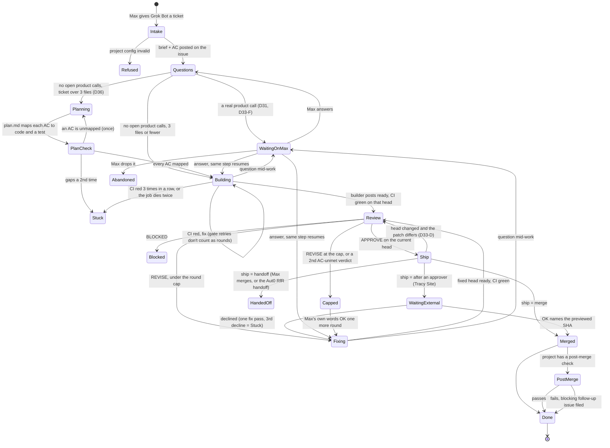

# Simple orchestrator plan (draft for Max, 2026-11-10)

Status: **draft in [maxharris1/factory](https://github.com/maxharris1/factory). Nothing is built yet.** Decisions through 9:42 AM ET on 2026-11-10 are folded in below. The old factory repo was wiped and recreated; see section 13.

## 1. Goal

Max, in his words: "I want to use the P-Stack skills to integrate into my Grok bot to be able to use it as an orchestrator to work on projects. I want to be able to develop across Cursor, Claude, and Codex using the Grok bot as my central orchestrator and handoff."

Done means Max can hand Grok Bot a ticket on any project, answer only product questions, and get back a merged (or handed-off) PR that one harness built and a different harness reviewed, with pstack driving how each session works.

## 2. Architecture (four parts, nothing else)

1. **pstack in every harness.** One pinned pstack source, installed natively where Claude Code, Codex and Cursor load skills. pstack (poteto-mode plus the principle skills) decides *how* work gets done. The orchestrator adds no work rules of its own.
2. **One handoff format.** Each piece of work is one ticket plus its PR. The brief, questions, answers, plan, verdicts and "done" are comments on the PR (and on the ticket when the tracker is GitHub), with one small machine-readable header (section 5). There is no other state store. The dispatcher's local job list can be rebuilt from the tracker at any time.
   - **Default (GitHub issues):** the GitHub issue is the ticket. Labels show the current state.
   - **Aut0, and any repo whose `factory.md` says `tickets: linear`:** Linear is the ticket source of truth. Every repo change goes through a PR. The orchestrator creates **no GitHub issues or labels** in that repo. State lives on the Linear ticket and in PR comments.
3. **One Grok Bot skill, `orchestrate-project`.** Grok Bot plans with Max, asks him product questions, decides technical ones, picks the builder and reviewer, and handles everything the dispatcher can't decide. It reads each project's `factory.md` for models, review policy, ship rule, ticket source, special skills and repo context (section 7).
4. **One dispatcher script, `orch`, a few hundred lines.** It polls the configured trackers, applies the table in section 4, and wakes an agent only when judgment is needed. Bots wait on it with a blocking `orch wait <role>` shell call. That costs no tokens, and the shell exiting wakes the bot. No webhooks, no new credentials. It uses the existing `gh` login (and Linear, for Aut0). The factory repo's `orch.yml` lists which projects to poll and the dispatcher settings. It does not repeat the per-repo policy; that lives in each project's `factory.md`.

Ownership stays as Max decided: **Claude Bot starts every Claude session, Codex Bot every Codex session, Cursor Bot every Cursor CLI job.** Grok Bot and `orch` only queue requests. They never run `claude`, `codex` or `cursor-agent` themselves.

## 3. State chart (simplified from v13.8 charts 1a, 1b, 1c, 1d, 1e, 1g, 1h)



Note: Refused, Stuck, Blocked, Capped and Abandoned are terminal unless Max acts. Each one wakes Grok Bot once, and Grok Bot tells Max once. On Aut0, a "blocking follow-up issue" is a Linear ticket, never a GitHub issue.

**What each approved invariant becomes:**

| v13.8 rule | Where it lives now |
|---|---|
| QuestionsBeforeBuilding, QuestionResumesWhereItPaused | Grok Bot skill (questions step) + dispatcher T5 (resume the same step) |
| MappedBeforeBuilding, MappingApprovedForCurrentArtifact | PlanCheck is a review of `plan.md` at a SHA. A scope-changing answer sends the ticket back to Planning (skill judgment) |
| GateLoopsBounded, DeclinesBounded, StopsAfterTwoACUnmet, round cap | Counters on the ticket (labels on GitHub-issue repos; Linear fields or PR header comments on Aut0), enforced mechanically by the dispatcher |
| ShipPinnedToCoveredHead, InheritedVerdictOnlyOnExactRebase | T4: merge only with `--match-head-commit` on the approved SHA. A moved head carries the approval only if `git patch-id --stable` is equal. Otherwise it gets a re-review |
| OnlyTheHarnessBotStarts | Only owning bots run harnesses. `orch` refuses to exec a harness binary |
| RerouteKeepsCrossFamily, OnlyUrgentUsesReserve, 20% reserve | Routing table in `factory.md` plus the owning bot's usage check (section 6) |
| ContradictoryConfigNeverRuns | `orch check-config` refuses an inconsistent `factory.md` (e.g. a same-family reviewer) |
| ExitCodesMeanOneThing (15/16/17/18) | Default labels: `waiting:max`, `abandoned`, `waiting:external`, `waiting:deploy`. Aut0: the same states on the Linear ticket and in PR `orch:` comments, with no GitHub labels |
| Slots, PC offline 60 min, LivePatch, lane cutover, MissionControl | Phase 2 (slots), or dropped (section 10) |

## 4. Dispatcher transition table

`orch` polls each configured repo every 60 s (`env -u GH_TOKEN gh`, plus Linear for Aut0). It reads only tickets/PRs it already tracks and comments that carry an `orch:` header. Every row is a plain `if`. It's idempotent: each handled comment ID is recorded, so a restart never acts twice.

| # | Event (mechanical) | Known answer | Wakes |
|---|---|---|---|
| T1 | Issue or Linear ticket gets `orch:go` (Grok Bot, after Questions) | Queue a `build` job (or `plan` if over 3 files) for the builder from `factory.md` | Builder's owning bot |
| T2 | `ready head=<sha>` comment, then CI finishes on that SHA | Green: queue `review` for the reviewer. Red: queue `fix` with the failing log (gate count +1; 3rd in a row → `stuck`) | Reviewer's or builder's bot |
| T3 | `verdict=REVISE` | Round under the cap: queue `fix` with the verdict link. At the cap: mark `capped` | Builder's bot, or Grok Bot at the cap |
| T4 | `verdict=APPROVE head=<sha>` | Head equals sha, or patch-id equal → ship per `factory.md` (`merge` = `gh pr merge --squash --match-head-commit`, `handoff`, `after:<bot>`). Else queue a re-`review` | Nobody on merge. The approver bot for `after:` |
| T5 | `questions` comment from any session, then `answers` | Mark `waiting:max`. On answers, re-queue the same step with the answer linked (not a round) | Grok Bot (it decides technical ones itself) |
| T6 | Job exits with no handoff comment, or runs past its timeout | Retry once. 2nd time → `stuck` | Grok Bot on the 2nd |
| T7 | `verdict=BLOCKED`, `stuck`, `capped`, config refused, anything unparsed | No known answer | Grok Bot, once |
| T8 | `ok sha=<sha>` / `decline` from the external approver | OK on the previewed SHA → ship. Decline → `fix` (3rd → `stuck`) | Builder's bot on decline |
| T9 | PR merged and the project has `post_merge` | Queue a `post-merge` job (e.g. deployed QA once the SHA is served, bounded wait). A fail files a blocking follow-up on the project's ticket tracker (Linear on Aut0) | QA owner bot |

T1–T6 are the core loop. T7–T9 are added only when a project needs them. Any new row needs a real run that showed a wasted wake.

## 5. Handoff comment format

Each handoff is one comment. Its first line is a header the dispatcher parses, and the rest is plain prose for people and agents:

```
<!-- orch:v1 kind=verdict from=codex-bot role=reviewer round=2/3 head=3f9c2ab ac=met verdict=REVISE risk=high -->
**Review round 2 of 3: REVISE** (Codex Bot, gpt-6-astra high)
1. [blocking] tools/x.py:40, empty result treated as resolved. Repro: `…`
2. [minor] … (batched into follow-up if low risk)
Full report: <link>
```

The comment kinds are `brief`, `questions`, `answers`, `plan`, `ready`, `verdict`, `ok`, `decline`, `done`, `stuck`. On GitHub-issue repos, labels hold the current state, round and counters: `orch:state/<name>`, `orch:round/<n>`, `orch:risk/<low|high>`, `orch:builder/<harness>`. On Aut0, those same facts stay in the `orch:` header and on the Linear ticket; the orchestrator does not create labels. Max can read everything on the ticket and the PR, and nothing else is needed to resume.

## 6. Grok Bot orchestration skill (`orchestrate-project`)

1. **Intake.** It reads the project's `factory.md`, then writes the ticket `brief`: goal, acceptance criteria, files likely touched, a risk class, and done-evidence (pstack orchestrate kickoff rules).
2. **Questions (D31, always).** It posts the restatement (in-your-own-words) and the open questions. Each question gets classified:
   - Observable: settled with a prototype.
   - Default-able: decided by the bot and recorded.
   - Product call: asked of Max, one at a time, in chat. The answers get posted as an `answers` comment.
   Then the skill sets `orch:go`.
3. **Routing (technical, the bot's call).** It picks the builder and the model by fit for the job, from the preferences in `factory.md`. **One reviewer, from a different model family than the builder, gives the final verdict** (Max, 9:38 AM ET). That reviewer also runs the project's verify skill (UI and database checks) when `factory.md` names one. There is no second reviewer and no separate Judge inside the factory loop. Aut0 still hands off after Ready for Review to Oliver's flow, which may run Aut0 Judge on its own; the factory does not.
   - **Risk class:** `low` (docs, cleanup, monitoring) gets one review round, with minors batched into a follow-up ticket. `high` (ship, merge, sign-off, credential, isolation code) gets up to 3 rounds. Every extra round needs Max's own words.
4. **On a T5/T7 wake.** It answers technical questions itself, relays product ones to Max, and reports a stop once, with evidence and a recommended next step.
5. **Never:** launch a harness, create logins or credentials, treat another agent's approval as Max's, or create GitHub issues or labels on Aut0.

The builder and reviewer briefs say "run as poteto-mode". The builder follows the playbook that fits the ticket (feature, bug-fix: repro first, refactor). For tickets over 3 files, it starts with an architect scaffold and `plan.md`. Before `ready`, it does a self-check: prove-it-works, deslop, no-comments. The reviewer runs interrogate and blast-radius, runs the named verify skill, can run code in a throwaway copy, and blocks only on a demonstrated failure (D33-A/B).

**Usage (D35/D44).** Before starting a job, each owning bot checks its harness's usage. At the last 20% of the cycle, non-urgent jobs go to the next-best fit, and urgent jobs (the resumed paused step, past-ship work, or anything Max marks urgent) may use the reserve. If a harness has no verified usage source, routing is best fit only.

## 7. Project config (`factory.md`)

Every project repo keeps a root `factory.md` that the orchestrator reads. It is about one screen: a short YAML front block plus a few short prose sections. Human developers can ignore it. Max (9:42 AM ET): keep `factory.md` per repo for models, the review process, special skills and extra context, and "simplify the purpose and usage of factory.md if its context has become bloated."

Required YAML fields:

| Field | What it is |
|---|---|
| `builder.harness` / `reviewer.harness` | Preferred harness (`claude`, `codex`, `cursor`). The orchestrator may pick a different builder by fit, but the reviewer must be a different model family. Optional `model` hints are allowed. |
| `review.rounds.low` / `review.rounds.high` | Round caps by risk class (default 1 and 3). |
| `review.verify` | The verify skill the reviewer runs, or `none`. |
| `ship` | `merge`, `handoff`, or `after:<approver>` (for example `after:tracy-site`). |
| `tickets` | `github` or `linear`. Linear implies no GitHub issues or labels from the orchestrator. |
| `base_branch` | The integration branch (`main`, `dev`, …). |
| `skills` | Special repo skills to load, besides pstack. |

Free-text sections after the front block: **Review** (who gives the verdict, what the reviewer runs), **Ship** (what happens on APPROVE, any external OK), and **Context** (repo-specific facts that do not belong in the YAML).

`orch check-config` refuses a file that is missing a required field, names a same-family reviewer as required, or sets `tickets: linear` while also asking the orchestrator to create GitHub issues or labels.

Generic example:

```markdown
---
base_branch: main
tickets: github
builder:
  harness: claude
reviewer:
  harness: codex
review:
  rounds:
    low: 1
    high: 3
  verify: verify-cleffy
ship: merge
skills:
  - verify-cleffy
---

## Review
One reviewer from a different model family than the builder gives the final verdict and runs `verify-cleffy` (UI and database checks). Low-risk changes get one round; leftover minors are batched into a follow-up issue. High-risk changes get up to three rounds; every extra round needs Max's own words.

## Ship
On APPROVE of the covered head, squash-merge with `--match-head-commit`.

## Context
PRs target `main`. Mention any repo-specific gotchas here, not in the YAML.
```

A Tracy-style file would set `ship: after:tracy-site` and describe the Site OK in **Ship**. The Aut0 draft (Linear, `ship: handoff`, `verify-aut0`, Oliver's flow after Ready for Review) is in [docs/AUT0-CLEANUP.md](AUT0-CLEANUP.md).

## 8. Installing pstack in each harness

One source: `skills/` in this repo, holding a pinned pstack (0.15.36 today) plus a `skills.lock` with the commit and sha256 of each file. `orch install-skills` symlinks the same files into:

| Harness | Local path (per bot user, per machine) | Cloud runs |
|---|---|---|
| Claude Code | `~/.claude/skills/<name>/` | Vendored into the project at `.claude/skills/` |
| Codex | `~/.agents/skills/<name>/` (`~/.codex/skills` is the deprecated alias) | Vendored at `.agents/skills/` |
| Cursor | `~/.cursor/skills/` or a Cursor plugin install of pstack | `.agents/skills/` or `.cursor/skills/` |

`orch doctor` runs a canary prompt in each harness, started by that harness's own bot. The canary asks the harness to name the poteto-mode skill and quote a token from it. It fails if any harness didn't load the pinned version. Bumps go through one PR that updates the pin and the lock together.

## 9. Build list (each item is one PR, except Aut0 work which follows Aut0's own PR + Linear flow)

**Phase 1: one machine (the box), end-to-end loop**

1. Repo skeleton: README, `orch.yml` (repos to poll and dispatcher settings), a `factory.md` schema plus a validator (`orch check-config`), and example `factory.md` files (Aut0, Cleffy and Tracy shown only as examples).
2. pstack source and pin: `skills/`, `skills.lock`, `orch install-skills`, and `orch doctor` with a load canary in all three harnesses.
3. Handoff format: a parser and writer for `orch:v1` headers, the label conventions (and the Aut0 no-label path), and tests on fixture comments.
4. Dispatcher core: the poll loop, the handled-comment ledger, and T1 + T2 + T6, with fake bots in tests.
5. Dispatcher review loop: T3 + T4 (round cap by risk class, `--match-head-commit` merge, patch-id carry-over) + T5.
6. `orch wait <role>`, the blocking wait for each owning bot, and an `orch job done` helper. Add a one-paragraph "orch jobs" section to the Claude Bot, Codex Bot and Cursor Bot handoff skills.
7. Grok Bot skill `orchestrate-project`: intake, questions, routing, and stop handling.
8. Usage reserve and routing: the fit table, the 20% reserve check in each owning bot, and best-fit-only while a source is unverified.
9. Project hooks: T7 + T8 (external OK, for Tracy) + T9 (post-merge check, for Cleffy deployed QA and the 1-in-10 post-merge audit task).
10. Live acceptance: three real tickets, one each on three projects that Max picks, run end to end. Fix only what those runs expose.
11. **Aut0 Linear ticket** for the cleanup in item 12, filed in Aut0's board in the aut0-linear-board skill shape (Description, Acceptance Criteria, Notes). Priority is required; ask Max if it is unset. Do not invent one. The title and body are drafted in [docs/AUT0-CLEANUP.md](AUT0-CLEANUP.md). Do not file it until Max says go.
12. **Aut0 cleanup PR** on `aut0-code/aut0` targeting `dev`, after the Linear ticket exists: add the slim `factory.md`, replace the `## Factory` block in `AGENTS.md` with a pointer, and remove the retired statechart tooling. Leave the vendored pstack skills and the open verify-aut0 PRs (#1305, #1318) alone. File-level keep/remove lists are in [docs/AUT0-CLEANUP.md](AUT0-CLEANUP.md). Items 11–12 can start immediately and should land before the Aut0 live ticket in item 10.

**Phase 2: more compute and self-hosted CI (after Phase 1 works)**

13. Device pool: `machines.yml` with the box, PC and Mac (Tailscale names), a declared safe maximum of slots per device, and each harness counted as eligible only where Max has provisioned its login under that bot's user.
14. Remote start: each owning bot starts its harness on a device over Tailscale SSH as its own user (claude-bot, codex-bot, cursor-bot). A slot stays held until the worker is confirmed gone. 60 minutes offline means `stuck`.
15. Self-hosted CI: runner labels per project in `orch.yml` or `factory.md`, plus a registration checklist for Max. Max registers the runners himself, and the plan never touches runner tokens. Credential-holding deploy workflows stay hosted (D21).
16. `orch status`: a read-only text summary of queue, slots and paused items, generated from the tracker and the local job list.

## 10. Deliberately left out

These are out until a real run shows they're needed:
- The bash driver, exit-code protocol and run directories. Labels and comments replace them (PR comments and Linear, on Aut0).
- Two reviewers plus a separate Judge. One cross-family reviewer gives the verdict. Aut0 Judge, if it still runs, is part of Oliver's flow after handoff, not of the factory loop.
- A separate pre-merge QA stage. The reviewer runs `verify-<repo>` when the project has one.
- Byte-identical rebase proofs. These are replaced by patch-id plus re-review.
- The live reader patch, lane coexistence and old/new cutover, since there's no old lane in a fresh repo.
- The mission-control dashboard. `orch status` (item 16) covers it.
- Per-run `decisions.tsv` and receipts. The PR comments are the trail.
- Self-improvement routines (weekly correct, reflect, blinded evals, daily maintain jobs).
- Webhooks, and any new credential or login.
- The genericity purge and protected-field base reads. The repo starts generic, and `factory.md` is read from the base branch.
- Arena and swarm by default. They stay available to the builder as pstack tools.

## 11. Phase 1 estimate

Items 1–9 are small, and most can run in parallel after item 3: items 2, 7 and 8 are independent of 4–6. Items 11–12 (Aut0 cleanup) are also independent of 1–9 and can start as soon as Max OKs the Linear ticket. Expect about **2–3 working days**, with a first end-to-end ticket on day 2 and item 10 on day 3. If Max says go on Tue 11-10, Phase 1 would finish **Thu 11-12 to Fri 11-13 ET**. Phase 2 is about 2 more days, plus Max's runner and login setup.

## 12. Repo layout

This is [maxharris1/factory](https://github.com/maxharris1/factory) (private). Today it holds only the plan and the Aut0 cleanup draft.

```
factory/
  README.md
  bin/orch               # CLI: poll, wait, job, check-config, install-skills, doctor, status
  lib/                   # handoff.py (headers/labels), transitions.py (table), gh.py, usage.py
  skills/                # pinned pstack + skills.lock
  grok/orchestrate-project/SKILL.md
  bots/                  # short "orch jobs" sections for Claude/Codex/Cursor Bot skills
  config/orch.example.yml
  docs/PLAN.md           # this file
  docs/AUT0-CLEANUP.md   # Aut0 keep/remove lists, factory.md draft, Linear ticket draft
  docs/factory.example.md
  tests/                 # fake GitHub + fake bots, one test per transition row
```

## 13. Migration and Aut0 cleanup

1. **Old repo wiped and recreated.** On 2026-11-10 Max had `maxharris1/factory` deleted and recreated empty for this plan. A full backup of the retired repo (git history, 134 issues, 87 PRs) is on the box at `/workspace/factory-backup-20261110`. This new repo's `main` started at `c3c354ab` with a README and this plan.
2. **Closed Aut0 PRs.** At 9:42 AM ET on 2026-11-10, three Aut0 PRs from the old factory plan were closed without merging: [#1306](https://github.com/aut0-code/aut0/pull/1306) (self-hosted `factory-local` CI), [#1317](https://github.com/aut0-code/aut0/pull/1317) (the bloated `factory.md` move), and [#1321](https://github.com/aut0-code/aut0/pull/1321) (statechart offline-boundary follow-up). They stay closed.
3. **Keep / remove and the Aut0 `factory.md` draft.** Merged Aut0 PRs [#1303](https://github.com/aut0-code/aut0/pull/1303), [#1304](https://github.com/aut0-code/aut0/pull/1304) and [#1314](https://github.com/aut0-code/aut0/pull/1314) left pstack and old-plan config on `dev`. **Keep** the 51 vendored pstack skills and their vendor scripts (248 files). **Remove** 421 files: the `statechart` skill tree (410, brought back in #1314 only for factory formal verification), `create-formal-verification-skill` (4, it needs `statechart`), and 7 factory statechart scripts/docs. Replace the `## Factory` section in `AGENTS.md` with a pointer to a slim `factory.md`. Open verify-aut0 PRs [#1305](https://github.com/aut0-code/aut0/pull/1305) and [#1318](https://github.com/aut0-code/aut0/pull/1318) stay open; they do not overlap the cleanup paths, though #1318 already conflicts with its #1305 base. File-level lists, the drafted Aut0 `factory.md`, and the Linear ticket body are in [docs/AUT0-CLEANUP.md](AUT0-CLEANUP.md).
4. **Cleanup PR and Linear ticket are Phase 1 items 11 and 12.** The orchestrator does not file the Linear ticket or open the Aut0 PR until Max says go. Both follow Aut0's existing handoff: Linear is the source of truth, and the change lands through a PR into `dev`.
