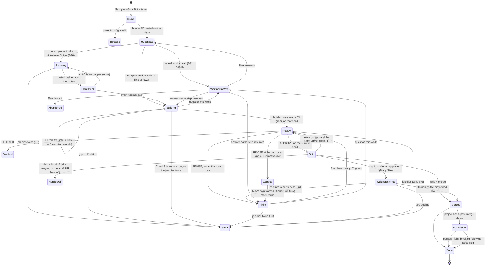

# Factory specification, plan and to-do

Status: **draft specification** for [maxharris1/factory](https://github.com/maxharris1/factory). Nothing is built yet. This document is the full spec, plan and to-do list for the simplified factory. It is based on [docs/PLAN.md](PLAN.md) at `aa941d27`, [docs/AUT0-CLEANUP.md](AUT0-CLEANUP.md), the approved state chart, and Max's decisions on 2026-11-10 (America/New_York). It does not invent decisions. Anything still open is in [Open questions](#16-open-questions). Technical decisions by Factory are recorded as "Factory decided (technical)" in the Decisions table and in the section they affect.

Shorter companion: [docs/PLAN.md](PLAN.md). Aut0 cleanup detail: [docs/AUT0-CLEANUP.md](AUT0-CLEANUP.md).

## Decisions on 2026-11-10 (ET)

| When | Decision | Source |
|---|---|---|
| 9:38 AM | One reviewer from a different model family than the builder gives the final verdict. | Max, Q1 |
| 9:38 AM | That reviewer also runs the UI and database checks, through the project's verify skill. | Max, Q2 |
| 9:38 AM | The repo stays named `factory`. The old `maxharris1/factory` was deleted and recreated empty for this plan. A backup of the retired repo is on the box at `/workspace/factory-backup-20261110`. | Max, Q3 |
| 9:38–9:42 AM | Aut0 (`aut0-code/aut0`) uses the existing handoff. Linear is the ticket source of truth. Every repo change goes through a PR. The orchestrator creates no GitHub issues or labels there. | Max, Q4 |
| 9:42 AM | Every project repo keeps a slim `factory.md` (models, review process, special skills, extra context). Simplify it if the old config has become bloated. | Max |
| 9:42 AM | Aut0 PRs #1306, #1317 and #1321 were closed without merging. They stay closed. | Factory, with Max's earlier agreement |
| 9:49 AM | The pstack `statechart` skill is a core part of pstack and is kept, including `create-formal-verification-skill` and the Aut0 install/preflight scripts, so we can build evaluation systems that measure the factory. | Max |
| 9:49 AM | Cleffy's deployed QA and its 1-in-10 post-merge audit are deferred. Phase 1 stays lean. | Max skipped that question; recorded as deferred |
| 10:18 AM | Add F1-15: migrate Cleffy (`maxharris1/Cleffy`) and Tracy (`maxharris1/tracy-harris-coaching`) to slim `factory.md`. | Max |
| 10:18 AM | Priority for the Aut0 cleanup Linear ticket (F1-11) is High. | Max |
| 10:19 AM | Default job timeout is 90 minutes of no heartbeat or progress. A project may override it with `job_timeout` in `orch.yml`. After that, T6 retries once and then marks the job stuck. | Factory decided (technical) |
| 10:19 AM | Phase 1 routes on best fit only, plus each owning bot's own reserve check. A verified usage source is added per harness when its bot can report one. This is not a Phase 1 blocker. | Factory decided (technical) |
| 10:19 AM | Self-hosted runner labels go in each repo's `factory.md` (`ci_runner:`), because they are repo policy. The device inventory goes in `orch.yml`. | Factory decided (technical) |
| 10:19 AM | Optional model hints have no fixed allow-list. `check-config` warns on an unknown model name, and the owning bot can refuse. | Factory decided (technical) |
| 10:19 AM | Extra `orch:v1` header keys are added only when a real run needs them. This is a standing rule, not an open question. | Factory decided (technical) |
| 10:19 AM | Factory merges factory-repo PRs itself once the cross-family reviewer approves the current head and CI is green. Product calls still go to Max. Max's words: "Yes, keep merging approved PRs in the new factory repo". | Max |
| earlier today, still in force | Claude Bot starts every Claude session, Codex Bot every Codex session, Cursor Bot every Cursor CLI job. Grok Bot and the dispatcher never launch those binaries. | Standing rule |
| earlier today, still in force | Max provisions logins and registers runners himself. The factory does not create logins or credentials without his OK, and never reads credentials, runner tokens, or `FACTORY_WEBHOOK_*` values. | Standing rule |
| earlier today, still in force | Product questions go to Max, one at a time, in his own words for approvals that need them. Technical questions are decided by the orchestrator. | Standing rule |
| earlier today, still in force | Every ticket gets a clarifying-questions step before building (D31). | Approved invariant, kept |
| Nov 11, 2:31 PM | The dispatcher may send outbound deliveries to the existing Grok routine webhook. It does not accept inbound webhooks or create credentials. | Factory decided (technical) |

Low-risk changes (docs, cleanup, monitoring) get one Codex review round, with leftover minors batched into a follow-up ticket. High-risk changes (ship, merge, sign-off, credential and isolation code) keep up to three rounds. Every extra round needs Max's own words. (Max, earlier today.)

Max will pick the three first live-test tickets when the build is ready. That choice is still open.

## 1. Goals

Max, in his words: "I want to use the P-Stack skills to integrate into my Grok bot to be able to use it as an orchestrator to work on projects. I want to be able to develop across Cursor, Claude, and Codex using the Grok bot as my central orchestrator and handoff."

Done means Max can hand Grok Bot a ticket on any configured project, answer only product questions, and get back a merged or handed-off PR that one harness built and a different-family harness reviewed, with pstack driving how each session works.

The factory is four parts and nothing else:

1. **pstack in every harness.** One pinned pstack source, installed where Claude Code, Codex and Cursor load skills. pstack (poteto-mode plus the principle skills) decides *how* work gets done. The orchestrator adds no work rules of its own.
2. **One handoff format.** Each piece of work is one ticket plus its PR. The brief, questions, answers, plan, verdicts and "done" are comments, with one small machine-readable header. There is no other state store. The dispatcher's local job list can be rebuilt from the tracker at any time.
3. **One Grok Bot skill, `orchestrate-project`.** Grok Bot plans with Max, asks him product questions, decides technical ones, picks the builder and reviewer, and handles everything the dispatcher cannot decide. It reads each project's `factory.md`.
4. **One dispatcher script, `orch`.** A few hundred lines. It polls the configured trackers, applies the transition table, and wakes an agent only when judgment is needed. Bots wait on a blocking `orch wait <role>` shell call, which costs no tokens. It accepts no inbound webhooks and creates no credentials. Outbound Grok delivery uses the existing routine webhook. GitHub uses the existing `gh` login, and Aut0 uses existing Linear access.

The factory repo's `orch.yml` lists which projects to poll and the dispatcher settings. Per-repo policy lives in that repo's `factory.md`.

## 2. Non-goals

These stay out until a real run shows they are needed. They are not Phase 1 or Phase 2 work:

- A custom bash driver, exit-code protocol, or run directories. Comments (and labels on GitHub-issue repos, or Linear on Aut0) replace them.
- Two reviewers plus a separate Judge inside the factory loop. One cross-family reviewer gives the verdict. If Aut0 Judge still runs, it is part of Oliver's flow after handoff, not of the factory loop.
- A separate pre-merge QA stage. The reviewer runs `verify-<repo>` when the project has one.
- Cleffy's deployed QA and its 1-in-10 post-merge audit (dispatcher T9). Deferred past Phase 1.
- Byte-identical rebase proofs. Replaced by `git patch-id --stable` plus re-review when the patch differs.
- A live reader patch, lane coexistence, or old/new cutover. There is no old lane in this repo.
- A mission-control dashboard (anything that controls the factory). Phase 2 `orch status` is a read-only text summary. The requested `orch dashboard snapshot` is a read-only, redacted static view of the same data that is pushed out from the box; it controls nothing (README "Dashboard").
- Per-run `decisions.tsv` and receipts. PR comments are the trail.
- Self-improvement routines (weekly correct, reflect, blinded evals, daily maintain jobs). The weekly factory eval report in Phase 1 is a measurement of runs against the chart, not that list.
- Inbound webhooks, any new credential or login, or creating another Grok
  routine webhook. Outbound delivery to the existing Grok routine is part of
  the dispatcher.
- A genericity purge or protected-field base reads. The repo starts generic. `factory.md` is read from the project's base branch.
- Arena and swarm by default. They stay available to the builder as pstack tools.

The 125-item old factory plan, its state-chart formalization of that plan, and its driver are retired. A backup of that repo is at `/workspace/factory-backup-20261110`. This specification does not carry those items forward.

## 3. Roles

| Role | Who | Does | Does not |
|---|---|---|---|
| Consumer | Max | Hands Grok Bot a ticket; answers product questions one at a time; provisions logins and runners; picks the first live-test tickets; OKs extra review rounds in his own words; merges Aut0 PRs (and any other `ship: handoff` repo); gives or withholds an external OK when a repo uses `ship: after:<approver>`. | Does not have to poll CI, drive review rounds under the cap, or answer technical questions the orchestrator can decide. |
| Orchestrator | Grok Bot, skill `orchestrate-project` (this Factory bot) | Intake, clarifying questions, routing, technical decisions, stop reports, posting `orch:go`, relaying product questions. | Does not start `claude`, `codex`, or `cursor-agent`. Does not create logins or credentials. Does not treat another agent's approval as Max's. Does not create GitHub issues or labels on Aut0. |
| Builder session | Claude Bot, Codex Bot, or Cursor Bot, as routed | Starts its own harness as poteto-mode, builds or plans, self-checks, posts `ready`. | Does not start a harness it does not own. |
| Reviewer session | A bot whose model family differs from the builder | Reviews, runs the named verify skill (UI and database checks), posts `verdict`. Blocks only on a demonstrated failure. | Does not merge. Does not act as a second Judge. |
| Dispatcher | `orch`, a script | Polls trackers every 60 seconds, applies the transition table, queues jobs, merges when `ship: merge` and the head is the approved SHA, marks terminal states. | Does not make judgment calls. Does not exec a harness binary. Wakes Grok Bot or a harness bot when the next action is not fully determined. |
| Aut0 after handoff | Oliver's existing flow | Whatever Aut0 already does after Ready for Review, which may include Aut0 Judge and human review. | Not part of the factory loop. The factory does not run a second judge. |

Harness ownership is fixed: **Claude Bot starts every Claude session, Codex Bot every Codex session, Cursor Bot every Cursor CLI job.** Grok Bot and `orch` only queue requests.

Phase 1 runs on one machine: the box. Phase 2 adds Max's other Tailscale devices, with each harness eligible only where Max has provisioned its login under that bot's user.

## 4. Ticket lifecycle and transitions

Max starts a ticket by handing it to Grok Bot (a GitHub pull request in Phase 1, a Linear issue, or a description that becomes a ticket on that project's tracker). GitHub issue-only discovery is deferred; an `orch:state/` label on an issue is not polled. Grok Bot reads `factory.md`, writes the brief, and always runs the questions step. After product questions are answered, or when there are none, Grok Bot posts `orch:go`, a handoff comment with `kind=go`. That is the mechanical start of build or plan. Max does not have to type "go" a second time unless he is restarting a capped or stuck ticket.

### 4.1 States



Refused, Stuck, Blocked, Capped and Abandoned are terminal unless Max acts. Each one wakes Grok Bot once, and Grok Bot tells Max once. On Aut0, a blocking follow-up is a Linear ticket, never a GitHub issue.

Planning is required when the ticket is expected to touch more than 3 files (D36). Three files or fewer go straight to Building after questions. A scope-changing answer mid-work sends the ticket back to Planning; that is a skill judgment, not a dispatcher `if`.

`PostMerge` (T9) is defined in the chart and the transition table, but Cleffy's deployed QA and post-merge audit are deferred past Phase 1. No Phase 1 project is configured with `post_merge` until that work is scheduled.

### 4.2 Dispatcher transition table

`orch` polls each configured repo every 60 s (`env -u GH_TOKEN gh`, plus Linear for Aut0). It reads only tickets and PRs it already tracks, and comments that carry an `orch:` header. Every row is a plain `if`. It is idempotent: each handled comment ID is recorded, so a restart never acts twice.

| # | Event (mechanical) | Known answer | Wakes |
|---|---|---|---|
| T1 | GitHub PR or Linear ticket gets a `kind=go` handoff comment (`orch:go`, posted by Grok Bot after Questions) | Queue a `build` job (or `plan` if over 3 files) for the builder from `factory.md` | Builder's owning bot |
| T1P | While Planning, the trusted builder for the current plan job posts `kind=plan ac=met\|unmet round=<n>/2` | `ac=met`: queue `build` for the same builder, with the plan link or comment ID in `detail`. First `ac=unmet`: return to Planning and queue one more `plan` with `round=2/2` in its detail. Second: mark `stuck`. Stale rounds and duplicate comments are no-ops. | Builder's owning bot, or Grok Bot on the second gap |
| T2 | `ready head=<sha>` comment, then CI finishes on that SHA | Green: queue `review` for the reviewer. Red: queue `fix` with the failing log (gate count +1; 3rd in a row → `stuck`) | Reviewer's or builder's bot |
| T3 | `verdict=REVISE` | Round under the cap: queue `fix` with the verdict link. At the cap: mark `capped` | Builder's bot, or Grok Bot at the cap |
| T4 | `verdict=APPROVE head=<sha>` | Head equals sha, or patch-id equal → ship per `factory.md` (`merge` = `gh pr merge --squash --match-head-commit`, `handoff`, `after:<bot>`). Else queue a re-`review` | Nobody on merge. The approver bot for `after:` |
| T5 | `questions` comment from any session, then `answers` | Set state `orch:state/waiting-max`. On answers, re-queue the same step with the answer linked (not a round) | Grok Bot (it decides technical ones itself) |
| T6 | Job exits with no handoff comment, or 90 minutes pass with no heartbeat or progress (or the project's `job_timeout` in `orch.yml`) | Retry once. 2nd time → `stuck` | Grok Bot on the 2nd |
| T7 | `verdict=BLOCKED`, `stuck`, `capped`, config refused, anything unparsed | No known answer | Grok Bot, once |
| T8 | `ok head=<sha>` / `decline` from the external approver | OK on the previewed SHA → ship. Decline → `fix` (3rd → `stuck`) | Builder's bot on decline |
| T9 | PR merged and the project has `post_merge` | Queue a `post-merge` job. A fail files a blocking follow-up on the project's ticket tracker. Deferred from Phase 1. | QA owner bot |

T1, T1P and T2–T6 are the core loop. T7–T9 are added only when a project needs them. T9 is not built in Phase 1. Any new row needs a real run that showed a wasted wake. The default job timeout is 90 minutes of no heartbeat or progress; a project may override it with `job_timeout` in `orch.yml` (Factory decided (technical), 10:19 AM ET).

Grok jobs are pushed by the dispatcher through `GrokDelivery` during reconciliation, never through `orch wait`.

Each builder/reviewer job's `detail` is compact JSON containing the Linear
URL, `gitBranchName`, base branch, linked PR number when known, brief text or
link, risk, `round=n/cap`, reviewer harness, verify skill, repo skill paths,
and PR issue-comment destination. Rejected author/marker comments and
verdicts stale for the current state or round wake the configured project bot
once. Terminal success is delivered once to that bot.

`orch poll` is the production entry point. It takes `--db` or `$ORCH_DB`;
`--once` runs exactly one cycle. The live `PollSource` reads GitHub through
`env -u GH_TOKEN -u GITHUB_TOKEN -u GH_ENTERPRISE_TOKEN -u
GITHUB_ENTERPRISE_TOKEN gh api` and reads configured Linear projects through
the Linear GraphQL API. Grok jobs are delivered to the owning bot through its
existing routine webhook, with the queue's stable logical key as the delivery
deduplication key.

### 4.3 Invariants, and where they live now

| Rule | Where it lives |
|---|---|
| Questions before building; a mid-work question resumes where it paused | Grok Bot skill + T5 |
| Every acceptance criterion is mapped before building; the mapping is for the current plan | PlanCheck; a scope-changing answer returns to Planning |
| Gate loops, declines, two AC-unmet verdicts, and the round cap are bounded | Counters on the ticket, enforced by the dispatcher |
| Ship is pinned to the covered head; an inherited verdict is only valid on an exact patch-id rebase | T4: `--match-head-commit`; otherwise re-review |
| Only the owning harness bot starts that harness | `orch` refuses to exec a harness binary |
| Reviewer stays cross-family; last 20% of a usage cycle is reserved; only urgent work may use the reserve | `factory.md` plus each owning bot's usage check |
| Contradictory config never runs | `orch check-config` |
| Waiting, abandoned, external and deploy-wait states mean one thing | Labels on GitHub-issue repos; Linear + `orch:` comments on Aut0, with no GitHub labels |

## 5. Handoff comment format

Each handoff is one comment. The first line is a header the dispatcher parses. The rest is plain prose for people and agents.

```
<!-- orch:v1 kind=verdict from=codex-bot role=reviewer round=2/3 head=3f9c2ab ac=met verdict=REVISE risk=high -->
**Review round 2 of 3: REVISE** (Codex Bot, gpt-6-astra high)
1. [blocking] tools/x.py:40, empty result treated as resolved. Repro: `…`
2. [minor] … (batched into follow-up if low risk)
Full report: <link>
```

Comment kinds: `brief`, `questions`, `answers`, `go`, `plan`, `ready`, `verdict`, `ok`, `decline`, `done`, `stuck`.

On GitHub-issue repos, labels hold current state, round and counters: `orch:state/<name>`, `orch:round/<n>`, `orch:risk/<low|high>`, `orch:builder/<harness>`.

On Aut0, those same facts stay in the `orch:` header and on the Linear ticket. The orchestrator does not create GitHub issues or labels in `aut0-code/aut0`.

Linear comments may use the visible first line
`` `orch:v1 key=value …` `` when Linear strips or visibly renders HTML
comments. `lib.orchestrate` and `format_comment(..., visible=True)` write that
form without hand-written headers, and it has the same validation as
`<!-- orch:v1 … -->`. For
Linear-backed tickets, brief/questions/answers/go stay on Linear;
ready/verdict/stuck are PR issue comments, not reviews or inline comments.
The poll source joins both streams using the linked PR.

Max can read everything on the ticket and the PR. Nothing else is needed to resume.

The `orch:v1` header keys in the example are `kind`, `from`, `role`, `round`, `head`, `ac`, `verdict` and `risk`.
A `plan` uses `ac=met|unmet` and `round=<n>/2`: `n=1` for the first plan and `n=2` after one gap. The round is checked against the persisted plan-gap count. Extra keys are added only when a real run needs them (Factory decided (technical), 10:19 AM ET).

## 6. `factory.md` schema

Every project repo keeps a root `factory.md` that the orchestrator reads from the base branch. It is about one screen: a short YAML front block plus a few short prose sections. Human developers can ignore it.

### Required YAML fields

| Field | Type | Meaning |
|---|---|---|
| `builder.harness` | `claude` \| `codex` \| `cursor` | Preferred builder harness. The orchestrator may pick a different builder by fit. |
| `reviewer.harness` | `claude` \| `codex` \| `cursor` | Preferred reviewer harness. The reviewer must be a different model family than the builder actually used. |
| `review.rounds.low` | integer | Round cap for low-risk work. Default 1 if the field is present as decided; examples use 1. |
| `review.rounds.high` | integer | Round cap for high-risk work. Examples use 3. |
| `review.verify` | skill name or `none` | The verify skill the reviewer runs for UI and database checks. |
| `ship` | `merge` \| `handoff` \| `after:<approver>` | What happens on APPROVE of the covered head. |
| `tickets` | `github` \| `linear` | Ticket source. `linear` means the orchestrator creates no GitHub issues or labels in that repo. |
| `base_branch` | branch name | Integration branch (`main`, `dev`, …). |
| `skills` | list of names | Special repo skills to load, besides pstack. |

Optional:

- `builder.model` and `reviewer.model` as hints. There is no fixed allow-list. `orch check-config` warns on an unknown model name, and the owning bot can refuse (Factory decided (technical), 10:19 AM ET).
- `ci_runner` — self-hosted runner label for this repo, when Phase 2 self-hosted CI is in use. Runner labels are repo policy, so they live here, not in `orch.yml` (Factory decided (technical), 10:19 AM ET).

Free-text sections after the front block:

- **Review** — who gives the verdict, what the reviewer runs.
- **Ship** — what happens on APPROVE, including any external OK or Aut0 Ready-for-Review handoff.
- **Context** — repo-specific facts that do not belong in the YAML (branch naming, CI caveats, domain skills, human reviewers).

`orch check-config` refuses a file that is missing a required field, names a same-family reviewer as required, or sets `tickets: linear` while also asking the orchestrator to create GitHub issues or labels. It warns on an unknown optional model name and does not fail the check for that alone.

Generic example (GitHub-issue repo, merge on approval):

```markdown
---
base_branch: main
tickets: github
builder:
  harness: claude
reviewer:
  harness: codex
review:
  rounds:
    low: 1
    high: 3
  verify: verify-cleffy
ship: merge
skills:
  - verify-cleffy
---

## Review
One reviewer from a different model family than the builder gives the final verdict and runs `verify-cleffy` (UI and database checks). Low-risk changes get one round; leftover minors are batched into a follow-up issue. High-risk changes get up to three rounds; every extra round needs Max's own words.

## Ship
On APPROVE of the covered head, squash-merge with `--match-head-commit`.

## Context
PRs target `main`. Mention any repo-specific gotchas here, not in the YAML.
```

A Tracy-style file would set `ship: after:tracy-site` and describe the Site OK in **Ship**. The Aut0 draft (`tickets: linear`, `ship: handoff`, `verify: verify-aut0`, Ready for Review, Max merges) is in [docs/AUT0-CLEANUP.md](AUT0-CLEANUP.md). Until `verify-aut0` merges to Aut0 `dev` (#1305), reviewers list that check as not run.

**F1-15 migrates Cleffy and Tracy to this schema.** Today neither repo has a `factory.md`. Each still has an old-plan `## Factory` block in `AGENTS.md` (Cleffy on `dev`, lines 5–50, from PRs #77 and #81; Tracy on `main`, from line 11, from PRs #2 and #3). Those blocks contradict today's decisions (`reviewers: a+b` or `review: none`, a judge, `qa: browser:click-through` or `qa: none`, `fixer: codex-local`). F1-15 is one cleanup PR per repo (Cleffy targets `dev`, Tracy targets `main`): add a slim root `factory.md`, move the still-valid Context notes, replace the `## Factory` block with a pointer, and keep the pstack router. Do not open those PRs until that to-do is started. Still-valid Context to carry over:

- **Cleffy:** risky areas (migrations, RLS, Edge Functions under `supabase/`, and billing/Stripe); never apply migrations or change config on a hosted Supabase project from an agent session; privacy policy forbids tracking pixels; marketing surfaces use public-domain repertoire only and the primary CTA is always "Start free"; PRs target `dev`; never push to `dev` or `main` directly; `dev` → `main` is Max's merge. Name the repo's verify skill if one exists, otherwise `review.verify: none` (the old block had `verify: off`). The existing `ui-check` skill can stay in Context for UI changes. `ship: merge` applies to PRs into `dev`.
- **Tracy:** small static marketing site; a push to `main` deploys production on Vercel and other branches get previews; Tracy approves the preview, then `main` is fast-forwarded to that exact SHA (no force-push, no merge commit); work runs on the box; before ship, run lint, typecheck and build plus the "Never ship" grep in `CLAUDE.md`; copy, pricing, photo and motion rules in `CLAUDE.md` stay. `ship: after:tracy-site`. Drop `review: none`; the new review rules apply.

Fields from the old Aut0 Factory block that this schema drops on purpose: `owner_bot`, `stages`, `reviewers: a+b`, `judge` / `judge_session`, fixer lanes and cloud overflow, `tests_gate`, `qa`, `small_ticket` path lists, and cloud env IDs. Those are not part of this factory. Cloud env IDs may come back later if a real run needs them; that is open.

## 7. `orch.yml` schema

`orch.yml` lives in the factory repo, not in each project. It lists which projects to poll and the dispatcher settings. It does not repeat per-repo policy.

Decided content:

```yaml
poll_seconds: 60
# Default job timeout. A project may set job_timeout (minutes) to override.
# job_timeout: 90
linear:
  api_key_env: LINEAR_API_KEY
grok:
  webhook_url_env: FACTORY_WEBHOOK_URL
  webhook_key_env: FACTORY_WEBHOOK_KEY
trusted_logins:
  maxharris1: [grok-bot, claude-bot, codex-bot, cursor-bot]
# Before install, Max adds the confirmed stable Linear user ID:
# trusted_linear_users:
#   stable-user-id: [grok-bot]
projects:
  - repo: owner/name
    factory_ref: main
    # Required when this repo's tickets are in Linear:
    # linear_project_id: REPLACE_WITH_LINEAR_PROJECT_ID
    # grok_bot: project-bot
    # linear_ready_for_review: false
    # optional job_timeout: 90
```

Phase 1 polls from the box, using the existing `gh` login and the Linear key
named by `linear.api_key_env`. The key name is configuration; the key value is
only read from that environment variable at request time. A missing key fails
with the variable name, never its value. `trusted_logins` maps GitHub authors
to sets of accepted `from=` bot labels. `trusted_linear_users` separately
maps immutable Linear user IDs to those sets. The expected `from=` and
`role=` are mandatory. With one shared GitHub login, the marker is a routing
label, not an identity or signature; no signing secret is added. The shipped
file records the known shared GitHub login and leaves the stable Linear ID for
Max to confirm. Max approved that GitHub map at 3:09 PM ET on November 11,
2026: "Yes, the factory may trust maxharris1 for comments on factory PRs".
That approval does not make the marker an identity. While a configured Linear
project has no trusted Linear-user map, `orch poll` refuses to start at all,
including for GitHub projects.

`factory_ref` is the trusted base branch from which the poller reads
`factory.md`; it never discovers policy through the repository's default
branch. `linear_project_id` is an immutable Linear project ID, not its
renameable display name.

The Grok webhook fields also contain environment-variable names, not values.
Delivery sends one JSON object containing the job fields and `logical_key`,
with the existing routine's bearer/key headers. The dispatcher never prints
or includes either webhook value in an exception.

Before install, Max must confirm that `LINEAR_API_KEY` names an existing,
Max-provisioned key on the box. This work does not create one. A read-only
Linear introspection and known-comment search must also confirm
`includeComments`, preservation of the `<!-- orch:v1 ... -->` body, and that
both the ID-only search query and direct issue query are accepted without a
complexity error. Brief and go use separate searches; the poller does not
depend on full-text `OR` semantics.

Linear's API-key limits are shared per user: 2,500 requests/hour and
3,000,000 complexity points/hour. Factory owns the named
`LINEAR_SHARE = 0.5`; the other half remains available to Max's other API
keys. For poll interval `P`, one cycle is capped at
`floor(2500 × LINEAR_SHARE × P / 3600)` requests and
`floor(3,000,000 × LINEAR_SHARE × P / 3600)` complexity. At `P = 60`, that
is 20 requests and 25,000 complexity per cycle, or at most 1,200 requests and
1,500,000 complexity per hour.

Brief and go each run a filtered search over configured project IDs and
workflow states other than `completed` and `canceled`. A page contains 50
hits, costs about 116 complexity, and each term is limited to two pages. The
normal one-page-per-term case uses two requests, leaves two requests for a
same-cycle handoff, and permits up to 16 direct issue reads: at most 1,200
requests and about 726,720 complexity per hour if all process headroom is
used. Every additional search page is counted against both budgets and
reduces direct reads. A page-limit or budget discovery cutoff is recorded.
Tracked reads and discovery fair-share the remaining budget, and tracked
reads rotate across cycles so a deferred ticket is served later. Search hits
already tracked are not fetched directly again, and a direct issue read is
reused throughout its cycle. HTTP 429 or GraphQL `RATELIMITED` pauses Linear
requests for `Retry-After`; T4 and T8 pre-write deferrals retry next cycle.

The default job timeout is 90 minutes of no heartbeat or progress. A project may override it with `job_timeout` in this file (Factory decided (technical), 10:19 AM ET). Phase 2 device inventory (Tailscale names, slot maximums, harness eligibility) also lives here, or in `machines.yml` as listed under Phase 2. Runner labels do not: they go in each repo's `factory.md` as `ci_runner:` (Factory decided (technical), 10:19 AM ET). Log path and Linear access details may be added as placeholders in the F1-01 skeleton; do not invent new required fields.

`grok_bot` routes stops and successful handoffs to the owning project bot. If
the webhook's `target_bot` is set, only that project bot handles the wake. If
it is `null`, Grok Bot handles the wake for the repo's project.
`linear_ready_for_review` defaults to `false` and controls only the Linear
Ready for Review move after a covered cross-family APPROVE. Aut0 enables it;
no other Linear state transition is written.

## 8. Review and merge rules

- **One reviewer**, from a **different model family** than the builder, gives the **final factory verdict**.
- That reviewer runs the project's **verify skill** (UI and database checks) when `factory.md` names one, plus interrogate and blast-radius. They may run code in a throwaway copy. They block only on a demonstrated failure.
- There is no second factory reviewer and no factory Judge. Aut0 Judge, if it still runs, is Oliver's flow after handoff.
- **Risk class**, assigned at intake:
  - `low` — docs, cleanup, monitoring. One review round. Leftover minors are batched into a follow-up ticket (a GitHub issue, or a Linear ticket on Aut0).
  - `high` — ship, merge, sign-off, credential, or isolation code. Up to three rounds. Every extra round needs Max's own words.
  - If the class is unclear, ask Max. Do not invent a third class.
- Gate retries (CI red, then fix) do **not** count as review rounds. Three CI-red cycles in a row mark the ticket `stuck`.
- A second AC-unmet review verdict marks the ticket `capped`, even if rounds remain.
- **Ship is pinned to the covered head.** `ship: merge` uses `gh pr merge --squash --match-head-commit <sha>`. If the PR head has moved, the approval carries only when `git patch-id --stable` is equal; otherwise the dispatcher queues a re-review.
- `ship: handoff` (Aut0): on APPROVE, mark the linked PR ready. The
  per-project `linear_ready_for_review` flag alone controls the Linear Ready
  for Review move; it defaults off and Aut0 enables it. Never merge, request
  `maxharris1` as a reviewer, or make any other Linear state change.
- `ship: after:<approver>`: wait for `ok head=<sha>` on the previewed SHA, or `decline` (fix; third decline is `stuck`).
- Another agent's approval is never treated as Max's.

The builder brief says "run as poteto-mode". The builder follows the playbook that fits the ticket (feature; bug-fix, repro first; refactor). Tickets over 3 files start with an architect scaffold and `plan.md`. Before `ready`, the builder self-checks: prove-it-works, deslop, no-comments.

**Usage (D35/D44).** Before starting a job, each owning bot checks its harness's usage. At the last 20% of the cycle, non-urgent jobs go to the next-best fit. Urgent jobs (a resumed paused step, past-ship work, or anything Max marks urgent) may use the reserve. Phase 1 routes on best fit only, plus each owning bot's own reserve check. A verified usage source is added per harness when its bot can report one. That is not a Phase 1 blocker (Factory decided (technical), 10:19 AM ET).

## 9. Failure handling

| Failure | What happens |
|---|---|
| Invalid or contradictory `factory.md` at intake | `Refused`. Grok Bot tells Max once. |
| Product question mid-intake or mid-work | `WaitingOnMax`. On answers, the same step resumes. Not a review round. Max may abandon the ticket. |
| PlanCheck finds an unmapped acceptance criterion | Return to Planning once. A second gap is `Stuck`. |
| CI red on a `ready` head | Queue `fix` with the log. Gate count +1. Third in a row: `Stuck`. |
| Job exits with no handoff comment, or 90 minutes pass with no heartbeat or progress (or the project's `job_timeout`) | Retry once. Second time: `Stuck`. |
| `verdict=REVISE` under the cap | Queue `fix`. |
| `verdict=REVISE` at the cap, or a second AC-unmet verdict | `Capped`. Grok Bot tells Max once. Max's own words can OK one more round. |
| `verdict=BLOCKED`, anything unparsed, or config refused later | Wake Grok Bot once. Grok Bot tells Max once, with evidence and a recommended next step. |
| External `decline` | One fix pass per decline. Third decline: `Stuck`. |
| Device offline 60 minutes (Phase 2 only) | `Stuck`. |
| Post-merge check fails (deferred) | File a blocking follow-up on the project's tracker, then `Done`. |

Grok Bot reports each stop once. It does not poll Max about the same stop.

## 10. Security

- The factory never creates logins or credentials without Max's OK. Max provisions harness logins and registers self-hosted runners himself.
- Never read credentials, runner tokens, or `FACTORY_WEBHOOK_*` values. Never `cat` `.credentials*`, `.runner`, `auth.json`, or `.env`.
- For `maxharris1/*` and `aut0-code/aut0`, run GitHub as `env -u GH_TOKEN gh`.
- The dispatcher uses the existing `gh` login, configured Linear access, and
  the existing Grok routine webhook. `orch.yml`, documentation, unit files,
  errors, and logs contain only environment-variable names, never credential
  values.
- Credential-holding deploy workflows stay on hosted runners (D21). Phase 2 self-hosted CI is for non-credential checks. The plan never touches runner tokens.
- `orch` refuses to exec `claude`, `codex`, or `cursor-agent`.
- `factory.md` and `orch.yml` are read from the relevant base branch, not from an untrusted PR head, when deciding whether a project may run and how it ships.
- The factory does not create GitHub issues or labels on Aut0.

## 11. Measuring and evals

`statechart` is a core pstack skill (pstack plugin README and `docs/guide/06-verify-and-ship.md`). Max wants it kept so we can measure the factory.

- Keep the orchestrator's loop as a TLA+ model plus a Mermaid statechart in this repo, under `model/`.
- Check it with pstack `/statechart`.
- Re-run that check in CI whenever the dispatcher's transition table changes, so the picture, the model and the code cannot drift apart.
- The evaluation compares real runs against the chart's states, using `orch:` comment headers and the dispatcher log.
- It measures: time in each state, wasted agent wakes, review rounds per PR, stuck jobs, and the rule breaks the model finds.
- A small weekly report is built from that data (to-do F1-13 and F1-14). The report may run against fixtures until live tickets exist.
- This is not the retired self-improvement routine list.

On Aut0, the `statechart` skill, `create-formal-verification-skill`, and the install/preflight scripts stay vendored so those skills can run there. They are not removed in the cleanup PR.

## 12. Phase 1

One machine (the box). End-to-end loop. The 15 to-do items are listed in [section 17](#17-to-do-checklist). F1-15 (Cleffy and Tracy `factory.md` migrations) can start after F1-01 and must land before live tickets on those repos. Aut0 cleanup and those two PRs can run in parallel with items 2–9, but live acceptance now waits on those merges (Aut0's merge is Max's). Expect about **3 working days**, with a first end-to-end path on day 2 and live acceptance on day 3 or 4. If work starts 2026-11-10, Phase 1 would finish **Friday 11-13 to Saturday 11-14 ET**.

Phase 1 includes Aut0 cleanup (High-priority Linear ticket, then a PR into `dev`), Cleffy and Tracy `factory.md` migrations, and the model, chart and weekly eval report. It does not include T9, Tailscale device scheduling, or self-hosted CI.

Live acceptance is three real tickets, one each on three projects Max picks, run end to end. Fix only what those runs expose. Max will pick the tickets when the build is ready.

## 13. Phase 2 (later add-ons)

Start only after Phase 1 works.

- **Device pool.** `machines.yml` with the box, PC and Mac (Tailscale names), a declared safe maximum of slots per device, and each harness eligible only where Max has provisioned its login under that bot's user (`claude-bot`, `codex-bot`, `cursor-bot`).
- **Remote start.** Each owning bot starts its harness on a device over Tailscale SSH as its own user. A slot stays held until the worker is confirmed gone. 60 minutes offline means `stuck`.
- **Self-hosted CI.** Runner labels live in each repo's `factory.md` as `ci_runner:`. The device inventory lives in `orch.yml` (or `machines.yml`). Plus a registration checklist for Max. Max registers the runners himself. Credential-holding deploy workflows stay hosted.
- **`orch status`.** A read-only text summary of queue, slots and paused items, generated from the tracker and the local job list.

About two more days, plus Max's runner and login setup. Exact device names, slot counts and which logins are provisioned where are open until Max provides them (Q8).

## 14. Aut0 cleanup (summary)

Do not file the Linear ticket or open the Aut0 PR until Max says go. Priority is **High** (Max, 10:18 AM ET).

On Aut0 `dev`, keep 668 factory-added pstack files (53 vendored skills, including `statechart` and `create-formal-verification-skill`, plus vendor scripts and install/preflight tooling). Remove 1 file: `docs/aut-2166-factory-follow-up.md`. Edit `AGENTS.md` (replace the `## Factory` block with a pointer to slim `factory.md`; keep the pstack router row for `statechart`), retarget Factory-section pointers, and add `factory.md`. Open PRs #1305 and #1318 (verify-aut0) stay open and do not overlap the cleanup paths; #1318 already conflicts with its #1305 base and should be rebased separately.

Draft ticket title: **chore: slim factory.md and remove old factory plan config**. Full lists, the drafted `factory.md`, and acceptance criteria are in [docs/AUT0-CLEANUP.md](AUT0-CLEANUP.md).

## 15. Repo layout

This is [maxharris1/factory](https://github.com/maxharris1/factory) (private).

```
factory/
  README.md
  bin/orch               # CLI: poll, wait, job, check-config, install-skills, doctor, status
  lib/                   # handoff.py, transitions.py, gh.py, usage.py
  deploy/                # reviewed systemd user unit; never auto-installed
  skills/                # pinned pstack + skills.lock
  grok/orchestrate-project/SKILL.md
  bots/                  # short "orch jobs" sections for Claude/Codex/Cursor Bot skills
  config/orch.example.yml
  model/                 # TLA+ model + Mermaid statechart of the orchestrator loop
  docs/SPEC.md           # this file
  docs/PLAN.md           # shorter plan
  docs/AUT0-CLEANUP.md
  docs/factory.example.md
  tests/                 # fake GitHub + fake bots, one test per transition row
```

The current pstack pin named in the plan is 0.15.36. Aut0's existing vendor pin is pstack 0.15.34 at `cursor/plugins` commit `519d36aa98955bf680db01bcde5fdfba686dc901`. A bump of Aut0's pin is not part of the cleanup PR.

## 16. Open questions

Do not invent answers. Ask Max when the work needs one. The only items still open are:

1. **Which three tickets** run as live acceptance (F1-10)? Max said he will pick them when the build is ready.
2. **When to schedule T9** (Cleffy's deployed QA and post-merge audit) after Phase 1.
3. **Phase 2 inventory:** Tailscale names, slot maximums per device, and which harness logins Max has provisioned where.

## 17. To-do checklist

Each item is one PR, except Aut0 work, which follows Aut0's own Linear ticket plus a PR into `dev`, and F1-15, which is one PR on Cleffy and one on Tracy. Sizes: **S** (hours), **M** (about a day or less), **L** (spans the live runs). Phase 1 items are small except F1-10.

Do not start F1-11, F1-12, or F1-10's Aut0 ticket until Max says go on the Linear ticket (priority is already High) and has picked live tickets. Do not open the F1-15 PRs until that item is started; this document only plans them.

### Phase 1

#### F1-01 — Repo skeleton

- **Description:** README, `orch.yml` (repos to poll and dispatcher settings), a `factory.md` schema plus `orch check-config`, and example `factory.md` files (Aut0, Cleffy and Tracy as examples only).
- **Acceptance criteria:** `orch check-config` accepts the examples and refuses a missing required field, a same-family reviewer, and `tickets: linear` combined with GitHub issue or label creation. `orch.yml` lists projects and `poll_seconds: 60`. The default job timeout is 90 minutes; a project may set `job_timeout` to override. `check-config` warns on an unknown optional model name. No other invented `orch.yml` fields are required to pass.
- **Depends on:** none.
- **Size:** S.

#### F1-02 — pstack source and pin

- **Description:** `skills/` in this repo, a `skills.lock` with the commit and sha256 of each file, `orch install-skills`, and `orch doctor` with a load canary in Claude Code, Codex and Cursor, each started by that harness's own bot.
- **Acceptance criteria:** Install symlinks or vendors the pinned files to the paths in [docs/PLAN.md](PLAN.md) section 9. The canary asks the harness to name poteto-mode and quote a token from the pinned skill, and fails if any harness did not load that version. A pin bump is one PR that updates the pin and the lock together.
- **Depends on:** F1-01 (can start in parallel once the repo layout exists).
- **Size:** M.

#### F1-03 — Handoff format

- **Description:** Parser and writer for `orch:v1` headers, label conventions, the Aut0 no-label path, and tests on fixture comments.
- **Acceptance criteria:** Round-trip tests for every comment kind in section 5. GitHub-issue repos get the labels listed there. Aut0 fixtures carry the same facts in the header only, with no label writes.
- **Depends on:** F1-01.
- **Size:** S.

#### F1-04 — Dispatcher core

- **Description:** Poll loop, handled-comment ledger, and transitions T1, T2 and T6, with fake bots in tests.
- **Acceptance criteria:** One test per of T1, T2 and T6. A restarted dispatcher does not handle the same comment twice. CI red increments the gate count and marks `stuck` on the third in a row. A job with no handoff, or with 90 minutes of no heartbeat or progress (or the project's `job_timeout`), is retried once and marked `stuck` the second time. `orch` cannot exec a harness binary.
- **Depends on:** F1-03.
- **Size:** M.

#### F1-05 — Dispatcher review loop

- **Description:** T3, T4 and T5: round cap by risk class, `--match-head-commit` merge, patch-id carry-over, and question resume.
- **Acceptance criteria:** One test per of T3, T4 and T5. Low-risk cap is 1, high-risk cap is 3, unless `factory.md` says otherwise. A moved head with an equal `git patch-id --stable` ships; a different patch-id is re-reviewed. `ship: handoff` and `ship: after:<approver>` do not merge. Answers resume the same step and do not increment the round.
- **Depends on:** F1-04.
- **Size:** M.

#### F1-06 — Blocking wait

- **Description:** `orch wait <role>`, and an `orch job done` helper. Add a one-paragraph "orch jobs" section to the Claude Bot, Codex Bot and Cursor Bot handoff skills.
- **Acceptance criteria:** A waiting bot is blocked on the shell call and spends no model tokens until the shell exits. The owning bot is the process that then starts the harness. The three handoff skills document how to wait and how to mark a job done.
- **Depends on:** F1-04.
- **Size:** S.

#### F1-07 — `orchestrate-project` skill

- **Description:** Grok Bot skill for intake, questions, routing and stop handling.
- **Acceptance criteria:** The skill reads `factory.md`, posts a brief (goal, acceptance criteria, likely files, risk class, done-evidence), always runs the questions step, classifies questions as observable, default-able, or product, asks Max product questions one at a time, records technical defaults, posts `orch:go` only after product questions are cleared, picks a cross-family reviewer, and reports each stop once with evidence and a recommended next step.
- **Depends on:** F1-01, F1-03.
- **Size:** M.

#### F1-08 — Usage reserve and routing

- **Description:** Fit table, and each owning bot's own reserve check. Phase 1 routes on best fit only. A verified usage source is added per harness when its bot can report one; that is not a Phase 1 blocker.
- **Acceptance criteria:** Phase 1 routing is best fit and stays cross-family for the reviewer. Each owning bot still applies its own reserve check when it can. Missing a verified usage source does not block F1-08 or F1-10.
- **Depends on:** F1-07.
- **Size:** S.

#### F1-09 — Project hooks T7 and T8

- **Description:** T7 (unparsed or terminal states wake Grok Bot once) and T8 (external OK / decline, for Tracy-style `after:<approver>`). Do not build T9.
- **Acceptance criteria:** One test each for T7 and T8. An `ok` is accepted only for the previewed SHA. A third decline is `stuck`. No `post_merge` job is queued in Phase 1.
- **Depends on:** F1-05.
- **Size:** S.

#### F1-10 — Live acceptance

- **Description:** Three real tickets, one each on three projects Max picks, run end to end. Fix only what those runs expose.
- **Acceptance criteria:** Each of the three tickets reaches `Merged`, `HandedOff`, or the `ship` state that project's `factory.md` defines, without a rule break the model flags as unexpected. Issues found are fixed or filed. No scope is added beyond what the runs expose.
- **Depends on:** F1-05, F1-06, F1-07, F1-09; F1-12 before the Aut0 ticket; F1-15 before the Cleffy or Tracy ticket; Max picking the three tickets.
- **Size:** L.

#### F1-11 — Aut0 Linear ticket

- **Description:** File the cleanup ticket on Aut0's board in the aut0-linear-board skill shape (Description, Acceptance Criteria, Notes), using the draft in [docs/AUT0-CLEANUP.md](AUT0-CLEANUP.md). Title: `chore: slim factory.md and remove old factory plan config`. Priority is **High** (Max, 10:18 AM ET).
- **Acceptance criteria:** One ticket, unassigned, not In Progress at filing, priority High. No GitHub issue is created. Not filed until Max says go.
- **Depends on:** Max saying go.
- **Size:** S.

#### F1-12 — Aut0 cleanup PR

- **Description:** PR on `aut0-code/aut0` targeting `dev`: add the slim `factory.md`, replace the `## Factory` block with a pointer, delete `docs/aut-2166-factory-follow-up.md`, retarget Factory-section pointers, keep pstack including `statechart`, `create-formal-verification-skill`, and the install/preflight scripts. Leave #1305 and #1318 alone.
- **Acceptance criteria:** The acceptance criteria in [docs/AUT0-CLEANUP.md](AUT0-CLEANUP.md) are met. `npm run test:vendor-pstack` and `npm run test:statechart-preflight` still pass. Max picks the merge.
- **Depends on:** F1-11.
- **Size:** M.

#### F1-13 — Orchestrator model and chart

- **Description:** A small TLA+ model of the loop in `model/`, plus the Mermaid statechart `/statechart` draws from it. CI re-checks the model whenever the dispatcher transition table changes.
- **Acceptance criteria:** `/statechart` runs clean on the model. A deliberate transition-table change in CI (or a fixture that omits a decided transition) fails the check. The chart's states match section 4.1, including deferred T9 as present in the model but not enabled in Phase 1 config.
- **Depends on:** F1-05.
- **Size:** M.

#### F1-14 — Weekly eval report

- **Description:** A small script that reads `orch:` comment headers and the dispatcher log, compares each run to the chart, and reports time in each state, wasted agent wakes, review rounds per PR, stuck jobs, and rule breaks the model finds.
- **Acceptance criteria:** The script produces that report from fixtures without live runs. Once F1-10 has data, a weekly run can use it. It does not implement the retired self-improvement routines.
- **Depends on:** F1-13. Live data depends on F1-10, fixtures do not.
- **Size:** S.

#### F1-15 — Migrate Cleffy and Tracy to `factory.md`

- **Description:** One cleanup PR per repo. Cleffy's targets `dev` on `maxharris1/Cleffy`. Tracy's targets `main` on `maxharris1/tracy-harris-coaching`. Each PR adds a slim root `factory.md` in the section 6 schema, with the new review rules (one cross-family reviewer runs the verify skill; low-risk gets 1 round, high-risk gets 3). It moves the still-valid Context notes (for Cleffy: risky areas, the privacy/no-pixels rule, the marketing rules, and that `dev` → `main` is Max's merge; for Tracy: preview-then-fast-forward to `main` after Tracy's OK, pre-push checks, and the CLAUDE.md copy rules). It replaces the `## Factory` block in `AGENTS.md` with a pointer, and keeps the pstack router. Old-plan fields that contradict today's decisions (`reviewers: a+b`, `review: none`, a judge, `qa: browser:click-through`, `fixer: codex-local`) are not carried over. These PRs are planned only until this item is started.
- **Acceptance criteria:** Each repo has a root `factory.md` that passes `orch check-config`. `AGENTS.md` has no `## Factory` section and has one pointer to `factory.md`. The pstack router remains. Cleffy's `factory.md` uses `base_branch: dev`, `tickets: github`, `ship: merge`, and the Context notes listed in section 6. Tracy's uses `base_branch: main`, `tickets: github`, `ship: after:tracy-site`, and the Context notes listed in section 6. Review policy in both is one cross-family reviewer, `review.rounds.low: 1`, `review.rounds.high: 3`, and `review.verify` set to the repo's verify skill or `none`.
- **Depends on:** F1-01 (schema and `check-config`).
- **Size:** M.

### Phase 2

#### F2-01 — Device pool

- **Description:** `machines.yml` with the box, PC and Mac (Tailscale names), slot maximums, and harness eligibility only where Max has provisioned the login under that bot's user.
- **Acceptance criteria:** A harness is never scheduled on a device that is not listed as eligible for it. Slot counts are not exceeded. Missing inventory is not invented; it is asked of Max.
- **Depends on:** Phase 1 complete (F1-10), and Max's inventory.
- **Size:** M.

#### F2-02 — Remote start

- **Description:** Each owning bot starts its harness on a device over Tailscale SSH as its own user. A slot stays held until the worker is confirmed gone. 60 minutes offline means `stuck`.
- **Acceptance criteria:** Only the owning bot starts that harness, over SSH as `claude-bot`, `codex-bot`, or `cursor-bot`. A slot is released only after the worker is gone. An offline host for 60 minutes marks the job `stuck` and wakes Grok Bot once.
- **Depends on:** F2-01.
- **Size:** M.

#### F2-03 — Self-hosted CI

- **Description:** Runner labels per project, plus a registration checklist for Max. Max registers the runners. Credential-holding deploy workflows stay hosted. The plan never touches runner tokens.
- **Acceptance criteria:** The checklist tells Max how to register runners without the factory handling tokens. Credential-holding deploy workflows remain on hosted runners. Labels are read from each repo's `factory.md` (`ci_runner:`). The device inventory is in `orch.yml` or `machines.yml`.
- **Depends on:** F2-01, and Max registering runners.
- **Size:** M.

#### F2-04 — `orch status`

- **Description:** A read-only text summary of queue, slots and paused items, generated from the tracker and the local job list.
- **Acceptance criteria:** The command prints that summary and changes no state. It covers the box and, once F2-01 exists, the device pool.
- **Depends on:** F1-04; device rows depend on F2-01.
- **Size:** S.
