# Factory specification, plan and to-do

Status: **draft specification** for [maxharris1/factory](https://github.com/maxharris1/factory). Nothing is built yet. This document is the full spec, plan and to-do list for the simplified factory. It is based on [docs/PLAN.md](PLAN.md) at `aa941d27`, [docs/AUT0-CLEANUP.md](AUT0-CLEANUP.md), the approved state chart, and Max's decisions on 2026-11-10 (America/New_York). It does not invent decisions. Anything still open is in [Open questions](#16-open-questions). Technical decisions by Factory are recorded as "Factory decided (technical)" in the Decisions table and in the section they affect.

Shorter companion: [docs/PLAN.md](PLAN.md). Aut0 cleanup detail: [docs/AUT0-CLEANUP.md](AUT0-CLEANUP.md).

## Decisions on 2026-11-10 (ET)
New decisions go in `docs/decisions/`, one file per decision.

| When | Decision | Source |
|---|---|---|
| 9:38 AM | One reviewer from a different model family than the builder gives the final verdict. | Max, Q1 |
| 9:38 AM | That reviewer also runs the UI and database checks, through the project's verify skill. | Max, Q2 |
| 9:38 AM | The repo stays named `factory`. The old `maxharris1/factory` was deleted and recreated empty for this plan. A backup of the retired repo is on the box at `/workspace/factory-backup-20261110`. | Max, Q3 |
| 9:38–9:42 AM | Aut0 (`aut0-code/aut0`) uses the existing handoff. Linear is the ticket source of truth. Every repo change goes through a PR. The orchestrator creates no GitHub issues or labels there. | Max, Q4 |
| 9:42 AM | Every project repo keeps a slim `factory.md` (models, review process, special skills, extra context). Simplify it if the old config has become bloated. | Max |
| 9:42 AM | Aut0 PRs #1306, #1317 and #1321 were closed without merging. They stay closed. | Factory, with Max's earlier agreement |
| 9:49 AM | The pstack `statechart` skill is a core part of pstack and is kept, including `create-formal-verification-skill` and the Aut0 install/preflight scripts, so we can build evaluation systems that measure the factory. | Max |
| 9:49 AM | Cleffy's deployed QA and its 1-in-10 post-merge audit are deferred. Phase 1 stays lean. | Max skipped that question; recorded as deferred |
| 10:18 AM | Add F1-15: migrate Cleffy (`maxharris1/Cleffy`) and Tracy (`maxharris1/tracy-harris-coaching`) to slim `factory.md`. | Max |
| 10:18 AM | Priority for the Aut0 cleanup Linear ticket (F1-11) is High. | Max |
| 10:19 AM | Default job timeout of no heartbeat or progress, first set at 90; superseded on Nov 11 by 60 minutes (below). A project may override it with `job_timeout` in `orch.yml`. After that, T6 retries once and then marks the job stuck. | Factory decided (technical) |
| 10:19 AM | Phase 1 routes on best fit only, plus each owning bot's own reserve check. A verified usage source is added per harness when its bot can report one. This is not a Phase 1 blocker. | Factory decided (technical) |
| 10:19 AM | Self-hosted runner labels go in each repo's `factory.md` (`ci_runner:`), because they are repo policy. The device inventory goes in `orch.yml`. | Factory decided (technical) |
| 10:19 AM | Optional model hints have no fixed allow-list. `check-config` warns on an unknown model name, and the owning bot can refuse. | Factory decided (technical) |
| 10:19 AM | Extra `orch:v1` header keys are added only when a real run needs them. This is a standing rule, not an open question. | Factory decided (technical) |
| 10:19 AM | Factory merges factory-repo PRs itself once the cross-family reviewer approves the current head and CI is green. Product calls still go to Max. Max's words: "Yes, keep merging approved PRs in the new factory repo". | Max |
| earlier today, still in force | Claude Bot starts every Claude session, Codex Bot every Codex session, Cursor Bot every Cursor CLI job. Grok Bot and the dispatcher never launch those binaries. | Standing rule |
| earlier today, still in force | Max provisions logins and registers runners himself. The factory does not create logins or credentials without his OK, and never reads credentials, runner tokens, or `FACTORY_WEBHOOK_*` values. | Standing rule |
| earlier today, still in force | Product questions go to Max, one at a time, in his own words for approvals that need them. Technical questions are decided by the orchestrator. | Standing rule |
| earlier today, still in force | Every ticket gets a clarifying-questions step before building (D31). | Approved invariant, kept |
| Nov 11, 2:31 PM | The dispatcher may send outbound deliveries to the existing Grok routine webhook. It does not accept inbound webhooks or create credentials. | Factory decided (technical) |
| Nov 11, 9:09 PM | F2-01 inventory: the PC is the WSL Ubuntu node `pc-wsl-bots.tail68624b.ts.net` (not the Windows host), 3 slots, Claude, Codex and Cursor under `claude-bot`, `codex-bot` and `cursor-bot`, shipped `enabled: false` until Max OKs SSH; jobs stay off `/mnt/c`. The Mac is `maxs-macbook-pro.tail68624b.ts.net`, 2 slots, `enabled: false`; its bot users do not exist and SSH is off. No device has SSH yet. A device that drops mid-job keeps its slot and goes stuck through the heartbeat timeout, never done. | Max |
| Nov 11, 9:09 PM | The device inventory lives in `machines.yml`, not `orch.yml`. The box is the one `local: true` device and needs no Tailscale name; it keeps 3 slots because the box runs at most 3 heavy local agent sessions at once (slots are generic, not one per bot). Two devices may not share a `tailscale_name`, so one host has one `slot_max`. Remote devices name a `workdir_root` that is not under `/mnt/`. The scheduler picks the first eligible device in file order. Apart from a requeue (a claim undone before work starts), a slot is freed only by an explicit release after the worker is gone. | Factory decided (technical) |
| Nov 11 | A job goes stuck after 60 minutes with no heartbeat or progress, not 90: the default job timeout is 60 minutes. A project may still override it with `job_timeout` in `orch.yml`; T6 still retries once, then marks the job stuck. | Factory decided (technical) |
| Nov 11 | The PC's `workdir_root` is `/home/<bot>/factory-work` on `pc-wsl-bots`, written `/home/{bot}/factory-work` and resolved per harness to that harness's bot user, so jobs stay off `/mnt/c`. F2-02 reaches the PC through the box's SSH aliases `pc-wsl-claude-bot`, `pc-wsl-codex-bot` and `pc-wsl-cursor-bot`. The PC and the Mac stay `enabled: false` until F2-02 remote start lands. | Factory decided (technical) |
| Nov 12, 10:02 AM | Linear discovery moves to a Linear webhook. Max's words: "Go straight to a Linear webhook through Tailscale Funnel". This supersedes the Nov 11, 2:31 PM "accepts no inbound webhooks" for this one listener only. `orch linear-webhook serve` verifies Linear's HMAC signature and timestamp and only marks issues dirty in `orch.db`; the poller reads dirty issues each cycle and runs the full search as a reconcile every `linear_webhook.reconcile_seconds` (default 900). With no `linear_webhook` in `orch.yml` nothing changes. Tailscale Network owns the Funnel; Max creates the Linear webhook and saves its signing secret on the box (issue #55, section 7). | Max; details Factory decided (technical) |
| Nov 12, 5:29 AM | Factory lessons batch 1, ops: the job heartbeat is orch-owned. A bot starts its harness as `orch job run <bot> <id> [--worktree] -- <command>`, which heartbeats every third of `timeout_seconds` and stops when the command exits, the job is no longer running, or `orch job run` dies (issue #49). With `--worktree`, a job checkout is a git worktree of one shared clone per repo, removed when the command exits unless it has uncommitted changes or unpushed commits; `orch gc` removes stale ones. `orch poll` writes and removes its own pidfile under its single-poller lock, and `deploy/poller-service.sh` is the no-systemd service with opt-in autostart. | Max approved the batch ("Proceed with fixes"); details Factory decided (technical) |
| Nov 12, 10:12 AM | Continue with Phase 2: F2-02 remote start is built next. Max's words: "continue with phase 2". | Max |
| Nov 12 | F2-02 design: each remote device in `machines.yml` names an `ssh_alias` containing `{bot}` (the PC's is `pc-wsl-{bot}`, so `pc-wsl-claude-bot`, `pc-wsl-codex-bot` and `pc-wsl-cursor-bot`), the box's own SSH config holds the host and key, and `orch` always passes `-l <bot user>` and never a key path. `orch wait` claims through the device pool; `orch job run` starts a remote job over that alias in `<workdir_root>/jobs/<job-id>` (`--worktree` stays box-only). A slot is released only once the worker is confirmed gone: by `orch job run` when its command ends (a remote worker still running is sent SIGTERM and checked again), or by the poller for a finished job whose runner died. The poller checks each remote device holding a slot over SSH once per poll; a device that fails every check for 60 minutes marks each job still running on it `stuck` at once (no T6 retry), wakes Grok Bot once through the ticket's stuck flag, and keeps the slot held. The PC and Mac stay `enabled: false` until Max turns them on. | Factory decided (technical) |
| Nov 12, 4:03 PM | Job states (issue #75). A running job is `claimed` (it holds a device slot, no `orch job run` recorded itself, and nothing has heartbeated since the claim), `running` (fresh heartbeat), `stale` (no heartbeat for more than `job_states.stale_minutes`, default 2) or `dead` (its recorded runner is gone and its worker is confirmed gone, by pid on the box or by `check_worker` over SSH), derived in one function, `lib/job_state.py`, used by the poller, the dashboard and `orch status`. `orch job run` heartbeats every 30 seconds by default (or a third of the timeout if shorter). The poller requeues a job claimed for more than `job_states.release_claimed_minutes` (default 5) as the same job row, so no review round or T6 attempt is charged, frees its slot and logs a `job_events` row; a dead job takes the existing failure path (failed, then T6). The dashboard shows the state on each slot, the job's own round (`detail.round`), and counts stale and dead jobs in stuck / overdue and needs attention. | Max approved the scope ("yes lets address these fixes"); details Factory decided (technical) |
| Nov 12, 8:26 PM | Per-PR human hold before ship (issue #86). Max's words: "There are some features that I wouldn't want to merge before we do a UI QA test ... I'm wondering if there's a way we can add a human approval gate." He picked: "Add the hold and apply it automatically to any PR that touches UI files". `factory.md` gains an optional `hold:` (section 6). On a `ship: merge` repo a PR that carries the hold label, or whose diff against base touches a `hold.paths` glob, is not merged on a covered APPROVE with green CI: it moves to `orch:state/awaiting-ok`, `orch status` and the dashboard show "waiting on <approver>", and Grok Bot is woken once per held head with the PR and head. The approver's `kind=ok head=<sha>` at the current head (or, on a label-only hold, the approver removing the label) clears it, and the factory merges with `--match-head-commit` as before. Grok Bot posts that `ok` only with Max's own words for that PR. A hold is never applied on `ship: handoff` or `ship: after:<approver>`. | Max; details Factory decided (technical) |
| Nov 12 | Job states follow-up (PR #77). A job the poller requeues after an unstarted claim restarts its queue-wait clock at the release (`last_activity_at`; `created_at` is kept for its place in line), so the job timeout and T6 never act on time it spent queued before the claim; a failed Grok delivery requeue keeps its original clock. `orch job run` heartbeats every 15 seconds by default (or a third of the timeout if shorter); an `--interval` override is capped at 30 seconds (half the smallest `job_states.stale_minutes`) and at a third of the timeout. | Factory decided (technical) |
| Nov 12, 6:59 PM | The waiter starts claimed jobs itself (issue #80). Max's words, 6:13 PM: "We shouldn't require any bot-to-bot handoffs. To your point, we should have a standard brief that is augmented by the factory.md additional context in each repo." And 6:59 PM: "Yes, let the waiter start the harness itself and update the spec rule." `orch wait <bot> --autostart`, running as the owning bot's own user and login, starts each claimed job under `orch job run` from the standard brief for its kind plus the repo's `factory.md`, then waits again. Waiters run under a restart supervisor. The dispatcher and `orch poll` still never exec a harness. Section 4.3 and section 10 updated. | Max |
| Nov 12, 8:04 PM | Backlog feeder and throughput routing (issue #85, with #83 and #84). Max's words: "So the question is, when I speak to you and we create these tickets, we just need a system, to your point, that's automatically checking to see what's in the queue of things that should be working on, and A, get them in the actual queue, and B, get them routed effectively so we're maximizing our throughput." A project's `intake` in `orch.yml` names its signal: a GitHub label (default `factory:ready`) applied by a trusted login, or a Linear workflow state (Aut0: In Progress) a trusted Linear user moves the issue to. Each poll the feeder opens one draft PR per eligible ticket (keyed on the ticket) with brief and go handoffs, only while the builder harness has free slots, urgent first, then bug, then oldest. The device pool places on the least-loaded device (ties in `machines.yml` order), the queue claims urgent, then a resumed paused step, then bug, then oldest, and `orch wait --autostart` serves remote devices too, with `orch job done` run on the box. Ship merge marks a draft PR ready first; a ship that fails with a retryable error is re-driven once, else flagged needs-attention. Only the latest attempt of each CI check counts, so a green rerun at one head clears a recorded failure, and a job dedupe drops flags the ticket. This supersedes "GitHub issue-only discovery is deferred" (section 4) and "the first eligible device in file order" (Nov 11, 9:09 PM; section 13). Sections 4, 4.2, 7, 8, 9 and 13 updated. | Max; details Factory decided (technical) |
| Nov 12, 9:01 PM | Every harness claim goes through device placement (issue #90). Max's words: "Every claim goes through device placement, and a claim with no placement is refused, or placed on the box and counted." and "`orch status` and the dashboard show a single slot count per device." A harness claim with no device pool is refused; a running harness job with no slot row still counts as one box slot when the pool places a job, so the box never runs more than its `slot_max`; `orch status` drops the separate `Slots — box` section and lists such a job under the box device. Section 13 updated. | Max |
| Nov 12, 9:19 PM | Component heartbeats and a Health tab (issue #92). Max's words: "Yes, file it and build after #82". Every long-running part writes one heartbeat row (component, device, bot, pid, started_at, last_seen, version) every 15 seconds: `orch poll` (`poller`), each bot's `orch wait` per device it claims on (`waiter`), `orch linear-webhook serve` (`linear-listener`), the dashboard writer (`dashboard`, once per push snapshot), and a per-device SSH reachability probe the poller runs every 60 seconds on each enabled remote device (`device-probe`; only an answer counts as seen). The listener checks its tunnel with a GET of `linear_webhook.public_url` (its Funnel URL); only the listener's own 405 counts as seen. Rows are per process, and each device must be one `machines.yml` lists. Every component `machines.yml` or `orch.yml` expects that has never beaten is down; a row nothing expects is shown as not configured. An unreadable `orch.health.db` needs attention. The page keeps a pushed snapshot's states until 3 publication intervals pass; after that a component no longer inside its up window is unknown, not down, and only the dashboard writer's own row ages to down, so a dead publisher is one needs-attention item (with no configured writer row, the old snapshot itself is that item). A component is up while its last beat is at most 3 intervals old, stale up to 8 intervals (45 seconds and 2 minutes at 15 seconds; 3 and 8 minutes for a probe), then down; a clean stop or no beat at all is down. A queued harness job with no up or stale waiter for its bot on any device eligible for its harness is flagged "no waiter for <harness>". The dashboard's Health tab (after Efficiency), its needs-attention line, `orch status` (a Health section) and `orch health` read the same report; the hourly momentum check reads `orch health --json` (exit 3 when anything needs attention) instead of ad-hoc process checks. Rows live in `orch.health.db` beside `orch.db`, so heartbeats never wake the live dashboard push. Section 9 and section 10 updated. | Max; details Factory decided (technical) |
| Nov 12 | GitHub polling may run every 30 seconds. `poll_seconds` is 30 or 60 (shipped 30; anything else is refused) and is the sleep after each cycle, so a cycle's elapsed time includes its own work and 30 seconds is the poll interval, not a 30-second pickup promise. Linear keeps its own 60-second cadence (`LINEAR_POLL_SECONDS`): its discovery search, dirty-row reads and tracked reads run only on every second 30-second cycle, under the same per-window budget as before (20 requests and 25,000 complexity per 60-second window), and the `linear_webhook` reconcile fallback keeps its `reconcile_seconds`. A 30-second poller makes no more Linear calls per hour than a 60-second one. | Max asked (relayed by Factory); the cadence split is the builder's design, in review |
| Nov 12 | Stale vs dead, unstarted requeue and the T6 verdict guard (issue #91, filed by Max, with his three follow-up cases). (1) A running job whose recorded `orch job run` is confirmed alive is `running`, never `stale`: `orch job run` heartbeats on its own thread while the command runs, silent or not, so a late beat with a live runner is not a dead job; `stale` now means no fresh heartbeat and no runner known to be alive. (2) `orch job run` records how its command ended in `job_events` while the job still runs: `run-died` (a non-zero status or a signal, e.g. `exit 3`, `killed by SIGKILL (exit 137)`) or `run-exited` (status 0). The poller fails a job whose run died and freed its slot once its heartbeat is stale (`dead` event naming the exit reason, then T6); a run that exited 0 stays the bot's to finish with `orch job done` (or the timeout); a `dead` job's event also names the exit reason when one was recorded. (3) A running job with a slot whose worker never started (no worker pid, `remote_started=0`) is released like an unstarted claim, same job row, no round charged: at once when its recorded runner is confirmed dead, or after `job_states.release_claimed_minutes` with no heartbeat when no runner was ever recorded (job 044db50d). (4) When `orch job run`'s harness never started, it requeues the job in the same transaction that frees the slot (`requeued-early-exit`), instead of leaving it running with no slot (044db50d's exit 127). An exit status never decides that, since a harness that ran may exit 127 too (PR #99 round 1): never started means no earlier run left a worker and this run has evidence it reached no harness. Either nothing was spawned (setup failed, e.g. the box worktree), or the box command was never exec'd (the gate reports the exec), or the device answers that this start wrote no launch record (`<job dir>.launched`, holding the start's worker tag, written just before the exec into the harness once it is found on the login PATH). A device that cannot answer counts as started. An autostart run gets the same requeue before it would be failed for T6. Each job row gets 3 free unstarted requeues (`released-unstarted` and `requeued-early-exit` together); the next unstarted end fails it for T6 (`failed-unstarted`). A remote harness runs under the bot's login shell (`bash -lc`, as #94's preflight and checkout do) so the bot's profile PATH (`~/.local/bin`) applies; the job's environment and working directory are applied after the profile ran, so a profile cannot change them. (5) T6 guard (PR #88): before retrying a failed review job, the poller looks for a trusted reviewer verdict for that job's head and round in the comments it read this poll, posted no earlier than the job was queued and not rejected when it was handled (stale, superseded, duplicate and the like); if there is one, the job is marked `done` with that comment as its handoff (`done-from-verdict`) and is not retried. A job with no round takes no verdict (a review resumed by T5 keeps its round). While a fix job for the same head is queued or running, or has failed and awaits its own T6 retry (PR #99 round 3), the T6 retry review waits (`retry-deferred`, the failure stays unhandled); once no fix is open it is queued if the ticket still has that head, and dropped (`retry-skipped`) once the head was replaced. | Max filed the issue and the cases; details Factory decided (technical) |
| Nov 12 | Remote placements get a checkout (issue #94, filed by Max). `orch job run --worktree` (so every waiter start, and every bot that keeps `--worktree` for a remote line) makes the job's checkout on whichever device the job is placed: the box keeps its git worktrees; on a remote device `orch` clones or fetches the repo into `<workdir_root>/jobs/<job-id>` at the job's head, through the device's ssh alias, and runs the harness there under the bot's login shell (`bash -lc`) with the brief on stdin, `ORCH_JOB_WORKTREE` naming the checkout and `ORCH_JOB_BRIEF` a copy of the brief beside it. Before that, one ssh call checks that `git`, `gh` and the harness binary exist under `bash -lc`. A missing tool, an unreachable device or a failed checkout starts nothing: the job is requeued and its slot freed in one transaction, with no round or attempt charged and a `requeued-unstarted` job event, and `orch job run` exits 75 with one line saying why. Harnesses never build their own remote command. Remote checkouts are kept (reused by a re-run of the same job); the waiter still claims box slots only. Section 10 F2-02 updated. | Factory decided (technical) |
| Nov 12, 9:23 PM | Job telemetry (issue #93). Max's words: "Yes, file it and build after #82". `orch job run` runs Claude Code with `--output-format stream-json --verbose` and Codex with `codex exec --json`, keeps each job's raw event stream in a capped local log (`events.jsonl`, about 20 MB, rotated once) on the machine that runs `orch job run`, and writes a scrubbed summary to `job_telemetry` in `orch.db` with each heartbeat (~15 s) and at exit. The job modal shows a live feed of recent steps, counters and the exit reason; the Efficiency tab rolls up tokens and cost per job, harness and repo. Only summaries reach the dashboard; a step is a fixed label, never command or argument text (#100 r10). Section 4.3, section 10, section 11 and F2-05. | Max (go); details Factory decided (technical) |
| Nov 12 | No second attempt beside a live remote worker (PR #87 review r3 F2.1). The job timeout never fails a running job whose slot records a remote start: its heartbeats can stop (the box's `orch job run` died) while the worker on the device still runs, and failing it let T6 queue attempt 2 beside it. Such a job stays running, and the poller records one `timeout-held` job event, until the device confirms the worker gone (the job is then `dead` and T6 retries it once, as before) or the device fails every check for 60 minutes (`stuck`, no retry). A box job keeps the plain timeout. With the #86 hold merged in, the one #83 merge re-drive also waits while a hold applies at its head (a label put back after the OK, or an unread hold input). | Factory decided (technical); the extra review round is Max's: "Yes, one more round on #87 for the timed-out worker fix" (Nov 12, 11:13 PM) |
| Nov 13, 1:01 AM | A sandboxed Codex harness can finish its own job (issue #103). `codex exec --sandbox workspace-write` could not write `orch.db`, so every Codex job's `orch job done` failed with "attempt to write a readonly database" and its PR paused `job-failed-2`. Factory asked for an in-code fix with a test: on the box, `orch job run` adds `--add-dir <directory of the resolved ORCH_DB>` to a sandboxed `codex exec` command (workspace-write by `-s`/`--sandbox`, `-c sandbox_mode=...` or `--full-auto`), once, skipping a directory already given; every other command, and every remote run, is unchanged. Section 4.2 updated. | Factory decided (technical) |
| Nov 13 | One harness command for every device (added to issue #103 by Factory). A Codex review placed on the PC exited 127: the shared waiter config named the box's `/home/box/.local/bin/codex`. For a remote run `orch job run` now runs a codex command by its bare name from the device's login PATH (`bash -lc`, as placed runs already do), takes each `--add-dir` out of the argv and gives it back only where `test -d` holds on the device; no box state dir is sent and no device path is made up. The box keeps the #103 state dir, added only where it exists. Claude and Cursor commands are unchanged. Section 4.2 updated. | Factory decided (technical) |
| Nov 13 | Rounds, caps and retries (issue #105, folding in #102, #61, #53, #67, #68 and #42 N2). (1) Max's extra round is a recorded fact: the trusted Grok go on a `capped` ticket raises `ticket_state.cap_extra` by 1, moves the ticket to `fixing` and queues one fix in one transaction, keyed on the go comment, so every extra round Max approves queues exactly one fix. Nothing else raises the cap: the effective cap is `review.rounds` for the ticket's risk plus `cap_extra`. (2) `round=N/CAP` parses for any N; the dispatcher judges it. A verdict whose round is over the effective cap is `rejected-over-cap` (and wakes the project bot once), `review_round` advances on every round, and a REVISE at the effective cap is `capped`. (3) A ready on a `capped` ticket, or one whose review would be past the effective cap, queues nothing and flags the ticket needs-attention (`ready-after-cap`); Max's next go clears it. (4) `risk=` is read only from a comment whose author is trusted for its `from`. (5) Build and fix jobs carry `round=<next review round>/<effective cap>` in their detail, and the builder brief's ready header copies `round=` and `risk=` from the job (a key the job lacks is left out). A trusted ready naming a head other than the polled PR head re-reads the ticket uncached before it is called stale; a failed read leaves it for the next poll. (6) T6 marks a failed build or fix job `done` with a trusted builder ready it already posted at a new head (`done-from-ready`), instead of retrying it. The ready counts once T2 routed it, or while it waits on CI at the polled PR head; one T2 has not yet checked against the PR head (its fresh read failed) holds T6 (`done-deferred`, the failure stays unhandled) until T2 routes it, or calls it stale and T6 retries the job. (7) The builder brief says to run test suites in the foreground; `orch job run` sets `CLAUDE_CODE_PRINT_BG_WAIT_CEILING_MS=0` for a job whose harness is Claude (by the job's recipient, not the command's name), on the box and on a remote device; a T6 retry's detail names the failed job (`retry_of`), and on the box the retry takes over that job's kept worktree when no live run owns it. | Max filed the issue; details Factory decided (technical) |
| Nov 13, 12:13 PM | PR titles start with their source issue (issue #115). GitHub numbers issues and PRs from one sequence, so issue #107 became PR #111 and Max was confused by the two numbers. Every factory-built PR's title starts with its source: `#<issue>: <title>` for a GitHub issue, `<KEY>: <title>` for a Linear ticket (for example `AUT-2284: <title>`). The feeder opens its draft PR with that title, and the standard build brief tells the builder to use it. A GitHub PR's source is a `#<n>:` prefix its title already has, else its first closing reference to an issue in its own repo (`Fixes #115`, `Fixes owner/repo#115` or the issue URL), else the feeder's `factory/issue-<n>` branch; a Linear ticket's is its key. The first time the poller sees an open PR whose title lacks the prefix it renames it once (the REST write `gh pr edit --title` makes) and records that in `ticket_sources`, so a later rename by hand is left alone; a failed rename is retried on the next poll and never blocks the ticket. `orch status` and the dashboard show the issue first and the PR second, as `owner/repo#115 (PR #116)` or `owner/repo#AUT-2284 (PR #123)`. Sections 4 and 10 updated. | Max; details Factory decided (technical) |
| Nov 13 | Ticket lifecycle (issue #108, folding in #66 and #42 N1, N3, N4, N5). (1) Every merge path (the poll's merge observation, a merge ship, the handoff re-drive, an external ship's settle) goes through one transition, `_enter_merged`: `merged`, stuck and paused cleared, needs-attention cleared, queued harness jobs cancelled; `merged` and `done` are absorbing. (2) A handoff that finds the PR already merged is `merge-confirmed` with a `done` wake (`AlreadyMergedError`); the shipper reads a merged PR; the fresh read records nothing. (3) Handed-off tickets stay polled, and stopped states are read every 300 seconds, spread by a hash of the ticket. (4) A trusted ready after handoff re-enters review at the approved round + 1 inside the effective cap; past it, `ready-after-cap`. A go after handoff and a verdict with no re-entry do nothing. (5) A step a later trusted `orch:v1` comment already answered is recorded as a cancelled job, and queued again if that answer is then rejected with no other standing. (6) `orch.db` is backed up every cycle and restored by `start`/`ensure`; `orch job cancel` cancels a queued job (new `cancelled` job state). Known limits: Max cannot raise the cap of a handed-off ticket through the factory (#105's resume acts only on `capped`), and a go after handoff queues no fix; both are in the #42 follow-up issue. Sections 4.1, 4.2, 4.3, 7 and 9 updated, and the model gained `ReenterAfterHandoff` and `MergeObserved` (handed-off left `Terminal`). | Max approved the plan (PR #113); the design calls are the builder's, in review |
| Nov 13 | Runner resilience, first part (issue #106, with #70 and #71). (1) #70 F2.1: `orch job run` decides takeover on the slot row `attach_runner` read inside its own transaction, not on an earlier read, and records its worker only while it is still the slot's runner and the slot names no worker; a runner that recorded its worker and died between another run's read and attach no longer has that worker's identity overwritten. (2) Dashboard push fails fast: SSH `ConnectTimeout=5` with keepalives (5 s, 2 misses), each upload or rename killed after 20 s (was 60), rsync I/O timeout 10 s. After the k-th failed push in a row, the poller starts no push until min(30·2^(k-1), 600) s after the failed one started, logs one line per failure, and clears it on a success; a live push's pending change waits and is not dropped. The poller records each push's outcome as the `dashboard-push` Health component: stale after one failure ("push failing, last pushed … ago"), down once no push has succeeded for 8 push intervals. (3) #71: a `ready` is stale (`stale-ready-verdict`, nothing queued) when a trusted reviewer verdict for the same head was posted after it and is the first for its round (a late duplicate of a round that already had a verdict at or before the ready, a verdict with no round, or one for a round past the one the ready asks for or above the cap, or one for a completed round that T3 did not act on, or one T3 and T4 could not act on because T5 held the ticket at waiting-max at any point from the ready to it, answers no ready: Codex PR #112 r1–r4, r7 and r8); a ready stale on a verdict T3 or T4 has not yet acted on moves a ticket with no state or at questions to review, so that verdict is acted on; while T5 holds a review of that head at waiting-max, a ready followed by a trusted REVISE or APPROVE for that head and the next round is also `stale-ready-verdict`, leaves the ticket at waiting-max and queues nothing, since Max's answer resumes the paused review (Codex PR #112 r9); a ready posted after the verdict is still reviewed as the next round, and a failed build or fix whose ready is `stale-ready-verdict` is still `done-from-ready` (its review ran). T6 never retries a review whose head is no longer the PR head (`retry-skipped`), fix job or not. The detached remote harness with follow and reattach (#106 criterion 1) and #70 F2.2 moved to issue #117, which waits for PR #100. | Factory decided (technical); moving criterion 1 and F2.2 to #117 is Max's: "Ship #106 now, follow-up after #100" (Nov 13, 1:04 PM) |
| Nov 14 | Dashboard push timeouts and backoff (issue #224, follow-up to #106). Push `scp`, `ssh` and rsync's `ssh` pass only `-o BatchMode=yes`: connect and keepalive timeouts come from the host's ssh_config, since #106's `ConnectTimeout=5` overrode it and cut off a 10-second relay-first proxy try before its direct fallback. Each upload or rename is still killed after 20 s, and rsync keeps its 10 s I/O timeout. Push-failure backoff is min(30·2^(k-1), 60) s (was capped at 600), so a recovered link is retried within about a minute; a success still clears it and a live push's pending change still waits and is not dropped. | Max: "You both then" (Nov 14, 10:19 AM ET) |
| Nov 14 | Link-drop failures requeue free (issue #218, on Max's words). A remote run whose follow got no certain answer from its device for the whole grace window (`FollowEnd` `LOST`) records `link-drop` right after `run-died`. T6 checks `_posted_handoff` first, so a ready or verdict that already landed at the current head still makes the job `done-from-ready` / `done-from-verdict`. Otherwise T6 requeues the same job row (`requeued-link-drop`): same action, head, generation, attempt and detail, so no round and no attempt is charged and the drop never counts toward `job-failed-2`. Each row gets 6 link-drop requeues, apart from the free-requeue budget, each after a backoff of 1, 2, 5, 10, 10 and 10 minutes from the failure (`requeue-deferred` while it waits). Once they are spent (`link-drop-budget-spent`), T6 retries or marks the ticket stuck `job-failed-2` as for any failure, and the stuck wake detail names the link drop. No requeue happens beside a worker that may still run: the device must confirm the worker gone (then `dead`, as today), or the job must be past its settle time, the link-drop time plus the launch TTL, the job timeout and a 5-minute margin, by which the device has killed the worker on its own budget (#199 r1). Until that time a 60-minute offline device does not mark the job stuck `device-offline`. A drop counts only for the run whose worker tag the slot still names, so a later `orch job run` that took the row over is never failed on the earlier run's settle time. A failed review's requeue waits while a fix for its head is open, as its retry does. T6 frees the settled run's slot as soon as it handles the drop, before that wait, the backoff or the retry, so an open fix, a requeue or attempt 2 never waits behind it. A requeued job is placed on another device when one has a free slot. A harness that exits non-zero on a reachable device is a plain failure, as before. Status and dashboard history views are a follow-up. | Factory decided (technical) |
| Nov 13 | Ops, health and self-heal (issue #107, filed by Max; folds in #79 and #69). `deploy/self-heal.sh once` runs every 2 minutes (a systemd user timer where one exists, else a loop `profile.sh` starts with a cron watchdog) and pipes `orch health --json` into `orch heal`. `orch heal` is deterministic and calls no LLM. It restarts a down component, or an idle one running stale code, through its own service script only (poller through `poller-service.sh`, so through `run-poller.sh`; waiters through `waiter-service.sh <bot> restart`; the listener and tunnel through `deploy/linear-webhook-service.sh restart`). It acts only on this device's components whose autostart flag this account owns, never overrides a `*.stopped` hold, and never sends a signal itself, so no `orch job run` is stopped. It allows at most 3 restarts per component in 30 minutes, logs to `self-heal.log`, and escalates once per window (backoff, failing restarts, or flapping) by POSTing a short JSON summary to the Factory webhook without logging the URL or auth. `orch poll` finishes its cycle on SIGTERM before it exits. Heartbeats record the commit the process loaded, and health, `orch status` and the Health tab show a poller, waiter or listener on another commit than the checkout as "stale code". Health expects no waiter for a harness in orch.yml `refused_harnesses` (`[cursor]`), and a tunnel row only when `linear_webhook.public_url` is set. `run-poller.sh` is the one poller launcher and refuses to start without its env files; `install.sh` retires the legacy launchers in `~/.local/share/factory`. The Linear webhook log is timestamped; any signed delivery counts as received; the warning fires only on a missed delivery the poller's direct read finds (a comment no delivery covered), and a quiet hour is a soft note. A marker Comment is admitted only while its stored project is still configured (#69). poll_errors keep the scrubbed message (500 characters). Host-specific config moves to gitignored `orch.local.yml` and `machines.local.yml`, merged at load. CI runs once per push. `orch status` ages a running job from its claim. Interpretation calls: `refused_harnesses` stands in for "not in any project's routing" (routing lives in each project's remote factory.md); the overlay files sit beside the base files, not in `~/.config/factory`, because the poller and the waiters run as different users. Section 9 and section 10 updated. | Max filed the issue; details Factory decided (technical) |
| Nov 15 | A drained waiter restarts at once (issue #309, filed by Max). Self-heal restarts a stale waiter as soon as it confirms in `waiter-<bot>.drain.ack` that it claims nothing, without waiting for its running jobs; the jobs keep running in their own session and the new waiter adopts its remote runs, as after a crash. The pass waits up to 10 seconds for that confirmation from every draining waiter, busy or idle, and no longer counts running jobs. The marker and confirmation handshake is unchanged, so no claim races the restart. | Max filed the issue |
| Nov 15 | The box deploys while jobs run (issue #366, filed by Max). `orch heal deploy` no longer waits for an idle box: it marks the box `deploying` in `device_sync`, moves the checkout and drops the mark, whatever jobs are running, so a merge reaches the box on the first self-heal pass after it (the poller's MergeKick, else the 2-minute timer). Only new placement waits for the move. A running job keeps going and hands off normally: it runs from its own worktree, `orch job run` holds its code from the start, and `orch job done` from the moved checkout finishes it. The stale-home `orch install-skills` retry runs the same way. Each bot's waiter likewise brings its own box `factory_root` (a per-account checkout) and home to the deployed HEAD before each claim, even while that bot's earlier box jobs run, so the next box start passes the preflight. This replaces the #297 row's `busy` rule for the box ("leaves the box on its old HEAD while it holds a job" and the retry that "waits (`busy`) while the box holds a job"); remote devices keep draining first. | Max filed the issue |
| Nov 14 | Self-deploy after merge (issue #219, filed by Max). Each self-heal pass first runs `orch heal deploy`: the checkout's owner fetches origin main and fast-forwards only, keeping local edits to `machines.yml`, `orch.yml` and `deploy/install.sh` (backed up, and 3-way merged before any write when upstream changed them too). A conflict, local commits, another branch, staged changes or other local edits leave the checkout unchanged and escalate once per reason through the self-heal webhook POST; a kept path that is not a regular file any local path where upstream adds one, and any tracked file with local state `git diff` does not show (assume-unchanged or skip-worktree flags, or bytes that do not hash to the index entry) are refused before any change, and a failed apply resets to the old HEAD and restores the backups. A deploy that changed `deploy/` or `requirements.txt` runs `deploy/install.sh --update` (keeps the venv). The poller runs `self-heal.sh kick` after a cycle that merged a PR of its own repo. The heal pass after the deploy restarts the stale poller through `poller-service.sh` and idle stale waiters; a stale waiter is drained first (`waiter-<bot>.drain`: it claims nothing and confirms in `waiter-<bot>.drain.ack`) and restarted only after that confirmation with no job running (an idle one in the same pass), escalating after 2 hours and never killing a job. Interpretation calls: no overlay exists for `deploy/install.sh`, so the three files are carried by stash-and-reapply; only the checkout owner pulls, and each bot user's own pass restarts its waiter. | Max filed the issue; details Factory decided (technical) |
| Nov 14 | Every device deploys after a merge (issue #297, filed by Max). After each box pass, `deploy/self-heal.sh once` starts `orch heal devices` detached (its own `device-deploy.lock`; the box pass never waits). Each enabled remote device in the box's `machines.yml`, a device added later included, has one target per bot: its `factory_root`. A pass observes every target over ssh (HEAD, branch and the pinned skill hashes); a target is synced only on `main` at the box checkout's HEAD with every pinned file matching. The rest are marked `lagging` (or `missing`) in orch.db's `device_sync` table, which keeps that harness off the device so it drains; once the device holds no slot, its targets go `deploying` (no harness is placed there) in the same transaction, and one login-shell ssh call clones a missing checkout or fetches origin main, then `git checkout -B main <target>` with origin/main upstream and `bin/orch install-skills` under the Python the installed `~/.local/bin/orch` wrapper names (else `python3`). Staged or modified tracked files, an untracked or ignored local file the checkout would overwrite, a merge or rebase in progress, or commits the target lacks are `refused` with nothing written and escalated once per reason and commit; a running job is never touched. The fleet target is the box HEAD, not raw origin/main, so a remote never runs ahead of the `skills.lock` the waiter checks. The skill preflight's ssh call also reads the remote checkout's HEAD: a checkout that lags the box (`preflight-lagging: ...`) or is missing (`preflight-no-checkout: ...`) marks the target lagging and requeues the job with no round charged (a free requeue from the shared budget of 3, then T6). After a box deploy that moved HEAD, `once` also starts `orch dashboard push --once`, refreshing the PC's `factory-dashboard` files. `orch health` and status.json's `health.devices` list every checkout's state (the box: HEAD against origin/main); missing and refused need attention at once, lagging and deploying after 15 minutes. The box follows the same rules: `orch heal deploy` leaves the box on its old HEAD (`busy`, not escalated) while it holds a job, and marks it `deploying` in `device_sync` in the transaction that found it idle, so nothing is placed on it while the checkout moves; a merge that changes `skills/` also runs `orch install-skills` from the new checkout. A box start whose checkout HEAD is not its fetched origin/main is refused (`preflight-lagging: ...`) and requeued the same way. A remote start is refused the same way while the box checkout itself is behind its fetched origin/main. Installed skills follow state, not a diff: each box pass reruns `orch install-skills` for every bot home whose installed copy misses the pin (HOME and the home of each box harness user in `machines.yml` that exists on the box), so every bot account gets a newly pinned skill from the deploy pass and an install that failed is retried once the cause is gone. That retry takes the same `deploying` mark as a checkout move and waits (`busy`) while the box holds a job. Each bot's waiter also installs the checkout's pin into its own home before a box start. Interpretation calls: busy means any job on the device; the PC's dashboard server script is not copied. | Max filed the issue; details Factory decided (technical) |
| Nov 15 | Remote devices deploy while jobs run (issue #463, filed by Max). `orch heal devices` no longer waits for an idle device: a target that needs a deploy goes `deploying` in the pass that observed it, whatever jobs run on its device, and the same pass fast-forwards its checkout and runs `orch install-skills`. Only new placement on that device waits for the move, and only the deploy pass replaces a `deploying` row: a waiter's lagging preflight or home sync during the move leaves it, so the whole device stays blocked until the pass records its result. A running remote job keeps going: it works in its own checkout under the device's `workdir_root`, never in the `factory_root` checkout. This replaces the #297 row's drain rule ("once the device holds no slot") and the #366 row's "remote devices keep draining first". | Max filed the issue |
| Nov 14 | The poller grants policy-allowed extra rounds itself (issue #263). factory.md's optional `review.auto_extra_rounds: n` (default 0) lets a trusted REVISE at the effective cap raise `cap_extra` by 1 and queue its fix in T3's own transaction, while `cap_extra` is below n, instead of parking the ticket in `capped` for a go. "Already granted" counts all of `cap_extra`, Max's gos included. A pending row then posts one PR comment, "Auto extra round k of n", keyed on the REVISE comment id, and a failed post retries next poll without touching the fix. BLOCKED, `repeat=`, `unsat=` and a stuck ticket always wait. This repo set n = 2 until issue #1613 dropped the key, which `convergence` ignores. Max, 5:30 PM ET 2026-11-14: "Yes, turn on #259 (from round 4), #263 and #262 for the factory repo". | Max; details Factory decided (technical) |
| Nov 13 | Test-gap sweep of the early-phase review follow-ups (issue #109, closing #10, #11, #13, #14, #15, #17, #18, #19, #20, #21, #23, #27, #28, #29, #32, #35 and #37). Behaviour that changed: a `done` job's handoff comment is checked once, on the next poll (on the ticket, an `orch:v1` header, a login trusted for the recipient), and a failure flags `unverified-handoff` rather than failing the job; an `orch:v1` comment edited before it was handled is `rejected-edited`; a queued job does not time out while every schedulable slot for its harness is in use; a trusted Grok `answers state=abandoned` sets `abandoned` and every later comment on the ticket starts nothing, nor does reconciliation (a queued job is failed unstarted, a failed job is not retried or marked stuck, no stuck wake is queued); a failing stuck wake is regenerated at most twice per stuck episode, then flags `stuck-wake-failing`, and a missing stuck wake is regenerated; a ticket whose poll fails 3 times in a row (a source read error or a processing error) flags `poll-errors`; an APPROVE on red CI wakes Grok once (`blocked`); a PR head that is not a full SHA is refused at the source; the model family word needs a boundary; the eval log keys runs on `ticket=`. Three design items moved to issue #127. Sections 4.1, 4.2 (T5, T6), 4.3, 9 and 10 updated. | Max approved the plan ("Yes, unstick #113, #114 and #116 and rerun them" reran the approved plan); details Factory decided (technical) |
| Nov 13, 6:10 PM | Live run data in job telemetry (issue #147, LR1; `docs/design/mission-control/STATUS.md` decision 7). Max approved building it now, which partly reverses #100 r10's "no text is stored" rule for three things only: the agent's task-list text, its current task, and a sub-agent's description and type. `job_telemetry` gains `plan` (JSON, up to 12 `{text, status}`), `current_task`, `last_finished` and `subagents` (JSON, up to 8 `{kind, description, status, started_at, finished_at}`), added to older tables in place. Each text is scrubbed like a tool name, with an absolute path and the rest of the text after it cut to `[path]`, and capped at 120 characters (40 for a type). Prompts, results, summaries, assistant text, command lines and tool paths stay unstored. `ORCH_TELEMETRY=counters` keeps the r10 behaviour (counters and fixed labels, the four columns `NULL`). Codex reports no sub-agent description or type, so its sub-agents are not recorded. Section 4.3, section 10 and section 11. | Max (go); details Factory decided (technical) |
| Nov 15 | Update readies are attributed by handoff id, not timestamps (issue #241, split from #131 by Max). TU charges a ready to the update job that recorded it as its handoff, else, as the one fallback, to the newest update job that started: one whose run was link-dropped, a worker recorded on its device slot, or, with no slot, claimed and not failed unstarted. A retry claimed with no worker never ran and is never charged, and a ready no started update job produced charges nothing. T6 takes a ready as a failed update job's handoff only when it follows the comment that queued the job, TU names that job and TU did not handle it as an update failure or as `update-unattributed`. No job time is compared with GitHub's whole-second comment time on these paths. The time filter stays for build, fix and review jobs in T6. The model is unchanged: attribution picks which job a failure is charged to and adds or removes no transition. | Factory decided (technical) |
| Nov 15 | A lagging checkout delays a job, it never fails it (issue #357). A start the waiter's preflight refuses as `preflight-lagging` or `preflight-no-checkout` marks the checkout that lags lagging in `device_sync` (the box's own row when the box lags its origin/main, whichever device the job was placed on) and fails the row unhandled with a `preflight-lagging` event, charging no free requeue. T6 requeues the same row (`requeued-lagging`: same action, head, generation, attempt and detail) after a backoff of 30, 60, 120 and then 240 seconds from the refusal (`requeue-deferred` while it waits), so a refusal never counts toward `job-failed-2`. A harness is lag-blocked when every device listing it is sync-blocked for it, or when the box's own checkout lags its origin/main, which refuses every placement. A requeued row whose harness is lag-blocked stays queued; once its first refusal is 15 minutes old it is failed again (`lag-blocked`) for T6. T6 marks the ticket stuck `device-lagging`, and the wake detail names the last refusal, only when its harness is still lag-blocked 15 minutes (`SYNC_GRACE_SECONDS`, the deploy grace after which health already flags a lagging or deploying device) after the first refusal since the row last ran. A refusal that late proves only that its own checkout lags, so while another eligible checkout is current the row keeps its backoff and that checkout takes the retry. | Factory decided (technical) |
| Nov 16 | An unavailable verify skill is an explicit factory.md key (issue #596). `review.verify_unavailable: true` lets the review brief list the named verify skill as not run when it is not on the reviewed base, instead of `verdict=BLOCKED` for its missing result. The brief no longer reads the **Review** prose for this, so a "not run" sentence about anything else cannot waive the skill. Absent, an unreadable verify result is `verdict=BLOCKED` as before. Max, 3:34 PM ET 2026-11-16: "#597: one final round, use an explicit factory.md setting instead of parsing prose". | Max |
| Nov 19 | Each criterion has one owner, and the reviewer does not boot the app (issue #1023, F-11). The review brief tags each `ac-<n>` exactly one of `review` (code, tests or logic can show it) or `qa` (only the running app can show it). The reviewer writes an independent check, before reading the builder's proof, only for `review` criteria. It never boots or drives the app: `review.verify` is `none` for the reviewer whatever factory.md names, so `review.verify` and `review.verify_unavailable` no longer change the review brief. Each helper gets a distinct question (one criterion group or one risk). The verdict ends with one non-blocking line naming what could have been deleted and the size against the plan's estimate. This replaces the 9:38 AM reviewer verify-skill decision. Approved design, Max 10:54 AM ET Nov 19 2026. | Max |
| Nov 19 | Accounts declare the devices they are signed in on (issue #1063, part 1 of PR #1070's split, on Factory's go). An account in `machines.yml` gains `signed_in_on` and an optional `max_jobs`, and a device it names gains `home`, the bot's home folder that holds `.factory-accounts/<id>`. `MachinesConfig` answers `accounts_on`, `account_home` and a wider `serving`. A file without `signed_in_on` loads and schedules exactly as before, and the #772 `{bot, account}` device value loads with a deprecation warning. Jobs still run under each device's own login: parts 2 and 3 record the account on the slot and run the job under its folder, and #1064 chooses it. Interpretation calls: the account folder sits under a declared device `home` rather than a `$HOME` the device expands, so it is a resolved path and the start script never expands a job value; a Cursor account may not list `signed_in_on`, since no isolation variable is defined for Cursor. | Factory decided under Max |
| Nov 16 | pstack's blocking bar behind a factory.md key (issue #490). `review.block_on: user-impact` blocks only an unmet criterion, a failed gate, a user-hit bug on a changed path or a wrong shipped doc, files every other finding as a follow-up from round 1, and makes a later round a check of the fix. (A) Chosen. One helper, `followup_start`, gives the filing round to both the brief and the poller, so they cannot disagree. (B) Chosen. `followup_from_round` still decides variant demotion and the `repeat=` stop, so a project that sets only `user-impact` keeps the stop. (C) Chosen. `[minor]` is dropped under `user-impact`, because the ticket sends every finding below the bar to a follow-up. (D) Chosen. Refused with `tickets: linear`, like `followup_from_round`. The default `any-failure` leaves every brief byte-identical. Not turned on for any project. | Max (issue #490); Factory decided (technical) |
| Nov 15 | Review before CI (issue #262). `review.start_before_ci` (default false) lets a builder `ready` queue the review at once, and ship still needs a covered APPROVE plus green CI on the approved head. (A) Chosen. T2 queues the review and marks the ready handled. T3 and T4 read and record CI at the verdict head. So each ready gets one review job, and the gate count still moves once per head. (B) Rejected. Leaving the ready unhandled and acting again when CI finishes would recompute the round after T3 advanced it and queue a duplicate review. (C) Rejected. A REVISE does not skip CI. It waits for the result, so a red head is recorded once and one fix job carries both the findings and the CI log. (D) Not chosen. A ready on a head already red goes to the CI fix, not to review, because the ticket's point is to stop waiting on pending CI. An APPROVE on red does not use up its round, since a gate retry is not a round. This repo turns the option on. | Max (issue #262); Factory decided (technical) |
| Nov 14 | Two tickets may hold one `Touches:` path (issue #269). factory.md's optional `feeder.max_holders_per_path` (default 2) lets that many tickets in flight hold colliding paths, counted on both sides of the collision so a held directory never goes over the limit. `feeder.exclusive_paths` and `Conflicts with` edges keep one holder. The serial merge queue and the existing base update resolve the overlap; no merge code changes. The feeder logs each shared feed so base-update cost can be measured. This repo sets 2 and keeps `model/` exclusive. Max, 5:38 PM ET 2026-11-14: "File and build: allow two tickets per hot file, resolve at merge". | Max; details Factory decided (technical) |
| Nov 15 | A hold also blocks a handoff ship (issue #183, T05c). A configured `hold:` now gates `ship: handoff` as it gates `ship: merge`, with the same head rule: no ready-mark, no merge queue, no `done` wake until the approver's `ok` at the covered head. `FactoryConfig.hold_applies` is the one rule the dispatcher, the poll source and the T8 hook read. #131's merge queue did not honor a hold on a handoff repo before this; it waits on a hold that comes back after the `ok`. `ship: after:<approver>` repos stay outside the hold. | Max (issue #183); details Factory decided (technical) |
| Nov 15 | Never edit a posted handoff (issue #236). Every builder and reviewer brief's handoff step says a posted comment is never edited: the dispatcher refuses an edited `orch:v1` comment, so a correction goes in a new comment. The `edited-comment` flag such a rejection raises shows under its own reason in `orch status` and on the dashboard, and clears when a clean ready queues the review or a clean verdict is acted on. A repost that is itself rejected or stale leaves it up. | Max (issue #236); Factory decided (technical) |
| Nov 15 | BLOCKED stops the ticket (issue #188, T16b, C02). A reviewer's `verdict=BLOCKED` is a verdict row (TB) checked like REVISE and APPROVE, not a T7 hook event. It stores state `blocked`, records the verdict as the cause, and wakes Grok Bot once per BLOCKED comment with the verdict link. A later APPROVE at the same head and round no longer ships. Blocked is no longer terminal: an approver's go queues a fresh review at the same round; a bot go is `go-not-from-approver`. Sections 4.1 and 4.2 and the model updated. | Max filed the ticket; details Factory decided (technical) |
| Nov 15 | An unreachable device never charges an attempt (issue #460). When the waiter's skill preflight cannot reach the placed device over ssh (`preflight-unreachable`), nothing ran there, so the waiter requeues the same job row at once (`requeued-unreachable`): no round, attempt or free requeue is charged, and the start never counts toward `job-failed-2`. In the same transaction it backs the device off for 5 minutes (`device_backoff`): no claim places any harness there until then, so the job goes to another device with a free slot, or waits queued until the backoff ends: the dispatcher counts its queue wait from the backoff's end, never through it, so the first reconcile after expiry cannot time it out. The feeder's capacity read skips a backed-off device too. The timeout sweep never fails a claim whose run has not started, so a preflight still in flight is never charged; the claimed release bounds it instead. | Factory decided (technical) |
| Nov 22 | A signed-out login never charges an attempt (issue #1334). Before it starts a placed job, the waiter runs the harness's login status (`claude auth status` or `codex login status`) for the run's account on the placed device, in the environment the launched harness gets: a local device runs it directly, a remote device over ssh under the bot's login profile. The device's own login keeps the config folder and tokens its environment sets; an account folder replaces both. A reading of not logged in never starts the harness: in one transaction the waiter writes a `preflight` sign-in hold for that account@device (`signin_holds`, issue #1332) and requeues the same job row (`requeued-signed-out`), with no round, attempt or free requeue charged, so a bad login never burns a ticket retry or reaches `job-failed-2`. The doctor clears the hold once the login reads signed in. An unreached device or an inconclusive reading (a reply not understood, a nonzero exit) passes: the skill preflight's `preflight-unreachable` path owns ssh failures. A harness with no status command (cursor) is not checked. | Factory decided (technical) |
| Nov 16, 12:47 PM | The factory repo's hold covers only the safety files (issue #564). Max's words: "Shrink the hold list to the safety files; file it as a ticket". `hold.paths` in the root `factory.md` is `orch.yml`, `lib/hold.py`, `lib/orch_yml.py`, `lib/harness_env.py`, `.github/**` and `factory.md`; skills, the skills lock and `grok/**` merge on the normal APPROVE and green CI. A diff that touches the repo-root `factory.md` holds only when its `hold`, `ship`, `finish_line`, `builder` or `reviewer` front matter differs from base (T4H). | Max; details Factory decided (technical) |
| Nov 16, 5:39 PM | A base with no CI does not hold review (issue #615, on Max's go). (A) Chosen. factory.md `ci.branches` names the CI bases, and an unreported head on any other base is a fourth CI status, `not-run`, read once at the source, so every gate reads it and none checks the base itself. It clears the gates but is never recorded as green. (B) Rejected. Treating no checks as success would hide a CI that should have run. (C) Chosen. On a CI base, ten minutes with nothing reported flags `ci-silent` once instead of waiting silently. The bound is a constant, since GitHub queues a check run within seconds of a push. (D) Chosen. The base shows as a dashboard chip, not on the attention strip, because it needs nothing from Max. | Max (issue #615); details Factory decided (technical) |
| Nov 17 | A job on a long-unreachable device is lost, not stuck (issue #662, part 1 of PR #677's split, on Factory's approval of the plan). Once a remote device has failed every SSH check for `job_states.unreachable_lost_minutes` (default 10), the poll fails each job still running there whose worker started with its failure unhandled, records `device-lost` (the device, how long and the worker tag), moves its slot row to `device_orphans` and backs the device off for 5 minutes, in one transaction. So the slot is free at once. T6 reads `device-lost` as a link drop: the same row is requeued free under the link-drop budget, after its backoff, on another device when one has room. A claim whose worker never started is not lost: the claimed and unstarted releases requeue it without spending a run attempt. A lost `update-from-main` job is never requeued (nor is a link-dropped one): it counts one update failure, and the dead-update re-review (issue #660) settles any head it pushed. This replaces the 60-minute `device-offline` stuck tier and the model's `T6DeviceOffline`. A ticket already stuck `device-offline` still retries through TR. The cost: a worker on a device that comes back may still run beside the requeue until its own device-side deadline kills it; stopping it from the poller, and losing jobs on a device set `enabled: false`, is issue #679. | Factory decided (technical) |
| Nov 17 | Max's retry frees a job stranded on its device (issue #663). TR loses a ticket's running job when its remote device is disabled or failed one probe, and requeues the same row at once, instead of refusing it as not stuck or job-active. It reads `device_health` rather than probing, so the write transaction never waits on SSH. Disabled is checked here, not in the poll's lost tier, which is issue #679. The requeue spends one of the six link-drop requeues. | Factory decided (technical) |
| Nov 17 | A disabled device loses its jobs, and the poller stops their orphaned workers (issue #679, part 2 of PR #677's split, on Factory's approval of the plan). This closes the gap the #662 row names. `enabled: false` on a device in `machines.yml` or `machines.local.yml` now loses each job still running there whose worker started, in the next poll, whether the device answers or not, with `device-lost` (`<device>: disabled`) and the same transaction, backoff and T6 requeue as #662. The box is covered as well: its running job is lost the same way and its `orch job run` (or, with that gone, its worker) is sent SIGTERM, which stops the command and everything it started; its `device_orphans` row keeps both pids, each later poll sends SIGKILL to whichever still runs, and the row is deleted only once both are gone. The poller loads `machines.yml` again on its first poll (its startup read came before the monitor could stamp the file) and then when it or its overlay changes (by mtime), so no restart of `orch poll` and no hand edit of `orch.db` is needed. A file that fails to load keeps the last good config and is recorded as a `devices` poll error (`machines.yml:`) on each poll until it is fixed. Each poll also checks every `device_orphans` row by its worker tag: a worker still running is sent SIGTERM, a gone one's row is deleted, and an unreachable device is checked once per poll, not once per orphan. A requeue placed back on the same device has a new tag, so it is never stopped. Every box-side check that lets a remote worker go (the monitor's release and orphan sweep, and a runner's own settle) first makes that start's run directory on the device with an exit file, so a launch still in transit from a runner since lost answers `already` and starts nothing; a launch that got there first is tagged and seen as running. On Linux that check also takes the start's own record first, as on macOS, so a start already launched but not yet recorded (which a process scan can miss while its launcher forks and exits) refuses and never runs. A device removed from `machines.yml` keeps its slots and orphans; only `enabled: false` disables one. | Factory decided (technical) |
| Nov 20 | Cleanup's next pass finishes a `<id>.gone` left by a crash after the commit (issue #1203, part 2 of #1192's plan). This settles what the #1202 row left for a later part. The rename to `<id>.gone` is the commit point, and `_CLAIM` only ever moves `<id>.cleanup` back, never `<id>.gone`. The device writes the full record to `jobs-kept/<id>/kept.json.tmp` before it deletes the folder and renames it to `kept.json` last, so a crash leaves either `<id>.gone` or a pending `kept.json.tmp`. The next pass's HOLD step first finishes each `<id>.gone` and each pending `kept.json.tmp` under the work root it was sent to, under the job's lock tried without waiting (`lock-held`, retried next pass). It archives `<id>.run/`, `<id>.brief.md` and `<id>.launched` and deletes `<id>.claimed` only when the host still names the id finished and neither `<id>.claimed` nor `<id>.launched` changed after its own `finished_at`. Otherwise it archives and deletes only the `<id>.gone` tree and leaves the rest to the requeued run. A pending record alone is renamed to `kept.json` and reports the bytes it recorded. A dry run lists each `<id>.gone` as would-remove and writes nothing. The HOLD step's removed bytes now reach the pass's report beside the FINISH step's. Every `<id>.gone` under the root counts as this pass's own; telling one bot's from another's is a later part. | Factory decided under Max |
| Nov 20 | Cleanup archives a collected job's leftovers and deletes its folder (issue #1202, part 1 of #1192's plan). This replaces the empty-and-put-back step of the #928 and #1178 rows. Under the job's lock, once no #1178 guard keeps a set-aside `<id>.cleanup`, the device renames it to `<id>.gone`, and that rename is the commit point. It then moves the folder's kept files to `<workdir_root>/jobs-kept/<id>/<id>/`, and `<id>.run/`, `<id>.brief.md` and `<id>.launched` to `jobs-kept/<id>/` under their own names. It deletes `<id>.claimed` and the rest of the folder, and writes `jobs-kept/<id>/kept.json` (the id, its `finished_at`, the archived file list and the bytes removed) last, so a `kept.json` means the archive is whole. A folder keeps each top-level regular file that HEAD does not track (handoffs, logs, PR bodies), every `.orch-worker*` record, and the same one level down in a subfolder with its own `.git` (the local layout's `repo/`). The checkout's tracked files, `.git`, `venv/`, `interrogate-*` and every other tree or symlink are not kept. A name already taken in `jobs-kept/<id>/` gets `.1`, `.2` and so on, so archiving an id twice loses nothing. Every move is a rename, so a work root whose `jobs-kept/` (or, before it exists, the root itself) is on another device than `jobs/` keeps every named folder with an `error:` reason. A `<id>.gone` already there puts the folder back with `error: <id>.gone is still there`. A process with a cwd or open file under `<id>.run/` now keeps the folder too (`held-open`). The bytes reported removed are the folder's blocks minus the kept files' blocks. A stale `<id>.json` stays, and the #1298 row settles `<id>.lock`. A failure after the commit leaves `<id>.gone` with an `error:` reason, for a later part to settle. | Factory decided under Max |
| Nov 20 | Cleanup keeps a job folder only while something still holds it (issue #1178, part 1 of PR #1179's split, on Factory's go). This replaces the #928 row's device keep rules. The host's plan now carries each named job's `finished_at`, and the device keeps a named folder, at the move aside and again under the lock before it empties the folder, for any of these reasons, checked in order: no `flock` on the login PATH (`cannot-lock`); another holder of `jobs/<id>.lock`, tried without waiting so the pass never queues behind a claim (`lock-held`, retried next pass; a dry run only tries a lock file that already exists and creates none); `jobs/<id>.claimed` or `jobs/<id>.launched` changed after that job's own `finished_at`, or after the cutoff when the plan comes from an older host (`claimed-since`); a `jobs/<id>.json` worktree record whose owning pid still runs (`worktree-owner-live`), or one that cannot be read (`worktree-record`), or, once its owner is gone, a folder that is not a readable git worktree or whose worktree holds uncommitted changes, untracked files or unpushed commits (`worktree-work`, the same test `worktrees.finish` keeps a worktree by, until part 3 saves that work as `worktree.patch` and `refs/orch-kept/<id>`); a worker of any tag named by a `.orch-worker-<tag>.*` record in the folder or a `jobs/<id>.run/<tag>/` directory that the poller's own check (`remote.worker_check_script`, check_script without the fence) finds running (`worker-live`) or cannot rule out (`worker-unsure`); then the existing open-file scan (`held-open`, `cannot-scan`). A leftover `.claimed` or `.lock` from the job's own run is older than its finish and no longer keeps the folder, and neither does a worktree record whose owner is gone and whose worktree holds no work. The folder's own mtime and its worker records' mtimes are no longer read: every start touches `.claimed` under the lock, and the Linux worker check rewrites the tree record. The archive to `jobs-kept/` and the removal of the folder and its markers are issue #1202; finishing a `.gone` left by a crash, the stale-record and lock-file removal and the waiter's automatic pass are later parts. | Factory decided under Max |
| Nov 22 | Cleanup collects a dead owner's worktree with its work saved (issue #1297, part 1 of #1193's split). This replaces the `worktree-work` clause of the #1178 row and "a stale `<id>.json`" in the #1202 row. A `jobs/<id>.json` worktree record whose owner is gone no longer keeps the folder when the folder is a worktree of the clone the record names; a folder that is not keeps it as `worktree-record`. Under the job's lock, after every guard passes and just before the rename to `<id>.gone`, the device saves the worktree's uncommitted changes, tracked edits and untracked files alike, as `jobs-kept/<id>/worktree.patch`, a binary diff against HEAD that `git apply` takes on that commit, saves the index's staged changes as `index.patch` beside it when they differ from that patch, and points `refs/orch-kept/<id>` in the shared clone at HEAD when HEAD holds commits on no remote-tracking ref and not on the job's start commit. A name already taken gets `.1`, `.2` and so on, so a requeued job collected twice keeps both patches and both commits; a patch or pin already saved is not saved again. A failure to save puts the folder back with an `error:` reason, and so does a nested git repository or changed submodule in the worktree, whose work no patch can hold, and a set-aside worktree whose record is gone. Every clone-wide `git worktree prune` first pins the unpushed HEAD of each missing `jobs/<id>` worktree the same way, and locks through the prune the entry of one whose `<id>.cleanup` or `<id>.gone` exists, so its work can still be saved; `gc` and `finish` keep the record of such a set-aside worktree. Once the folder is deleted, the worktree's entry is pruned from the clone and the record is unlinked, unless its owner runs again or `jobs/<id>` exists again. A pass also takes each record of a job the plan names finished whose `<id>`, `<id>.cleanup` and `<id>.gone` are all missing: under the lock, with no `claimed-since`, an unreadable record keeps it (`worktree-record`) and a live owner keeps it (`worktree-owner-live`); otherwise the clone entry's HEAD is pinned the same way, the entry is pruned and the record is unlinked. A record of a job the plan does not name is not touched. The #1298 row settles `<id>.lock`. | Factory decided under Max |
| Nov 22 | Cleanup unlinks a collected job's lock last (issue #1298, part 2 of #1193's split). This replaces the `<id>.lock` clauses of the #1202 and #1297 rows. Once a collected job is fully retired (FINISH, a finished `<id>.gone`, an orphan record) and nothing else of it is left under `jobs/`, the device unlinks `jobs/<id>.lock` as its last step, while it still holds it. It does so only when the host's plan carries `unlink_lock: true`, which `orch cleanup run` sets because the claim script the same host sends relocks; a plan without the field leaves the lock. `_CLAIM` and the device's own lock both check, after locking, that the held file's inode number is still `jobs/<id>.lock`'s, and relock the new file otherwise, so two holders never sit in the critical section on different inodes. They compare inode numbers because `-ef` against `/dev/fd/9` never matches on macOS, whose devfs gives it another `st_dev`. A device with no `/dev/fd` cannot check, so its claim takes the lock it holds rather than spin. Out of scope: a claim script from the previous deploy that is waiting at the moment of the first unlink does not relock. | Factory decided under Max |
| Nov 22 | A cleanup pass can belong to one bot (issue #1348, part 1 of #1194's split). This settles "telling one bot's from another's is a later part" in the #1203 row. `orch cleanup run --bot <bot>` reads every job whose recipient is that bot's harness, in any state, and sends its plan only to the targets of that bot. The plan names those ids as `owned`, and names as finished only owned ids past the grace, which defaults to 10 minutes after `finished_at` with `--bot` (an explicit `--grace-hours` still wins). On a work root several bots share, the device acts only on owned ids: HOLD finishes only owned `<id>.gone` folders and pending `kept.json.tmp` records, reports only owned `<id>.cleanup` folders as held, and neither touches nor reports a folder another bot owns; FINISH walks only owned `<id>.cleanup` folders, so it never puts back one another bot's pass set aside. A plan without `owned` (from `--backlog`, or from an older host) owns every id, as before; a `<id>.gone` with no job row belongs to no bot, so only `--backlog` takes it. Each target now prints its summary line, then one `removed <id> <bytes> bytes` (`would remove` on a dry run) and one `kept <id> <reason>` line per id, for `--backlog` too. `run` takes exactly one of `--backlog` and `--bot`. The waiter's automatic pass is part 2; the first live sweep on the box and the PC is the operator's ops step. | Factory decided under Max |
| Nov 22 | Each bot's waiter starts its own cleanup pass every 15 minutes (issue #1349, part 2 of #1194's split). This settles "the waiter's automatic pass is part 2" in the #1348 row and the waiter's automatic pass the #1178 row left for a later part. Each `orch wait <bot> --autostart` waiter starts a detached `orch cleanup run --bot <bot>` on its first step and every 15 minutes after, never while its last pass still runs, and never waits on it, so the claim in the same step goes ahead. A pass for a bot holds a flock on `cleanup-<bot>.lock` beside orch.db and exits at once when another pass for that bot holds it, so a restarted waiter never runs a second pass beside the first. The pass writes `<state_dir>/cleanup.log`, emptied at each start, and the waiter logs its exit code. | Factory decided under Max |
| Nov 27 | Cleanup keeps a job whose `finished_at` is not a number (issue #1762, part 1 of #1746's split). `read_jobs` reads a `jobs` row's `finished_at` as a time only when it is NULL or a finite number; ISO-8601 text, other text, a blob or infinity is marked unreadable. A finished job with such a value is kept with the reason `bad-finished-at`, checked after `live` and before `recent`, so it is never named finished and never reaches the plan's `finished_at`. The value is kept as it is and not converted. The pass only reads orch.db, and a person repairs the row. The rest of the pass goes on and exits 0. The host prints `orch cleanup run: kept <id> bad-finished-at` once for each such job the pass covers (only the bot's own under `--bot`), whether or not a device has its folder, and a device that has the folder reports `kept <id> bad-finished-at` through the usual relabelling of folders the plan does not name. A NULL `finished_at` still keeps `recent`, and a job that is not finished still keeps `live`. | Factory decided under Max |
| Nov 27 | orch.db refuses a job time that is not epoch seconds (issue #1786, part 1 of #1765's split). `SQLiteJobQueue` installs two triggers on `jobs`, `jobs_times_insert` (before an insert) and `jobs_times_update` (before an update of `created_at`, `last_activity_at` or `finished_at`). They abort a write that puts text, a blob or infinity in one of those three columns, or NULL in `created_at` or `last_activity_at`, with `sqlite3.IntegrityError` and `jobs.<column> takes epoch seconds`, for every writer of the file: the queue, a hand edit, or a future code path. `INSERT OR IGNORE` with a NULL `created_at` is refused, not skipped. NULL is allowed only in `finished_at`. An int, a float and numeric text pass; numeric text passes because the column's REAL affinity makes it a number before the trigger reads it. The update trigger checks a column only when its value changes, so a row that already holds a bad value can still change its other columns and can be repaired to a number. Existing bad rows are left as they are and not migrated; a person repairs them. Both triggers are created with `IF NOT EXISTS`, so an existing orch.db keeps the body it got first: a changed trigger needs new trigger names, with the old names dropped in the same change. | Factory decided under Max |
| Nov 27 | `orch health` lists each job time stored before #1786 that is not epoch seconds (issue #1787, split from #1765). It finds the `jobs` values the #1786 triggers would refuse, with the same column list and the same bad-value test, on the read-only connection that reads the queued jobs. Each one is a `bad-job-time` needs-attention item. An item carries the job id through health's slug, cut to 64 characters, the column name and the stored kind (`text`, `blob`, `infinity` or `null`). It never carries the stored value. The text output ends with `  needs attention: <n> job times are not epoch seconds`, with ` (first 20 listed)` when there are more than 20, and then one `  needs attention: job <id> <column> holds <kind>` line for each of the first 20, ordered by job id and then column. `orch health --json` adds one `{"kind": "bad-job-time", "job", "column", "stored"}` entry per listed item to `needs_attention`, after the `tunnel-down` entries, counts them in `attention`, and adds the full count as `bad_job_times`. Any such value makes `orch health` exit 3, also before the first heartbeat. A report error still exits 1. `orch status` and the dashboard do not read the job times and do not change. Existing bad rows are listed and not migrated. A person repairs them. | Factory decided under Max |
| Nov 27 | The waiter keeps the last eight cleanup passes in per-pass logs (issue #1763, part 2 of #1746's split). This replaces "emptied at each start" in the #1349 row. Before a pass starts, the waiter renames `<state_dir>/cleanup.log` to `cleanup.log.1` and moves each older file up one, to `cleanup.log.7` at most, dropping the oldest, so the folder holds the current pass and the seven before it. The new `cleanup.log` is created mode 0600 and never through a symlink. Its first line is `cleanup run started <time>`, the pass's wall-clock start from the queue clock in UTC ISO-8601, written before the child starts. When the waiter sees the child exit it appends `cleanup run exited <code>`. A pass that could not start ends with `cleanup run not started: <reason>`, and a pass whose waiter died has no last line. `orch cleanup run` that exits non-zero ends its output with one line naming the failure: `orch cleanup run: failed: <device> <bot> <root>: <reason>` for the first failing target, or `orch cleanup run: failed: <ExceptionType>: <message>` after the traceback when the pass crashed. `orch cleanup run --bot <bot>` exits 75 instead of 0 when another pass for that bot holds `cleanup-<bot>.lock`, and still prints its `already running` line. | Factory decided under Max |
| Nov 27 | A bot's waiter raises one needs-attention row after four failed cleanup passes in a row (issue #1764, part 3 of #1746's split). The waiter reads the streak from the pass files the #1763 row keeps and stores none of it, so a restarted waiter reaches the same answer. Newest first, a pass counts only once it has an exit line, matched at the end of the file's last non-blank line, so an exit line glued onto an unfinished output line still counts. A running pass, a pass that could not start, a pass whose waiter died and a pass that exited 75 are skipped. Every other non-zero code, a signal's negative code included, is a failure, and the streak ends at the newest pass that exited 0. When four or more passes in a row failed, the waiter raises the row `("orch", "cleanup-<bot>", "cleanup-failing")` with the detail `the last <n> cleanup passes failed: <line>`, the newest failed pass's last non-blank output line, or `the last <n> cleanup passes failed with no output`. A later failure updates the detail and keeps `raised_at`. When the newest finished pass exited 0 it deletes the row; one to three failures, or no finished pass, leave the row as it is. The waiter reads all eight files on its first step and after each pass exit it sees, before it starts the next pass, so the rotation never drops `cleanup.log.7` unread, and writes only its own row's key in one `BEGIN IMMEDIATE` transaction, never the whole table, so it never touches another bot's row. A write that fails is logged as `cleanup-failing not written: <reason>` and tried again 60 seconds later, and no pass starts until it is written. The waiter logs `cleanup-failing raised: <detail>` when it creates the row and `cleanup-failing cleared: a cleanup pass exited 0` when it deletes one, so a restart neither repeats the first nor misses the second. The dashboard and `orch status` list the row under the reason `cleanup-failing`, and `orch status` lists it on a queue database that has no `ticket_state` table yet. | Factory decided under Max |
| Nov 27 | `orch cleanup run --backlog --root [LOGIN@]DEVICE:PATH` sweeps a retired device work root, one machines.yml no longer lists (issue #1766, part 5 of #1746's split). It builds the normal backlog plan (jobs of all bots, 6 hour grace) and runs the same HOLD and FINISH device steps against PATH on DEVICE, with every existing guard unchanged. Without LOGIN it runs once for each ssh login the device lists today, with that login's ssh alias and checkout; each target prints as `<device> <login> <PATH>`. With a LOGIN the device lists it runs once as that login; with one it does not list it runs once as that login, with the first listed harness's alias and checkout. The command exits 2 with an `orch cleanup run: --root` message when `--root` comes without `--backlog`, when the spec is not `[LOGIN@]DEVICE:PATH`, when the device is unknown or local, when PATH is not absolute, or when PATH (normalised) is a work root the device lists today. Each device step of such a sweep runs `orch cleanup device --root PATH --owner-guard`, and passes without `--root` never send the flag and behave as before. With the guard the device acts only on job ids whose entries under `jobs/` all belong to the calling user, reports each other id it would have looked at as kept `not-owner`, and prunes old `jobs-kept/` archives only when the calling user owns `jobs-kept/`. The guard acts only on ids it saw under `jobs/` or as a pending `jobs-kept/<id>` archive, never on a finished id it did not see, skips an entry that vanishes while it reads the owner, and keeps a pending archive another user owns as `not-owner`. The logins of one sweep share PATH, so they run one after another. A device checkout older than this change rejects the unknown flag, so the host reports that target as `failed: device step exited 2` and nothing under the root is touched. A PATH with no `jobs/` folder makes the guarded device step exit 3 with `no jobs folder under <PATH>`, a failed target and not an empty sweep. `--dry-run` prints the same summary and per-id `would remove` and `kept <id> <reason>` lines and changes nothing on disk. | Factory decided under Max |
| Nov 18 | Finished job checkouts are deleted on their device (issue #928, part 1 of PR #938's split, on Factory's go). `orch cleanup run --backlog [--dry-run] [--grace-hours H]`, run by hand on the orch host, reads orch.db once and names every job that is done, failed or cancelled more than the grace period (default 6 hours) ago, except a failed job that T6 has not handled yet (it can be requeued under its own id) or whose ticket still has a queued or running job. It sends that list over ssh to each target `orch heal devices` covers (every enabled remote device, one per bot), where `orch cleanup device` moves each named `<workdir_root>/jobs/<id>/` folder aside to `<id>.cleanup`. The host then reads orch.db again and confirms only the ids still finished; the device empties each confirmed folder except its `.orch-worker*` records and moves every set-aside folder back, so a job requeued and claimed after the first read keeps its checkout. Issue #953: the runner's checkout and start each claim the job first under `flock` on `jobs/<id>.lock`, touching `jobs/<id>.claimed` and moving `<id>.cleanup` back to `<id>` if the pass set it aside; the device takes the same lock around each move aside and each empty, and keeps the folder when `<id>.claimed` changed after the cutoff, so no move or empty overlaps a claim or follows one, whenever the job is claimed during the pass. A device whose login PATH has no `flock` keeps every named folder (`cannot-lock`), dry runs included, because its runner claims without the lock. A folder left aside by an interrupted pass is settled the same way by the next pass. The device keeps a named folder when the folder, its `.launched` file or a worker record changed after the cutoff, when a worktree record (`<id>.json`) sits beside it, or when a process of the bot user has its cwd or an open file inside it (scanned before the folder is set aside and again before it is emptied); a device that cannot scan for such processes (`/proc`, else `lsof` exiting 0) keeps them all. A live process of the bot user whose `/proc` links it cannot read also keeps them all, unless the chain of such processes above it reaches another user's process: root starts sshd's session process, `systemd --user` and `(sd-pam)` and drops them to the bot user, which hides their cwd, and they never run in a checkout. A process with no address space (a zombie or one exiting) counts as gone. A folder the host did not name is never touched. The log, handoff and exit files in `<id>.run/`, the `.launched` and `.brief.md` files, telemetry and transcripts are outside the checkout and stay. Each target prints one line: checkouts removed and GiB freed, and the folders kept by reason (`live`, `recent`, `retry-held`, `unknown`, `held-open`, `cannot-scan`, `cannot-lock`, `worktree-record`, `error`); a failing target is one `failed:` line and the others still run. Interpretation calls: a finished checkout with unpushed commits is removed too (the branch is the record); folders with no job row are kept. The automatic cycle and its config, a per-job `TMPDIR`, the `/tmp` sweep and cache caps are the split's later parts. | Factory decided under Max |
| Nov 18 | An unanswered clarify wake is re-sent once, then flagged (issue #916). A builder question parks the ticket at `waiting-max` and wakes the driver with one clarify job. When the ticket still waits on that question `job_states.driver_wake_minutes` (default 20) after the wake was delivered, the poll delivers it again as attempt 2 under the same logical key. Delivery means the Grok webhook accepted the wake, or, on an inbox-only project, the inbox comment was posted. Only an accepted go or answers ends the question wait; an `ok`, or an untrusted or edited answer, does not. After a second timeout it raises one `driver-wake-unanswered` needs-attention row, naming the wake, the head and how long the question has waited. The ticket leaving the question wait clears the row and drops a re-wake that is still queued or not yet posted to the inbox. Only a question wait counts: plan-size, repeat and unsat parks, capped, blocked, stuck and awaiting-ok tickets are never re-woken. A ticket whose read failed this poll is skipped, so a failed read never re-wakes. | Factory decided (technical) |
| Nov 18 | Max hands a ticket off from the dashboard (issue #891, slice #822d of #822). An approver's `answers state=handed-off` moves a ticket that waits on him (WaitingOnMax past go, AwaitingOk, Capped, Blocked, WaitingExternal, or stuck past go) with no running job to HandedOff, as section 4.2's T5 row says. The dashboard's journey treats the new edges as Max's moves, not factory steps: they never shorten hops to Shipped, bridge a gap, or decide which visit owns a job. The model gains `T5Handoff`; leaving HandedOff draws the risk cap for a ticket handed off before its first review, and its chart bound draws only first-round drops into Abandoned to stay under the 500-state drawing limit. Sections 4.1 and 4.2 updated. | Max labelled #891 `factory:ready`, which the ticket held for his answer on the hand-off transition; details Factory decided (technical) |
| Nov 19 | Global rank v2 (issue #1050, on Factory's go). An urgent ticket with no tier from `priority_labels` or `priority_from_linear` is tier 0; an explicit tier wins. A ticket's effective tier is the best tier among its own and every candidate it unblocks through `Blocked by` or `Depends on`, transitively, from the gate lines the poll already reads, and it drives both the feeder order and the claim order. `ticket_priority` keeps `tier` (effective) and `own_tier`; `orch status` and the dashboard show `tier 0 (own 1)`, or `tier 0 (own none)`, when they differ. Inside a tier the claim order takes a finishing job (`review`, `fix`, `update-from-main`, `qa`) before a starting one (`plan`, `build`). Feeder room subtracts the queued jobs of every harness that shares a device with the builder. An open non-candidate blocker in a tracked repo raises one `critical-path-blocker` flag. An optional `intake.capacity_share` lets a project under its share of slots feed first. Decision `docs/decisions/1050-global-rank-v2.md`. | Factory decided (technical) |
| Nov 19 | Stop the line when main is red (issue #1025, part 1 of PR #1060's split). On Nov 15 main went red 46 times in a row while the feeder kept starting tickets. factory.md's optional `feeder.required_checks` lists job-name globs (this repo: `test (*)`). Each poll the feeder reads the latest completed push run of each workflow on a project's base once; while a matching check concluded red (any `CHECK_FAILED` conclusion, `cancelled` included) or the read fails, a ticket whose feed has not begun (no branch recorded yet, whatever its state, a failed first attempt included) waits: it is `waiting-blocked`, `main is red at <sha>: <checks>`. A ticket labelled `factory:main-fix` is exempt. A begun feed and its queued or running jobs go on. Filing the main-fix ticket is a separate ticket (issue #1061). | Factory decided under Max |
| Nov 20 | The factory repo reviews on convergence (issue #1112, part 4 of #1035's split). This repo's `factory.md` sets `review.stop_on: convergence`: after three rounds, review goes on while each round cuts the open blocking findings to a new low, one flat round (no new low) may still continue, and two flat rounds in a row or a flat round that carries a blocker from the round before stop it and ask Max. The #1035 plan's defaults stand: "reduces" means a new low, the key is opt-in per repo with `rounds` the default, a reviewer `repeat=` on a reducing round continues, a REVISE with no parseable blocking id is a flat round, and there is no round ceiling. Under `convergence` the review brief drops "ask Max what to do, and stop" and its high-risk line and `repeat=` step say rounds continue while blocking findings shrink, allow one flat round, and name the two-flat-rounds and carried-blocker stops; briefs under `rounds` (Aut0, Cleffy) are unchanged. `review.auto_extra_rounds` is not read under `convergence`; issue #1613 makes `check-config` warn when it is set there and drops it from this repo. | Factory decided (technical) |
| Nov 20 | A dead runner's posted handoff settles its job despite tagged leftovers (issue #1209, on Max's words at 12:56 PM: "File factory tickets for fixes 1-3 and the stale-job cleanup"). After the 12:13 PM OOM, aut0 #1286's job 4f441ac6 posted its ready, but a leaked vite server and the launcher watchdog still carried its worker tag, so the worker check never said gone, the job was never `dead` and its ready sat unprocessed until the wall-clock timeout. Now a running job whose recorded runner is gone, whose worker check still says running, and whose ready, verdict, plan or questions for that job is already posted (the same handoff T6 counts) is failed for T6 in one guarded transaction (`dead`, naming the comment), and its slot moves to `device_orphans` so the orphan sweep stops what is left of its scope. T6 then marks it `done-from-<kind>` in the same poll, and the handoff is routed as usual on the next poll (a ready queues its review, a verdict is applied), once. With no such handoff nothing changes: tagged leftovers still keep the job from `dead`. `lib/job_state.py` `derive` is unchanged; the exception lives in the dispatcher. | Factory decided (technical) |
| Nov 20 | Job workers die first under memory pressure (issue #1229). A job worker, a 2-4 GB harness, runs at `oom_score_adj` 800 and its children inherit it: a local gated run's gate writes it just before the exec, and a remote start writes it in the shell that execs the harness, so the keeper, the launch wrapper and the deadline process keep their score. `orch job run` lowers its own score to 0 before it spawns anything, so its keeper and heartbeat share it. Under the systemd user manager an unprivileged process cannot go below the manager's score, so it settles at the lowest value the kernel accepts (100 there) and logs that value. It never raises itself. A failed write logs a skip line and the job starts anyway. choom is not used: `choom -n 800 cmd` never starts the command when the write fails, and a direct `/proc` write needs no extra binary. `lib/oom.py`. | Factory decided (technical) |
| Nov 20 | A queued job held only by memory-held devices records `memory-wait` and waits (issue #1227, part 3 of #1208's split; the reads are #1226). The defaults are code constants in `lib/device_memory.py`, not `machines.yml` knobs: a device is over its limit when `/proc/meminfo` MemAvailable is under 8 GiB (`MIN_AVAILABLE_BYTES`) or `/proc/pressure/memory` PSI some avg10 is over 10 (`MAX_PSI_SOME_AVG10`), each file judged on its own. Each poll reads every enabled, non-draining device (a remote device in one SSH call with a 10 s timeout) and holds an over-limit device for 180 s (`HOLD_SECONDS`) from that read, renewed while it stays over; placement skips a held device. The read fails open: a failed read or a timed-out SSH call clears the hold, and a missing file counts as under its limit, so a device with no `/proc` (macOS) is never held. When every free slot a queued job could take is on a memory-held device, and the job would have a free slot with the memory holds left out, both judged by the live placement settings a claim uses (the shared `device_live` row's enabled, drain and slot_max, so a requested drain or narrowed slot limit counts, PR #1270 round 1 f-1), the poll records one `memory-wait` job event naming the held devices and their readings, with its poll-log line, once per job row. The job stays queued and its queue wait does not count while a hold lasts, so it never times out for that wait; it gets a full timeout window after the last hold ends, and the next poll after the readings are back under the defaults places it. `memory-wait` resets no lag, usage-limit or link-drop history. A job also held by a backoff, a lag block, an account limit, a full slot or unknown project pins (orch.yml not yet loaded, so no claim places anything, PR #1270 round 2 f-1) records no `memory-wait`. A per-device threshold override in `machines.yml` is reserved for a later change Max would have to approve. Usage-headroom routing ([#1064](https://github.com/maxharris1/factory/issues/1064)) is separate and unchanged. | Factory decided (technical) |
| Nov 20 | A box job worker is capped at 4 CPUs in code (issue #1221, part 2 of #1206's split, on Factory's go). The cap is `lib/harness_env.py` `CPU_CAP`, a containment default against test runners that start one worker per host CPU, not a per-device `machines.yml` knob; no device sets it. Every job's env, local and remote, carries `ORCH_CPU_CAP=4`, `PYTEST_XDIST_AUTO_NUM_WORKERS=3`, `VITEST_MAX_THREADS=3` and `VITEST_MAX_FORKS=3`, because pytest-xdist's `-n auto` counts CPUs through psutil, which ignores affinity. It also carries `VITEST_MIN_THREADS=1` and `VITEST_MIN_FORKS=1`: Vitest 1 and 2 default a pool's minimum to the host's CPUs less one and exit with `RangeError: options.minThreads and options.maxThreads must not conflict` when the maximum is below it, which broke every vitest run on a host of more than 4 CPUs without affinity (PR #1223 round 1 f-1). A runner's worker count is never below 1. On a gated box run, `orch job run` sets the worker's CPU affinity to 4 consecutive allowed CPUs, offset by the run tag so concurrent jobs spread across the host, after the gate starts and before it opens, so the harness and every descendant inherit it and jest 29.4 and later and vitest, which count `os.availableParallelism()`, start at most 3 workers. When the affinity call is missing (macOS) or fails, the run log says the affinity path was skipped and the run goes on with the env cap. A process can widen its own affinity again: this is containment, not enforcement. Remote affinity is out of scope here. | Factory decided (technical) |
| Nov 20 | The waiter's container sweep removes the unlabelled compose and Supabase stacks of finished tickets (issue #1238, part 2 of #1234; `aut0-aut2129-pc` was the first orphan). Every ten minutes, on the box and each remote device, after the `factory.job` pass, it lists the containers of each Supabase project and then of each compose project. The Supabase CLI also puts the compose label on its containers, networks and volumes, so when a compose project shares containers with a Supabase project, its removal covers only the containers the Supabase removal did not: a compose-only helper of a removed Supabase stack is removed in the same sweep. Projects that share a container form one group, and when any project in the group is kept, every project in it is kept: a Supabase database whose compose project also holds a running job's labelled helper stays. It ties a project to a ticket in one of two ways: a container's `com.docker.compose.project.working_dir` lies under `<root>/jobs/<id>` for a job id in orch.db (the box's work root, or a remote device's `workdir_root` for any of its harnesses, since its bots share one Docker daemon), or the project's name is `stack_name(repo, ticket, device)` for that device. It keeps the project, checked in this order, when a container could not be read, a container carries `factory.job`, the name is not a compose project name, no ticket or more than one ticket owns it, the ticket has a job that is not done, failed or cancelled, the ticket has a live run of this waiter, the ticket holds a slot on this device, the ticket has no finish time, or a container is newer than the ticket's last `finished_at`. A project no ticket owns is kept without a log line, so stacks the factory never started do not fill the log; every other keep is logged once. orch.db is read once per sweep, and when it cannot be read every stack is kept. Removal is `docker rm -f -v` of the listed containers, then a fresh listing of the project's label: a container that started after the listing stops the removal and keeps the networks and volumes. Only then are the project's networks and then its volumes removed. #901's rule for `factory.job`-labelled containers is unchanged. `lib/stacks.py`. | Factory decided (technical) |
| Nov 20 | The poller and the waiter supervisors stay out of the self-heal cgroup (issue #1230, part 2 of #1207's split). `deploy/poller-service.sh` and `deploy/waiter-service.sh` start them through `deploy/contain.sh`, which lowers its own score to the floor (`python3 lib/oom.py floor <pid>`) and then execs the command in a systemd user scope of its own, `orch-poll-<epoch>-<pid>.scope` or `orch-wait-<bot>-<epoch>-<pid>.scope`, with the probe a remote start uses (#817). So a restart by `factory-self-heal.service` no longer leaves them in that service's cgroup at the 200 a transient user service gets. Each launch gets a new unit name, because with `KillMode=process` an old scope lives on with its process. Every step execs, so the pidfile still names the launched process. With no lingering user manager, no usable `systemd-run`, or a user manager that does not answer `loginctl` or the probe within 3 seconds each, the poller or supervisor still starts, at the floor, and its log gets `<stem>: uncontained (no systemd user scope)`. Off Linux the command runs as is. `factory-self-heal.service` sets `OOMScoreAdjust=0`, which lands at the user manager's floor, and keeps `KillMode=process`. | Factory decided (technical) |
| Nov 20 | A split parent closes when its last part, follow-ups included, has merged (issue #1260, part 2 of #1253's split). On Nov 20 Coo #89, #18 and #21 and factory #1082 and #1078 stayed open after every part had merged, so tickets that said `Depends on` them never started. A part's PR still says only `Fixes #<part>`, and the parent close is the feeder's, not GitHub's. Each poll the feeder reads the issues closed in a `tickets: github` intake repo since its cursor. An issue closed completed whose body has an unfenced `Split from #<parent>` line (every auto-split part has one, beside its `orch-split` marker) names a parent, and so does a part whose ticket turns `merged` in orch while its issue stays open. The siblings are every issue whose body says `Split from #<parent>`, found by issue search or the parent's timeline cross-references, so a later hand-filed follow-up counts like an auto-split part even before the search index has it. When each sibling is closed completed or its ticket is `merged` in orch, the feeder comments once on the parent, removes the intake label and `orch:state/abandoned`, and closes it as completed, in that order. A sibling closed `not_planned` keeps the parent open for a person. A parent left open is checked again every 120 seconds until it closes, so a stale read never loses it. A parent already closed, by hand or by an earlier poll, is left alone with no write, so a rerun is idempotent. Parents are same-repo only; Linear parents are out of scope. | Factory decided under Max |
| Nov 20 | A run's processes die with its harness (issue #1210, part 1 of PR #1216's split, on Factory's go). On Nov 20 a leaked `npm exec vite` dev server and a watchdog `sh` kept job 4f441ac6's worker running after its harness exited, so its ready was never processed. Process-group / cgroup teardown: once the harness's main process exits, for any reason including SIGKILL, every process of the run is killed. On the box, each kill round of the run's tree (`lib/process_tree.py` `Tree.kill_round`) first writes `1` to the `cgroup.kill` of its systemd scope `orch-run-<tag>.scope`, found from a member's cgroup v2 path under `/sys/fs/cgroup`. On a remote device the wrapper, once its start exits, runs the stop that kills until the check says gone (at most 30 rounds, one a second), then writes `exit`; that stop also writes the scope's `cgroup.kill` first when the scope record names it. The wrapper does this without the worker tag and with `ORCH_WORKER_DEADLINE`, so no check counts it and no stop reaches it, and it needs neither the box nor the link. Fallback: with no scope (an uncontained run, a macOS device) or no usable `cgroup.kill` (a kernel before 5.14, a scope directory the user cannot search, or a write the kernel refuses) the existing SIGSTOP/SIGKILL rounds over the run's tag, tree, session or process group do the kill, and they run after `cgroup.kill` in every case. `orch job run`'s finish sends SIGKILL after SIGTERM to a worker that still runs once its harness exited or is gone, as it did for a cancelled one; a run whose link was lost still only gets SIGTERM. A cancelled remote run ends with 128 plus the cancel's signal, whatever status the wrapper recorded for the worker it killed. Sweeping leftovers of finished jobs on devices (#1233), a dead runner's box tree (#1232) and unlabelled compose/Supabase stacks (#1235) are the split's other parts. | Factory decided (technical) |
| Nov 20 | The waiter's sweep kills what is left of finished jobs' runs on remote devices (issue #1233, part 3 of PR #1216's split; a vite dev server outlived its job). Every ten minutes, after the container and stack passes, it lists the bot's own run directories on each remote device, `<workdir_root>/jobs/<job>.run/<tag>/`, for the waiter's own harness only, reading files and nothing else: a real directory (not a symlink) with a plain job id, a 32-hex tag and no `swept` file. A run has ended when `exit` exists, when it has no `pid` file, or when no pid in `pid` answers `kill -0`. It keeps the run, checked in this order, when its job is not in orch.db, its job is not done, failed or cancelled (running, queued, a requeued job's old tag, or a state it could not read), a held slot carries its tag, or its run has not ended; orch.db's held slots are read only once a run gets that far, and when they cannot be read every such run is kept. Each keep is logged once. Otherwise one call checks the tag (`worker_check_script`), and unless it is gone sends `stop_script(kill=True)` and checks again; once a check says gone it writes `swept`, so later listings skip the run. A run gone before the kill is not logged; one gone after it is logged as killed, and one still there is kept and logged. At most 20 runs are reaped per device per sweep, the rest are logged as deferred to the next sweep. The waiter remembers when it last tried each listed run and tries runs it never tried first, then the least recently tried, so a run left unresolved does not starve the runs behind it; and an unreachable device ends that device's pass. Box runs, `jobs-kept/` and a finished job whose wrapper never ends are out of scope. `lib/leftovers.py`. | Factory decided (technical) |
| Nov 20 | Box slot release waits for the run's tree (issue #1232, part 2 of PR #1216's split). The poller releases a finished box job's slot only once no process of the run is left: none carrying its tag, none in its scope, and not its recorded worker. When the runner is dead it kills that tree first. It writes the scope's `cgroup.kill`, then runs the SIGSTOP/SIGKILL rounds, one round per poll. It keeps the slot while any member survives and kills again on the next poll. A process listing that fails keeps the slot and signals nothing. A recorded runner or worker pid joins the tree only while the live process has the start time the slot recorded: one recorded without a start time, or whose pid now names another process, is never signalled, never names the tag, and never anchors a macOS responsible-process match. A start time is `/proc/<pid>/stat` field 22 where there is a `/proc`, else `ps`'s `lstart` (macOS), the same value the process listing shows, so a box run on macOS records its starts and its lost runs are still found. A pid whose start cannot be read while the pid lives counts as live, not reused. A running job's tree is never touched by this path. Before this, the slot was freed once the runner and the recorded worker pid were dead, so a tagged dev server that outlived the worker kept running on a freed slot. `lib/device_monitor.py` `_local_slot_free`. | Factory decided (technical) |
| Nov 20 | factory.md reads `ci.required_checks` (issue #1278, part 1 of #1275's split). It is an optional list of job-name globs under `ci`, checked like `feeder.required_checks`. A bad value is a `check-config` error. With it given, `ci.branches` may be omitted, and every base is a CI base. Nothing reads it yet. The PR CI gate that reads it lands in #1275's second part, so no project should set it before then. It is independent of `feeder.required_checks`. | Factory decided under Max |
| Nov 20 | The PR CI gate honors `ci.required_checks` (issue #1279, part 2 of #1275's split). The poller filters the adapter's `CIResult` through the globs when it builds `ticket.ci`, so T2, T3, T4, TQ and ship read one result. A failed match is `failure` and takes today's red-CI path: its rerun waits only on checks the adapter saw still running, never on a missing or unsuccessful glob. A success for every glob with nothing matched still running is `success`, and anything else is `pending`, so a skipped or missing aggregate is never a free pass and a skipped path-gated job never holds the gate. Failed checks the adapter saw outside the globs stay in `failed` after the gate's own, so the cause and fix brief still see the culprit. The gate does not apply on a base outside `ci.branches`. With the key unset the result is the adapter's, unchanged. | Factory decided under Max |
| Nov 20 | The feeder refuses to feed a ticket already split into parts (issue #1255). Just before a GitHub ticket would feed, the feeder reads its split parts (issues whose unfenced body says `Split from #<n>`, #1253's definition), the issue body, and the comments of the issue and of the PR the feed would reuse. Any part, an unfenced `<!-- orch-split-link plan=… -->` marker line, or an unfenced line opening `Split into #<digits>` refuses it. The marker and the `Split into` line count in the body or in a comment by a trusted intake login or the orchestrator. The row goes to `split-parent` with the evidence and the refusal is logged. Nothing is written to GitHub (no branch, PR, brief or go). It takes no room or holds and is not re-read. A failed read leaves it in `error`, unfed. Removing the label forgets the row, so re-adding it checks again. Linear tickets are not checked. `lib/feeder.py` `_split_parent`. | Factory decided under Max |
| Nov 21 | factory.md reads `ci.force_rerun_paths` (issue #1285, part 1 of #1276's split). It is an optional list of repo-relative paths or globs under `ci`, checked like `shared_paths`. Omitted, or with `ci` absent, it is `.github/workflows/**`; `[]` turns it off. A bad value, `null` included, is a `check-config` error. With it given, `ci.branches` may be omitted, and every base is a CI base, so `ci: {force_rerun_paths: []}` needs no branch list. Nothing reads it yet. The stale-green CI gate that reads it lands in later parts of #1276. | Factory decided under Max |
| Nov 22 | The feeder retires abandoned rows (issue #1299). Auto-split parents stayed `done`, shown as "fed, job queued", and held their `Touches:` paths for good, blocking other tickets. Each poll, before anything else, a `fed` or `done` row whose ticket is `abandoned` becomes `split-parent` (when the dispatcher auto-split it, a `plan-auto-split` transition) or `abandoned`. The feeder also reads the PR of every unreleased fed row, and an open one labelled `orch:state/abandoned` turns its row `abandoned`. Both release their paths, are never fed again, and are logged. `lib/feeder.py` `_retire_abandoned`, `_retire_labelled`. | Factory decided under Max |
| Nov 22 | A split-parent feeder row gets one close check (issue #1300). A parent was checked only when a part closed after the feeder's closed-issue cursor started or a part's ticket turned `merged`, so #1192, #1206, #1207 and #1254, whose parts all closed before the cursor, stayed open. Each poll the feeder also checks every `split-parent` row it has not checked before, whether `_retire_abandoned` retired it this poll or before this change, and marks it checked. A parent with a part still open is rechecked every 120 seconds as before. A parent with no findable parts stays open and is not searched again until a part closes. `lib/feeder.py` `_close_repo_split_parents`, `lib/split_parent.py` `close_split_parent`. | Factory decided under Max |

Low-risk changes (docs, cleanup, monitoring) get one Codex review round, with leftover minors batched into a follow-up ticket. High-risk changes (ship, merge, sign-off, credential and isolation code) keep up to three rounds. Every extra round needs Max's own words, except the first `review.auto_extra_rounds` extra rounds a repo's factory.md grants under `review.stop_on: rounds` (issue #263). (Max, earlier today.)

Max will pick the three first live-test tickets when the build is ready. That choice is still open.

## 1. Goals

Max, in his words: "I want to use the P-Stack skills to integrate into my Grok bot to be able to use it as an orchestrator to work on projects. I want to be able to develop across Cursor, Claude, and Codex using the Grok bot as my central orchestrator and handoff."

Done means Max can hand Grok Bot a ticket on any configured project, answer only product questions, and get back a merged or handed-off PR that one harness built and a different-family harness reviewed, with pstack driving how each session works.

The factory is four parts and nothing else:

1. **pstack in every harness.** One pinned pstack source, installed where Claude Code, Codex and Cursor load skills. pstack (poteto-mode plus the principle skills) decides *how* work gets done. The orchestrator adds no work rules of its own.
2. **One handoff format.** Each piece of work is one ticket plus its PR. The brief, questions, answers, plan, verdicts and "done" are comments, with one small machine-readable header. There is no other state store. The dispatcher's local job list can be rebuilt from the tracker at any time.
3. **One Grok Bot skill, `orchestrate-project`.** Grok Bot plans with Max, asks him product questions, decides technical ones, picks the builder and reviewer, and handles everything the dispatcher cannot decide. It reads each project's `factory.md`.
4. **One dispatcher script, `orch`.** A few hundred lines. It polls the configured trackers, applies the transition table, and wakes an agent only when judgment is needed. Bots wait on a blocking `orch wait <role>` shell call, which costs no tokens. It creates no credentials. Its only inbound endpoint is the optional Linear webhook listener (section 7, Nov 12 decision), which only marks Linear issues dirty for the next poll. Outbound Grok delivery uses the existing routine webhook. GitHub uses the existing `gh` login, and Aut0 uses existing Linear access.

The factory repo's `orch.yml` lists which projects to poll and the dispatcher settings. Per-repo policy lives in that repo's `factory.md`.

## 2. Non-goals

These stay out until a real run shows they are needed. They are not Phase 1 or Phase 2 work:

- A custom bash driver, exit-code protocol, or run directories. Comments (and labels on GitHub-issue repos, or Linear on Aut0) replace them.
- Two reviewers plus a separate Judge inside the factory loop. One cross-family reviewer gives the verdict. If Aut0 Judge still runs, it is part of Oliver's flow after handoff, not of the factory loop.
- A separate pre-merge QA stage. The reviewer runs `verify-<repo>` when the project has one.
- Cleffy's deployed QA and its 1-in-10 post-merge audit (dispatcher T9). Deferred past Phase 1.
- Byte-identical rebase proofs. Replaced by `git patch-id --stable` plus re-review when the patch differs.
- A live reader patch, lane coexistence, or old/new cutover. There is no old lane in this repo.
- A mission-control dashboard (anything that controls the factory). Phase 2 `orch status` is a read-only text summary. The requested `orch dashboard snapshot` is a read-only, redacted static view of the same data that is pushed out from the box; it controls nothing (README "Dashboard").
- Per-run `decisions.tsv` and receipts. PR comments are the trail.
- Self-improvement routines (weekly correct, reflect, blinded evals, daily maintain jobs). The weekly factory eval report in Phase 1 is a measurement of runs against the chart, not that list.
- Inbound webhooks other than the Linear webhook listener (section 7), any
  new credential or login, or creating another Grok routine webhook. Outbound
  delivery to the existing Grok routine is part of the dispatcher. The Linear
  signing secret is created by Max in Linear, not by the factory.
- A genericity purge or protected-field base reads. The repo starts generic. `factory.md` is read from the project's base branch.
- Arena and swarm by default. They stay available to the builder as pstack tools.

The 125-item old factory plan, its state-chart formalization of that plan, and its driver are retired. A backup of that repo is at `/workspace/factory-backup-20261110`. This specification does not carry those items forward.

## 3. Roles

| Role | Who | Does | Does not |
|---|---|---|---|
| Consumer | Max | Hands Grok Bot a ticket; answers product questions one at a time; provisions logins and runners; picks the first live-test tickets; OKs extra review rounds in his own words; merges Aut0 PRs (and any other `ship: handoff` repo); gives or withholds an external OK when a repo uses `ship: after:<approver>`. | Does not have to poll CI, drive review rounds under the cap, or answer technical questions the orchestrator can decide. |
| Orchestrator | Grok Bot, skill `orchestrate-project` (this Factory bot) | Intake, clarifying questions, routing, technical decisions, stop reports, posting `orch:go`, relaying product questions. | Does not start `claude`, `codex`, or `cursor-agent`. Does not create logins or credentials. Does not treat another agent's approval as Max's. Does not create GitHub issues or labels on Aut0. |
| Builder session | Claude Bot, Codex Bot, or Cursor Bot, as routed | Its own waiter (`orch wait <bot> --autostart`, running as that bot) starts its harness under `orch job run` from the standard brief plus `factory.md`; the session builds or plans as poteto-mode, self-checks, posts `ready`. | Does not start a harness it does not own. |
| Reviewer session | A bot whose model family differs from the builder | Reviews code and logic, never boots or drives the app, posts `verdict`. Blocks only on a demonstrated failure. | Does not merge. Does not act as a second Judge. |
| Dispatcher | `orch`, a script | Polls GitHub every `poll_seconds` (30 or 60; shipped 30) and Linear on its own 60-second cadence, applies the transition table, queues jobs, merges when `ship: merge` and the head is the approved SHA, marks terminal states. | Does not make judgment calls. Does not exec a harness binary. Wakes Grok Bot or a harness bot when the next action is not fully determined. |
| Aut0 after handoff | Oliver's existing flow | Whatever Aut0 already does after Ready for Review, which may include Aut0 Judge and human review. | Not part of the factory loop. The factory does not run a second judge. |

Harness ownership is fixed: **Claude Bot starts every Claude session, Codex Bot every Codex session, Cursor Bot every Cursor CLI job.** Grok Bot, the dispatcher and `orch poll` only queue requests. A bot's harness is started by that bot's own waiter, which runs as the bot's own user and login (section 4.3).

Phase 1 runs on one machine: the box. Phase 2 adds Max's other Tailscale devices, with each harness eligible only where Max has provisioned its login under that bot's user.

## 4. Ticket lifecycle and transitions

Max starts a ticket by handing it to Grok Bot (a GitHub pull request in Phase 1, a Linear issue, or a description that becomes a ticket on that project's tracker). An `orch:state/` label on an issue is not polled. A ticket also enters by itself through the backlog feeder (issue #85) when its project has an `intake` in `orch.yml` (section 7): a GitHub issue carrying the intake label (default `factory:ready`) applied by a trusted login, or a Linear issue a trusted Linear user moves to the intake state. The chat in which Max and a bot file such a ticket is its questions step. For each one, while its builder harness has room, the feeder opens a branch from base with an empty start commit and one draft PR titled `#<issue>: <title>` (`<KEY>: <title>` for a Linear ticket, issue #115) ("Fixes <ticket>"; GitHub-ticket repos label it `factory` and `orch:state/<building|planning>`), posts a brief rendered from the ticket body plus `factory.md`, then a `kind=go` (state=planning when the ticket's `Plan first:` line says `yes` or its body names more than three distinct file paths, else building; risk from the ticket's `Risk:` line, raised to high by a `risk:high` label), all as the orchestrator; on a Linear project brief and go go on the Linear issue. A ticket not started yet is fed only when its body has an `Acceptance criteria` section with at least one criterion the builder can meet, a `Risk: low` or `Risk: high` line, a `Plan first: yes` or `Plan first: no` line and a `Depends on:` line (issue #204). Risk is never defaulted to low. An optional `Type:` line (`feature`, `bug-fix`, `refactoring` or `perf-issue`, issue #1022) picks the pstack playbook every builder job of the ticket reads. No line means feature, and any other value refuses the ticket. The brief carries it as a `- Type:` line. An optional `Target branch:` line (issue #1447) names a non-default base for the ticket. Section 4.4 holds its grammar and the stacked-ticket lifecycle. A line inside a fenced or indented code block is an example, never one of these template lines. A file path is a path ending in a known source, config or doc extension (`.py`, `.md`, `.yml` and the like), counted once however often the body names it. A ticket that fails the template is `refused-intake` with its reasons: it posts nothing, raises needs-attention (`intake-refused`), wakes Grok Bot once per distinct set of defects, and is checked again every poll. A GitHub ticket already split into parts is `split-parent` and never fed (issue #1255). Each poll, a `fed` or `done` row whose ticket is abandoned becomes `split-parent` (when the dispatcher auto-split it) or `abandoned`, as does one whose PR, open or closed, carries `orch:state/abandoned`. Both hold no paths and are never fed again (issue #1299). It is idempotent, keyed on the ticket, so a re-poll never opens a second PR. It feeds in build order (issues #258, #1050): effective priority tier, then urgent, then bug, then the ticket that unblocks the most open intake tickets, then the oldest (section 7). Otherwise Grok Bot reads `factory.md`, writes the brief, and always runs the questions step. After product questions are answered, or when there are none, Grok Bot posts `orch:go`, a handoff comment with `kind=go`. That is the mechanical start of build or plan. Max does not have to type "go" a second time unless he is restarting a capped or stuck ticket.

### 4.1 States

```mermaid
stateDiagram-v2
  [*] --> Intake: Max gives Grok Bot a ticket
  Intake --> Refused: project config invalid
  Intake --> Questions: brief + AC posted on the issue
  Questions --> WaitingOnMax: a real product call (D31, D33-F)
  WaitingOnMax --> Questions: Max answers
  Questions --> Planning: no open product calls, Plan first: yes or over 3 files (D36)
  Questions --> Building: no open product calls, Plan first: no and 3 files or fewer
  Planning --> PlanCheck: trusted builder posts kind=plan
  Planning --> Stuck: job dies twice (T6)
  PlanCheck --> Planning: an AC is unmapped (once)
  PlanCheck --> Building: every AC mapped
  PlanCheck --> Stuck: gaps a 2nd time
  PlanCheck --> WaitingOnMax: plan over the size line, the split goes to Max
  PlanCheck --> Abandoned: plan over the size line with a split, file the parts
  Building --> Review: builder posts ready, CI green on that head
  Building --> Building: CI red, fix (gate retries don't count as rounds)
  Building --> Stuck: CI red 3 times in a row, or the job dies twice
  Review --> Fixing: REVISE, under the round cap
  Review --> Fixing: APPROVE on red CI with review.start_before_ci, CI fix (issue #262)
  Fixing --> Review: fixed head ready, CI green
  Fixing --> Ship: ready at the patch an APPROVE on red CI covers, CI green (issue #493)
  Fixing --> Fixing: CI red, fix (gate retries don't count as rounds)
  Fixing --> Stuck: job dies twice (T6)
  Review --> Capped: REVISE at the cap
  Review --> Blocked: BLOCKED
  Blocked --> Review: approver's go, fresh review at the same round
  Review --> Ship: APPROVE on the current head
  Review --> Stuck: job dies twice (T6)
  Review --> WaitingOnMax: REVISE with unsat=, or a repeat stop (T3)
  Ship --> Review: head changed and the patch differs (D33-D)
  Ship --> Merged: ship = merge, QA covers the head
  Ship --> HandedOff: ship = handoff (Max merges, or the Aut0 RfR handoff), QA covers the head
  Ship --> WaitingExternal: ship = after an approver (Tracy Site), QA covers the head
  Ship --> AwaitingOk: ship = merge or handoff and the PR is held (hold label or hold.paths), QA covers the head
  Ship --> WaitingOnMax: QA environment fails twice at one head (qa.gate block)
  AwaitingOk --> Merged: approver's OK at the head, or approver removes a label-only hold
  AwaitingOk --> MergeQueue: approver's OK at the head, finish_line merge
  AwaitingOk --> HandedOff: approver's OK at the head, ship = handoff, finish_line ready-for-review
  AwaitingOk --> Review: head changed and the patch differs
  AwaitingOk --> Fixing: REVISE, under the round cap
  AwaitingOk --> Capped: REVISE at the cap
  AwaitingOk --> WaitingOnMax: REVISE with unsat=, the criterion goes to Max
  AwaitingOk --> Fixing: PR dirty or behind, base update (issue #300)
  WaitingExternal --> Merged: OK names the previewed SHA
  WaitingExternal --> Fixing: declined (one fix pass, 3rd decline = Stuck)
  WaitingExternal --> Stuck: 3rd decline
  Merged --> PostMerge: project has a post-merge check
  Merged --> Done
  PostMerge --> Done: passes
  PostMerge --> Done: fails, blocking follow-up issue filed
  Building --> WaitingOnMax: question mid-work
  Fixing --> WaitingOnMax: question mid-work
  WaitingOnMax --> Building: answer, same step resumes
  WaitingOnMax --> Fixing: answer, same step resumes
  WaitingOnMax --> Ship: answer, QA runs again at the same head
  WaitingOnMax --> Review: Max's /go, a planning go or Grok's answers, the paused review resumes
  WaitingOnMax --> Fixing: approver's building go on an unsat= REVISE, fix round (issue #611)
  WaitingOnMax --> Review: approver's go names Overrule the finding at a repeat stop, review at the same round (issue #1420)
  WaitingOnMax --> Abandoned: Max drops it
  WaitingOnMax --> HandedOff: Max hands it off (answers state=handed-off, issue #891)
  AwaitingOk --> HandedOff: Max hands it off (answers state=handed-off)
  Capped --> HandedOff: Max hands it off (answers state=handed-off)
  Blocked --> HandedOff: Max hands it off (answers state=handed-off)
  WaitingExternal --> HandedOff: Max hands it off (answers state=handed-off)
  Stuck --> HandedOff: Max hands it off (answers state=handed-off)
  Capped --> Fixing: Max's own words OK one more round
  Capped --> Review: approver's go names Overrule the finding, review at the same round (issue #1420)
  HandedOff --> Review: trusted ready at a new head, within the effective cap
  HandedOff --> Fixing: approver's building go within the cap, reopen, or approver's go at the cap, one more round
  HandedOff --> Merged: PR merged (by Factory or by hand)
  Ship --> MergeQueue: APPROVE, finish_line merge (ship = handoff marks the PR ready and waits here, not HandedOff), QA covers the head
  MergeQueue --> Merged: poller squash-merges the queue head (clean, CI green, approval covers the head), or the merge is observed
  MergeQueue --> Updating: PR conflicts with base, update-from-main job queued
  Updating --> MergeQueue: trivial update (each conflict hunk took one side, or both sides in a shared_paths file, nothing else changed), approval carried
  Updating --> Review: non-trivial update, cross-family re-review
  Updating --> Stuck: two failed updates (update-failed-2)
  MergeQueue --> Planning: trusted go, queue plan
  MergeQueue --> Building: trusted go, queue build
  MergeQueue --> Review: trusted ready at a new head, within the effective cap
  MergeQueue --> Abandoned: PR closed unmerged
  Review --> Fixing: trusted kind=rebase, rebase-only fix (issue #1404)
  AwaitingOk --> Fixing: trusted kind=rebase, rebase-only fix (issue #1404)
  Capped --> Fixing: trusted kind=rebase, rebase-only fix (issue #1404)
  HandedOff --> Fixing: trusted kind=rebase, rebase-only fix (issue #1404)
  MergeQueue --> Fixing: trusted kind=rebase, rebase-only fix (issue #1404)
  WaitingExternal --> Fixing: trusted kind=rebase, rebase-only fix (issue #1404)
  Capped --> HandedOffExternally: Max moves the Linear issue to a handoff state (issue #749)
  Stuck --> HandedOffExternally: Max moves the Linear issue to a handoff state
  HandedOffExternally --> Capped: Linear back to a started state, the prior state resumes
  HandedOffExternally --> Stuck: Linear back to a started state, the prior state resumes
  HandedOffExternally --> Merged: Linear Done, PR merged
  HandedOffExternally --> Done: Linear Done, PR not merged
  HandedOffExternally --> Abandoned: Linear Canceled
  Done --> [*]
```



A T6 retry (a job that dies once is retried in the same state), and a link-drop requeue of the same job row (issue #218), are self-loops the chart does not draw. Building and Fixing draw their CI-red self-loops.

A trusted `kind=rebase` (TRB, issue #1404) queues a rebase-only fix from Review, Fixing, AwaitingOk, Capped, HandedOff, MergeQueue or WaitingExternal. In Fixing it is a self-loop the chart does not draw. It spends no review round. Its ready at a new head is the Fixing --> Review arrow, at round R with no cap check (issue #1408). A ready at the unchanged head puts the ticket back in the state the rebase left, an arrow the chart does not draw.

A `kind=retry` carrying Max's words (TR, issue #216) moves a Stuck ticket back to the step that got stuck, Planning, Building, Review, Fixing or Updating, for one more attempt. The chart does not draw those arrows. Like the model (`model/Orchestrator.tla`), it keeps Stuck terminal and reads the retry as Max acting.

Refused, Stuck, Blocked, Capped and Abandoned are terminal unless Max acts. For Stuck that act is a `kind=retry` with his words (TR); for Capped it is a go for one more round (T1); for Blocked it is an approver's go, which queues a fresh review (TB). Each one wakes Grok Bot once, and Grok Bot tells Max once. On Aut0, a blocking follow-up is a Linear ticket, never a GitHub issue.

A merge seen in any state moves the ticket to Merged (issue #108): the poll reads every tracked ticket, a handed-off one included, and a merged PR goes through one transition that clears stuck, the paused step and every needs-attention flag and cancels the ticket's queued harness jobs. Merged and Done are absorbing: after them only a ship intent's replay acts (it writes the `merged` label), and any other comment, one a hook (T7, T8) would handle included, is handled as `after-merge` with no job, ship, state write or wake. HandedOff is not terminal: the poll keeps reading it, more slowly (section 4.2), for its merge and for a trusted builder ready that re-enters review. Max can also hand off a ticket that waits on him (issue #891): WaitingOnMax past go, AwaitingOk, Capped, Blocked, WaitingExternal, or any started ticket that is stuck. The factory stops working on it and watches it as any HandedOff ticket. A ticket with a running job (Building, Review or Fixing, not stuck) cannot be handed off, because that job's ready would re-enter review behind him.

Max may move a tracked Linear issue past the factory's handoff point by hand (issue #749). `orch.db` records each tracked ticket's Linear state, and the poll applies his move before the comment pass (TL, section 4.2). A ticket not past go (Intake, Refused, Questions, or WaitingOnMax on its first questions: paused on `clarify`, or on no step in an older row) is left alone. Linear Canceled moves any ticket past go to Abandoned. Linear Done reads the PR once, fresh: a merged PR enters Merged through the merge transition, otherwise the ticket enters Done. A handoff state name (`linear_handoff_states`, default Ready for Review and In Review) moves a ticket in Planning, PlanCheck, Building, Review, Fixing, Capped, Blocked, WaitingOnMax or AwaitingOk, stuck or not, to HandedOffExternally. A Building ticket that is not stuck moves only after the comment pass, so the factory's own handoff (T4) keeps priority. In Ship, HandedOff, MergeQueue, Updating or WaitingExternal that name is the factory's own move and changes nothing. HandedOffExternally is not terminal: it waits for Linear. A started state that is not a handoff name (In Progress) resumes the state the ticket left, stuck included, at the same round. Backlog and Todo leave it handed off. The chart draws Capped and Stuck, the shapes that showed the gap; every other state named above enters and resumes the same way, and Done or Canceled settles any ticket past go, not only a handed-off one.

When the factory reopens a `ship: handoff` ticket that was already HandedOff (issue #1191), the ticket's `ticket_state` row carries `reopen_hold`, the Linear state name the reopen saw (such as Ready for Review) or `-` for a GitHub ticket. While the hold is set, a handoff state name in Linear does not move the ticket to HandedOffExternally and does not cancel its queued jobs. Done and Canceled still settle it. On a Linear project with `linear_ready_for_review` on, the reopen also moves the issue to In Progress. If the team has no In Progress state, In Progress is one of its handoff names, or In Progress sits after the Ready for Review state (where the APPROVE would read it as Max's move past review and leave it), the target is the `started` state that is not a handoff name and sits before the Ready for Review state in the team's order, lowest position first. The factory never invents a state. With no such state the issue stays where it is and the ticket is flagged `linear-not-reopened`. A Linear write that fails is flagged `linear-reopen-failed`. The hold keeps the jobs either way. The next covered APPROVE hands the ticket off as before. It moves the issue back to Ready for Review, marks the PR ready and enters HandedOff. Every settle clears `reopen_hold`, that is every ship state, the handoff reconcile, the answers handoff, Merged, and Linear Done or Canceled.

Planning is required when the ticket is expected to touch more than 3 files (D36). The feeder reads that from the ticket: its `Plan first: yes` line, or a body that names more than three distinct file paths, starts at Planning. `Plan first: no` with three file paths or fewer goes straight to Building after questions. A scope-changing answer mid-work sends the ticket back to Planning; that is a skill judgment, not a dispatcher `if`.

`PostMerge` (T9) is defined in the chart and the transition table, but Cleffy's deployed QA and post-merge audit are deferred past Phase 1. No Phase 1 project is configured with `post_merge` until that work is scheduled.

### 4.2 Dispatcher transition table

The dispatcher's code lives in `lib/dispatch/`, one module per area (see `lib/dispatch/README.md`); `lib/dispatcher.py` re-exports it and composes `Dispatcher` (issue #267).

`orch` polls each configured repo every `poll_seconds` (`env -u GH_TOKEN gh`), 30 or 60 seconds and 30 as shipped, plus Linear for Aut0 on its own 60-second cadence. `poll_seconds` in `orch.yml` may be 30 or 60 (anything else is refused); the shipped value is 30. It is how long `orch poll` sleeps after a cycle finishes, so a cycle's elapsed time includes the work it does: cycle start to cycle start is that work plus `poll_seconds`. 30 seconds is the poll interval, not a promise that a comment is picked up and acted on within 30 seconds. Linear's discovery, dirty-row and tracked reads run at most once per 60 seconds whatever `poll_seconds` is (every second cycle at 30), so the faster GitHub cycle neither doubles Linear discovery or fallback polling nor raises Linear API calls (section 7). It reads only tickets and PRs it already tracks, and comments that carry an `orch:` header. A ticket in a stopped state (`handed-off`, `capped`, `blocked`, `refused`, or stuck) with no ship replay or external settle left is read once every `STOPPED_POLL_SECONDS` (300) on the queue clock, however long cycles take: it is offered on the first cycle where its last read (the ticket, or a poll error for it) is at least 300 seconds old, and stays offered each cycle until a read reaches it, so a turn that lands on a GitHub-only cycle or a deferred Linear read is read on the next Linear cycle instead of being skipped. Last-read times live in the `ticket_reads` table, so a restart leaves every ticket's next read where it was; a stopped ticket with no recorded read is first offered at an offset of `crc32(repo#ticket) % 300` from the first cycle that sees it, so those reads spread out instead of bursting (issue #320); a stopped ticket waiting on that cadence is still read on the cycle its PR closes or merges, found by one batched GraphQL read of each waiting PR's `state` per repo (issue #931). The same probe covers a stopped ticket whose read is due. A Linear ticket's PR there is its stored PR number. Without one, its branch from that cycle's state read gets one fresh pulls lookup, at most 10 per repo per cycle, and a ticket whose branch has no PR is not looked up again until its next read. A ticket the probe finds closed is read uncached, so gh's cache cannot serve its PR as still open. A Linear ticket's full read uses its stored PR unless its branch has an open PR. On its first read after the PR closed it is read first and outside the tracked-read budget. Only a read that sees the PR closed uses up that exemption. A read that sees the PR open resets it, so a later closure gets it again (issue #957). Every other ticket, `awaiting-ok`, `waiting-max` and `waiting-external` included, is read every cycle (issue #108, #42 N4). The watched states `merge-queue` and `updating` are read every cycle too (issue #130). A `handed-off-externally` ticket is not read at all; only its Linear state is, each Linear cycle (TL, issue #749). Every row is a plain `if`. It is idempotent: each handled comment ID is recorded, so a restart never acts twice. A replay on a lost or restored database is idempotent too: whenever a comment queues a plan, build, fix or review (T1, T1P, T2, T3, T5's resume, a capped ticket's go), the thread is checked for a later trusted `orch:v1` comment that already answered that step (only the answer that step accepts: the job's recipient's `plan` for a plan, its `ready` for a build, its `ready` at a head other than the job's for a fix, and the reviewer's verdict naming the head at the review's own round for a review; not one handled as rejected). When there is one, the state write still happens and the job is recorded and cancelled in the transaction that queues it (`answered-by:<comment id>`, outcome `answered-<action>`), so no `orch wait` sees it queued, the trust and head checks that follow still find it, and nothing runs (issue #108, #66). If that answer's own row then rejects it (a plan of another round, a ready at a head the PR does not have) and no other trusted answer to the step stands, the job is queued again (`requeued`, `answer-rejected:<comment id>`), unless the ticket is merged, done or stuck; the triggering comment keeps its `answered-<action>` outcome. Before a ticket's comments are handled (and before any label or comment write for it), its queued harness jobs are checked against the same rule and an answered one is cancelled the same way. `orch restore-db` restores every queued plan, build, fix and review held: cancelled with the detail `restored`, before the database is renamed into place. The first pass that reads the ticket's thread queues each again (`requeued`, `restored-unanswered`) unless the thread answered it or the ticket is merged, done or stuck, so a job restored from a backup taken before its answer was posted (its triggering comment already handled, so never replayed) is never claimed again. A held job whose triggering comment the read lacks is queued again. A PR existing is not evidence of a build: the feeder opens the PR first.

| # | Event (mechanical) | Known answer | Wakes |
|---|---|---|---|
| T1 | GitHub PR or Linear ticket gets a `kind=go` handoff comment (`orch:go`, posted by Grok Bot after Questions) | Queue a `build` job (a `plan` job when the go says `state=planning`) for the builder from `factory.md`. On a `capped` ticket the trusted go is Max's extra round: in one transaction raise `cap_extra` by 1, set `fixing` and queue one `fix` keyed on the go comment (issue #105). A go whose words name `Overrule the finding` records the decision and queues a review of the current head at the stopped round, not a fix (T3, issues #1328, #1420). With `github_app.enabled` (issue #122) that go counts only from a login in `approver_logins`; any other wakes Grok Bot once with `go-not-from-approver` and changes nothing. A step a later trusted builder `ready` or `plan` already answered is `answered-build`/`answered-plan`. On a `handed-off` ticket at the cap, where T2 would flag the next ready `ready-after-cap` (`r + 1` over the effective cap, `r` the shipped APPROVE's round), a go with `state=planning` or `state=building` is the same extra round (issue #118): with the same approver rule, in one transaction raise `cap_extra` by 1, set `review_round` to `r`, clear the recorded approval as a T2 re-entry does, set `fixing`, and queue one `fix` for round `r + 1` at the PR head, keyed on the go comment (`t1:<scope>:fix:<comment id>`) and linking the go; the go clears `ready-after-cap`, and the fix's ready re-enters review at round `r + 1` through T2. Inside the cap, a go with `state=building` on a `ship: handoff` ticket in `handed-off` reopens it (issue #1197): with the same approver rule and in one transaction, set `review_round` to `r`, clear the recorded approval, set `fixing` and `reopen_hold` (see TL), leave `cap_extra` alone, and queue one `fix` with `kind=reopen` for round `r + 1` at the PR head, keyed and linked as above. The reopen spends one normal review round. Its brief first runs `git fetch origin <base>` and, unless `git merge-base --is-ancestor origin/<base> HEAD` shows the base is already in, `git merge origin/<base>` as a merge commit with no rebase or force-push, then makes the changes the go asks for. After the transaction the factory moves the tracker issue out of its handoff state (TL, `_reopen_linear`). A replayed go finds its `review_events` row and queues nothing, moves nothing and leaves the round alone. On a `ship: handoff` repo the poll also reads the PR's submitted reviews (issue #1198). A CHANGES_REQUESTED review submitted after the shipped APPROVE (the APPROVE whose ship intent completed last), from an approver or a `factory.md` `human_reviewers` login, acts as that building go: inside the cap it reopens the ticket the same way, keyed on `review:<review id>`, and its brief asks for the changes the review requests, inline comments included. At or over the cap it queues nothing: it records `changes-requested-after-cap` in `review_events` and raises that attention flag once. Any other review, and a replayed one, changes nothing. Any other go on a `handed-off` ticket (`state=planning` inside the cap, no `state=`, or another `ship` mode) is `go-after-handoff` and changes nothing; only the builder's ready re-enters (T2) (issue #108). A late factory `kind=verdict` on a `handed-off` ticket stays `after-handoff`. A trusted go on a `merge-queue`, `updating` or `waiting-external` ticket takes the normal path, keyed on the go comment (`t1:<scope>:<action>:<comment id>`, since the approved build already holds the generation's key; a replayed go is deduped). It cancels a queued `update-from-main` job, clears the recorded approval and sets `planning` or `building`, so ship waits for a new APPROVE (issue #130). A trusted go with `state=planning` on an unlanded plan (see TR) re-plans the same way and returns `queued-plan`, not `deduped-plan` (issue #608). When the ticket has no queued or running harness job, a trusted go whose generation key `t1:<scope>:<action>:g<n>` is held by a finished job of another comment is keyed on the go comment (`t1:<scope>:<action>:<comment id>`) and queues, in any state but the terminal ones, which keep the generation key; an unapproved `waiting-external` ticket is keyed on the go too, since a trusted go overrides the dependency hold. A go whose own key already holds a job is a replay: it queues nothing more but still writes the go's workflow state and label, so a replay after a failed tracker write finishes the transition. While any harness job for the ticket is queued or running, the go is `deduped-<action>` and raises no flag (issue #808). A go on a stuck ticket stays `ticket-stuck` and changes nothing: a stuck ticket resumes only through TR | Builder's owning bot |
| T1P | While Planning, the trusted builder for the current plan job posts `kind=plan ac=met\|unmet round=<n>/2` with an `Estimate: <n>` body line | A plan is mapped when it says `ac=met` and carries an `Estimate: <n>` body line (issues #502, #1021). `orch job done` refuses a plan handoff without one. Mapped and within the size line: queue `build` for the same builder, with the plan link and text in `detail`. Mapped and over the line (the estimate times 1.35, rounded up, over factory.md `plan.max_lines`, or more acceptance criteria than `plan.max_criteria`, counted from the canonical brief as the review evidence counts them): no build is queued. Unless the split is filed (below), one transaction parks the ticket at `waiting-max` with the build paused for the builder, records `waiting-max-size`, and queues one Grok wake whose detail is `plan-over-size: estimate=<n> x1.35=<padded> (line <max>), criteria=<k> (line <max>), <plan link>` followed by the plan's `Proposed split` section (at most 4,000 characters) or `no split proposed`. Grok's `answers`, an approver's `go` or Max's `/go` resumes the build with the plan text stored at the park (`ticket_state.paused_plan_text`), so an edit to the plan comment after the park does not change it (issue #586); a `go` from a login that may not lift a cap wakes `go-not-from-approver`. A split that does not parse is Grok's call: it files the smaller tickets and abandons this one (`waiting-max -> abandoned`). A replay returns the stored outcome and queues nothing. Mapped and over the line on a `tickets: github` repo with an intake label, when the plan's `Proposed split` parses into 2 or more parts (issue #1117): the decision transaction leaves the ticket at `plan-check`, records outcome `auto-split` and freezes the plan text in `paused_plan_text`. After that transaction the dispatcher files each part as an intake-labelled issue, posts one comment on the PR linking them, then abandons this ticket last with a guarded write (`plan-check -> abandoned`, source `plan-auto-split`). The parent issue stays open at split time; the feeder closes it when its last part merges (issue #1261, see the split-parent closer). Each filed part carries a marker the dispatcher looks for on GitHub before filing, so while the ticket stays at `plan-check` each poll retries the remaining steps and a part already filed is not filed again. A replay of the plan comment returns `auto-split` and writes no state. A Linear repo, a repo with no intake label, or a split that does not parse parks at `waiting-max` as above. Not mapped (`ac=unmet`, or `ac=met` without an `Estimate:` line): the first time, return to Planning and queue one more `plan` with `round=2/2`, the first plan's text and the unmapped item (`unsat=` when given, `expected size` when the `Estimate:` line is missing, else `not named`) in its detail; the round-2 brief names the item and quotes the first plan. The second time: mark `stuck`. Stale rounds and duplicate comments are no-ops. A build a later trusted builder `ready` already answered is recorded and cancelled (issue #108). A mapped plan's estimate is stored in `ticket_state.plan_estimate` in the same transaction, on the build path and on the size park; a later plan overwrites it | Builder's owning bot, or Grok Bot on the second gap |
| T2 | `ready head=<sha>` comment, then CI finishes on that SHA | Green: queue `review` for the reviewer. Red reruns the failed jobs once per head before the gate count moves or a fix is queued (issue #853). Each failed check is classified `infra` or `code` from its check output and failure annotations: `infra` is a job not acquired by a runner, the macOS runner pickup watchdog's timeout, a billing or spending-limit refusal, a lost or shut-down runner or a hosted-runner error, each matched as GitHub's or the watchdog's whole sentence at a line start, plus a cancelled sibling of such a check; `code` is a failing test, check or build on this head. Before the CI fix is queued, each failed job's fetched log is read too: a log that names no failing test and carries an infra sentence makes that check `infra` on the result the fix is queued with, so the fix brief and the dispatcher read the same cause. A job that never started has no log, so for a failed check no log classified the poller reads the run's jobs: a job with zero steps is `infra` (`job not started`), as is any check whose output or annotation says GitHub did not start the job (issue #905). A ready at the same head as a finished CI fix, while CI there is still red with an `infra` cause, queues no second fix and raises no `dedupe-dropped`: it waits unhandled (`ci-infra-wait`), and once that head goes green the same ready queues the review. Once that wait has lasted `CI_INFRA_WAIT_SECONDS` (1800), the poll flags needs-attention `ci-infra-blocked` once, naming the head and the infra signals; the ready keeps waiting and is never marked `queued-ci-fix`. The flag clears when the ready resolves any other way or the ticket ends. A `code` or `unknown` red at that head is dropped and flagged `dedupe-dropped` as before. If the head has no `ci_reruns` row, the poller asks GitHub to rerun only the failed jobs of each failed Actions run (`rerun-failed-jobs`), records the row with the failed job ids, and leaves the ready waiting unhandled (`ci-rerun`): no gate count and no fix. A read that still shows one of those job ids within `CI_RERUN_SETTLE_SECONDS` (900) is the attempt before the rerun and keeps waiting. Once the rerun settles, the latest-attempt rules below apply: green clears; still red queues `fix` with the failing log (gate count +1; 3rd in a row → `stuck`). The rerun is requested only once every failed check's workflow run has completed. While a run is in progress, or GitHub answers that the workflow is already running, the poller waits and retries on a later poll without recording or charging anything. A rerun GitHub refuses for a completed run (missing Actions write, or any other error) is logged, recorded as settled, charged in the same poll and never retried, and it raises one `ci-rerun-refused` needs-attention row and wakes the driver once at that head. A red head with no Actions run to rerun is recorded and charged in the same poll the same way. The same once-per-head gate runs before every red charge: T3's and T4's `review.start_before_ci` red paths (`revise-ci-rerun`, `approve-ci-rerun`, the verdict left unhandled) and TQ's orphaned update head wait on it too. Before that rerun, every one of those paths first compares the red with the PR base (`ticket.pr_base`, issue #955): the poller reads the latest completed push run of each workflow on the base once per poll per repo and base, never a run still in progress. When every failed check is explained by the base, the red is `base-red`: its failing tests are all among the base's failing tests when both logs name tests, otherwise the base's same-named check failed too. A base-red red charges no gate count, never counts toward `ci-red-3`, queues no fix and requests no rerun; it records a `ci_reruns` row `ci-base-red` for the head and the ready waits unhandled (`ci-base-red`, a T2 CI wait; T3's and T4's verdicts wait as `revise-ci-base-red` and `approve-ci-base-red`). A failed check the base passes or has no completed run of, or a base the poller cannot read while nothing is held, is charged as before. A PR the feeder fed from its main-fix issue (a `feeder_main_fix` row whose issue the PR's `feeder_items` row names, issue #1160) is never base-red, since main cannot turn green without it: its red takes the rerun, charge and CI-fix path, and a `ci-base-red` hold it already has is dropped on the next poll. A dispatcher with no feeder grants no exemption. Once the base no longer explains the red, the poll drops the `ci-base-red` row and the once-per-head rerun runs with no person or driver step; after that rerun settles, a red the base still explains holds again and any other red is charged. The ticket ending drops its `ci-base-red` rows and keeps its other `ci_reruns` rows. No CI-red ticket sits silently: each poll the poller records each open ticket's CI state, which is `ci-red-3` (stuck on its third red), `ci-infra-wait` or `ci-base-red` (its CI wait or base hold), or `ci-failed` (a red current head with no queued or running harness job). Once one state at one head has lasted `CI_STALE_SECONDS` (7200), it flags needs-attention `ci-stale` once and queues one `ci-stale` wake for Grok Bot, keyed on the state and head, so a later poll raises nothing new until the state or head changes; a change clears the flag and restarts the clock, and the ticket ending clears both. The dashboard's `ci_attention` counts the open `ci-base-red` tickets and the `ci-stale` flags, and the CI lane head shows them as `base red N` and `stale N`. A ready held after handoff stays `handed-off` or `merge-queue` while it waits. A tracked ticket in `review`, `fixing`, `awaiting-ok`, `handed-off` or `merge-queue` whose current head is red, with no `ready` or verdict naming that head, no recorded CI result there, no update job's head (TQ settles those) and no queued or running harness job (for example a push after handoff), gets the same protocol from the poll: one rerun, then the charge and the CI fix, sourced on the latest trusted handoff comment, with the workflow state unchanged. A tracked ticket in `building`, `fixing` or `review`, not stuck or paused, whose current head is green with no trusted `ready` or verdict naming it, no review job at that head, no open harness job, and that is not the head a build job started from (`start_head` in the build's detail), for example an orchestrator merge of the base into the PR, gets the next review round, round 1 when none has completed, from the poll through the same queue, cap and rebase scope, sourced on the latest trusted `ready` or `go`, with `source: unannounced-green-head` in its detail and state `review`; past the effective cap it queues nothing, flags needs-attention `unannounced-head-after-cap` once naming the head and wakes Grok once (`capped`), and a go that lifts the cap clears that flag (issue #986). When that state write failed, the next poll writes `review` again before it reads comments, while that review is queued, running or finished with its round still open and no state change or harness job came after it, so a verdict it posted counts as a review verdict and a later go, CI fix or verdict keeps the state it set (issue #1003). CI is re-read for each `ready` and only the latest attempt of each check counts (a check is one job name in one workflow run of one app; two workflows sharing a job name are two checks), so a green rerun at the same head clears a recorded failure and resets the gate count (issue #84). A ready naming a head other than the polled PR head re-reads the ticket uncached before it is `stale-ready-head`. A ready at the PR head of a PR GitHub reports with 0 commits names the base itself (issue #705): it is `rejected-ready-at-base`, whether the polled ticket or the uncached re-read shows it. The first on a ticket queues its build or fix job again at the same attempt and a new generation, so no T6 attempt is spent. The second marks the ticket `stuck` (`ready-at-base-2`), and TR resumes it with a build. A ready on a `capped` ticket, or one whose review round would pass the effective cap, queues nothing and flags needs-attention `ready-after-cap` (issue #105). A `ready` older than a trusted reviewer verdict for its head, the first for that verdict's round, is stale and queues nothing (issue #71). A review a later trusted verdict naming the head already answered is `answered-review`. On a `handed-off` ticket (issue #108) a trusted ready re-enters: let `r` be the round of the APPROVE whose ship intent completed last; a ready at that shipped head is `ready-already-shipped`; past the effective cap (`r + 1` over it) it is `ready-after-cap` and queues nothing; otherwise, once CI is read, `review_round` is set to `r` and the green path queues the review for round `r + 1` (state `review`), the red path the CI fix (state `fixing`). A `merge-queue` ticket re-enters the same way and its recorded approval is cleared; a ready at the approved head is `ready-already-shipped` (issue #130). With `review.start_before_ci` (issue #262), a trusted ready at the PR head whose CI is pending (no result, or still running) queues the review at once (`queued-review`, state `review`) and records no CI result. A re-entry ready does the same at round `r + 1`. Green and red keep the paths above, so a ready on a head already red still queues the CI fix and no review, unless a review or fix of that head is still queued or running, or the head's latest review or fix is a finished review: its verdict, still due or waiting on CI, or that fix, carries the CI failure, so the ready queues nothing (`ci-red-in-flight`). A failed fix of that head that T6 will retry carries it too. While T6 still waits to check that fix's posted ready at another head against the PR, the red ready waits unhandled (`ci-red-handoff-unread`, issue #371). A ready after a fix at the head of a finished review of the same round reviews that round again. A ready in `fixing` whose head is covered (same commit or equal stable patch id) by the APPROVE that T4 left on red CI (`approve-ci-red-fix`), while that APPROVE is still the latest counted verdict and the latest review job is at its head, queues no review and moves neither `review_round` nor `cap_extra` (issue #493): with CI pending it waits unhandled (`approved-ci-pending`), green ships that APPROVE as T4 (`approval-covers:<ship outcome>`), and red takes the red path above. A ready at a head whose patch differs is reviewed again at the same round. Without the option, a ready with CI pending waits unhandled (`ci-pending`). CI `not-run` (issue #615: factory.md `ci.branches` is set, the PR's base is not in it, and the head has no check run and no commit status) is not pending: the ready queues the review (`queued-review`) with or without the option, records no CI result and leaves no CI wait, and a covered ready ships as on green. A ready whose newest `ci.local_gate` event at that comment is `local-gate-unavailable`, with no `local-gate-passed` there, waits unhandled instead (`local-gate-waiting`, a CI wait shown as "gate unavailable"), and once the waiter's retry records `local-gate-failed` the ready takes the red path with the gate as its failed check (issue #1464). A later ready that queued review or a CI fix retires that wait, and the held ready is then `ready-superseded-by-ready` and queues nothing, whatever its gate later records. On a base in `ci.branches`, or on any base when factory.md sets no `ci.branches`, once a ready names the PR head and that head has had no check run and no commit status for `CI_SILENT_SECONDS` (600), the poll flags needs-attention `ci-silent` once. This holds whether the ready waits (`ci-pending`, `approved-ci-pending`) or `review.start_before_ci` already queued its review and an APPROVE or REVISE waits on CI. The flag clears when CI reports, the PR moves to a new head or the ticket ends. A ready in `updating` is TU. A ready on a conflicting PR with no check run on its head after a short grace queues one merge-only `fix` at that head, charging no round (issue #255). A ticket TQ watches (approved, in `merge-queue`, `updating` or `waiting-external`) gets none: TQ's `update-from-main` is its one update (issue #281). A held ticket in `awaiting-ok` gets its base update from T4H instead (issue #300) A review past round 1 whose head does not descend from the last reviewed head (a force-push of the ticket branch) carries both merge bases with the base branch in its detail (`rebase`), and its brief gives the reviewer the exact `git range-diff` for the delta; when that check is missing or fails, the review is still queued with the generic delta step (issue #207). A queued review carries `size_flag={changed_lines, estimate}` in its detail when the PR's changed lines exceed both the padded estimate and `plan.max_lines`; the review brief prints it as one step that says it is not a finding and does not block, and no verdict gate reads it | Reviewer's or builder's bot |
| T3 | `verdict=REVISE` | Round under the effective cap (`review.rounds` for the risk plus `cap_extra`): queue `fix` with the verdict link. At it: while `cap_extra` is below factory.md `review.auto_extra_rounds` and the verdict has no `repeat=` or `unsat=` on a ticket that is not stuck, raise `cap_extra` by 1 and queue the fix in the same transaction, and record one "Auto extra round k of n" PR comment that the poll posts once (issue #263); else mark `capped`. A REVISE on a review queued with `source="rebase"` (TRB) takes neither this grant nor the convergence grant below (issue #1408). Under factory.md `review.stop_on: convergence` (issues #1110, #1112), T3 asks `converge()` (`lib/dispatch/verdict/convergence.py`) about the REVISE's open blocking findings against each earlier accepted REVISE, and `review.auto_extra_rounds` is not read: `Continue` (a new low, or a first flat round) raises `cap_extra` by 1 at the cap and queues the fix, with an "Extra round k" PR comment the poll posts once; `Stalled` (two flat rounds in a row) marks `capped` even below the cap, and its wake asks the stalled question; `Repeated` parks at `waiting-max-repeat` as below only on a flat round that carries a blocker from the round before, so a `repeat=` on a reducing round continues. A REVISE or APPROVE whose round is over it is `rejected-over-cap`. A fix a later trusted builder `ready` already answered is `answered-fix`. A verdict on a `handed-off` ticket that did not re-enter is `after-handoff`, with no wake (issue #108). With `review.start_before_ci` (issue #262), T3 reads CI at the verdict head before it queues the fix or marks `capped`, and a stale REVISE records nothing. With CI pending, the verdict waits unhandled (`revise-ci-pending`). With CI green, the result is recorded (the gate count resets) and the fix is queued as above. With CI red, the result is recorded (gate count +1). The 3rd red in a row marks the ticket `stuck` (`ci-red-3`). Otherwise one `fix` job carries the verdict link as its instruction and the failed check names in its own `ci_failure` detail field, so its brief is the review-fix brief with the findings inlined plus a CI section (issue #498). A fix resumed by `answers` or by a go that lifts the cap reads CI at its head again and carries `ci_failure` only while that CI is red. CI `not-run` (issue #615) counts as green and records nothing. Without the option, T3 does not read CI. A REVISE whose header carries `unsat=<ac-n>` (issue #190) skips the CI read, the fix and the cap: one transaction parks the ticket at `waiting-max` with the review paused for the reviewer at the verdict head, records `waiting-max-unsat`, and queues one Grok wake whose detail is `criterion-unsatisfiable: <ac-n>: <criterion text>`, with a `question` key next to it (issue #1027): one question that quotes the disputed finding of each round's verdict and the builder's `ready` after it, then the options `Change the criterion`, `Fix round` and `Split`, each with its consequence. `review_round` and `cap_extra` do not move, so no round is used. A body that says "unsatisfiable" with no `unsat=` key takes the normal path. Max's `/go`, a `state=planning` go from an approver, or Grok's `answers` resumes the paused review at the same round with that comment as the instruction. A `state=building` go from an approver asks for a fix round instead (issue #611): one transaction counts the REVISE's round (`review_round` +1, and `cap_extra` +1 when that round is at the effective cap), queues `fix` for the builder at the parked head with the REVISE link and the go link as its instruction, keyed on the go, moves the ticket to `fixing` and records `queued-fix`. Each release records the option the answer's words name in `decisions`, with the stop question and the REVISE as `question_id`: `Fix round` by default for the building go, `Change the criterion` for the others. The builder's next `ready` reaches T2 and queues the next review round. A `go` from a login that may not lift a cap wakes `go-not-from-approver` and leaves it parked. A replayed go (a label write failed after the resume) reports `resumed-review` or `queued-fix` and queues nothing more. A trusted builder `ready` while the review is parked, at any head, is `ready-while-unsat` and changes nothing, so only Max or Grok release it. A REVISE that blocks on the same rule again (issue #189) also skips the CI read, the fix and the cap: `repeat=<ac-n\|f-n>` in the header or as the first non-empty body line, or, with no `repeat=`, a `[blocking] f-<n>` or `[blocking] ac-<n>` list item, or an `ac-<n>` list item or table row whose status right after the id is `unmet`, which the REVISE T3 accepted for the round before also blocked (a parked repeat or `unsat=` REVISE counts as accepted; an earlier comment that no longer parses is skipped). Free text, headings and blockquotes never match. One transaction records the round, parks the ticket at `waiting-max` with the builder's fix paused at the verdict head, records `waiting-max-repeat`, and queues one Grok wake whose detail is `repeat-block: <id>, <earlier verdict link>, <this verdict link>, stops=<n>, for=<factory|max>, changed_lines=<n>` (issue #500). `stops` counts the accepted `waiting-max-repeat` verdicts on this ticket whose queued wake named the same id, this one included. It reads the id from each earlier stop's stored wake, never from today's comment bodies, so an edited or withdrawn verdict does not change it, and it survives a poller restart. `for=factory` on the first stop for an id, `for=max` from the second. `changed_lines` is the PR's additions plus deletions from the poll's PR read, and is left out when that read did not carry them. The wake's `question` key quotes the repeated finding the same way and offers `Another round`, `Overrule the finding` and `Split`. Only an approver's `go` or `/go` releases it into that fix; at the cap the same go also raises `cap_extra` by 1. The release records the option its words name, `Another round` by default, in `decisions`. A `capped` REVISE's wake carries the same `question` with every round quoted, and the go that lifts the cap records its option, `Another round` by default, in the same transaction. An approver's `go` or `/go` whose words name `Overrule the finding` at a repeat, `capped` or stalled stop is a scope cut that re-reviews the head (issues #1328, #1420, `docs/decisions/1413-overrule-review.md`): one transaction records that option in `decisions`, with the stop question and the REVISE as `question_id`, records `overruled-finding`, sets `review_round` to the stopped REVISE's round `r` minus one, clears the paused step, moves the ticket to `review` (source `overrule-review`) and queues one `review` of the current head at round `r`, keyed on the go (`t1:<scope>:review:<go id>`) and linking the REVISE and the go. It queues no fix and leaves `cap_extra` alone, so no round is spent. The review's brief quotes the decision, so the reviewer does not block on it again. A replay queues nothing more. A same-head REVISE or APPROVE from that review is not a `duplicate-verdict` of the overruled REVISE: `_duplicate_verdict` skips a verdict an overrule released. With the ticket in `review`, a later `/go` has nothing to release (`slash-go-no-target`). A Grok `answers` is `answers-while-repeat-block` and wakes `go-not-from-approver`, a `go` from a login that may not lift a cap wakes `go-not-from-approver`, and a builder `ready` is `ready-while-repeat`; none changes the state | Builder's bot, or Grok Bot at the cap, on `unsat=` or on a repeat |
| T4 | `verdict=APPROVE head=<sha>` | Only with `ac=met` and no open `[blocking]` list item (issue #508). The parser refuses `ac=unmet` (issue #187, outcome `rejected-approve-ac-unmet`). T4 refuses an APPROVE with no `ac=met` (`rejected-approve-no-ac`) or with an open `[blocking]` item (`rejected-approve-open-blocking`) when the comment was posted at or after the `approve_rule_floor` time, so an APPROVE posted before the #508 deploy reads as before. Head equals sha, or patch-id equal → ship per `factory.md` (`merge` = mark a draft PR ready, then `gh pr merge --squash --match-head-commit`; `handoff`; `after:<bot>`). Else queue a re-`review`. A ship that fails with a retryable error is re-driven once on a later poll; otherwise, or when the re-drive fails, the ticket is flagged needs-attention (issue #83). A handoff (or its re-drive) that finds the PR already merged is `merge-confirmed`: the ticket enters Merged and Grok Bot gets a `done` wake noting "merged before handoff", not `ship-failed` (issue #108, #42 N3). With `finish_line: merge` (issue #130), T4 also records the approval on the ticket (`approved_head`, `approved_at` = the APPROVE comment's time, `approve_comment_id`), and: `handoff` marks the PR ready, then enters `merge-queue` instead of `handed-off`, with no `done` wake (it comes with the merge, TQ); `merge` enters `merge-queue` too, and TQ merges it, in the same poll when it heads the queue; `after:<bot>` waits in `waiting-external` as before, and TQ updates it on conflict but never merges it (the approver's `ok` still ships it). A failed handoff's or merge's one re-drive also completes into `merge-queue` without shipping. `finish_line: ready-for-review` is unchanged: `handed-off`, the `done` wake and the Linear Ready for Review move; it never merges or updates. With `review.start_before_ci` (issue #262), an APPROVE with CI pending waits (`approve-ci-not-green`). Green is recorded, then the ship runs as above. Red does not ship. The result is recorded (gate count +1), the 3rd red in a row marks the ticket `stuck` (`ci-red-3`), and otherwise the poller queues the CI fix, keyed on the APPROVE comment so each red APPROVE at a head gets its own (state `fixing`, outcome `approve-ci-red-fix`), with no `blocked` wake. The approved round is not counted. The fix's next ready at a head the APPROVE covers ships it once CI there is green, with no new review; a ready at a head whose patch differs is reviewed again at the same round (T2, issue #493). A held ticket (`awaiting-ok`, `fixing` with a held CI fix out, or a hold in play) takes T4H's red-CI fix instead. CI `not-run` (issue #615) ships as green does but records no CI result. Without the option, red CI at an APPROVE wakes Grok Bot `blocked`. A `ship: handoff` ticket not on `finish_line: merge` that is in `building`, not stuck, with its PR out of draft, no queued, running or unhandled-failed factory job and no unread builder or reviewer handoff, while its latest counted verdict is an APPROVE that T4 does not refuse (not edited, not handled as `rejected-` or `superseded-`, with `ac=met`, no open `[blocking]` item and a round within the cap) or its Linear issue is in Ready for Review, is set to `handed-off` and queues nothing; T4 checks this before calling an APPROVE stale (`handed-off-reconciled`) and every poll checks it after the comments (issue #587). A reconcile on such an APPROVE also records that APPROVE's completed handoff ship intent at the PR head, so T2 treats a ready at that head as `ready-already-shipped` and counts that APPROVE's round on re-entry | Nobody on merge or on entering `merge-queue`. The approver bot for `after:` |
| T4H | `ship: merge` or `ship: handoff` with `hold:` in `factory.md` (issue #183 added handoff), and the covered head is held: the PR carries `hold.label`, or its diff against base touches a `hold.paths` glob (issue #86). A matched repo-root `factory.md` counts only when its `hold`, `ship`, `finish_line`, `builder`, `reviewer` or `ci` (issue #615) front matter differs between the base tip and the head; a comparison that cannot be read holds (issue #564) | Do not ship: no merge, no ready-mark, no merge queue. Set `orch:state/awaiting-ok` and keep re-checking the APPROVE every poll at the current head (labels, diff and label events are read uncached; an unread one holds). The approver's `kind=ok head=<40-char sha>` covering the current head (same commit, or equal patch-id) clears it. The ok also covers a head whose every commit after the ok head merges the base branch in, when the PR's own diff gains no file and every merge's hold-path files match git's own merge of its parents (no conflict there and no edit on top); a merge that changes a hold-path file, or a read that fails, needs a new ok (issue #574); on a label-only hold, the approver removing the label also clears it. Neither clears unless the approver is a `trusted_logins` key, or, with `github_app.enabled`, a login in `approver_logins` (issue #122). Then ship as T4. Each approver `kind=ok` on a repo whose hold applies is recorded in `handled_comments` by the hold at the PR's current head (issue #1418, `docs/decisions/1413-ok-semantics.md`): `hold-ok` when the PR is held and the ok's own head covers the current head (it clears the hold and is the merge OK for that head, so an APPROVE after it ships with no second ok), `hold-ok-other-head` when the PR is held and the ok's head does not cover it (the poller posts one note naming both heads, deduped on the ok's id, issue #1419), `ok-no-hold` when it is not held (that ok clears and ships nothing), `rejected-hold-ok-author` from anyone else; while a hold input, or this ok's own coverage, is unread the ok stays unhandled and is read again next poll. An `ok-no-hold` on a ticket outside `awaiting-ok`, `merge-queue`, `updating`, `handed-off` and the terminal states posts one note, deduped on the ok's id, naming the latest verdict and its round, any repeat, cap, stall or unsat stop, any stuck reason, and the comment that moves the ticket forward (a trusted `kind=retry` when stuck; each stop option with the command that takes it), and raises `ok-without-approve` needs-attention, which clears when the ticket enters one of those states (issue #1419). The ticket page shows each ok outcome. Red CI while held does not use up the APPROVE, even before `awaiting-ok` is written and even when a hold input is unread: it waits for green. With `review.start_before_ci` (issue #558), red CI while held queues one CI `fix` per red head (source = the APPROVE, or the last builder `ready` that answered an earlier fix under it, so that ready never answers the new fix; key `t4-held:<scope>:<approve>:<head>`, gate count +1, the 3rd red in a row marks the ticket `stuck`), sets `fixing` from `review` (`awaiting-ok` stays), and leaves the APPROVE unhandled. A `questions` handoff from that fix parks the ticket at `waiting-max` (T5), and the APPROVE stays unhandled there too (`approve-held-ci-fix-paused`), so the fix resumed by `answers` still answers to it. The fix's ready at a head that APPROVE covers (same commit, or equal patch-id) is `held-ci-fix-ready` and queues no review: once CI is green there, T4 re-checks the APPROVE and the PR goes to `awaiting-ok`. A ready whose patch differs is reviewed as usual. A later trusted REVISE for the same round at the current head replaces the held APPROVE and goes through T3. A head whose patch differs goes back to review and needs a new APPROVE and a new OK. A held PR whose `mergeable_state` is `dirty` or `behind`, in `awaiting-ok` or in a held CI fix's `fixing` with no review or fix open at the head, is not held at that head, whatever CI then says there: unless a merge-only `fix` is already queued or running at the head, the poller queues #255's merge-only `fix` (source chosen as for the held CI fix, round = the approved round, key `base-update:<scope>:<head>`, no grace). In the same transaction it records the APPROVE as `held-base-update` in `review_events` and sets `fixing`, so a restart replays the APPROVE as `held-base-update`, rewriting the state label, and never as `stale-approve`. Its ready is reviewed again at the same round, charging none, and the new APPROVE holds again at the new head and needs a new OK there (issue #300). With `qa:` on (issue #791), the `awaiting-ok` wake waits for the held head's newest primary `qa_runs` row (section 4.2.1). Every unhandled, unedited `kind=qa` comment already on the ticket is recorded first, so a report posted before the timeout counts even when the APPROVE is older than it. While that run is `queued` or `running` and less than `qa.timeout_minutes` old, no wake is queued and the APPROVE is re-checked on the next poll; the state is still `awaiting-ok`. The wake is queued once the run reports, is cancelled or passes its timeout, and its detail gains `qa`. A reported run gives `result`, `passed` and `total` (the report's scenario rows, and those marked Verified) and `evidence_link`, the report's `Evidence:` link, else the link to the report comment. A run that did not report gives `result: null`, `reason` (the cancel reason, else `timeout`) and a summary starting "QA did not finish", with no link. A head with no run (scope `none`, or no row at all) wakes at once with the row's `result` and `reason` (`qa-not-required`, `carried:<run_id>`, or `no-qa-run`). A shootout row never delays or changes the wake. Still one wake per held head; QA never lifts the hold. With QA off the wake and its timing are unchanged | Grok Bot, once per held head, with the PR and head (and, with QA on, the QA result) |
| T5 | `questions` comment from any session, then `answers` | Set state `orch:state/waiting-max`. On answers, re-queue the same step with the answer linked (not a round). The answers that resume it are recorded in `decisions`: the question, the options the questions comment listed, the choice, the answering login and the time, one row per `**Question**`/`**Answer**` block or one for the whole answer. Every later plan, build, fix and review brief quotes the ticket's decisions under `## Decided`, and the review brief says a decided point is not raised again as `[blocking]`, a `[follow-up]` at most (issue #1017). A trusted Grok `answers` with `state=abandoned` (Max dropped the ticket) sets `abandoned`, even on a stuck ticket. Every later comment on it, in the same read or after, is `ticket-abandoned` and starts nothing, and the ticket is no longer read. Nothing else starts work on it either: each poll fails a job still queued for it (`abandoned`, no T6), T6 neither retries nor marks stuck a job of it that fails, and no stuck wake is queued for it (issue #109). An `answers` with `state=handed-off` from a login in `approver_logins` (the dashboard's Hand off, issue #891), with the trusted Grok header, moves a ticket in `waiting-max` past go (paused on a step other than its first questions' `clarify`), `awaiting-ok`, `capped`, `blocked`, `waiting-external`, or any ticket past go with `stuck = 1`, to `handed-off`, while none of its jobs is running. In one transaction it clears stuck and the paused step, deletes the ticket's needs-attention rows and cancels its queued jobs (`handed-off`), and `ticket_transitions` records the prior state (`answers-handoff`). It wakes no one. Any other author, a trusted bot login included, is `rejected-handoff-author`; any other state, or a running job, is `rejected-handoff-state`, and nothing changes. The running-job check reads `jobs` in the same transaction, so a claim either lands before it and refuses the hand-off, or finds its job already cancelled. The dashboard offers Hand off only where this rule accepts it | Grok Bot (it decides technical ones itself) |
| T6 | Job exits with no handoff comment, or 60 minutes pass with no heartbeat or progress (or the project's `job_timeout` in `orch.yml`), or the job is `dead` (its `orch job run` and worker are confirmed gone, issue #75; or its run recorded `run-died`, freed its slot and its heartbeat went stale, issue #91). Phase 2 (F2-02, issue #662): the device the job runs on has failed every SSH check for `job_states.unreachable_lost_minutes` (default 10), or (issue #679) `machines.yml` sets that device `enabled: false`: the job is lost (`device-lost`) and its slot freed | Retry once. 2nd time → `stuck`. A job whose remote run ended in a link drop (issue #218) is first requeued as the same row, no round or attempt charged, up to 6 times with backoff, after the posted-handoff check; then the retry. A lost job (`device-lost`) is requeued the same way, under the same budget, and its device is backed off for 5 minutes so the requeue goes elsewhere when it can; a lost or link-dropped `update-from-main` job is not requeued but counts one update failure (below). A queued job never times out while every schedulable slot for its recipient in `machines.yml` is in use: its queue wait restarts instead, so a busy bot's backlog does not mark tickets stuck (issue #109). For a job of a project with `projects[].devices`, only the slots on its listed devices count (issue #1172). A job started on a remote device is never timed out while its worker may still run (#87 r3 F2.1): it stays running until the device confirms the worker gone (then it is `dead` and retried as above) or the job is lost. A running job whose runner is gone and whose ready or verdict for that job (any handoff T6 counts) is already posted is failed for T6 even while tagged leftovers keep the worker check running; its slot moves to `device_orphans` so the sweep stops its scope, and T6 then marks it done from that handoff (issue #1209). A failed review whose verdict for its head and round is already posted is marked `done` with that verdict, no retry; a failed build or fix whose trusted builder ready at a new head, posted after the job was queued, is marked `done` with that ready (`done-from-ready`, issue #105), no retry, and the ready goes through T2 as any ready does; while T2 has not yet checked that ready's head against the PR head, T6 waits (`done-deferred`); a retry's detail names the failed job (`retry_of`), and on the box it takes over that job's worktree when it was kept for unpushed work and no live run owns it; no retry review is queued while a fix for the same head is open or awaiting its own retry (issue #91), nor for a head that is no longer the PR head (issue #71); a job of an abandoned ticket that fails is not retried and does not mark it stuck (`abandoned`, issue #109). A failed plan job is also `done` with its trusted builder plan, and a failed plan, build, fix or update job with its trusted builder questions that T5 did not reject or find empty (`done-from-plan`, `done-from-questions`, issue #193). Before it retries or requeues a harness job inside a poll, T6 reads the tracked ticket again uncached, because the poll's read can be a cached document from before the failure; when that read fails, the job waits for the next poll (`reconcile-deferred`). A source with no uncached read counts the poll's read only when it began at or after the failure. A failed harness job on a `waiting-max` ticket is never retried, requeued or counted as an update failure, and never marks the ticket `stuck` (`waiting-max`): Max's answers resume the paused step. Once those answers have queued the step, a failed job of the same step queued before them is not retried or requeued either (`resumed-by-answers`). A failed Grok wake there is still retried, because the clarify wake is what asks Max (issue #193). A delivered clarify wake whose ticket still waits on that question `job_states.driver_wake_minutes` (default 20) later, timed from the webhook delivery or the inbox post, is delivered once more (attempt 2, same logical key); after a second timeout it raises one `driver-wake-unanswered` needs-attention row (issue #916). On a `merged`, `done` or `abandoned` ticket (a running job the merge or close left alone, issues #108 and #130) a failed harness job is not retried, and no path marks a finished ticket `stuck`. Every path that would put such a job back in the queue (a claim released after 5 minutes, a placed job whose worker never started, a run whose command exited early or whose start failed, an answer handled as rejected) cancels it instead, in the same transaction (`cancelled`, `finished:<reason>`), so a finished ticket has no claimable harness work. A failed `update-from-main` job takes a posted ready as its handoff only when the ready follows the comment that queued the job, TU's attribution names that job and the ready was not handled as an update failure or as `update-unattributed` (issue #241). A failed `update-from-main` job gets no generic retry: it counts one update failure (`update_failures` +1, TU's rule), so the first sends the ticket back to the queue, whose next pass queues one more update job, and the second is `stuck` with `update-failed-2` (issue #130). A failed merge-only `fix` on a ticket TQ watches gets no generic retry and no link-drop requeue (`queue-owns-update`): TQ queues that head's one `update-from-main`, and a merge-only `fix` or its retry still out at the head holds TQ's update back (issue #281) | Grok Bot on the 2nd |
| TB | `verdict=BLOCKED` | Checked like REVISE (issue #188): the ticket's reviewer, a registered review job, within the cap, the current head, state `review` and the round under review, else `rejected-blocked-author`, `rejected-unregistered-verdict`, `rejected-over-cap` or `stale-blocked`. A valid one stores state `blocked` (the round is not consumed), records the verdict as the cause, and wakes Grok Bot `blocked` once per BLOCKED comment, with its link. While blocked, a REVISE, APPROVE or second BLOCKED is `verdict-while-blocked` and a ready is `blocked-ready`: no job, ship or wake. Only an approver's go (`kind=go` or `/go`) leaves `blocked`: it queues a fresh review at the current head and the same round, keyed on the go (`queued-blocked-review`). A go from anyone else is `go-not-from-approver`, wakes Grok Bot once and changes nothing | Grok Bot, once; the reviewer after an approver's go |
| T7 | `stuck`, `capped`, config refused, anything unparsed | No known answer | Grok Bot, once |
| T8 | `ok head=<sha>` / `decline` from the external approver | OK on the previewed SHA → ship. Decline → `fix` (3rd → `stuck`). With `finish_line: merge` the previewed SHA is the approval TQ holds for that APPROVE now: the head a carried update moved it to (TU posts the approver a new preview), and none once a go or a re-review cleared it (issue #130). Such an ok ships only after the poll's comment pass, so every APPROVE that pass reads is in the queue first, and then only when its ticket heads the repo's merge queue and nothing in that repo merged this poll; until then it stays unhandled and is read again next poll. That turn is checked before CI, so an ok posted while the PR conflicts waits for the update even when CI on the old head is pending or red | Builder's bot on decline |
| T9 | PR merged and the project has `post_merge` | Queue a `post-merge` job. A fail files a blocking follow-up on the project's ticket tracker. Deferred from Phase 1. | QA owner bot |
| TM | The poll reads a tracked ticket whose PR is merged (a GitHub PR, or a tracked Linear ticket's linked PR, including one discovery read earlier in the same cycle), merged by Factory or by hand (issue #108) | Enter Merged in one transaction: clear `stuck`, the `stuck_*` and `paused_*` columns and every needs-attention flag, and cancel the ticket's queued harness jobs (Grok wakes and running jobs are left alone). On a GitHub-issue repo write `orch:state/merged`, best effort (a failure is a `poll_errors` row). The ticket is then read only for a ship replay. The shipper's own fresh read records nothing (#42 N3) | Nobody |
| TQ | Once per poll, after the comment pass: the merge queue of each repo (issue #130). Members are the repo's tickets in `merge-queue`, `updating`, or `waiting-external` with a recorded approval, not stuck, ordered by `approved_at`, then ticket id | Act on the head first. Read the head fresh (one uncached PR read per repo per poll). When the head is `updating`, gets its update job in this pass, is `dirty` or `behind`, or has CI missing or pending at its head (whatever else it waits on), the oldest member behind it in `merge-queue` that could merge as the head now (every merge condition below, and its fresh read still shows `finish_line: merge`) merges instead; only members green at their polled head are read fresh, and the first that passes the read gets the one merge attempt (issue #425). A member that may share files with the head (either side's changed files unread, or one path in both, judged on the head's fresh read and again on the member's own fresh read before its merge) passes it only while no other ticket of the repo has merged since the head's `approved_at` (`MERGES_BEFORE_OVERLAP_WAITS`, 1); later ones wait, logged `behind #<head>`, so the head is passed at most once by such members and is not starved into conflicting again (issue #559). A member whose files are disjoint from the head's still passes. A head that waits only on something else (CI red, a hold, an uncovered approval, unknown mergeability) holds the rest back. Merged: TM. Closed unmerged: `abandoned`, queued harness jobs cancelled, label `abandoned`. A PR closed unmerged ends its ticket the same way in any state that is not terminal, not only a watched one (a PR GitHub closed because its branch has no commits beyond base still follows issue #705 unless the ticket is approved and no job runs), and clears its `ship-failed` flag, so a ship never starts on a closed PR and one that failed on it leaves no needs-attention row (issue #931). Any read that shows the PR closed unmerged (the poll's, TQ's, or T2's on a builder ready) abandons it the same way before the read is acted on, and every later comment in that comment pass is handled `ticket-abandoned` with no job, state write or wake. In `updating`, or `factory.md` no longer says `finish_line: merge`: nothing (the update's ready or failure moves it). `mergeable_state` `dirty` or `behind`: queue one `update-from-main` job for the `factory.md` builder (head = PR head, source = the APPROVE, round = the approved round, key `t-update:<scope>:<head>:u<failures>:g<generation>`) and set `updating`. Otherwise merge only when GitHub's `mergeable` is true, CI on the current head is green or `not-run` (issue #615), the approval covers the current head (T4's rule: same commit or equal stable patch-id), `ship` is not `after:`, and on `ship: merge` or `ship: handoff` a `hold:` does not apply (T4H). The merge is a squash pinned with `--match-head-commit`, at most one per repo per poll, counting every merge path (T4, a re-drive, T8's ok): each merge of a `finish_line: merge` ticket outside TQ (T4, a re-drive, T8's ok) goes through the one gate that requires the ticket to head its queue and GitHub to report it `mergeable` and neither `dirty` nor `behind`; an approver's `ok` that arrives while the PR cannot merge waits (unhandled, the preview unclaimed) for TQ's update, and the carried preview takes a fresh `ok` at the new head. A retryable refusal (405, transient) or a head mismatch waits for the next poll. Any other refusal marks the ticket `stuck` (`merge-failed`), and the next ticket moves up. After a merge: Merged, label `merged` | Grok Bot `done` (outcome merged) on a merge; Grok Bot once on `merge-failed` |
| TU | In `updating`, the builder's trusted `ready` after an `update-from-main` job (issue #130) | Read the PR fresh. A ready naming the head the update started from, or a PR still `dirty`, is one failed update. The exception is a `dirty` PR when another ticket of the repo entered `merged` at or after the update job was queued: that conflict is new, so the ticket goes back to the queue (`update-conflicts-anew`, `update_failures` unchanged), and the queue's next pass queues one more update (issue #559). `mergeable` unknown or CI pending: wait (the comment stays unhandled). Red CI: T2's CI fix, approval cleared, state `fixing` (gate retries, not rounds). Green: the poller classifies the update (`lib/update_check.py`). Trivial: the approval is carried: `approved_head` moves to the new head, `approved_at` is kept (so is the queue place), the ticket goes back to `merge-queue` (`waiting-external` on `after:`), the ready is handled as `approval-carried:<old12>-><new12>` with a log line, no review is queued, and TQ merges once green. Non-trivial: the approval is cleared and a cross-family review of the new head is queued at the approved round (no extra round is used; a REVISE follows the normal fix loop and cap), state `review`; ship waits for a new APPROVE, which re-enters `merge-queue` through T4. Each failed update job adds 1 to `update_failures`, once however many signals report it (its old-head ready here, its failed exit in T6; a ready belongs to the update job that recorded it as its handoff, else, as the one fallback, to the newest update job that started (one whose run was link-dropped; a worker recorded on its device slot; with no slot, claimed and not failed unstarted), so a retry still queued, or claimed with no worker, is never charged for its predecessor's ready, a ready no started update job produced charges nothing (`update-unattributed`), and no job time is compared with a comment time (issue #241); a signal from an update job older than the ticket's newest changes nothing, `update-superseded`, because that job was counted or retired by TR before the newer one was queued): the first sends the ticket back to the queue for one more job; the second is `stuck` with `update-failed-2`, any update still queued is cancelled, and no third job is queued. A carried update resets the count. A first failed update whose job had already pushed a head the approval does not cover, with the PR now clean, no harness job out and CI at that head done, is settled at that head as its ready would have been, in the poll that counts the failure (or, while CI runs, the first poll after), wherever the ticket now sits in the queue: a trivial update carries the approval; any other queues one review at the approved round, and red CI one CI fix, and both clear the approval as above. When the failed job's pre_ready or local_gate check failed, or never passed at that head while factory.md plans it for the PR, green CI queues one fix at that head instead of a carry or review, and clears the approval the same way (issue #660). An `update-from-main` job that finishes `done` without a ready that settles the update is a failed update too: its handoff is not a ready, or its ready was handled and left the ticket `updating` (a stale head, say), or no handoff comment shows on the thread within `UPDATE_READY_GRACE_SECONDS` (600) of the job finishing. A questions handoff pauses the ticket in `waiting-max` as for any job | Reviewer's bot on a re-review. Grok Bot once on `update-failed-2` |
| TR | A trusted Grok Bot `kind=retry` (`role=orchestrator`) on a stuck ticket, its body quoting Max's words; `orch retry <owner/repo>#<n> --reason "..."` posts one (issue #216) | In one transaction clear stuck (its reason, source comment and wake job), raise the generation, cancel the queued stuck wake, mark every failed harness job of the ticket that T6 has not settled as handled (TR supersedes it, so a T6 interrupted before it settled cannot make the ticket stuck again), and queue one more attempt of the step that got stuck, always at `attempt=2` so T6 does not retry it. A failed newest harness job (`job-failed-2`, or `device-offline` from before issue #662) is cloned with `retry_of`: same action, recipient, head and detail; a cloned `plan` sets `planning` and clears `plan_check_comment_id`, so the clone's plan is accepted, and a cloned `review` sets `review`, so the clone's verdict at the current head and expected round acts (issue #354). `update-failed-2`, or any stuck `updating` ticket, stays `updating` with `update_failures` at 1 and queues one more `update-from-main` at the polled PR head (`queued-retry-update-from-main`). `update_from_head` and `update_failed_job` are kept, so a head an earlier attempt pushed is settled by the new job's ready, and a late signal from the last counted attempt stays `update-failure-counted`, from an earlier one `update-superseded`. The new job's failure is `update-failed-2` again. `ci-red-3` queues the CI-red `fix` at the polled PR head. `plan-gaps-2` sets `planning`, sets `plan_gap_count` to 1 and queues a `round=2/2` plan, so exactly one gap attempt is left. Any other reason resumes by `workflow_state`: `planning` or `plan-check` queues `plan`, `building` queues `build`, `review` and `fixing` replay the newest step; `merge-queue`, `waiting-external` or a state with no step only clears stuck (`retried-no-job`) and the poll goes on. No other counter changes (`gate_count`, T6's attempt), so the next failure is stuck again. Not a review round: `review_round` and `cap_extra` are unchanged. Idempotent per comment: a `ticket_retries` row is written in the same transaction (dedupe key `retry:<scope>:<comment id>`), and a replay returns its stored outcome. An unlanded plan is the one ticket TR takes that is not stuck (issue #608): a `planning` ticket with no queued or running harness job, whose newest harness job is a `done` plan whose handoff comment is not on the ticket as read. TR raises the generation, sets `plan_gap_count` to 0, clears `plan_check_comment_id` and `unverified-handoff`, and queues a fresh `plan` at attempt 1, built from the ticket as read so it posts on the factory PR and carries nothing from the old job, keyed as a go's plan for the new generation, `t1:<scope>:plan:g<n>`, so a later go dedupes against it (`queued-retry-plan`). `orch retry` allows it when `job_events` records that job as `handoff-unverified` with its comment not on the ticket. A running harness job stranded on its remote device is the other (issue #663): when the device is `enabled: false` in machines.yml or `device_health` has a `failing_since` for it, stuck or not, TR settles the job as the poll's lost tier does (`device-lost`, slot to `device_orphans`, device backed off) and requeues the same row at once as a link drop, with no round, attempt or T6 backoff charged (`queued-retry-stranded`). Generation and workflow state are kept. On a stuck ticket TR also clears stuck (its reason, source comment and wake job), cancels the queued stuck wake and marks the ticket's other unsettled failed harness jobs handled, so the requeued row's result resumes the ticket. When the lost job already posted the handoff T6 would settle it with, TR leaves the row failed and unhandled instead of requeuing it, and T6 settles it done from that handoff (`retried-stranded-posted`). `orch retry` allows it from the same reads, `enabled` from `--machines`. A retry on a ticket that is not stuck, a capped one included (`rejected-retry-not-stuck`), on a ticket with a queued or running harness job (`rejected-retry-job-active`), from another author (`rejected-retry-author`; with `github_app.enabled`, the `approver_logins` gate of a capped go) or with an empty body (`rejected-retry-no-reason`) changes nothing | The resumed step's owning bot; a no-op wakes Grok Bot once |
| TRB | A trusted `kind=rebase` (Grok Bot as orchestrator, or an approver's comment that would count as a go) on a tracked PR in `review`, `fixing`, `awaiting-ok`, `capped`, `handed-off`, `merge-queue` or `waiting-external` with no harness job queued or running (issues #1404, #1407) | In one transaction queue one `fix` at the PR head with `detail.kind="rebase"` and `rebase={from_state, from_head, round}`, where `round` is the `review_round` read. Write no `cap_extra` and no `review_round`: a rebase is not a review round, under, at or over the cap. Move the ticket to `fixing` and clear the approval. From `merge-queue` or `waiting-external`, cancel a queued `update-from-main`. Record the decision. Idempotent per comment (`queued-rebase`). Refusals: `rejected-rebase-author`, `rejected-rebase-state`, `rejected-rebase-no-pr`, `rejected-rebase-job-active`. From `merge-queue` or `waiting-external` the block also keeps the approval it cleared. The builder's `ready` while the rebase fix is the newest harness job, and the fix started from the last reviewed head, is the ready after the rebase (issue #1408). At a new head it queues the review at round R with `source="rebase"` and the `git range-diff` scope, and it is never `capped-ready` or `ready-after-cap` (`queued-review`). R is `review_round` when the rebase came from `capped`, else `review_round + 1`. From `capped` the ready writes `review_round` = R - 1 so the verdict's round check holds, else `review_round` does not move. The brief reviews the range-diff and keeps every finding open in the last verdict open. A REVISE on that review never takes an automatic extra round (T3), so at the cap it marks `capped` with `cap_extra` unchanged. A ready at the unchanged head (`from_head`) is `rebase-noop`. It puts the ticket back in `from_state` (source `rebase-noop`), restores the approval from the block, and queues no review. A red CI at the rebased head queues a CI fix as T2 does, and that fix's ready is a plain T2 ready. See `docs/decisions/1404-rebase-kind.md` | None when queued; a refusal wakes Grok Bot once |
| TL | Once per Linear cycle the poll applies each tracked Linear ticket's workflow state, read into `linear_states` by the cycle's `FactoryStates` read (section 7), in two passes: in the `linear-states` phase right after that read, before `feed`, so a parked or settled ticket is not read or processed that cycle; and in the `linear-moves` phase (after `process`, before `merge-queue`) for the tickets `process` handled (issue #749) | A pure decision, `linear_move`, in this order. A ticket with no state, or in `intake`, `refused`, `questions` or `waiting-max` paused on `clarify` or on no step, is left alone. On any other unfinished ticket, state type `canceled` sets `abandoned`, clearing stuck, the paused step and needs-attention, and cancelling the ticket's queued jobs. State type `completed` (Done): one fresh PR read; merged enters `merged` through `_enter_merged` (TM), otherwise `done`. A `handed-off-externally` ticket in a `started` state that is not a handoff name (In Progress) resumes: `workflow_state` returns to `external_from_state` and `stuck` to `external_from_stuck`. `review_round`, `cap_extra`, the `paused_*` columns and `stuck_reason` were never touched, so the round and the reason are the ones it left with. `_requeue_unanswered_jobs` queues the jobs the hand-off cancelled again (the same rows); a capped or stuck ticket requeues nothing and waits on Max as before. Backlog and Todo leave it handed off. A handoff name (the project's `linear_handoff_states` in `orch.yml`, default `[Ready for Review, In Review]`) on a `planning`, `plan-check`, `building`, `review`, `fixing`, `capped`, `blocked`, `waiting-max` or `awaiting-ok` ticket, stuck or not: `handed-off-externally`, recording `external_from_state`, `external_from_stuck` and `external_at`, setting `stuck` to 0, deleting the ticket's `needs_attention` rows and cancelling every queued job of the ticket, Grok wakes included, with reason `handed-off-externally`. A running job is left alone, and no round, retry or wake starts. A `building` ticket that is not stuck moves only in the second pass, after `process`, so the factory's own T4 or `_reconcile_handoff` (to `handed-off`) keeps priority. The same name in `ship`, `handed-off`, `merge-queue`, `updating` or `waiting-external` is the factory's own move and changes nothing. While `handed-off-externally` the ticket is parked: no FactoryIssue or PR read, no comment pass (no T1–T4 round, no ship, no T7 wake), the queue never claims its jobs, T6 does not retry a job that fails meanwhile (it retries after the resume), handoff verification skips it, and it is not in the Needs attention list. Every move goes through `write_workflow_state` (source `linear-handoff`, `linear-resume`, `linear-done` or `linear-canceled`) and is a `ticket_transitions` row | Nobody |

A verdict the dispatcher refuses (unparsed, an APPROVE without `ac=met` or with an open `[blocking]` item, the wrong author or kind, stale, superseded or over the cap) changes no state or round and wakes Grok Bot once with its outcome. If it was a done review job's handoff, at the current head and for the round the ticket is in, that review is queued once more as a new job with its own T6 attempts, after any open fix for that head settles (issue #91). A second refusal in the round only wakes (issue #187).

Before any comment on a tracked ticket acts, a PR that the poll reads closed with 0 commits is reopened when its branch tip has moved off the PR's frozen head and is ahead of its base (issue #705). GitHub closes a PR whose branch is reset to its base and freezes its head there, so a ready at the rebuilt head could never match it. A closed PR with commits (closed by a person) stays closed. The poll that reopens the PR acts on nothing else for it. The next poll reads the reopened PR at its new head. `orch job done --handoff` checks a ready against a closed, unmerged PR's branch tip, not its frozen head, so the ready that the rebuild posted before the reopen completes its job and runs `review.pre_ready` at the rebuilt head.

T1, T1P and T2–T6 are the core loop. TQ and TU act only on `finish_line: merge` projects (issue #130). TR resumes a stuck ticket (issue #216). TL follows Max's own Linear moves on Linear projects (issue #749). T7–T9 are added only when a project needs them. T9 is not built in Phase 1. Any new row needs a real run that showed a wasted wake. The default job timeout is 60 minutes of no heartbeat or progress; a project may override it with `job_timeout` in `orch.yml` (Factory decided (technical), 10:19 AM ET; 60 minutes since Nov 11).

Grok jobs are pushed by the dispatcher through `GrokDelivery` during reconciliation, never through `orch wait`.

Harness jobs start without a bot-to-bot message (issue #80). Each harness bot's waiter runs `orch wait <bot> --autostart` under a restart supervisor (`deploy/waiter-service.sh`, or the `deploy/orch-waiter@.service` user unit), so a killed waiter comes back by itself. On a claim (on any device the pool places it, the box or a remote device: issue #85), the waiter renders the standard brief for the job's kind (implement for `build` and `plan`, fix, review, and merge-only for an `update-from-main` job or a `fix` whose detail says `"kind": "merge-only"`; the `update-from-main` brief adds that taking exactly one side of each conflict hunk keeps the approval, issue #130, and so does keeping both sides in a `shared_paths` file, issue #261) from the job row: repo, PR or ticket, head, round and cap, risk, the review rules of section 8 and the `orch:v1` header the job must end with. It appends the prose of the repo's `factory.md`, read from the repo's `factory_ref` (never a PR head) as an additional-context section; project-specific behavior stays there. It then runs `orch job run <bot> <job-id> --worktree -- <the bot's configured command>` (no `--worktree` on a remote device, where `orch job run` starts the harness over the bot's own SSH alias as section 13 describes) with the brief on stdin, in its own session, and goes back to waiting. `orch job run` heartbeats before the harness starts, so the job reads `running` within seconds of the claim. The harness posts its handoff and runs `orch job done`. A remote device has no `orch.db`, so there the harness ends its output with `ORCH-HANDOFF: <comment-id>` (or `ORCH-HANDOFF: failed`); that output returns over SSH, and when the run ends the waiter runs `orch job done` on the box: done only when `orch job run` exited 0 and that line is the last line of this run's output, else failed for T6; once a remote worker was started, the job instead stays running until the poller's device check confirms the worker gone and fails it then, so no retry runs beside it. A restarted waiter adopts the remote runs still running for its bot (each is recorded in its job directory, and `orch job run --status-file` leaves its exit status there) and finishes each exactly once. A job with no standard brief, or whose start fails, is failed at once for T6, and so is a job whose harness exits without `orch job done`. Each job gets exactly one handoff (Max, via Factory on PR #82): the claim records the autostart waiter on the job's slot, only that waiter's own `orch job run` may run the job and only that run may `orch job done` it (the run holds a per-run secret token, passed to the harness only in the `ORCH_JOB_PROOF` environment variable and never written to disk, and only its hash is on the slot, issue #96; there is no process-tree check, so a harness sandbox with its own PID namespace can still finish its job; a same-user process that reads the run's `/proc/<pid>/environ` can take the token, so the check stops bot turns that were never handed it, not a hostile process of the same Unix user), so a bot turn never runs or posts for it; a plain `orch wait <bot>` is refused while the bot's autostart waiter runs; a second `orch job run` of a running job is refused; `orch job done` with the outcome already recorded is a no-op and a different outcome is refused without a state change; and a verdict that repeats an already handled verdict (same author, head, round and verdict) is recorded as `duplicate-verdict` and starts no job, ship or wake. Every claim, plain or autostart, also records a per-claim token (issue #127): the claim writes the SHA-256 of a fresh token to `jobs.claim_token_hash` in its own transaction, so a requeue and reclaim replaces it, and the token itself is never stored. A plain `orch wait <bot>` prints the token as `proof` in its JSON line; the autostart waiter never prints its token or puts it in the brief; it hands the token only to the `orch job run` it starts, in `ORCH_JOB_PROOF`, and that run passes its harness the run token instead, so the harness proves itself with the run token. While a job is `running`, `orch job heartbeat`, `orch job done` (`--handoff` or `--failed`) and `orch job run`, plain or autostart, exit 2 and write nothing unless `ORCH_JOB_PROOF` matches the claim's token or the run's token. Each of those writes checks the proof again inside its own write transaction (the heartbeat, the finish, the invalid-handoff record, and every write of `orch job run`: its runner and worker records, its exit event, its wall-clock event, its T6 fail, its unstarted requeue and its slot release), so a proof retired by a release and reclaim between the check and the write still exits 2 and leaves the later claim's job, events and slot unchanged, and a run retired before its command starts never starts it. For a plain claim on the box, `orch job run` passes the proof it was given on to the harness; a remote device never gets it, since it would be on the ssh command line. A claim from before claim tokens has no hash, so it can only end by T6. No bot-facing command releases a claim: only the dispatcher, the waiter, `orch job run` and the device monitor release one, each from inside the process that holds it. One waiter runs per bot: it holds a per-bot lock for its whole life. A sandboxed Codex harness must be able to run `orch job done` (issue #103): on the box, `orch job run` adds `--add-dir <state dir>` right after `exec` when the command is `codex exec` with an effective workspace-write sandbox (`-s`/`--sandbox workspace-write`, `-c sandbox_mode=workspace-write` or `--full-auto`, and no `--dangerously-bypass-approvals-and-sandbox`). The state dir is the directory of the resolved `ORCH_DB` (`orch.db`, its `-wal`/`-shm` and the waiter lock; for a symlinked database, the real file's directory as well), never a fixed home path. A directory the command already names with an absolute `--add-dir` is not added again, so a box-local waiter config with a manual `--add-dir` stopgap still works. A state dir that does not exist is not added. Claude and Cursor commands, an unsandboxed or read-only Codex, and a wrapper (`env codex ...`) are run exactly as configured. One waiter config serves every device (Factory, Nov 13): for a remote run no box state dir is added (the device has no `orch.db`, and the waiter runs `orch job done` on the box from the run's `ORCH-HANDOFF` line), a codex command runs by its bare name `codex` from the device's login PATH under `bash -lc` (never the box's absolute path), and each `--add-dir` it names is given only where `test -d` holds on the device when the job starts (a relative one tested under the command's last `-C`/`--cd` directory, where codex resolves it). machines.yml names no state dir for a device, and none is made up.

Each builder/reviewer job's `detail` is compact JSON containing the Linear
URL, `gitBranchName`, base branch, linked PR number when known, brief text or
link, risk, `round=n/cap`, reviewer harness, verify skill, repo skill paths,
and PR issue-comment destination. `cap` is the effective cap. A review job's
`n` is the round under review; a build or fix job's is the review round its
ready starts, and the brief's ready header copies `round=` and `risk=` from it
(issue #105). The brief tells a builder to run test suites in the foreground. Rejected author/marker comments and
verdicts stale for the current state or round wake the configured project bot
once. Terminal success is delivered once to that bot.

`orch poll` is the production entry point. It takes `--db` or `$ORCH_DB`;
`--once` runs exactly one cycle. The live `PollSource` reads GitHub through
`env -u GH_TOKEN -u GITHUB_TOKEN -u GH_ENTERPRISE_TOKEN -u
GITHUB_ENTERPRISE_TOKEN gh api` and reads configured Linear projects through
the Linear GraphQL API. Grok jobs are delivered to the owning bot through its
existing routine webhook, with the queue's stable logical key as the delivery
deduplication key.

### 4.2.1 QA runs (issue #763)

Only a project whose `factory.md` has `qa.enabled: true` gets QA runs. With QA absent or off, nothing here reads or writes anything. Under `gate: report` a result is recorded and shown, and no review, fix, round or ship waits on it. Under `gate: block` the QA gate in section 8 applies.

The queue has the action `qa` and the recipient `qa`, the factory's own QA worker (section 4.2.2). A `qa` job's `detail` carries `head`, `scope`, `runner`, `arm`, `scenarios` (the scenario ids to run), `live` (each of those scenarios as the plan wrote it: `id`, `criterion`, `steps`, `passes`, `pack` and `saves`), `regression` (the plan's regression-lane ids among them), `run_id` and `pr_number`. The worker reads its scenarios from `live` alone, so it reads no comment thread and repeats no trust check. Its dedupe key is `qa:<ticket scope>:<scope>:<head>:<runner>:<arm>`, and its timeout is `qa.timeout_minutes`.

The `qa_runs` table holds one row per QA decision and runner at a head: `run_id`, `repo`, `ticket_id`, `head`, `patch_id`, `round`, `attempt`, `scope` (`full`, `targeted`, `smoke` or `none`), `runner`, `arm` (`primary` or `shootout`), `job_id`, `state` (`queued`, `running`, `reported`, `cancelled` or `stale`), `result`, `cause` (`product` or `drift` on a `FAIL`, else null), `reason`, `comment_id`, `started_at`, `finished_at`, and Max's `/qa` ruling (section 5) in `ruling` (`right` or `wrong`), `ruled_by`, `ruled_at` and `ruling_reason`, all null until he rules, `evidence_dir`, the run's evidence folder (section 7, Recycling), and `visual`, 1 once a screenshot or video has been seen in that folder and never cleared. A row has a job exactly when its scope is not `none`. `lib/dispatch/qa.py` (`QaMixin`) writes every column but `evidence_dir`, which only `lib/qa_evidence.py` sets. `visual` is set by `record_evidence_dir` and by the dispatcher's own look at the folder. QA adds no workflow state.

Wherever the dispatcher queues a review for a head (T2, the patch review, the merge-queue re-review, and an approver's go on a BLOCKED ticket), it also decides QA for that head, once. A head with a `qa_runs` row is never decided again, so a T6 retry or a resume at the same head queues no second run. The live scenario ids come from `lib/evidence/scenarios.py`, read over the trusted builder's `plan` and `ready` comments. The scope is decided by `decide_scope`, a pure function of facts the dispatcher gathers; the first match wins:

| # | Situation | Scope |
|---|---|---|
| 1 | The head's `git patch-id --stable` equals that of a head whose primary run recorded `PASS` | none: recorded `carried:<run_id>` with result `PASS` |
| 2 | There is a baseline, and the diff since it touches nothing under `qa.paths` | none: recorded `carried:<run_id>` with the baseline's result |
| 3 | The plan or ready has no live scenario, or its section is invalid | `smoke` when the diff touches `qa.paths`, otherwise none, recorded `qa-not-required` |
| 4 | There is no baseline: the ticket's first ready | `full`, with every live id |
| 5 | More than `qa.full_rerun_lines` lines changed under `qa.paths` since the baseline | `full` |
| 6 | Otherwise: a ready after a fix | `targeted`, with the live ids, in plan order, whose newest primary report did not mark them passed |

A scenario passes when a report's `| qa-<n> | ac-<n> | Result | Evidence |` row for it has a `Verified` cell. Each id is judged by the newest reported primary run whose comment has a row for it, and an id never reported has not passed. When every live id last passed, a targeted run carries them all. The baseline is the newest primary row at another head that recorded `PASS` or `FAIL`; a `BLOCKED` or cancelled run verified nothing, so the first full run is still owed after one. The diff is from the baseline to the head, or from the merge-base without a baseline. An empty `qa.paths` counts every file. A no-run decision is one primary row with scope `none` and state `reported`. The git facts come from the injected `qa_diff` (`lib/update_check.py`): the head's patch id and each changed path with its added and deleted lines. When it is missing or raises, the facts are unknown and the decision runs more QA, never less: no row carries, every diff counts as touching `qa.paths`, and a fix runs `full`.

Runners: `qa.runners[0]` is the primary and gets `arm=primary`. With `shootout: true` every other runner gets its own row and job at the same head with `arm=shootout`. Without it, only the primary runs.

A `qa` job is not harness work. It holds no device slot and counts against no builder's or reviewer's slots, and it never blocks a retry (`_harness_job_active`), a handoff ship (`_has_open_factory_work`), the emptied-PR check or the handoff check: those read `recipient NOT IN ('grok', 'qa')`. Merge, close, rebind and route cancels still cancel it with the rest. A failed or timed-out `qa` job is never retried and never marks the ticket stuck: T6 records `qa-no-retry`, marks the failure handled and cancels its row with reason `job-failed`.

Recording a result: a trusted `kind=qa` (`from=grok-bot`, a `trusted_logins` login for `grok-bot`, `role` absent or `qa`) whose `head` is the PR's current head sets the open row for its `runner` and `arm` to `reported` with its `result`, its `cause` and comment id (`qa-reported`). One that matches no open row changes nothing (`qa-unmatched`). One whose head is no longer current marks that head's row for its runner and arm `stale` and changes nothing else (`qa-stale`). An untrusted one is `qa-untrusted`. None of these outcomes wakes anyone.

A new head: once per poll, after the comment pass, every `queued` or `running` row at a head other than the PR's current head is set to `cancelled` with reason `new-head`, and its job is cancelled while it is still queued. The queue cannot cancel a running job, so a running lane keeps running until the worker stops it, and its late report is recorded `stale`. The same pass moves a `queued` row to `running` once its job is claimed, back to `queued` when the worker requeues the job, and cancels a row whose job was cancelled (`job-cancelled`).

One wake: the same pass checks every primary row reported `FAIL`. When its comment has a line starting `[blocking]` (after an optional list marker) and the same head has a trusted APPROVE, it queues one `qa-failed` job for Grok Bot (recipient `grok`, as the other wakes are), keyed on the QA comment, so it fires whether the APPROVE comes before or after the FAIL and a replay queues no second one. The detail names the first blocking line (`finding`) and the report's `Evidence:` link (`evidence_link`). When the comment has a line starting `[drift]`, whether or not it has a `[blocking]` line and whatever the verdict at its head, the same pass also queues one `qa-skill-drift` job for Grok Bot, keyed on the QA comment, whose detail names the verify skill (`verify`), the drift lines (`drift`), `evidence_link`, the report `link` and an `ask` for a `maintain-verification-skill` run on the base branch. A shootout row never wakes anyone, and under `qa.gate: block` the gate wakes instead (section 8). `qa-failed` and `qa-skill-drift` are in `GROK_WAKE_REASONS` and the queue's actions. `qa-head-moved` (section 4.2.2, Finish) is in the queue's actions only, since the QA worker queues it itself.

### 4.2.2 The QA worker (issue #784)

`orch qa-worker` is a fixed program run by orch, never a model session. It claims jobs whose recipient is `qa`, holds no build slot and makes no model call. It ticks every 15 seconds (`--tick-seconds`, `--once` for one tick) under a lock beside the database, so one worker runs per `orch.db`. `deploy/orch-qa-worker.service` is a user unit in the waiter unit's style; nothing in the repo installs or starts it. All run state is in `jobs`, `qa_runs`, `qa_lanes` and `qa_runner_backoff`, so a restarted worker carries on from the rows. When a project's evidence root has less free space than its `qa_storage.min_free_gib`, the worker claims none of that project's QA jobs and logs the pause once (section 7, QA storage and evidence intake). The code is `lib/qa_cloud.py` (`QaWorker`).

**Runners.** A runner is one vendor, behind the interface in `lib/qa_runners/__init__.py`. `launch(lane)` starts one cloud agent and returns its id and link. Launching the same `lane_id` again returns the first agent, so a worker that crashed between a launch and its write never starts a second one. A `Lane` is the lane id, the rendered brief (`lib/brief/qa.py`), the repo, the base branch, the `qa.<runner>.environment` name (`environment_name`) and the model. It has no field that could hold a secret value. `status(agent_id)` is `running` or `ended`. `stop(agent_id)` ends an agent, and stopping an ended one is not an error. `describe(agent_id)` gives the machine size and the agent version. A launch raises `RunnerOutage`, `UsageLimit` or `LaunchFailed`, each a `LaunchError`. Runners register by name. The worker builds only the names in `factory_md.QA_RUNNERS` that are registered (`claude-cloud` in `lib/qa_runners/claude_cloud.py`, `local-docker` in `lib/qa_runners/local_docker.py`). `lib/qa_runners/fake.py` registers `fake`, for tests; `factory.md` refuses that name.

**`claude-cloud` runner (issue #785).** Implements `Runner` against the scripted CLI behavior measured in issue #780 (recorded in [PR #1664](https://github.com/maxharris1/factory/pull/1664)). `launch(lane)` prepares a deterministic clean base-branch checkout under `ORCH_QA_CLAUDE_WORK_ROOT` (with `origin` set to the repo's remote URL and `HEAD` on `base_ref`, serialized per lane and per checkout with exclusive locks, resetting local drift before checkout) and runs `claude [--environment <ccpool_id>] [--model <model>] --cloud <brief>` inside a PTY (`pty.openpty()`), because `--cloud` requires an interactive terminal and cannot be combined with `-p`. Claude Code 2.1.323's `--environment` flag accepts only self-hosted `ccpool_...` pool IDs; logical `qa.claude_cloud.environment` names are resolved through `ORCH_QA_CLAUDE_ENVIRONMENTS` to either a `ccpool_...` ID or a dedicated per-environment `CLAUDE_CONFIG_DIR` pre-configured with `/remote-env` (unmapped non-`ccpool_` names fail closed with `LaunchFailed`). Accepting Claude Code folder trust for that checkout path is a one-time host step; if the workspace-trust dialog appears, launch fails immediately with `LaunchFailed` and never accepts it. `stop(agent_id)` runs non-interactive `claude -p "stop" --cloud <session-id> --output-format json` (fire-and-forget); a second `stop` on an ended session is a no-op, while network/TLS errors remain retryable (`RunnerOutage`). Claude Code 2.1.322 exposes no non-interactive CLI command or flag to query a `--cloud` session's live status (#780; `claude cloud` and `claude sessions` do not exist, and `attach`/`logs`/`stop`/`rm`/`respawn` apply to background sessions only), so `status(agent_id)` reads the local session marker (`running` after `launch`, `ended` once `stop` delivers or observes an already-ended session), and a cloud session that ends silently without uploading a result relies on `qa.timeout_minutes` (which calls `stop()` and marks the lane `timed-out`). Lane and session markers (`agent_id`, `url`, `state`, `machine`, `config_dir` — never the brief or upload links) are persisted atomically under the per-lane lock in `ORCH_QA_CLAUDE_WORK_ROOT` so idempotent `launch` and restart recovery survive worker crashes and concurrent calls. `describe(agent_id)` returns the reported machine (or `"unknown"`) and `claude-<version>`. CLI and git network errors map to `UsageLimit` (usage/rate-limit/429), `RunnerOutage` (missing binary, timeout, API/git connectivity/TLS/5xx), or `LaunchFailed` (trust dialog, auth, unmapped environment, bad flags, or unparseable output) with URLs and tokens scrubbed from error messages. Host settings:

- `ORCH_QA_CLAUDE_CONFIG_DIR` (required): host path passed to `claude` as `CLAUDE_CONFIG_DIR` under an allowlisted child environment via `account_environ` (dropping ambient Claude API/OAuth tokens and worker secrets such as `LINEAR_API_KEY`, `GH_TOKEN`, or S3 keys). The runner never opens, reads, or lists files in this directory.
- `ORCH_QA_CLAUDE_ENVIRONMENTS` (optional): JSON object or comma-separated `name=target` map resolving logical `qa.claude_cloud.environment` names to a self-hosted `ccpool_...` ID or an absolute per-environment `CLAUDE_CONFIG_DIR` path pre-configured with `/remote-env`.
- `ORCH_QA_CLAUDE_WORK_ROOT` (default `/tmp/factory-qa-claude`): base-branch checkouts, lock files, and lane/session state markers.
- `ORCH_QA_CLAUDE_REPO_CACHE` (default `/tmp/factory-qa-repos`): bare repo mirror cache.
- `ORCH_QA_CLAUDE_BINARY` (default `claude`): Claude Code CLI binary name or path.
- `ORCH_QA_CLAUDE_TIMEOUT_SECONDS` (default `180`): launch timeout in seconds.
- `ORCH_QA_CLAUDE_STOP_TIMEOUT_SECONDS` (default `30`): stop timeout in seconds.
- `ORCH_QA_REPO_URL_TEMPLATE` (default `https://github.com/{repo}.git`): git remote URL template (credentials embedded in the URL are refused).

**Seams.** The worker is given `storage(repo)`, which returns the project's `Storage` (built in production from `projects[].qa_storage`), and `evidence`, each project's `qa_storage` entry. It reads lane results with the real intake, `qa_evidence.collect` over that storage, into the entry's `evidence_root` (Lane rules, Read). Before each launch the worker signs the lane's links with `links_for_lane`, for its run id, its lane number, the distinct packs its scenarios name and `qa.timeout_minutes` in seconds. The brief carries them. Without `storage` the worker claims nothing. A job whose repo has no `evidence` entry gets no plan, so it is never claimed and no lane launches. A `Lane`'s repr leaves out the brief, and no log line or comment holds a link. The base commit is the merge-base of the head and the base branch, from the waiter's fetched clone. The worker reads the project's `qa` block from `factory.md` at `projects[].factory_ref`. It is also given `head(repo, pr)`, which reads the PR's current head sha from GitHub (`pull_head`) at call time. Without `head` the worker claims nothing.

**`qa_lanes`.** One row per agent attempt: `lane_id`, `run_id`, `job_id`, `slice`, `kind` (`head`, `regression` or `base-check`), `lane_no` (the next unused number in its run when the row was reserved, 1 to 8), `scenarios` (the `qa-<n>` ids), `commit_sha` (the commit the lane tests), `base_commit`, `runner`, `agent_id`, `agent_url`, `state`, `attempt` (1 or 2), `reason`, `result` (the accepted result JSON), `started_at`, `finished_at`, `launch_called_at` (written before the first launch call) and `pack_keys` (section 7, Signed pack keys). States: `launching` (a reserved slot, no agent yet), `running`, `reported`, `dropped`, `gap`, `cancelled` and `timed-out`. `(run_id, slice, attempt)` is unique, so a replayed tick never launches twice. A slice's outcome is its newest row.

**Slicing.** The run's ids split into at most `qa.lanes` slices. When the plan named regression ids among them and `qa.lanes` is at least 2, one slice is the `regression` lane and tests the base commit. Every run id is also tested at the head, split into the remaining lanes as contiguous chunks whose sizes differ by at most one. Each `qa_lanes` row gets the next unused lane number in its run, in the order rows are reserved. When the cap has room, the slices take 1 to 3 and a relaunch or base-check takes the next number. Under a full cap, a relaunch can take a number before a later slice does. A lane's evidence key (`qa/<repo>/<run_id>/lane-<n>/`) is then never shared between two agents. The brief uses `s-<n>` for `qa-<n>`, and a `Saves:` phrase becomes a plain file name (`after screenshot` is `after-screenshot.png`). Every scenario also saves `after-screenshot.png` and `pass-test-output.txt`. A run with no scenarios (`smoke`) launches nothing and posts `BLOCKED` with the gap `no scenarios`.

**The tick.**

1. Claim. Walk `claim_order(conn, "qa")`. Skip a job whose runner is not registered, is backed off, yields to its shared account (below), or is at `qa.max_cloud_lanes`, or whose project is pinned to devices none of which has a free slot (section 7, Project devices); a skipped job blocks nothing behind it. A job skipped for the cap, a backed-off runner, a shared account or a full pin gets its queue-wait clock restarted, so waiting is not a timeout. A claimed job's first lane is reserved `launching`, and a pinned project's job takes its slot on a listed device, in the same transaction as the cap count. A job whose detail has no `live` (queued before this worker) is finished failed and never retried.
2. Advance. Check for cancel and launch reserved lanes, in lane number order. Then grant: a running job whose first lane has started takes its next slices, one lane each, while its runner has room after one lane for each job still waiting on that runner. Then read each running lane's result through the evidence intake (Lane rules, Read), so a slice the cap has room for is reserved before a relaunch takes a number. The job is heartbeated (`owner=qa`) only after a pass that raised nothing, so a run that fails every tick times out and is cancelled.
3. Finish. When every slice has a final row, or any slice is a gap and no lane is open, the run finishes in this order:
   1. Decide (Decision, below).
   2. Audit the receipts with `qa_audit.audit`. Each newest `reported` row gives one receipt: its lane number, the commit and method its result named, the stored result, and the lane's stored `manifest.json` (an unreadable manifest reads as empty, so it fails closed). Each run scenario asks for `s-<n>/after-screenshot.png` and `s-<n>/pass-test-output.txt`. The start commit is the job's `head`, and the current head is read live through `head(repo, pr)`. That read comes after every other call the finish makes before the audit, such as each lane's `describe` for the comment, so a push during those calls makes the run stale instead of posting the old head's decision. A failed read raises, the tick logs it, and the next tick tries again, so nothing posts on a failed read.
   3. Map the decision and the audit's verdict with `audited`, the only place the two meet. A clean audit keeps the decision as it is. A `head-moved` gap makes the run stale. Any other gap makes the result `BLOCKED` and adds one `Gaps:` line per gap kind and scenario, `qa-<n> (lane <k>): <kind>, <fixed phrase>`. The line holds no lane-controlled text; each gap's full detail goes to the worker log as `qa audit <run_id>: <detail>`. The audit can only turn a result into `BLOCKED`, never into `PASS`. It checks receipts only for scenarios a lane marked verified, so a mismatch on a failed scenario's artifact leaves a `FAIL` a `FAIL`.
   4. Stale: post nothing. In one transaction, `record_stale` sets the `qa_runs` row `stale` with reason `head-moved`, and one `qa-head-moved` job is queued for Grok Bot (recipient `grok`), with the dedupe key `qa-head-moved:<run_id>` and the detail `run_id`, `from`, `to` and `link` (the PR). Then the job finishes with no comment id, so T6 records `qa-no-retry` and leaves the `stale` row as it is.
   5. Otherwise post the mapped decision once and finish the job with the comment id.

**Lane rules.**

- Read. A running lane's result comes from `collect` (section 7), which stores its checked and scrubbed evidence at `lane_dir` under the project's `evidence_root`. When that folder already exists, as after a crash between intake and the `reported` write, the worker reads it back with `stored` and fetches nothing. Any stored result, accepted or not, records the run's `run_dir` as `evidence_dir`. `EvidenceRefused` is a miss with the reason `evidence-refused` (Drop). Its text names lane-controlled member names, so it goes only to the worker log, as `qa lane <n> of <run_id>: evidence refused: <text>`, never to a row or the comment. `StorageError` means no result this tick: the worker logs `qa lane <n> of <run_id>: StorageError: <text>` and fetches again next tick, and the timeout still applies. Neither text holds a signed link.
- Drop. A result is accepted only when its `run_id`, `lane`, `kind`, `commit`, `base_commit` and scenario ids match the brief, its `method` is the verify skill or `fallback-playwright` or `fallback-control-ui`, its `status` is `PASS`, `ISSUES` or `BLOCKED`, and each scenario result is `verified`, `failed`, `inconclusive` or `needs-human`, and each `failed` scenario, and only a failed one, carries a `cause`: `product`, or `drift` when the `method` is the verify skill (`wrong-cause` otherwise). A first miss stops the agent, writes the lane `dropped` and reserves its relaunch (attempt 2) in the same slot. A second miss writes it `gap`.
- Ended. `status` says ended and a fetch found no `result.json`: `gap` at once, with no relaunch. A `StorageError` is not such a fetch.
- Timeout. No result `qa.timeout_minutes` after the agent started: `stop()`, then `timed-out`, which counts as a gap.
- Base-check. When every slice reported and some head scenario that failed with cause `product` has no base result, exactly one `base-check` lane starts for those ids, at the base commit, in the last lane's slot, as the slice after the highest one written. It is the only extra lane a run may start.
- Launch failures. An outage or usage limit on the run's first launch falls back (below). Any other launch failure, and any failure of a later launch (an extra lane, a relaunch, the base-check), makes that slice a gap.

**Decision.** Any gap makes the run `BLOCKED`. So does a lane that reported `status: BLOCKED`, a head scenario that is `inconclusive`, and a run scenario no lane ran at the head: a gap is never a pass. A lane whose boot or health check (factory.md's doctor and the verify skill's own doctor) fails reports `status: BLOCKED`, so the run is `BLOCKED`, never `FAIL`. Otherwise any failed head scenario makes it `FAIL`, with one finding per failed scenario under its `qa-<n>` id. A product failure is `[follow-up]` when the same id failed on the base commit (in the regression or base-check lane), else `[blocking]`, and its table cell is `Failed`. A drift failure is `- [drift] qa-<n> (ac-<n>): the verify skill or its map no longer matches the app; maintain-verification-skill owns it, not a product change`, and its table cell is `Drift`. Otherwise `PASS`. `needs-human` is not a failure. A `FAIL` carries `cause=product` when any failure is a product failure, and `cause=drift` when every failure is drift. `PASS` and `BLOCKED` carry no cause.

**Comment.** One issue comment on the PR as the orchestrator: `<!-- orch:v1 kind=qa from=grok-bot role=qa head=<sha> result=<R> [cause=<product|drift>] scope=<S> lanes=<1..3> env=<qa.profile> runner=<runner that ran> arm=<arm> attempt=<n> -->` (`lanes` is absent when nothing launched), then the `| qa-<n> | ac-<n> | Result |` table, the findings, the gaps, each lane's agent link with its machine and agent version, and `<!-- qa-run <run_id> -->`. The findings carry no lane prose. The post finds an earlier comment by that marker first, so a crash between posting and finishing never posts twice. The dispatcher records the comment as section 4.2.1 says. A PR that merges mid-run still gets its result.

**The cap.** `qa.max_cloud_lanes` in `orch.yml` (default 10) bounds the open lanes (`launching` or `running`) per runner. Every job gets one lane before any job gets a second.

**Fallback.** When a job's first launch raises `RunnerOutage` or `UsageLimit`, the job is on arm `primary` and `qa.shootout` is off, its reserved lane and the run's `qa_runs.runner` (`record_runner_moved`) move to the next runner listed in `qa.runners` that is registered and has room, and it launches there, under the same rule. After a `UsageLimit`, a runner on the same shared account is not a fallback. A runner whose shared account is paused is not a fallback either. With no such runner, or on a shootout arm, the job goes back to `queued` with `qa_runs.runner` restored to the job's runner, with its `attempt` unchanged and a `qa-requeued` job event, and its runner is not claimed for 300 seconds. Each tick of that backoff restarts the job's queue-wait clock, as the cap wait does. The event's detail is `<runner>:<error>` for the last launch, after one `<runner>:UsageLimit` entry for each earlier mapped runner in the chain that raised `UsageLimit`, joined by commas.

**Shared accounts.** A QA runner can run on a vendor account that a builder harness also uses, so the two share one usage limit. When that limit bites, QA waits first, and a QA job never delays a build, fix or review job. `qa.shares_usage_with` in `orch.yml` maps a QA runner to that harness's recipient, as in `claude-cloud: claude`. It is empty by default, and an empty map changes nothing. A job whose runner is mapped is not claimed while the recipient's lane limit holds (`lane_limit.active`, #367). A job requeued after a `UsageLimit` on a runner of that account, at any step of its fallback chain, is also not claimed while `claim_order` has queued jobs for the recipient. A job that waits gets one `qa-yielded` job event per reason, with the reason as its detail. No new lane launches on a runner while its account is paused, whether a granted slice, a retry or a base-check. A lane reserved during the pause launches once the pause ends. Lanes already running run on. A runner on another account is still a fallback.

**Linear evidence.** People who review a Linear-tracked change read the Linear ticket, so the worker puts a small part of each primary-arm run's evidence there in one comment (issue #792). On a `tickets: linear` project, `_finish` inserts the run's `qa_linear` row (section 7) after the PR comment posts and before the job finishes. `INSERT OR IGNORE` on the run id means a replay adds no row. The row is decided right there. A shootout-arm run is `skipped` with reason `shootout-arm`. A primary run whose test data is not known clean is `skipped` with reason `pack-not-signed: <pack id>`: some newest `reported` head lane names a pack whose `packs/<id>` key is not in that lane's `qa_lanes.pack_keys` (a NULL counts as empty). A scenario with `pack: none` names no pack, so it passes. Any other run is `pending`. A `tickets: github` project gets no row. Each tick, before claiming, the worker's Linear pass reads each `pending` row with its `qa_runs` row. A `cancelled` or `stale` run is `skipped` with reason `run-<state>`. A run not yet `reported` waits, since the dispatcher marks it reported only after it reads the PR comment. For a reported run, the worker resolves the ticket's issue and looks for a comment holding the line `QA run <run_id>`. If one is found, the row is recorded `posted` with that comment's id, so a crash between posting and the ledger write never posts twice. Otherwise `linear_upload.subset` reads each newest reported head lane's stored `manifest.json` and considers only the files it lists. It picks each `<scenario>/after-screenshot.png` and each video (`.webm`, `.mp4`), never a trace, a log, `network.json` or a console capture. A path that is absolute or holds `..` is left out. A file over `UPLOAD_CAP_BYTES` (100 MiB, by its manifest size) is not opened or uploaded. Every other pick is opened without following a symlink and hashed again, and a missing file, or one whose size or sha256 differs from the manifest, is left out. The picks are uploaded, and one comment is posted. It holds the result line (`QA result: <R> at <short head>`), the same scenario table as the PR comment, each screenshot inline and each video as a link, a `Left out:` list naming each over-limit file with its size and each file left out with the reason, the link to the PR's QA comment, and the marker line. The row then becomes `posted` with the Linear comment id. A failed attempt logs `qa linear <run_id>: <error type>`, plus a `LinearError`'s text, which names the operation and an HTTP status at most. It adds one to `attempts`, and the third failure makes the row `failed`. Only the worker holds the Linear key. `orch qa-worker` builds `HttpLinear` from the variable named by `linear.api_key_env` in `orch.yml`, the one the poller reads. Without that block or that variable, the worker has no Linear client, and a reported row stays `pending` with one log line. No lane brief, log line, `repr`, row or comment holds the key, a signed upload URL, a header or a body.

**Cancel.** A run is cancelled when its `qa_runs` row is `cancelled` (a new head, or the job cancelled) or `stale` (Finish, step 4), or its job is no longer `running`. A worker that crashed after the stale transaction and before the finish takes this path on its next tick, so it never audits or posts again, and the dedupe key keeps the wake to one. Each open lane's agent is stopped, and its row becomes `cancelled` only once the stop succeeds. A stop failure keeps the row open and retries next tick. A lane whose launch was called but whose agent id was never saved first recovers the agent through the idempotent launch. A row whose launch was never called closes at once. A still-running job is finished failed, so T6 records `qa-no-retry`. QA adds no workflow state.

### 4.3 Invariants, and where they live now

| Rule | Where it lives |
|---|---|
| Questions before building; a mid-work question resumes where it paused | Grok Bot skill + T5 |
| Every acceptance criterion is mapped before building; the mapping is for the current plan | PlanCheck; a scope-changing answer returns to Planning |
| Gate loops, declines and the round cap are bounded; a blocker raised again on the same rule stops for Max (the repeat stop, T3) | Counters on the ticket, enforced by the dispatcher |
| Ship is pinned to the covered head; an inherited verdict is only valid on an exact patch-id rebase | T4: `--match-head-commit`; otherwise re-review |
| A held PR (`hold:` label or paths) ships (merge, ready-mark or merge queue) only after the approver's OK pinned to the current head, by the same patch-id rule, or carried from an earlier head through merges of the base branch alone whose hold-path files match git's own merge of their parents, with no conflict there and no edit on top (issue #574); on `ship: merge` and `ship: handoff` repos, never on `after:` repos | T4H, `lib/hold.py` |
| Only the owning harness bot starts that harness | The dispatcher and `orch poll` exec no harness, and plain `orch wait` starts nothing. The waiter, running as the owning bot's own user and login, may start that bot's harness under `orch job run` from the standard brief plus `factory.md` (`orch wait <bot> --autostart`, issue #80). The harness command comes only from that bot's own config file (`~/.config/factory/waiter-<bot>.yml`, owned by the bot and writable by no one else); the brief goes on stdin and into a file, and no job, PR or comment text reaches a command line. `orch job run` only runs the command it is passed after `--`, for a running job that bot owns, and never names a harness itself. The one change it makes to that command is the fixed telemetry flags (issue #93): `--output-format stream-json --verbose` for a `claude` run with `-p`/`--print` and no `--output-format`, and `--json` after `exec` for a `codex exec` run without it, or for a codex bot's wrapper whose first word is `exec` (#151); `ORCH_TELEMETRY=off` turns that off, and `ORCH_TELEMETRY=counters` keeps the flags but stores no live run text (issue #147). With telemetry on, a job whose command is `claude` also gets one usage probe at its start for each account signed in on its device (#151, Max on PR #234; #1249): that same binary (on a remote device, `claude` from the bot's login PATH) runs as the bot with only the fixed `get_usage` control request on stdin and no prompt, and nothing from a job reaches its argv |
| Reviewer stays cross-family; last 20% of a usage cycle is reserved; only urgent work may use the reserve | `factory.md` plus each owning bot's usage check |
| Contradictory config never runs | `orch check-config` |
| Waiting, abandoned, external and deploy-wait states mean one thing | Labels on GitHub-issue repos; Linear + `orch:` comments on Aut0, with no GitHub labels |
| Merged is absorbing, and a merge leaves nothing on a person's screen (issue #108) | `Dispatcher._enter_merged`, the one transition every merge path uses; `FINISHED_STATES` guards every later state write |
| A job is queued only for a step the thread has not already answered (issue #108, #66) | `Dispatcher._answered_by` before T1, T1P, T2 and T3 queue; the job is recorded and cancelled instead, and `_requeue_unanswered_jobs` queues it again when that answer is rejected and no other stands |
| Approved PRs merge one at a time per repo, oldest approval first: at most one merge per repo per poll, and only the queue head gets an update job. The head merges first, unless it waits on its own update or CI; then the oldest entry behind it that could merge as the head now merges instead (issues #130, #425) | TQ, `Dispatcher._advance_merge_queues` |
| The poller, never the builder, decides whether an update keeps the approval. Any error, missing check or doubt fails closed to a cross-family re-review | TU, `lib/update_check.py` (git plumbing on the waiter's bare clone) |
| `finish_line: ready-for-review` never auto-merges and never updates from base | T4 hands off as before; TQ acts only while `factory.md` says `finish_line: merge`; `check-config` refuses `ship: merge` with `finish_line: ready-for-review` |
| A ticket Max hands off in Linear keeps its prior state, stuck flag and round, and resumes with them; while it is `handed-off-externally` nothing is read, claimed, retried or woken for it, and it is off the Needs attention list (issue #749) | TL (`linear_move`, `write_workflow_state`); `external_from_state` and `external_from_stuck` on the ticket; the `handed-off-externally` filters in `_tracked_refs`, T6 and the queue claim |

The model (`model/Orchestrator.tla`) checks these as safety invariants only. No liveness property is checked, and none holds by design: the capped to fixing to review loop (each extra round needs Max's own words) and the ship to review loop (a head whose patch differs goes back to review, D33-D) have no bound. `ShipPinnedToCoveredHead` holds because a new head, a REVISE and a decline clear the covered head; `model/fixtures/omit-ship-guard.cfg` drops the guard on ship = merge and must break it. `ExternalKeepsPrior` holds because a Linear hand-off records the state it left and no step but Linear's is enabled in `handed-off-externally`; `ResumeRestores` checks that a hand-off and its resume leave the state, counters, cap and paused step as they were.

`ShipNeedsCoveredQa` holds the QA gate (issue #764): a gated ticket reaches a shipped state only at a head whose QA result covers it. QA covers the head when the gate is off or set to `report`, and under `qa.gate: block` only on a QA PASS, a result carried by a trivial update, or a recorded "qa not required". A new head resets the result to none, and a second QA environment failure at one head parks the ticket in WaitingOnMax with ship paused; the answer runs QA again at that head. A merge the factory did not gate counts as a hand merge. `model/fixtures/omit-qa-guard.cfg` drops the QA condition from ship = merge and must break it.

### 4.4 Target branches and stacked tickets (issue #1447)

A ticket can name a base branch other than its project's default. The factory can then build a child ticket on its parent PR's branch, review only the child's own diff, and move the child to the default branch once the parent merges. The design is project-agnostic: every per-project setting is a `factory.md` key (Max, 2026-11-23 4:18 PM ET). The decisions behind this section are in `docs/decisions/1447-stacked-tickets.md`. The statechart rows for the retarget, in the section 4.2 T-table and in `model/`, come with the ticket that implements it. This section adds no T-row.

**Grammar.** A ticket names its target on one unfenced intake line, `Target branch: <branch>` (Max, 2026-11-23 3:44 PM ET). The field name is case-insensitive. `parse_intake` reads it like `Risk:` and `Depends on:`, for GitHub and Linear tickets alike. A line in a fenced or indented code block is an example, as for the other template lines. With no line, or with `Target branch: default`, the ticket gets today's base: `factory_ref`, or its project's `intake.base_branches` entry on a Linear project. The value must be a plain branch name (the feeder's `_BRANCH` pattern in `lib/feeder.py`), must not contain `..`, and must not be the ticket's own head branch. A value wrapped in markdown emphasis or in one or two backticks is unwrapped, and a Linear issue mention inside it (a `[KEY-n](https://linear.app/<workspace>/issue/KEY-n…)` link or an `<issue … label="KEY-n" … />` tag) is restored to its lowercase key, in both cases only when the result is a plain branch name (issue #1500). There is one field name and no alias. A second `Target branch:` line, a bad value, or the ticket's own head branch is the intake defect `bad-target-branch`. Like the other template defects (issue #204), it makes the ticket `refused-intake`, raises needs-attention (`intake-refused`), and wakes Grok Bot once per distinct set of defects.

**Target source.** A `Target branch:` line records `target_source=ticket` and overrides `intake.base_branches`. With no line, or with `default`, the ticket records `target_source=project`.

**Two target kinds.** The feeder classifies the target at feed time from GitHub state.

- Stacked. The branch is the head of an open PR in the same repo. That PR is the stack parent. The ticket's `Depends on:` line must name it, by its issue or its PR ref. A stacked ticket whose `Depends on:` does not name its parent is refused with the intake defect `stack-without-depends`.
- Feature-branch. The branch exists and is no open PR's head. The ticket is built, reviewed and shipped against it, like a per-ticket `intake.base_branches` entry, and is never retargeted.

**Recorded columns.** `feeder_items` gains `target_source` (`ticket` or `project`), `stack_parent_pr`, `stack_parent_branch` and `stack_parent_head_at_feed`. They are set when the feed begins and are frozen with the recorded base.

**Missing branch.** A target branch missing on GitHub holds the ticket in `waiting-blocked` with the reason "target branch X does not exist", where X is the branch. The ticket raises needs-attention `target-branch-missing`, wakes Grok Bot once per defect set, and feeds on the first poll at which the branch exists. Once the feed begins, the recorded base is frozen by the rule in section 7.

**Depends on, satisfied by stacking.** The #156 gate reads `Depends on:` as `Blocked by` (`docs/decisions/205-stacked-branch-holds.md`). Of a stacked ticket's blockers, the one whose open PR's head is the target branch counts as satisfied by stacking. Every other blocker still gates through #156.

**Stacked-branch hold.** The #205 hold compares the ticket's branch against its recorded base, which for a stacked child is its parent's branch. The parent's own commits never hold its child. A third open PR's commits on the branch still do.

**Parent closed unmerged.** When a stacked child's parent PR closes without merging, the child raises needs-attention `stack-parent-closed`, wakes the project bot once (`stack-parent-closed`, keyed on the parent PR) and starts no job. While the flag stands the child is held through every poll phase: a ready on it queues nothing, it leaves the merge queue, and T6 retries none of its harness jobs; the wake itself still retries until it is delivered. The factory never retargets it. A reopened or merged parent clears the flag (issue #1495). It waits for a person.

**Retarget.** The factory retargets only a stacked child, only to the branch its parent merged into, and only after GitHub reports the parent merged (Max, 2026-11-23 4:21 PM ET). The child's own commits are bounded by four recorded commits. The old head is the child's head before the retarget, and the new head is its head after. The new base is the head of the branch the parent merged into, read when the rebase runs. The parent heads are every head the parent's branch held while the child was stacked: `stack_parent_head_at_feed`, the parent's head at merge, and the `beforeCommit` of each `HeadRefForcePushedEvent` in the parent PR's GitHub timeline, read in full when the rebase runs. A push that only adds commits keeps the earlier head as an ancestor of the later one, so these heads reach every parent commit the child could have merged or rebased in. The child's own commits are `git rev-list <old-head> --not <parent-heads>`. The old base is a `git merge-base <old-head> <parent-head>`, taken over the parent heads, whose `git rev-list <old-head> ^<old-base>` lists exactly the child's own commits. Every such merge base gives the same range. Feed-time ancestry alone never sets the old base, because a child that merged a parent update holds parent commits above the feed head. The factory cannot bound the child's own commits, and fails closed as a failed rebase, when no merge base lists exactly the child's own commits, when a force-push event has no `beforeCommit`, or when the timeline cannot be read in full. The factory edits the PR's base, runs `git rebase --onto <new-base> <old-base> <old-head>`, which replays only the non-merge commits of `<old-base>..<old-head>`. A merge the rebase drops may hold the child's own work, such as a conflict resolution or an edit on top of git's own merge, so before the rebase the factory checks every merge in `git rev-list --merges <old-base>..<old-head>`. Each must have two parents, and `git merge-tree --write-tree <first-parent> <second-parent>` must exit 0 and print the merge's own tree, `git rev-parse <merge>^{tree}`, as the update check (`lib/update_check.py`) does. A merge that fails the check holds a change the rebase would lose with no conflict and no `range-diff` entry, so the retarget fails closed as a failed rebase. A non-merge commit is replayed or conflicts, and the rebase skips one only when the new base already holds its patch, so with the merges checked the rebase keeps every change the child wrote. The factory then pushes with `--force-with-lease`, and moves the recorded base to the new branch. This is the one exception to the frozen-base rule in section 7. A failed rebase or base edit raises needs-attention `stack-retarget-failed` and starts no job. Any other base change keeps `base-mismatch`.

**Retarget transition.** The dispatcher drives the retarget (issue #1494). On each poll of a stacked child whose recorded base is still its parent's branch, it reads the parent PR. A child with no recorded stack parent, such as one fed on a feature branch, is never read and never retargeted. Once GitHub reports the parent merged, the dispatcher computes the old base from the child's current head and the parent heads (`stack_bounds` in `lib/update_check.py`). It then edits the child's PR base to the branch the parent merged into, unless GitHub already moved it there when it deleted the parent's branch (issue #1451). In one transaction it moves the recorded base with a compare-and-set on the parent's branch, records the old base as the pending `onto_from`, and queues one `kind=rebase` fix whose `RebaseStep` carries that `onto_from`. Its brief runs `git rebase --onto origin/<new-base> <onto_from>`. A child that is busy, or in a state a rebase cannot start from, takes the new base at once and gets its rebase on the first later poll that can start it. The base edit is the only write outside the transaction, so a crash after it leaves a child whose PR base already moved, and the next poll converges without a second edit. The dedupe key `t-retarget:<scope>:<onto_from>` and the moved recorded base make a second poll queue nothing. A child whose bounds cannot be proven, or whose parent timeline cannot be read in full, raises needs-attention `stack-retarget-failed`, keeps its base and starts no job. A later poll that proves the bounds clears it. Any other base change keeps `base-mismatch`. A GitHub read that fails records a poll error. A GitHub ticket fed with a `Target branch:` line polls with its recorded base, as a Linear ticket does. A GitHub ticket fed on its project's base polls with `factory_ref`. The retarget also records the parent's head at merge (GitHub's `headRefOid`) as `parent_head` on the pending proof and on the rebase step, and a proof stored before it reads none (issue #1520). `retarget_delta` in `lib/update_check.py` reads, from a fetched clone, the child's own patch id before and after the rebase, the files the child changed, and the files of the parent's final delta from `onto_from` to its head at merge.

**CI after the retarget.** GitHub's `pull_request` event does not fire on a base edit by default, so CI on the new base normally starts from the rebase push (`synchronize`). The factory compares the child's head after the rebase with its head before the rebase. A different head is pushed, and its `synchronize` starts CI. An equal head means the rebase replayed nothing, as when the parent landed by a fast-forward that left the new base at the old base. Nothing is pushed, so the factory closes the PR and reopens it at once. The reopen fires `pull_request: reopened`, which is in GitHub's default activity types. The factory records the close as its own, with the step and the head, so the feeder and the poller never read it as a closed PR and never abandon the ticket. The record is `ticket_state.own_close_head` and `own_close_step`. The step is `closing` before the close and `reopened` after the reopen, and the factory restarts CI once per head. A poll that finds the PR closed at a `closing` record reopens it and acts on nothing else for the ticket. A GitHub read can be cached for 60 seconds, so a closed read in the 60 seconds after the reopen (`OWN_CLOSE_SETTLE_SECONDS`, `ticket_state.own_close_at`) may predate it. In that window the poller and the feeder still read the close as the factory's own and act on nothing for the ticket. A person who closes the PR after the reopen still abandons the ticket, at the first poll after that window. Two alternatives were rejected. An empty commit is a commit no person wrote, and it moves the head the approval pins. `workflow_dispatch` needs a per-project workflow trigger, against the project-agnostic rule. The retarget records its time as the CI cut, `feeder_items.retarget_at`, in the transaction that moves the recorded base (issue #1496). A GitHub Actions check counts on the new base only when its workflow run was created after the cut. A rerun, or a job of an old run that was queued and started late, keeps the merge ref of the event that created its run and so tests the old base, so its start time proves nothing. The poller reads each run's `created_at` once for a retargeted child. A check with no workflow run, such as a commit status, counts when it started after the cut. A green from before the cut is pending, at the same head or any other. A red from before the cut is pending too, not a failure, so it charges no fix and requests no rerun. The merge queue, the handoff and the review start all hold until a run created after the cut is green. The factory never reruns a run from before the cut.

**No ship into a parent.** A `ship: merge` project never merges a stacked child while its base is its parent's branch. A `ship: handoff` stacked child is handed off only after its retarget to the default branch and green GitHub CI there (Max, 2026-11-23 4:21 PM ET).

**Review scope and token policy.** Review always covers only the child's own diff, `git diff <base>...<head>` (the three-dot `git diff` starts at the merge base), so no review is spent on a diff the child's branch did not change (Max, 2026-11-23 3:17 PM ET). A parent push never queues a child review. After the retarget rebase, the approval carries with no review when all three hold:

- The child's own `git patch-id --stable`, of `git diff <old-base> <old-head>` before and of `git diff <new-base> <new-head>` after, is unchanged.
- CI is green.
- No file in the child's diff, `git diff --name-only <old-base> <old-head>`, overlaps the parent's final delta, `git diff --name-only <old-base> <parent-head-at-merge>`. Migrations and generated types always count as overlapping.

The dispatcher implements the carry (issue #1522). When the child still holds its approval, an unchanged own patch id, green CI and no parent overlap restore the rebase's `from_state` with its approval as `retarget-carry`, recorded in `approval_carries` and read through `_approval_carries`, and pending CI waits as `retarget-carry-ci-pending`.

Otherwise one scoped review runs over `git range-diff <old-base>..<old-head> <new-base>..<new-head>`. Each two-dot range holds only the child's own commits, so the review sees no parent commit. `range-diff` lists no merge, so a change held only in a merge would escape it. The retarget's merge check fails closed on any such merge before the rebase, so every change the child wrote is in a commit the scoped review reads. A three-dot range would not do, because a three-dot revision range takes the commits on both sides. The scoped review spends no round and is a `fix-check` at any round, round 1 included. Its brief names the child's files that overlap the parent's final delta, the same file or an `exclusive_paths` pattern a parent file also matches (issue #1521).

**Local CI.** A stacked or feature-branch base is usually outside `ci.branches`, so its heads are CI `not-run` and `ci.local_gate` (section 6) applies (Max, 2026-11-23 3:59 PM ET). GitHub CI spend starts once the PR points at a `ci.branches` base.

## 5. Handoff comment format

Each handoff is one comment. The first line is a header the dispatcher parses. The rest is plain prose for people and agents.

```
<!-- orch:v1 kind=verdict from=codex-bot role=reviewer round=2/3 head=3f9c2ab ac=met verdict=REVISE risk=high -->
**Review round 2 of 3: REVISE** (Codex Bot, gpt-6-astra high)
- ac-1: met. `tests/test_x.py::test_retry_stops` passes at 3f9c2ab.
1. [closed] f-1. The retry stops after three attempts; `tests/test_x.py::test_retry_stops` passes.
2. [blocking] f-2. Rule: an empty result is not a resolved one. tools/x.py:40. Repro: `python -m tools.x --empty` exits 0.
3. [minor] f-3. Rule: each log line names its ticket. tools/x.py:52. The retry log line has no ticket id.

Full report: <link>
```

The review brief gives the reviewer this form and calls it exact: the criteria by `ac-<n>` as `- ac-<n>: <state>. Owner: <review|qa>. <evidence>.`, then one numbered item per finding, `[blocking] f-<n>. Rule: <the rule it breaks>. <file:line>. <repro>.`, with the tag first. The tags are `[blocking]`, `[minor]` and, while follow-ups are filed (section 8), `[follow-up]`; under `review.block_on: user-impact` `[minor]` is not used. From round 2 an item `[closed] f-<n>. <what shows it closed>.` closes an earlier finding. The dispatcher reads the tag, the id and the `Rule:` sentence to carry a finding into later rounds (`lib/evidence/findings.py`). The verdict ends with one non-blocking line, `Could delete: <...>. Size: <lines changed> vs the plan's estimate of <estimate>.`, without the estimate when the plan has none (issue #1023). `tests/test_handoff.py` parses every fenced handoff example in this file.

Comment kinds: `brief`, `questions`, `answers`, `go`, `plan`, `ready`, `verdict`, `ok`, `decline`, `done`, `stuck`, `retry`, `qa`, `rebase`.

Max may also post three plain commands with no `orch:v1` header:

- `/go` (issue #173) is a first non-blank line of `/go`, in any case, with at most one more non-blank line as an instruction for the step it releases. Anything else is chat. Only a login in `orch.yml` `approver_logins` may post it, whether `github_app.enabled` is on or off. From a trusted bot login it is `go-not-from-approver` and wakes Grok Bot once; from anyone else it is ignored. An edited one is refused. It releases what an approver's go releases, in this order: a review parked at `waiting-max` (an `unsat=` park, whose review it resumes where a `state=building` go would queue a fix, or a repeat stop, T3), a BLOCKED review (TB), a `capped` ticket (one more round, T1), or a step paused on a question (T5). Before any of these, a `/go` that names `Overrule the finding` at a repeat, capped or stalled stop records the decision and queues one review of the current head at the stopped round, with `review_round` set to that round minus one and no `cap_extra` (T3, issue #1420). With nothing to release it is `slash-go-no-target`. On a stuck ticket it is `ticket-stuck`.
- `/qa right` or `/qa wrong` (issue #795) records Max's ruling on a QA result. Its first non-blank line is `/qa`, the ruling and an optional runner name, in any case. At most one more non-blank line is the reason. Anything else is chat. Only a login in `orch.yml` `approver_logins` may post it, as for `/go`. From anyone else it is `qa-ruling-not-from-approver` and wakes no one. An edited one is `rejected-edited` and wakes no one. It rules the newest `qa_runs` row at the current head whose state is `reported` and whose report was posted (`comment_id` set). That row is the primary arm's, or the named runner's when one is given. It writes `ruling`, `ruled_by` (the author), `ruled_at` and `ruling_reason` on that row, and is `qa-ruled`. With no such row it is `qa-ruling-no-run` and writes nothing. A later ruling replaces the earlier one. After a merge it is `after-merge`, like any other comment. It changes no job, round, workflow state or ship outcome under either `qa.gate`.
- `/ok <sha>` (issue #86) is a first line of `/ok` and a 40-character head sha. It clears a hold (T4H) as `<!-- orch:v1 kind=ok head=<sha> -->` does: only from `factory.md` `hold.approver`, who must be a `trusted_logins` key (with `github_app.enabled`, a login in `approver_logins`), only unedited, and only when the sha covers the current head (same commit or equal patch id). A `/ok` gets no `handled_comments` outcome of its own; a `kind=ok` records `hold-ok`, `hold-ok-other-head`, `ok-no-hold` or `rejected-hold-ok-author` (T4H, issues #1418 and #1419).

The orchestrator (Grok Bot) may post a `go` or an `ok` that stands for Max's only when it quotes Max's own words for that PR and that head. Another agent's approval is never Max's.

A `retry` comes only from Grok Bot and quotes Max in its body (TR, issue #216). `orch retry` writes this one:

```
<!-- orch:v1 kind=retry from=grok-bot role=orchestrator -->

Retry requested: <Max's words>
```

On GitHub-issue repos, labels hold current state, round and counters: `orch:state/<name>`, `orch:round/<n>`, `orch:risk/<low|high>`, `orch:builder/<harness>`.

On Aut0, those same facts stay in the `orch:` header and on the Linear ticket. The orchestrator does not create GitHub issues or labels in `aut0-code/aut0`.

Linear comments may use the visible first line
`` `orch:v1 key=value …` `` when Linear strips or visibly renders HTML
comments. `lib.orchestrate` and `format_comment(..., visible=True)` write that
form without hand-written headers, and it has the same validation as
`<!-- orch:v1 … -->`. For
Linear-backed tickets, brief/questions/answers/go stay on Linear;
ready/verdict/stuck are PR issue comments, not reviews or inline comments.
The poll source joins both streams using the linked PR.

Max can read everything on the ticket and the PR. Nothing else is needed to resume.

The `orch:v1` header keys in the example are `kind`, `from`, `role`, `round`, `head`, `ac`, `verdict` and `risk`.
In `round=<n>/<cap>`, `cap` is the effective cap (section 8). `n` and `cap` have at most 9 digits. Any such `n` parses, even one over its own `cap`; the dispatcher judges it against the effective cap (issue #105). `risk=` counts only from a comment whose author is trusted for its `from`.
A `verdict` may add `repeat=<id>` (the same broken rule as an earlier round's blocker, by its `ac-<n>` or `f-<n>` id) and `unsat=<ac-n>` (a criterion the PR cannot satisfy) (issue #186).
A `plan` may add `unsat=<ac-n>`, the criterion it left unmapped (issue #502). The changed lines a plan expects are not a header key: they are the first plan body line that reads `Estimate: <n>`, a non-negative integer of at most 9 digits with no leading zero (issues #586, #1021). A longer number, or text in place of the number, is no estimate. `orch job done` refuses a plan without one; the dispatcher treats such a plan as a plan with a criterion left unmapped (T1P). The size check pads the estimate by 1.35, rounded up, because estimates run low.

A `verdict=APPROVE` with `ac=unmet` does not parse (issue #187). It is a refused verdict (T7, `rejected-approve-ac-unmet`), never a ship. An APPROVE with no `ac` still parses, so readers of accepted verdicts see them as before, but `orch job done` and T4 refuse it (issue #508). `orch job done` also refuses an APPROVE with an open `[blocking]` list item and names what to change; T4 applies both rules only to comments posted at or after the `approve_rule_floor` time.
A `plan` uses `ac=met|unmet` and `round=<n>/2`: `n=1` for the first plan and `n=2` after one gap. The round is checked against the persisted plan-gap count. Extra keys are added only when a real run needs them (Factory decided (technical), 10:19 AM ET).

A plan may end with a `Verify, live` section (issue #761). It lists the live scenarios QA will run, each with its pass test fixed before the code exists. When the ticket had no plan step, the section goes at the end of the ready. Only briefs for a project whose factory.md has `qa.enabled: true` ask for it. The shape:

```
## Verify, live
- qa-1 (ac-1): As a practice user, upload the file from pack case-happy-01 on a draft case.
  Pass: the table shows the three lines the pack expects. Saves: after screenshot, video.
- qa-2 (ac-2): As an admin, open the case and accept the proposed values.
  Pass: the case's status reads "pending review". Saves: after screenshot.
- Regression lane: qa-1 on base.
- Not live: ac-3 (unit only). ac-4 (needs a human: sends a real email).
```

`lib/evidence/scenarios.py` reads it. The section runs from that heading to the next level 1 or 2 heading, and a heading inside a code fence does not count. Each `qa-<n>` id is unique, and every scenario needs `Pass:`. `Saves:` is optional. A line or bullet that is not one of the three entry shapes makes the whole section invalid, and the reader names that line. In `Not live:`, a reason may hold balanced parentheses, and any text outside the `ac-<n> (<reason>)` pairs, beyond one `.`, `,` or `;` after each, makes the section invalid. The latest plan's section wins over a later ready. A ready's section counts only when no plan has one.

A `go` may name `builder=<harness>` and `reviewer=<harness>` (issue #206). T1 queues the step to that builder and records the pair in the job detail as `routing`; later steps of the ticket use the pair of its newest plan, build or fix step (a T6 retry repeats an older step and does not change the pair). T2 accepts a ready only from that pair's builder, so an obsolete retry under the old pair cannot start a review. A side it leaves out is factory.md's. A pair whose families are the same, or whose family cannot be resolved (the section 6 rule, with factory.md's model hint only for a side whose harness matches factory.md's), is refused with no job. A go on a capped ticket is routed the same way before its extra round's fix is queued. When a later poll restores the pair and it no longer passes that rule (factory.md's model hint changed), the ticket is marked stuck (`route-same-family`), its queued jobs are cancelled and Grok wakes, before any review or ship. A watched PR that closed unmerged is abandoned first.

A `qa` reports a QA run (issue #758): an agent drove the project's real UI at the PR head and checked each criterion. The orchestrator posts it, as it posts `brief` and `go`. Its `from` is the label the orchestrator's own comments already use, and it is trusted by the same `trusted_logins` rule; there is no QA identity. On a Linear-ticket repo it uses the visible header form, as a `verdict` does. With QA on, the dispatcher records it on its `qa_runs` row (section 4.2.1); it changes no review, fix, round or ship. With QA off it stays unhandled. `orch job done` accepts a `kind=qa` only as the handoff of a `qa` job, from `grok-bot` with role `qa` (or no role) at exactly the job's head, and refuses a `verdict` or `questions` for a `qa` job.

```
<!-- orch:v1 kind=qa from=grok-bot role=qa round=1/3 head=3f9c2ab0d1e2f3a4b5c6d7e8f9a0b1c2d3e4f5a6 ac=met result=PASS scope=full lanes=3 env=full-stack runner=cursor-cloud arm=primary attempt=1 -->
**QA round 1 of 3: PASS** (full run, 3 lanes, 14 min)
| Flow | Proves | Result | Evidence |
|---|---|---|---|
| qa-1 | ac-1 | Verified | after screenshot, video |
Evidence: <link>
```

A `qa` requires `head`, `result`, `scope`, `runner` and `arm`, and its `head` is the full 40-character sha. Its `role`, when present, is `qa`. It may carry `round` and `ac`. These keys are valid only on `kind=qa`; any other kind that carries one does not parse:

- `result`: `PASS`, `FAIL` or `BLOCKED`.
- `cause`: `product` or `drift`, on a `FAIL` only: whether the product broke or the verify skill or its map drifted (section 4.2.2, Decision).
- `scope`: `full`, `targeted` or `smoke`.
- `lanes`: an integer from 1 to 3.
- `env`: `full-stack`, `supabase` or `none`.
- `runner`: `claude-cloud` or `cursor-cloud`, the harness that ran the agent. (`cursor-cloud` is the cloud QA runner, distinct from the local `cursor-bot` CLI harness running `cursor-agent -p` with `skills/factory/harness/cursor.md`.)
- `arm`: `primary` or `shootout`; a shootout runs both runners on the same head.
- `attempt`: an integer of 1 or more.

## 6. `factory.md` schema

Every project repo keeps a root `factory.md` that the orchestrator reads from the base branch. It is about one screen: a short YAML front block plus a few short prose sections. Human developers can ignore it.

### Required YAML fields

| Field | Type | Meaning |
|---|---|---|
| `builder.harness` | `claude` \| `codex` \| `cursor` \| `gemini` | Preferred builder harness. The orchestrator may pick a different builder by fit. |
| `reviewer.harness` | `claude` \| `codex` \| `cursor` \| `gemini` | Preferred reviewer harness. The reviewer must be a different model family than the builder actually used. |
| `review.rounds.low` | integer | Round cap for low-risk work. Default 1 if the field is present as decided; examples use 1. |
| `review.rounds.high` | integer | Round cap for high-risk work. Examples use 3. |
| `review.verify` | skill name or `none` | Read by no review brief since issue #1023: the reviewer never boots the app, and `qa.verify` names the skill QA drives the app with. |
| `ship` | `merge` \| `handoff` \| `after:<approver>` | What happens on APPROVE of the covered head. |
| `tickets` | `github` \| `linear` | Ticket source. `linear` means the orchestrator creates no GitHub issues or labels in that repo. |
| `base_branch` | branch name | Integration branch (`main`, `dev`, …). |
| `skills` | list of names | Special repo skills to load, besides pstack. |

Optional:

- `builder.model` and `reviewer.model` as hints. There is no fixed allow-list. `orch check-config` warns on an unknown model name, and the owning bot can refuse (Factory decided (technical), 10:19 AM ET).
- `ci_runner` — self-hosted runner label for this repo, when Phase 2 self-hosted CI is in use. Runner labels are repo policy, so they live here, not in `orch.yml` (Factory decided (technical), 10:19 AM ET).
- `hold` — a per-PR human hold before a `ship: merge` or `ship: handoff` (issues #86 and #183, T4H). A mapping, every key optional:

  | Key | Type | Default | Meaning |
  |---|---|---|---|
  | `hold.label` | GitHub label name | `factory:hold` | A PR carrying this label is held. |
  | `hold.approver` | GitHub login | `max` | Whose `kind=ok head=<sha>` comment, or removal of the label, clears the hold. It must also be a `trusted_logins` key in `orch.yml`, and in `approver_logins` when that is set (`check-config` refuses anything else, issue #122); otherwise the hold never clears. Matched case-insensitively. |
  | `hold.paths` | list of repo-relative globs | none | A PR whose diff against base touches a matching path is held automatically. `*` and `?` stay inside one directory; `**` spans directories. A matched repo-root `factory.md` holds only when its `hold`, `ship`, `finish_line`, `builder` or `reviewer` front matter differs from base, so a prose-only edit is not held (issue #564). |

  `hold: {}` turns on the label hold alone. `check-config` refuses an unknown key, a bad label, login or glob, and warns that `hold` has no effect on a `ship: after:<approver>` repo, where a hold is never applied. Cleffy's hold (in Cleffy's own `factory.md`): `hold: { paths: ["src/**/*.tsx", "src/**/*.css", "src/view/**", "src/features/**/*.tsx", "public/**", "index.html"] }`.
- `finish_line` — `ready-for-review` or `merge` (issue #130). `ready-for-review` stops at the ship step: `handoff` marks the PR ready (and moves Aut0's Linear issue to Ready for Review); nothing updates or merges it. `merge` keeps watching the approved PR in `merge-queue` until it merges or closes: the poller updates it from base when it conflicts and merges approved PRs one at a time (TQ, TU). Omitted, it follows `ship`: `ship: merge` gives `merge`; `ship: handoff` and `ship: after:<approver>` give `ready-for-review`. `check-config` refuses any other value ("finish_line must be ready-for-review or merge") and refuses `ship: merge` with `finish_line: ready-for-review` as a contradiction. This repo sets `finish_line: merge`; Aut0 does not set it.
- `review.followup_from_round` — an integer of at least 2 (issue #259). From that review round on, a variant of a rule an earlier round already raised is a `[follow-up]` finding, not a blocker, and the poller files a trusted verdict's `[follow-up]` findings as one new ticket (section 8). Absent, the policy is off and review briefs and verdict handling are unchanged. `check-config` refuses any other value ("review.followup_from_round must be an integer of at least 2"; the poller, feeder and waiter only warn and treat it as off) and refuses it with `tickets: linear`, which has no filer. This repo sets `followup_from_round: 4`.
- `review.auto_extra_rounds` — a non-negative integer, default 0 (issue #263). At the effective cap, a trusted REVISE gets one more round from the poller itself while `cap_extra` is below it (section 8); after that the ticket waits for Max's own words as before. `check-config` refuses any other value ("review.auto_extra_rounds must be a non-negative integer"; the poller, feeder and waiter only warn and treat it as 0). Under `review.stop_on: convergence` the key is ignored and `check-config` warns ("review.auto_extra_rounds is ignored under review.stop_on: convergence; remove it"). This repo does not set it.
- `review.stop_on` is optional (issues #1110, #1112): `rounds` (the default) or `convergence`. `rounds` keeps today's caps, `review.auto_extra_rounds` and review briefs byte for byte. `convergence` lets a REVISE that `converge()` calls `Continue` (it cuts the open blocking findings to a new low, or it is the first flat round) go on past the cap, stops the review as `capped` after two flat rounds in a row, parks a flat round that carries a blocker as a repeat, and ignores `review.auto_extra_rounds`, which draws a `check-config` warning when set (T3, section 4.2). The review brief then says rounds continue while the open blocking findings shrink, that one flat round may still continue, and that two flat rounds in a row or a flat round carrying a blocker from the round before stop the review, instead of telling the reviewer to ask Max and stop. `check-config` refuses any other value ("review.stop_on must be rounds or convergence"). This repo sets `stop_on: convergence` (issue #1112).
- `rule_engine` is optional (issue #1320): `on` or `off`, default `off`. `on` lets the rule engine rule at the cap, repeat and moved-head sites once later parts read it; nothing reads it yet. A bare YAML `on` or `off` is accepted (YAML 1.1 loads them as booleans), as are the strings `"on"` and `"off"`. `check-config` refuses any other value, a quoted `"true"` or `1` included ("rule_engine must be on or off"); the poller, feeder and waiter only warn and treat it as `off`. It is a trust key (`TRUST_KEYS`, T4H), so a PR that flips it in the repo-root `factory.md` is held. This repo sets `rule_engine: on`.
- `routing` is optional (E2-4): `inherit` or a mapping with optional `budget` (`unlimited`, `large`, `medium`, `small`) and `slots` overriding role preference pools from `config/routing.yml` (`lib/role_router.py`). `config/routing.yml` assigns ordered `[{harness, model, effort}]` preference pools across `claude`, `codex`, `gemini`, and `cursor`, mechanically filters same-family candidates for `review` (failing closed if none is eligible), skips refused/unavailable harnesses, and falls back to legacy `builder:` / `reviewer:` front matter when absent or `inherit`. A repo whose factory.md sets a `routing` mapping has its build, review and fix jobs queued for the harness the table picks, and the job detail's `routing` block carries each side's `model` and `effort`, which `orch job run` adds to the argv when its binary is the one that harness's driver runs (`claude`, `codex`, `cursor-agent` or `agent`, or `agy`): `--model` for each, effort as `--effort` for `claude` and `agy` and as `-c model_reasoning_effort=` for `codex` (Cursor takes no effort flag), inserted before `--` or before a trailing `-` (and before agy's `-p`, `--print` or `--prompt` when `-` is its value). A go naming `builder=`/`reviewer=` keeps those harnesses and takes the table's best pick for each. When the table's pools cannot pick a pair and no earlier step recorded one, a pending trusted go that names a cross-family `builder=`/`reviewer=` still routes that pair; any other comment, a `ready` included, marks the ticket stuck (`route-same-family`) with no job queued. `gemini` is skipped for queued jobs: the queue has no gemini recipient. `orch check-config` validates `config/routing.yml` (or `--routing PATH`). `routing` is a trust key (`TRUST_KEYS`, T4H).
- `review.start_before_ci` is an optional boolean (issue #262), default false. True queues the review as soon as a trusted builder `ready` lands at the PR head while CI on that head is still pending, and the review brief tells the reviewer to read CI only if it has finished. Ship still needs a covered APPROVE plus green CI on that head, so T3 and T4 read CI at the verdict head (section 4.2, section 8). False or absent, review briefs and dispatch are unchanged. `check-config` refuses any value that is not a YAML boolean ("review.start_before_ci must be true or false"). The poller, feeder and waiter only warn and treat it as off. This repo sets `start_before_ci: true`.
- `review.pre_ready` is an optional mapping (issue #503) with exactly `command`, a non-empty string, and `timeout_seconds`, an integer from 1 to 900. `check-config` refuses any other shape. When it is set, `orch job done --handoff` for a build or fix job whose handoff is a `ready` runs `sh -c <command>` at the ready's head, after the handoff checks pass. On the box it runs in a throwaway detached worktree of the ready's head, added from the job's worktree (`ORCH_JOB_WORKTREE`) under a new temporary directory and removed when the command ends (issue #1463). For a remote job the waiter runs it in a throwaway detached worktree of its shared clone at that head. Either way the command sees only the committed head. The builder's uncommitted edits and untracked files are not there, so they neither refuse the handoff nor make a check pass. Nor are git-ignored files: installed dependencies (`node_modules`, a virtualenv), build output and generated files the builder made in its worktree. A command that needs them installs or generates them itself, inside its timeout, or uses a tool from outside the checkout such as `ORCH_PYTHON` below. The job's worktree must hold the head's commit, and its own checked-out files are never read or changed. The command always comes from `factory.md` at orch.yml's `factory_ref`, never from the PR head. It runs with the harness environment rules (token variables and the approver gh profile dropped) and without `ORCH_JOB_PROOF` or `ORCH_DB`. It also gets `ORCH_PYTHON`, the interpreter orch itself runs under (the install venv, which `deploy/install.sh` fills from `requirements.txt`), so a check can name the factory's own Python instead of whichever `python3` the host's PATH finds. A non-zero exit, a timeout, or a checkout that cannot be made at the head refuses the handoff: the job event is `pre-ready-failed`, it counts toward the invalid-handoff cap like `submitted-invalid`, the command's output tail (its last 40 lines, at most 4,000 characters) is printed, and the job is not done. The whole output is redacted (URLs, hosts, tokens and secret assignments) before it is cut, so a secret the cut would split is never half-shown. T6 never registers a `ready` with a `pre-ready-failed` event for its job. A base `factory.md` that cannot be read exits 1 and records nothing. A `questions` handoff, a plan or review job, or an unset key runs nothing.
- `review.block_on` is optional (issue #490): `any-failure` (the default) or `user-impact`. `any-failure` keeps today's review briefs and verdict handling byte for byte. `user-impact` gives the review brief pstack's blocking bar from round 1, has the poller file `[follow-up]` findings from round 1, and limits a later round to a check of the fix (section 8). `followup_from_round` keeps its own meaning for variants and the `repeat=` stop. `check-config` refuses any other value ("review.block_on must be any-failure or user-impact"; the poller, feeder and waiter only warn and use `any-failure`) and refuses `user-impact` with `tickets: linear`, which has no filer. This repo sets `block_on: user-impact` (issue #499).
- `review.verify_unavailable` is an optional boolean (issue #596), default false. True says the `review.verify` skill may not be on the reviewed base yet. The review brief then tells the reviewer to list that skill as not run when it is not on the base, and a missing or unreadable result from it is not `verdict=BLOCKED`. When the skill is on the base, the reviewer runs it, and a result they cannot read is still `verdict=BLOCKED`. The brief reads only this key, never the **Review** prose, so prose that says to list a check as not run changes nothing. `check-config` refuses any value but true or false.
- `plan` — an optional mapping (issue #502). `max_lines`, default 400, and `max_criteria`, default 5, are the size line for a plan: a mapped plan that expects more changed lines, or a ticket with more acceptance criteria, queues no build. On a GitHub-ticket repo with an intake label a split that parses is filed as tickets. Otherwise the plan waits at `waiting-max` for Max (T1P). The plan brief prints both numbers. `check-config` refuses a `plan` that is not a mapping and a value that is not a positive integer ("plan.max_lines must be a positive integer"); the poller, feeder and waiter use the default for a bad value. An unknown key under `plan` follows the strict/warning rule. This repo sets neither.
- `ci` — an optional mapping (issue #615). `branches` is a non-empty list of the base branches CI runs on for a pull request; `local_checks` is a list of short labels for the checks a builder runs by hand, default none. A head with no check run and no commit status on a PR whose base is not in `branches` is CI `not-run`: T2, T3, T4 and TQ do not wait on it and never record it as green, the dashboard shows `no CI on this base`, and, without `local_gate`, the build and fix briefs ask the builder to run the `local_checks` and paste each command and result in the ready, and the review brief makes a missing paste a `[blocking]` finding. `required_checks` (issue #1278) is a list of non-empty job-name globs, such as `ci-ok`, default none. When set, it is the whole PR CI gate on a CI base (issue #1279). A head's CI fails when a matching latest check run concluded with any `CHECK_FAILED` conclusion, clears when every glob matched a `success` run and no matching run is still pending, and is pending otherwise, a skipped or neutral match alone included. Check runs that match no glob and commit statuses are ignored. On a base outside `branches` the `not-run` rule applies instead. With `required_checks` given, `branches` may be omitted, and every base is a CI base. It is independent of `feeder.required_checks`. `force_rerun_paths` (issue #1285) is a list of repo-relative paths or globs, checked like `shared_paths`. Omitted, or with `ci` absent, it is `.github/workflows/**`, and `[]` turns it off. A green head whose diff touches one of these paths does not clear on check runs that started before its head commit's committer date (issue #1286). A commit status counts by when it was posted. A glob newly added to `required_checks` does not clear on runs that started before the poller first saw it, and switching `required_checks` back to none, the all-checks gate, holds every check on runs that started before the poller saw the switch. The first set a poller sees is a baseline. Such a head stays `pending` until a run starts after the change. A ship or merge-queue read (a fresh read) also holds a green head that does not contain the newest commit on its PR base that touches one of these paths (issue #1287), read with the compare API. No run on such a head clears it: a commit's date is not when it reached the base, and a rerun keeps its run's original merge ref, so neither a start time nor a rerun proves a run took the changed workflow. Only a head that contains the commit is not held. A glob is read by its literal directory. The factory asks for one fresh run per head and set of changes (issue #1287), and never `rerun-failed-jobs` for it. After a path or required-set change it reruns the stale units' Actions workflow runs in full, recorded in `ci_fresh_runs`, once the build is over: in `review` or later, or in `building` once a trusted ready names the head, with no harness job open. A glob newly added to `required_checks` that never reported on a head whose finished checks all started before the change is such a stale unit, with no run to rerun. An approved merge-queue head behind a base workflow change gets an `update-from-main` job even when it is `clean`, and its approval carries over a trivial update as for a conflict. A stale unit with no Actions run, or a rerun GitHub refuses, is recorded `refused`, flagged `ci-rerun-refused` with a Grok wake, and the head stays pending. `[]` turns off only the path triggers. With `force_rerun_paths` given, `branches` may also be omitted, and every base is a CI base. `local_gate` (issue #1447) is an optional mapping with exactly `command`, a non-empty string, and `timeout_seconds`, an integer from 1 to 1800. It names the project's local check command for a PR whose base is not in `branches`, so its heads are CI `not-run`. It runs like `review.pre_ready`, through the same runner and the same redacted output tail, at the ready's head, with the command read from `factory.md` at `factory_ref`, never from the PR head. Exit 75 or a command that cannot start means the gate is unavailable on that device (issue #1464). It is recorded as `local-gate-unavailable` at the head, and the job finishes with its ready without using an invalid-handoff slot. T2 holds that ready as `local-gate-waiting`, shown as "gate unavailable", and never passes it. The waiter reruns the gate at most every 600 seconds: it records `local-gate-retry` before it checks out or runs the gate, so a retry that dies or cannot check out waits the same 600 seconds. A pass lets review queue. A failure queues a CI fix. `review.pre_ready` exit 75 still fails. Any other non-zero exit, exit 127 and a timeout refuse the handoff. A pass is recorded for the head, never as GitHub green. `orch job done --handoff` and the waiter run it after `review.pre_ready`, and only once that passed. A pass is job event `local-gate-passed` at the head. A failure is `local-gate-failed` and counts toward the invalid-handoff cap. T6 settles a failed job from its ready only once the gate passed for that ready (issue #1463), or was unavailable there, since T2 then holds the ready (issue #1464). With it set, the dashboard adds `local gate passed` and the first 12 characters of the ticket's newest head with a recorded pass (issue #1465). The build and fix briefs name the gate in place of the paste rule. The review brief reads a pass recorded at its head as that head's CI result, and no pass at its head is a `[blocking]` finding. The dispatcher writes the gate and its newest recorded pass into the job detail, so a brief rendered after a failed `factory.md` lookup still names the gate. Absent, the `local_checks` paste rule stands. The cap is 1800, twice `pre_ready`'s 900, because the gate stands in for a whole CI run (section 4.4). `check-config` refuses a `ci` that is not a mapping, a missing `branches` when both `required_checks` and `force_rerun_paths` are absent, an empty or non-list `branches`, a bad branch name, a bad `local_checks`, a `required_checks` that is not a list, a `required_checks` item that is not a non-empty string, a `force_rerun_paths` that is not a list (`null` included), a `force_rerun_paths` item that is not a repo-relative path or glob, a `local_gate` of any other shape, and an unknown key. `ci` is a trust section (T4H). Absent, every base is a CI base. This repo sets none.
- `shared_paths` — a list of repo-relative paths or globs (issue #261), for shared docs that many tickets add a few lines to. Globs follow `hold.paths`: `*` and `?` stay inside one directory and `**` spans directories. A trailing `/` names a directory and everything under it. Default none. A `Touches:` path that matches never causes a feeder collision wait (a `Conflicts with` edge still holds). In a matching file, an update from base whose conflict hunk is resolved to both sides, ours then theirs or theirs then ours, byte for byte with nothing added, still counts as trivial and keeps the approval. Absent, the feeder and the update check behave exactly as before. `check-config` refuses a value that is not a list and any item that is not a repo-relative path or glob. This repo sets `shared_paths: [docs/SPEC.md, docs/decisions/, docs/plans/, README.md]`.
- `human_reviewers` — an optional list of GitHub logins (issue #1198), default none. On a `ship: handoff` ticket handed off after an APPROVE, a CHANGES_REQUESTED PR review from one of these logins or from an approver reopens the ticket as an approver's go does (section 8). `check-config` refuses a value that is not a list, an item that is not a GitHub login, and a login listed twice (case-insensitive). It is a trust field: a PR that changes it holds under `hold.paths` like `ship` does. Aut0 sets `human_reviewers: [olivermillard, KonstantineBiganashvili]`.
- `feeder` — an optional mapping (issue #269). `max_holders_per_path` is how many tickets in flight may hold one `Touches:` path at once, an integer of at least 1, default 2. `exclusive_paths` is a list of paths or globs, matched like `shared_paths`, that keep one holder; default none. A path in `shared_paths` never collides, even when `exclusive_paths` lists it too. `check-config` refuses a `feeder` that is not a mapping, an unknown key under it, a `max_holders_per_path` that is not an integer of at least 1 and an `exclusive_paths` item that is not a repo-relative path or glob. The poller, feeder and waiter read a bad `max_holders_per_path` as a warning and use 1. This repo sets `max_holders_per_path: 4` (issue #405) and `exclusive_paths: [model/, lib/dispatch/qa.py, lib/brief/review.py]`, so the statechart keeps one writer and the QA lane and review brief files build one ticket at a time (issue #1051). `required_checks` (issue #1025) is a list of non-empty job-name globs, such as `test (*)`, matched against the base branch's checks; default none. While one is red the feeder starts no new ticket (section 7, `intake`). This repo sets `required_checks: ["test (*)"]`.
- `qa` is an optional mapping (issue #759). It says what a project's QA lane must run: which cloud runners drive the real UI, what the lane loads, and how to boot it. The dispatcher queues `qa` jobs from it (section 4.2.1). Absent, or with `enabled: false`, a project behaves exactly as without it.

  | Key | Type | Default | Meaning |
  |---|---|---|---|
  | `qa.enabled` | boolean | required | False keeps QA off. The other keys are still checked. |
  | `qa.gate` | `report` \| `block` | `report` | `report` posts the result and never gates a ship. `block` gates the ship. |
  | `qa.visual_hold` | boolean | true | When true on `ship: merge` or `ship: handoff`, a passing primary QA run with stored screenshot or video evidence (`.png`, `.jpg`, `.jpeg`, `.webp`, `.webm`, `.mp4`) automatically holds the PR in `awaiting-ok` (`reason: visual-qa-review`) until an approver posts `/ok <sha>` or `kind=ok`. The hold belongs to the ticket, not the head: once any primary PASS stored visuals (`qa_runs.visual`), every later head stays held under either `qa.gate`, even after recycling deletes the files. An ok at an older head covers a newer one only for the same stable patch id or a clean merge from base with no hand-merged file. |
  | `qa.runners` | list of `claude-cloud`, `cursor-cloud`, `local-docker` | required when enabled | One or two runners, no repeat. The first is the primary. |
  | `qa.claude_cloud`, `qa.cursor_cloud`, `qa.local_docker` | mapping | none | One block for each listed runner, and none for an unlisted one. `environment` is a required token. `model` is an optional model hint, checked like `builder.model`. |
  | `qa.shootout` | boolean | false | True sends every run to every listed runner, for comparison. It needs two runners and `gate: report`. |
  | `qa.profile` | `full-stack` \| `supabase` \| `none` | required when enabled | The `env=` label on the QA result comment. The factory starts no service for any profile: `qa.lane.boot` starts whatever the app needs. |
  | `qa.lanes` | integer, 1 to 3 | 1 | The number of QA lanes. |
  | `qa.paths` | list of repo-relative globs | none | Matched like `hold.paths`. |
  | `qa.full_rerun_lines` | positive integer | 400 | The changed-line size at which a run covers the whole app. |
  | `qa.setup` | command | none | The cloud environment's setup script. |
  | `qa.lane.boot` | command | required when enabled | Starts the lane. |
  | `qa.lane.base_url` | `http://` or `https://` URL | required when enabled | Where the lane serves the app. |
  | `qa.lane.doctor` | list of commands | none | Health checks for a booted lane. |
  | `qa.lane.recover` | command | none | Brings a broken lane back. |
  | `qa.fixtures.load` | command | none | Loads the test data. |
  | `qa.outside` | list of setting names | none | Outside services the lane needs. Names only: an entry with `=`, `://` or whitespace is refused. |
  | `qa.secrets` | list of secret names | none | Secrets the lane needs. Names only, under the same rule. |
  | `qa.verify` | skill name | none | The verify skill a QA run uses. |
  | `qa.timeout_minutes` | integer, 5 to 120 | 60 | The most one run may take. |
  | `qa.evidence.video` | `multi-step` \| `always` \| `never` | `multi-step` | When a run records video. |
  | `qa.evidence.trace` | `on-failure` \| `always` \| `never` | `on-failure` | When a run keeps a trace. |

  `check-config` refuses an unknown key anywhere in `qa`, any value outside its row, and a `qa` that is not a mapping. The poller, feeder and waiter read a bad block as warnings plus `qa is off: its block is invalid`, and treat QA as off. `qa` is a trust section (T4H). This repo sets none.

Free-text sections after the front block:

- **Review** — who gives the verdict, what the reviewer runs.
- **Ship** — what happens on APPROVE, including any external OK or Aut0 Ready-for-Review handoff.
- **Context** — repo-specific facts that do not belong in the YAML (branch naming, CI caveats, domain skills, human reviewers).

`orch check-config` refuses a file that is missing a required field, names a same-family reviewer as required, or sets `tickets: linear` while also asking the orchestrator to create GitHub issues or labels. It warns on an unknown optional model name and does not fail the check for that alone.

Generic example (GitHub-issue repo, merge on approval):

```markdown
---
base_branch: main
tickets: github
builder:
  harness: claude
reviewer:
  harness: codex
review:
  rounds:
    low: 1
    high: 3
  verify: verify-cleffy
  # followup_from_round: 4  # optional; from this round, variants of an earlier finding become a follow-up ticket
  # auto_extra_rounds: 0  # optional; the poller grants this many extra rounds at the cap itself
  # start_before_ci: true  # optional; review starts when the ready lands, ship still needs green CI
  # pre_ready:  # optional; a check the factory runs before a builder's ready counts
  #   command: pytest -q tests/fast
  #   timeout_seconds: 300
  # block_on: any-failure  # optional; user-impact uses pstack's blocking bar and files follow-ups from round 1
  # stop_on: rounds  # optional; convergence goes on while blocking findings reach a new low, through one flat round
  # verify_unavailable: true  # optional; the verify skill may not be on the base yet, so the reviewer lists it as not run
ship: merge
# finish_line: merge  # optional; omitted, it follows ship
# rule_engine: off  # optional; on lets the rule engine rule at the cap, repeat and moved-head sites
# ci:  # optional; the bases CI runs on. A PR into another base gets no CI wait, and briefs ask for local results
#   branches: [main]
#   local_checks: [pytest]
#   required_checks: [ci-ok]  # optional; when set, only these checks decide PR CI
#   force_rerun_paths: [.github/workflows/**]  # optional; the default. A green head touching these waits for runs started after its commit; [] turns it off
# qa:  # optional; what the QA lane must run. The dispatcher queues qa jobs from it (section 4.2.1)
#   enabled: true
#   gate: report  # report posts the result; block gates the ship
#   runners: [claude-cloud, cursor-cloud]  # one or two; the first is the primary
#   shootout: true  # every run goes to both runners; needs gate: report
#   profile: full-stack  # full-stack | supabase | none
#   lanes: 1  # 1 to 3
#   paths: [src/**]
#   setup: scripts/qa/cloud-setup.sh
#   claude_cloud:
#     environment: qa-example
#   cursor_cloud:
#     environment: qa-example
#   lane:
#     boot: bash scripts/qa/boot-lane.sh
#     doctor: [bash scripts/qa/doctor.sh]
#     base_url: http://127.0.0.1:8080
#   fixtures:
#     load: node scripts/qa/load-fixtures.mjs
#   outside: [EXAMPLE_SERVICE_URL]  # setting names, never values
#   secrets: [EXAMPLE_API_KEY]  # secret names, never values
#   timeout_minutes: 60
skills:
  - verify-cleffy
---

## Review
One reviewer from a different model family than the builder gives the final verdict and runs `verify-cleffy` (UI and database checks). Low-risk changes get one round; leftover minors are batched into a follow-up issue. High-risk changes get up to three rounds; every extra round needs Max's own words.

## Ship
On APPROVE of the covered head, squash-merge with `--match-head-commit`.

## Context
PRs target `main`. Mention any repo-specific gotchas here, not in the YAML.
```

A Tracy-style file would set `ship: after:tracy-site` and describe the Site OK in **Ship**. The Aut0 draft (`tickets: linear`, `ship: handoff`, `verify: verify-aut0`, Ready for Review, Max merges) is in [docs/AUT0-CLEANUP.md](AUT0-CLEANUP.md). Until `verify-aut0` merges to Aut0 `dev` (#1305), reviewers list that check as not run.

**F1-15 migrates Cleffy and Tracy to this schema.** Today neither repo has a `factory.md`. Each still has an old-plan `## Factory` block in `AGENTS.md` (Cleffy on `dev`, lines 5–50, from PRs #77 and #81; Tracy on `main`, from line 11, from PRs #2 and #3). Those blocks contradict today's decisions (`reviewers: a+b` or `review: none`, a judge, `qa: browser:click-through` or `qa: none`, `fixer: codex-local`). F1-15 is one cleanup PR per repo (Cleffy targets `dev`, Tracy targets `main`): add a slim root `factory.md`, move the still-valid Context notes, replace the `## Factory` block with a pointer, and keep the pstack router. Do not open those PRs until that to-do is started. Still-valid Context to carry over:

- **Cleffy:** risky areas (migrations, RLS, Edge Functions under `supabase/`, and billing/Stripe); never apply migrations or change config on a hosted Supabase project from an agent session; privacy policy forbids tracking pixels; marketing surfaces use public-domain repertoire only and the primary CTA is always "Start free"; PRs target `dev`; never push to `dev` or `main` directly; `dev` → `main` is Max's merge. Name the repo's verify skill if one exists, otherwise `review.verify: none` (the old block had `verify: off`). The existing `ui-check` skill can stay in Context for UI changes. `ship: merge` applies to PRs into `dev`.
- **Tracy:** small static marketing site; a push to `main` deploys production on Vercel and other branches get previews; Tracy approves the preview, then `main` is fast-forwarded to that exact SHA (no force-push, no merge commit); work runs on the box; before ship, run lint, typecheck and build plus the "Never ship" grep in `CLAUDE.md`; copy, pricing, photo and motion rules in `CLAUDE.md` stay. `ship: after:tracy-site`. Drop `review: none`; the new review rules apply.

Fields from the old Aut0 Factory block that this schema drops on purpose: `owner_bot`, `stages`, `reviewers: a+b`, `judge` / `judge_session`, fixer lanes and cloud overflow, `tests_gate`, `small_ticket` path lists, and cloud env IDs. Those are not part of this factory. Cloud env IDs may come back later if a real run needs them; that is open.

## 7. `orch.yml` schema

`orch.yml` lives in the factory repo, not in each project. It lists which projects to poll and the dispatcher settings. It does not repeat per-repo policy.

Decided content:

```yaml
# 30 or 60: the sleep after each cycle (GitHub every cycle; Linear
# keeps its own 60-second cadence and budget).
poll_seconds: 30
# Default job timeout. A project may set job_timeout (minutes) to override.
# job_timeout: 60
linear:
  api_key_env: LINEAR_API_KEY
grok:
  webhook_url_env: FACTORY_WEBHOOK_URL
  webhook_auth_env: FACTORY_WEBHOOK_AUTH
  webhook_key_env: FACTORY_WEBHOOK_KEY
# driver: grok                      # or claude; absent means grok
# claude:                           # required when driver is claude
#   fire_url_env: FACTORY_CLAUDE_FIRE_URL
#   fire_token_env: FACTORY_CLAUDE_FIRE_TOKEN
trusted_logins:
  maxharris1: [grok-bot, claude-bot, codex-bot, cursor-bot]
# Before install, Max adds the confirmed stable Linear user ID:
# trusted_linear_users:
#   stable-user-id: [grok-bot]
projects:
  - repo: owner/name
    factory_ref: main
    # Required when this repo's tickets are in Linear:
    # linear_project_id: REPLACE_WITH_LINEAR_PROJECT_ID
    # or, for tickets in several Linear projects:
    # linear_project_ids: [PROJECT_ID_A, PROJECT_ID_B]
    # grok_bot: project-bot
    # linear_ready_for_review: false
    # linear_handoff_states: [Ready for Review, In Review]  # Linear projects; default shown (issue #749)
    # linear_rework_states: [Changes Requested]  # Linear projects; default none (issue #895)
    # ready_starts_review: false
    # driver_inbox: owner/name#123    # optional: copy each Grok wake to this issue
    # grok_webhook: true              # false only with driver_inbox
    # qa_storage: {...}               # host value in orch.local.yml; see "QA storage" below
    # devices: [pc]                   # optional; omitted means every device; see "Project devices" below
    # optional job_timeout: 60
    # Optional backlog feeder intake (issue #85). Absent: not fed.
    # intake:
    #   label: factory:ready          # GitHub projects; default shown
    #   natural_label: factory:idea   # optional GitHub rough-ticket label -> intake-clarify (E3-2)
    #   linear_state: In Progress     # Linear projects (required there)
    #   natural_linear_state: Triage  # optional Linear rough-ticket state -> intake-clarify (E3-2)
    #   trusted: [login-or-user-id]   # default: trusted_logins / trusted_linear_users keys
    #   priority_labels: [priority:p0, priority:p1]  # build order tiers (#258); default none
    #   priority_from_linear: false   # Linear projects: priority Urgent..Low as tiers 0-3
    #   critical_path_order: true     # inside a tier, the ticket that unblocks most first
    #   capacity_share: 0.5           # 0 to 1, all projects sum to at most 1 (#1050); default none
    #   base_branches:                # Linear projects: a project's base in place of factory_ref
    #     PROJECT_ID_B: feature/name
# Optional Linear webhook listener (issue #55). Absent means none, and the
# poller behaves as it did before the listener existed.
# linear_webhook:
#   bind: 127.0.0.1:8787            # IP:port; --bind overrides
#   path: /linear-webhook           # the one path served; default shown
#   secret_file: ~/.config/factory/linear-webhook.secret  # mode 600
#   reconcile_seconds: 900          # 60 to 3600; default shown
#   tunnel_alert_minutes: 30        # tunnel down longer: needs attention; default shown
# Optional job states (issue #75), whole minutes, defaults shown.
# job_states:
#   stale_minutes: 2                # no heartbeat this long: stale
#   release_claimed_minutes: 5      # claimed, never started: requeued
#   unreachable_lost_minutes: 10    # device failed every check this long: its jobs are lost
#   driver_wake_minutes: 20         # clarify wake unanswered this long: re-wake, then needs attention
# Optional (issue #107): harnesses whose jobs are refused; health expects
# no waiter for them.
# refused_harnesses: [cursor]
# Optional (issue #784): the QA worker's limits (section 4.2.2).
# qa:
#   max_cloud_lanes: 10             # open cloud QA lanes per runner, at least 1; default shown
#   shares_usage_with: {claude-cloud: claude}  # QA runner -> harness on the same account; QA waits first
# Approval credential (issue #122, docs/decisions/122-approver-credential.md)
# and one GitHub App per bot (issue #170, docs/decisions/170-four-github-apps.md).
# approver_logins: [maxharris1]     # capped-ticket go and hold ok, once enabled
#                                   # check-config warns (issue #127) when a trusted_logins key carrying a harness bot (claude-bot, codex-bot, cursor-bot) is in approver_logins or is hold.approver: that bot could lift its own cap or clear its own hold
# approver_gh_config_dir: /home/grok/.config/factory/gh-approver  # absolute, outside every harness HOME
# github_app:
#   enabled: false                  # the switch; false keeps today's trusted_logins trust
#   apps:                           # keyed by bot: grok-bot (required when enabled), claude-bot, codex-bot, cursor-bot
#     grok-bot:
#       bot_login: factory-grok[bot]  # when enabled: a trusted_logins key for [grok-bot] alone
#       app_id: 111111
#       installations: {maxharris1: 1000001}  # when enabled: every project owner
#       private_key_file: /home/box/.config/factory/apps/factory.pem  # never opened by orch
# poller_reads_app: claude-bot  # issue #1128, optional, box poller only: its gh reads run through the lib/github_app_token.py gh helper with this bot's App token (ORCH_APP_TOKEN_ROOT, default ${ORCH_STATE_DIR}/app-tokens like deploy/app-token-service.sh, ORCH_STATE_DIR defaulting to ~/.local/state/factory); writes stay on the gh login. Needs github_app.apps.<bot>; absent means every call uses the login
```

Phase 1 polls from the box, using the existing `gh` login and the Linear key
named by `linear.api_key_env`. The key name is configuration; the key value is
only read from that environment variable at request time. A missing key fails
with the variable name, never its value. `trusted_logins` maps GitHub authors
to sets of accepted `from=` bot labels. `trusted_linear_users` separately
maps immutable Linear user IDs to those sets. The expected `from=` and
`role=` are mandatory. With one shared GitHub login, the marker is a routing
label, not an identity or signature; no signing secret is added. The shipped
file records the known shared GitHub login and leaves the stable Linear ID for
Max to confirm. Max approved that GitHub map at 3:09 PM ET on November 11,
2026: "Yes, the factory may trust maxharris1 for comments on factory PRs".
That approval does not make the marker an identity. While a configured Linear
project has no trusted Linear-user map, `orch poll` refuses to start at all,
including for GitHub projects.

`factory_ref` is the trusted base branch from which the poller reads
`factory.md`; it never discovers policy through the repository's default
branch. `linear_project_id` is an immutable Linear project ID, not its
renameable display name.

One repo can take tickets from several Linear projects (issue #132):
`linear_project_ids` lists their IDs, and `linear_project_id: X` means the
same as `linear_project_ids: [X]`. A project sets one key or the other, never
both. An empty list, an ID listed twice in one project, and an ID that
another project already names are errors, so every Linear project ID maps to
exactly one repo. Intake, discovery, tracked-ticket polling and the webhook
accept a ticket in any of a repo's projects. The factory never stores which
project a ticket is in: a tracked ticket that moves between two projects of
its repo keeps its job and state, and one that moves to an unconfigured
project fails with "Linear issue is not in its configured project", as
before. An `orch.local.yml` overlay replaces a nested list whole, so an
overlay that sets `linear_project_ids` over a base `linear_project_id` is
refused as setting both.

`intake.base_branches` (issue #614) gives one Linear project of a repo its
own base branch. It maps a Linear project ID that the entry watches to a
plain branch name. A ticket in that project opens its draft PR on that
branch, is built, reviewed and updated against it, and ships to it. Every
other project of the repo keeps `factory_ref`. `factory.md` is still read
from `factory_ref`, and its `base_branch` must still equal `factory_ref`.
An unwatched ID, a branch that is not a plain name, an empty mapping, and
the key on a project with no Linear ID are errors. `check-config` names the
key an `orch.local.yml` overlay sets, never its IDs or branches. A PR whose
live base differs from its ticket's base is flagged `base-mismatch` in
needs-attention and starts no job, and a ship refuses it, until someone
retargets the PR. The factory retargets a PR only for a stacked child,
only to the branch its parent merged into, and only after GitHub reports
the parent merged (Max, 2026-11-23 4:21 PM ET, section 4.4). Any other base
change keeps `base-mismatch`. The feeder records a ticket's base until its
feed begins and keeps it from then on, through holds, retries and a lost
label, so a later config edit never moves a branch or PR it opened. The one
exception is a stacked child's retarget (section 4.4), which moves its
recorded base to the branch its parent merged into, whether the factory or
GitHub moved the PR. A base branch missing
on GitHub, or a Linear issue with no project on a repo that sets `base_branches`, holds the
ticket in `waiting-blocked` with that reason, and opens nothing.

The Grok webhook fields also contain environment-variable names, not values.
Delivery sends one JSON object containing the job fields and `logical_key`,
with the existing routine's bearer/key headers. The dispatcher never prints
or includes either webhook value in an exception.

Before install, Max must confirm that `LINEAR_API_KEY` names an existing,
Max-provisioned key on the box. This work does not create one. A read-only
Linear introspection and known-comment search must also confirm
`includeComments`, preservation of the `<!-- orch:v1 ... -->` body, and that
both the ID-only search query and direct issue query are accepted without a
complexity error. Brief and go use separate searches; the poller does not
depend on full-text `OR` semantics.

Linear's API-key limits are shared per user: 2,500 requests/hour and
3,000,000 complexity points/hour. Factory owns the named
`LINEAR_SHARE = 0.5`; the other half remains available to Max's other API
keys. Linear work runs in windows of `P = 60` seconds (`LINEAR_POLL_SECONDS`),
whatever `poll_seconds` is. One window is capped at
`floor(2500 × LINEAR_SHARE × P / 3600)` requests and
`floor(3,000,000 × LINEAR_SHARE × P / 3600)` complexity: 20 requests and
25,000 complexity per window, or at most 1,200 requests and 1,500,000
complexity per hour. With `poll_seconds: 60` every cycle opens a window, as
before. With `poll_seconds: 30` only every second cycle does: it runs the
discovery search, dirty-row reads and tracked Linear reads, and the cycle
between makes no Linear read for them (tracked Linear tickets wait for the
next Linear cycle; GitHub tickets are read every cycle). The sleeps alone put
Linear cycles at least 60 seconds apart. The window's counters reset only
when a window opens, so a direct read between Linear cycles (the fresh read
before a ship or T4/T8 write, the Ready for Review move) counts against the
same window. A 30-second poller therefore makes the same Linear calls per
hour as a 60-second one.

Brief and go each run a filtered search over configured project IDs and
workflow states other than `completed` and `canceled`. A page contains 50
hits, costs about 116 complexity, and each term is limited to two pages. The
normal one-page-per-term case uses two requests, leaves two requests for a
same-cycle handoff, and permits up to 16 direct issue reads: at most 1,200
requests and about 726,720 complexity per hour if all process headroom is
used. Every additional search page is counted against both budgets and
reduces direct reads. A page-limit or budget cutoff is recorded as a
non-error deferral, at most one aggregated row per cycle. A budget cutoff
names its path: `Linear poll budget deferred discovery (search)` for the
search and its hit reads, `Linear poll budget deferred discovery (dirty)` for
dirty rows.
Tracked reads and discovery fair-share the remaining budget, and tracked
reads rotate across cycles so a deferred ticket is served later. Search hits
already tracked are not fetched directly again, and a direct issue read is
reused throughout its cycle. HTTP 429 or GraphQL `RATELIMITED` pauses Linear
requests for `Retry-After`; T4 and T8 pre-write deferrals retry next cycle.
Each Linear cycle also reads the workflow state of every tracked Linear
ticket that is not finished (issue #749): one batched `FactoryStates`
GraphQL request per team page, filtered by issue number. That is about one
request and 250 complexity per 60-second window, counted against the same
window budget; a budget cutoff defers the rest unread. The result is stored
in the `linear_states` table of `orch.db` (state name and type, read time,
read error) for TL (section 4.2). A failed read keeps the last stored value
and is logged once per failure streak.

**GitHub budget (issue #108, #42 N4).** `gh` allows 5,000 requests an hour.
Each cycle reads the open-issue list once per GitHub project (120 an hour at
`poll_seconds: 30`); an open PR already tracked is skipped there unread, so
discovery reads only PRs that may start tracking. A tracked ticket read in a cycle costs about four
requests: its pull request and `factory.md` (both through `gh`'s 60-second
cache, so about every second cycle), its comment pages (one per 100
comments) and its CI (check runs and the commit status). An active ticket is
read every cycle, so it costs up to about 480 requests an hour at 30
seconds; a stopped one (section 4.2) is read every 300 seconds, about 48 an
hour. Ten active tickets with any reasonable number of stopped ones stay
under the limit. Comment and CI reads retry with backoff, and a rate-limit
403 or 429 backs every GitHub read off.

The dashboard's CI board (`lib/dispatch/ci_board.py`, issue #717) adds at
most 4 requests a cycle, each a single `gh api` request with no
`--paginate`. Its rows come from the check runs `ci_status` already read,
at no cost, one per check per workflow at the ticket's head. Runner names
and queue times take at most 3 `actions/runs/{id}/jobs` reads a cycle,
each run read until every started job's runner is saved. Failing tests
take at most 1 `actions/jobs/{id}/logs` read a cycle, once per failed job
attempt, as soon as that job completes. GitHub answers it with a redirect
to the log blob, which is not an API request. It passes
`--allow-escape-sequences` (gh 2.97 or later), since gh refuses a coloured
pytest log without it. A read that fails is not retried, so the job shows
its log link without test names. At about 20 runs an hour that is
about 60 to 80 requests an hour; the worst case is 480 an hour at
`poll_seconds: 30`. Recent failures are listed for 24 hours from the time
the job completed, and only at the ticket's current head: a new head, a
merge, `done`, `abandoned` or an untracked ticket clears them (issue #973).
The board is written after `merge-queue`, `verify-handoffs` and
`reconcile-jobs`, from each ticket's last read that cycle, so a head, merge
or close those phases read clears the old head's failures in the same cycle.

**State backup (issue #108, #66).** After every cycle `orch poll` backs
`orch.db` up with SQLite's online backup API to `$ORCH_DB_BACKUP`, default
`~/.local/share/factory/backup/orch.db` (beside the venv, outside the state
directory a reboot lost), written to a temp file, fsynced and renamed into
place. A backup path in the database's own directory is refused. A failed
backup is one `poll_errors` row (`backup:<ErrorClass>`) and polling goes on.
`orch restore-db` restores a missing database after `PRAGMA
integrity_check`, with its queued plans, builds, fixes and reviews held
until the poller reads their threads (section 4.2); `orch backup-db` takes
one by hand. Before any manual write to `orch.db`, run `orch db-backup
<label>` (issue #654). It copies the database the same way to
`manual/orch-<UTC stamp>-<label>.db` beside the cycle backup, then keeps
the newest 5 labelled backups plus any under 48 hours old and deletes the
rest with their `-wal` and `-shm` files. The poller prunes them the same way
once a day; a failed prune is one `poll_errors` row
(`labelled-prune:<ErrorClass>`).
The same hook keeps a weekly snapshot beside the backup, in
`weekly/orch-<Monday>.db` (issue #545): the first cycle of each week in
America/New_York takes it with the same online backup, so a running poller
has it soon after midnight Monday, and a poller down over Monday takes it
on its first later cycle that week. Snapshots dated more than four weeks
before the current Monday are deleted, and the newest is always kept. A
failed snapshot is one `poll_errors` row (`weekly-snapshot:<ErrorClass>`).
These are the `--baseline` inputs for `orch eval-report --db`.

**Linear webhook (optional, issue #55).** `linear_webhook` turns on
`orch linear-webhook serve`, a small stdlib HTTP server on `bind` (an IP
literal and port). It accepts POST on `path` only, refuses a Content-Length
over 1 MiB before reading the body, verifies `Linear-Signature` (hex
HMAC-SHA256 of the raw body under the signing secret) with a constant-time
compare, and refuses a `webhookTimestamp` more than 60 seconds from now. When
it can see the client address (the TCP peer, or the last `X-Forwarded-For`
hop when the peer is a local proxy) it must be one of Linear's published
source IPs. A signed, fresh Issue event for a configured
project of `linear_project_ids` (or one just moved out of it), or a Comment on a tracked
issue, or a Comment carrying an `orch:v1` marker on an issue a signed Issue
event last placed in a configured project (Comment payloads do not carry the
issue's project, and a marker is text anyone can type), upserts one row in
`linear_dirty(issue_id, identifier, event, received_at)` in `orch.db`; every
other signed event gets 200 and is ignored (a handoff on an issue the
listener has not seen is found by the reconcile search). At most 8 requests
are worked on at once (a further connection is closed unread) and each must
arrive in full within 10 seconds in total. It never runs handoff logic and never calls Linear. Log lines carry
the outcome, event type and issue identifier only. `secret_file` names the
signing-secret file Max saves (mode 600; a group- or world-readable file is
refused); only the listener reads it, once at startup, and the value is never
logged, printed or put in an error. `check-config` validates the keys and
does not read the file. `linear_webhook` needs at least one Linear project.

With the webhook configured, each Linear cycle (every cycle at
`poll_seconds: 60`, every second cycle at 30) reads the dirty rows and the
tickets with queued or running jobs; a GitHub-only cycle leaves the dirty
queue untouched. Dirty untracked issues are read
directly (oldest first, under the same budget) instead of searching; an
issue outside the configured projects, completed, canceled or deleted is
dropped quietly. A tracked ticket is reread in full only when it is dirty,
has an active job, or its last read is `reconcile_seconds` old; otherwise its
last read is reused and the ticket is still rebuilt each cycle, so its
GitHub PR head, CI and PR comments stay current. Dirty rows are read before
the full brief/go search, which runs at startup and then every
`reconcile_seconds` (default 900; it stays due until its pass has read every
hit it listed), so a missed webhook costs about one reconcile interval. A
dirty row is deleted only after its issue was read in that cycle and only if
no newer event replaced it; a tracked ticket the dispatcher no longer polls (merged, done or abandoned,
with nothing left to replay or settle) is not read with or without a
webhook, so its row is deleted unread; a handed-off one is still polled
(issue #108). A read that finds the issue gone drops the reused read too. If the
dirty queue cannot be read, the cycle records the error and runs as a full
cycle. With no `linear_webhook` the poller is unchanged, and the dispatcher
creates no webhook tables (the listener creates them; a webhook-mode poller
records `linear_webhook_polling`).
`orch status` and the dashboard show the last delivery, the dirty-queue
depth and a warning after more than an hour with no delivery while Linear
tickets are active, once a listener or a webhook-mode poller has run on the
database (a listener that never started shows as `never`).

The default job timeout is 60 minutes of no heartbeat or progress. A project may override it with `job_timeout` in this file (Factory decided (technical), 10:19 AM ET; 60 minutes since Nov 11). Phase 2 device inventory (Tailscale names, slot maximums, harness eligibility) lives in `machines.yml`, not here (section 13). Runner labels do not: they go in each repo's `factory.md` as `ci_runner:` (Factory decided (technical), 10:19 AM ET). Log path and Linear access details may be added as placeholders in the F1-01 skeleton; do not invent new required fields.

`grok_bot` routes stops and successful handoffs to the owning project bot. If
the webhook's `target_bot` is set, only that project bot handles the wake. If
it is `null`, Grok Bot handles the wake for the repo's project.
`linear_ready_for_review` defaults to `false` and controls only the Linear
Ready for Review move after a covered cross-family APPROVE. Aut0 enables it;
no other Linear state transition is written. The move is made only from a
state before Ready for Review (Backlog, Triage, unstarted, or started before
it), never from Ready for Review itself or a state a human moved the issue on
to (completed, canceled, or started after it). On a team with no Ready for
Review state the handoff still completes and the `done` wake reports that the
issue was not moved.
`linear_handoff_states` (issue #749) names the Linear workflow states that
mean Max took a ticket past the factory's handoff point by hand. It needs a
Linear project, and must be a non-empty list of state names; the default is
`[Ready for Review, In Review]`. A ticket the factory is still working that
Max moves to one of them is `handed-off-externally` until Linear moves it
again (TL, section 4.2). The factory never writes these states, except the
Ready for Review move above, whose target is the first name in this list.
`linear_rework_states` (issue #895) names the Linear states a reviewer uses
to send an issue back for rework, such as `Changes Requested`. It needs a
Linear project, must be a list of state names, and may not share a name
with `linear_handoff_states`; the default is none. The Ready for Review move
also moves an issue in one of these states, wherever it sits in the team's
order.
`intake` (issue #85) turns on the backlog feeder for a project (section 4).
A GitHub project names `label` (default `factory:ready`); a Linear project
must name `linear_state` and may not name a label. An optional
`natural_label` (GitHub projects, convention `factory:idea`, must differ from
`label`) or `natural_linear_state` (Linear projects, e.g. `Backlog` or `Triage`,
must differ from `linear_state`) enables natural D31 clarifying intake (E3-2):
a rough issue carrying that signal from a trusted login/user is never refused
under `refused-intake`. On GitHub the feeder opens its draft PR on
`factory/issue-<n>` labelled `orch:state/intake` (on Linear it writes no
GitHub label), and enqueues one deduplicated `intake-clarify` orchestrator wake
naming that PR or Linear ticket. A trusted orchestrator `questions` handoff
starts tracking a labelled PR, like a brief or go, so a D31 product question
holds it at `waiting-max` before any brief exists, while `label` / `linear_state` keeps enforcing the strict
`#204` fast-path (an issue carrying both labels goes straight to strict intake).
`lib/natural_intake.py` (`NaturalIntakeSession`) enforces D31 discipline:
`observable` and `default-able` questions record decisions without pausing, only
`product` questions enter `waiting-max` one call at a time, and promotion posts
the structured brief (`Goal`, `Acceptance criteria`, `Likely files`, optional
`Out of scope`, `Risk`, `Done-evidence`) plus `kind=go`. `trusted` lists the
GitHub logins or Linear user IDs who may apply the signal; it defaults to
the keys of `trusted_logins` or `trusted_linear_users`. The feeder reads who
applied it (the actor of the latest `labeled` event, or of the latest move
to the state; every page of the Linear intake state is read) and ignores
anyone else. On a retry it reuses only the open PR on the ticket's branch
(a recorded PR closed or merged meanwhile ends the feed with nothing posted),
and only a brief or go posted by an author orch.yml trusts as `grok-bot`. It feeds a ticket for harness h only
while the jobs queued for h, plus tickets it fed for h in the last 10
minutes whose job is not queued yet, are fewer than the free slots on enabled devices that list h,
so the queue never floods. The queued jobs counted are those of every harness
listed on a device that lists h, not only h's own (issue #1050), because a
queued review or fix for another harness needs a slot on the same devices; a ticket whose feed failed midway resumes first
under the same bound. It feeds in build order (issue #258). First the
priority tier: `priority_labels` is an ordered list of label names, a
ticket's tier is the index of the first one it carries (case-insensitive),
and with `priority_from_linear: true` (Linear projects only; `check-config`
refuses it elsewhere) a ticket with no listed label takes Linear priority
1-4 as tier 0-3. A ticket that is urgent (an `urgent` label or Linear
priority Urgent) and has no tier from either key is tier 0; an explicit tier
wins. The rank uses the effective tier (issue #1050, decision
`docs/decisions/1050-global-rank-v2.md`): the best tier among the ticket's own
and every candidate it unblocks through `Blocked by` or `Depends on`, directly
or transitively, from the same gate lines, so a blocker of a p0 ticket ranks
as p0 (with `critical_path_order: false` too). Every candidate the poll reads
passes its tier on, a fed or failed one included, so a `Blocked by` line added
after a ticket was fed still promotes its blocker. Any other ticket with no tier
sorts after every tier, so a project with neither key orders as before.
Inside a tier: urgent tickets (an
`urgent` label or Linear priority Urgent), then `bug`, then the ticket that
unblocks the most open intake tickets (`critical_path_order`, default
`true`: those whose `Blocked by` names it or its PR, the unstarted ones in
its repo that share a `Touches:` path with it outside `shared_paths`, and
every ticket blocked by one of those, transitively; counted from the gate
lines and feeder rows the poll already read, with no extra tracker call),
then the oldest. It refreshes the claim order of tickets already fed each
poll with the same effective tier and count, and the queue claims in that
order with one more key after the tier: a finishing job (`review`, `fix`,
`update-from-main` or `qa`, all on a ticket already past intake) goes before a
starting one (`plan` or `build`) of the same tier, and so before any starting
job of a worse tier; then urgent, a resumed paused step, bug, unblocks and age
as before. A project may set `intake.capacity_share`, a fraction from 0 to 1
(the shares of all projects sum to at most 1). While such a project holds
fewer in-flight tickets (a queued or running harness job, or fed in the last
10 minutes with no job yet) than its share of the schedulable slots of its
builder harness, the feeder feeds that project's best eligible ticket before
any other project's. With no share set the order is unchanged. `orch status` and the
dashboard feeder block and queue rail show a ticket's tier as `tier N`, or
`tier 0 (own 1)` when the effective tier is better than its own. A ticket not fed yet is
gated by its own lines (issue #156): every `Blocked by` ref (and, on Linear,
every blocks relation) must be done (a PR merged; an issue closed completed or
with a merged linked PR; a Linear issue completed), fewer than the
project's `feeder.max_holders_per_path` tickets in flight in the same repo
(default 2, issue #269) may hold each of its `Touches:` paths (a path
matching the project's `shared_paths` never counts), and none may share a
`Conflicts with` edge with it (across repos too), the earlier
tickets in feed order keeping the spots. The limit counts holders on both
sides of a collision: a ticket on `lib/y.py` waits while `lib/` and
`lib/x.py` already have two holders between them, so a held directory
never goes over the limit. A path matching `feeder.exclusive_paths` and a
`Conflicts with` edge keep one holder, and so do two directory declarations
whose overlap holds an exclusive path: with `exclusive_paths: [lib/model/]`,
two `Touches: lib/` tickets keep one holder. The reason names every holder that
fills the limit, `waiting on file lib/x.py held by #1, #2` (one holder reads
`held by #1`, as before). A ticket fed onto a path others hold logs
`feeder: owner/app#3 shares lib/x.py with #1`, one line per extra holder,
and the serial merge queue plus the existing base update resolve the
overlap at merge. A ticket in flight whose round is `capped`
(`ticket_state.workflow_state`, read-only; not one marked stuck) holds only
its `Conflicts with` edges while it waits for a go, so a ticket waiting on
one of its paths is fed on the next poll (issue #270). That holds while the
feeder retries its own row too (`error` or `feeding`, as after a go whose
response was lost). When a go resumes the
round, it holds its paths again from the next poll; a ticket fed on a shared
path meanwhile keeps running, and the PR that merges second takes the
existing base update. The poller log says `feeder: released locks of
<repo>#<n> (capped)` and `feeder: re-held locks of <repo>#<n>`, once each
per change. Stop the line (issue #1025): for a project with
`feeder.required_checks`, a ticket whose feed has not begun (no branch
recorded yet, whatever its state, a failed first attempt included) also
waits while a required check is red on the latest completed push run of
its base, or that read failed, unless it is labelled `factory:main-fix`; the reason is
`main is red at <sha>: <checks>`. One read per base per poll, none for a
project without the key. A begun feed goes on. The first red read of a
streak files one main-fix issue (issue #1061), labelled with the intake
label and `factory:main-fix`, `Risk: high`, carrying the red checks, their
failing tests and their log tails cut to fit the 20,000-character body
limit; the same poll feeds it as `building`. A `feeder_main_fix` row per
streak and a marker line in the issue body keep it to one issue across
crashes and two feeders. The row stores the title and body rendered from
the streak's first red read, so a retry posts that head's logs. A feeder
posts or retires a filing row only while it holds the row's claim, which a
failed post releases and a crash leaves to lapse after 15 minutes. The claim
is stamped when the row is written, after the logs are read, and each claim
gets its own token. Right before the POST the holder renews it with a
compare-and-swap on that token and an unexpired lease, and posts nothing if
that fails. After a POST the feeder lists the issues carrying the marker,
keeps the lowest, closes any other as its duplicate and records the kept one
in the row, which covers a POST still in flight when its lease ran out. A green
read ends the streak; an issue closed while main is still red starts a new
one. While the issue is open, each later red head adds one comment to it
carrying that head's red checks, failing tests and log tails, cut to the same
limit. A head marker in the comment and the row's claim keep it to one comment
per head, and a crash after the post finds the marker and posts nothing more.
A head whose log read fails posts nothing that poll and is retried on the
next, and a feeder clears the row's claim only while it still holds it.
The streak's first head gets no comment. When the green read comes and no feed
of the issue has begun (no branch recorded and not feeding or fed), the feeder
moves the row to `closing` in the same write that checks no feed has begun,
then closes the issue with one comment saying the base is green, kept to one by
a close marker, so a crash between the comment and the close posts nothing more
on the retry. A `closing` row is closed on every later poll until the close
lands, then ends as `closed-unfed`. A feed starts only in a write that finds
no `closing` or `closed-unfed` row for its issue, so a feed and a close of one
issue never both begin. No write moves a row out of `closing` except to
`closed-unfed`, and none moves it out of `closed-unfed`, so a stale retire or a
late filer cannot clear that barrier. A fed issue stays open and only its row ends. While
the issue's state cannot be read, the green read keeps the row and the next
poll tries again. Split parents (issue #1260): each poll the feeder reads
the issues closed in each `tickets: github` intake repo since a per-repo
cursor (`feeder_split_cursor`; with none it reads from the last poll less
120 seconds, and a first poll reads nothing, so parents closed before are
never read). A part
closed completed whose body has an unfenced `Split from #<parent>` line
triggers its parent. So does a part whose ticket turns `merged` in orch
while its issue stays open (a stacked PR merged into a non-default base):
the feeder reads each newly merged issue's body once and marks its row
`split_noted`. The schema upgrade that adds `split_noted` marks every row
already `merged` then, so merges from before the upgrade are never read, and
a poll writes nothing to start its cursor. A triggered parent looks up the full sibling set: every issue
in the repo whose body says `Split from #<parent>`, the auto-split parts and
any later follow-up alike, found by issue search or by the parent's timeline
cross-references. The search index can lag a new or changed issue, and the
timeline cannot omit an issue that mentions the parent, so an open follow-up
the index has not caught still keeps the parent open; the timeline's copy of
an issue wins over the search's. A part's PR says only `Fixes #<part>`; the
parent is never in it. Once every sibling is closed completed or its ticket
is `merged` in orch, the feeder posts one comment on the parent that all
parts have merged (kept to one by a marker), removes the intake label and
`orch:state/abandoned` (a label already gone counts as removed), and closes
it as completed, last, so a failed step leaves it open. An open or
`not_planned` sibling keeps the parent open. A parent already closed gets no
write. A parent whose check did not close it, or failed, stays in
`feeder_split_unsettled` and is checked again every 120 seconds until it is
closed, by the feeder or a person, so a stale read is never a permanent miss;
the 120 seconds keep the sibling search under GitHub's 30 searches a minute,
and a close the cursor overlap reads again waits for that recheck. The cursor
moves to the poll start less 120 seconds when the poll read a close, checked
a parent or noted a merged part, and is not written otherwise; the overlap is
safe because each step converges. A ticket that waits is
`waiting-blocked` with its reason, takes no room and is re-checked every poll; a blocker cycle, a blocker closed without finishing and a blocker that
does not exist are flagged needs-attention (`blocker-cycle`,
`blocker-closed`, `blocker-missing`). An open issue in a tracked repo that a
candidate names in `Blocked by` or `Depends on` but that is not itself a
candidate (an operator ticket with no intake label) raises one
needs-attention flag per blocker, `critical-path-blocker` with the detail
`gates N candidates, best tier T`. A fed or failed candidate still counts.
The flag clears when a poll reads the blocker closed or no candidate names
it; a failed status read or a failed intake read keeps it. `orch status`
lists them under `Critical-path blockers`, and the feeder's `idle-blocked-ready`
flags, each a blocked ticket with its open blockers (`waiting on #18`), under
`Idle-blocked-ready`; the dashboard's Needs attention lists both by their reason.
`orch status` and the dashboard show
the feeder's last poll, even an empty one: eligible, fed, waiting for
capacity and waiting on blockers or files. With no `intake` anywhere the
poller runs no feeder.

**Dashboard snapshot fields (issue #1751).** Each item in status.json's
`feeder.items` carries `title`, the feeder's recorded title redacted and cut to
120 characters. Each `tickets` row carries `title` too, from the feeder row
with the same repo, compared without case, and the same issue: the row's
recorded source without its `#`, else its ticket id. The lookup reads every
feeder row, not only those seen at the last poll, so a merged ticket keeps its
title. A ticket with no feeder row, or a database without the feeder's table,
has a null `title`. No page shows it yet.

Each `feeder.items` item in a waiting state (`waiting-blocked` or
`waiting-capacity`) also carries `blocked_by` (issue #1757). It is a list of
`{kind, ref, path}`, read from the item's stored waiting reason before the
reason is cut. `kind` is `ticket` or `file`. `ref` is a full ref. A `#N`
label takes the item's repo, so `#12` reads as `owner/repo#12`. `path` is the
held file for a `file` entry and null for a `ticket` entry. Three reason
forms are read:

- `waiting on <labels>` gives one `ticket` entry per label. A bracket note
  after a label, such as `(not found)`, is dropped.
- `waiting on file <path> held by <labels>` gives one `file` entry per
  holder, each with `path` set.
- `waiting on a blocker cycle: A -> B -> A` gives one `ticket` entry per
  ticket on the loop, in loop order, without the item itself.

Any other reason, a null one or one that does not match a form whole, gives
an empty list. Other items have no `blocked_by` key. No page shows it yet.

`ready_starts_review` defaults to `false`. When `true`, a trusted `ready` from
`factory.md`'s builder (`from=<builder>-bot role=builder`, by a
`trusted_logins` author) whose head names the PR head starts tracking an
open PR with no Grok `brief` or `go`, and starts the first review even with
no build job, for a project whose PRs are built outside the queue (the
factory repo itself). Such a PR needs no `orch:state/` label to be
discovered: an open PR with a parseable `kind=ready` comment is a candidate,
the trust and head rules above decide, and the poller writes the label once
it tracks the PR (issue #59). Only that trusted `ready` admits an unlabelled
PR: a Grok `brief`, `go` or `questions` on it starts nothing until the PR is labelled. With the flag off, only a trusted Grok `brief`,
`go` or `questions` on a labelled PR starts tracking.

`driver_inbox` (optional, issue #737) names one GitHub issue as
`owner/name#<n>`. Its repo must be a configured project. With it set, each
Grok wake for the project's tickets is also posted on that issue as one
comment: the wake kind, repo, ticket, PR link, cause link and detail. A wake
from another repo than the inbox's carries IDs and links only, never its
detail text, and a Linear link loses its title slug; a same-repo detail is
redacted. A comment is posted once per
wake job, across restarts. The post runs after Grok delivery, at most 10 per
poll; a failed post stops that poll's posts, is recorded as a
`driver-inbox:` poll error and is retried on the next poll, and never holds
up a Grok wake. `grok_webhook` defaults to `true`. `false` (allowed only
with `driver_inbox`) finishes each wake with an `inbox:` receipt and sends
nothing to Grok's webhook. The top-level `grok` block is needed only while a
project keeps `grok_webhook` on.

`driver` (optional, issue #760) names the agent that receives wakes. It is
`grok` or `claude`. `grok` is the default and means the same as no `driver`
key. With `claude`, a top-level `claude:` block is required. It names two
environment variables, `fire_url_env` and `fire_token_env`, and never holds
their values. A `claude` wake POSTs the scheduled task's API-trigger fire URL
with the token as a Bearer credential. The body is `{"text": ...}`, where
`text` is the same JSON body a Grok wake sends, as a string. A wake goes to
exactly one driver. There is no fan-out, and with `claude` nothing goes to
Grok's webhook. A failed fire is recorded as a `grok-delivery:` poll error and
retried on the next poll, like a failed Grok POST. That includes HTTP 429 from
the routine limits of 30 fires per hour per task and 100 per hour per account.
`grok_webhook: false` with `driver_inbox` keeps its meaning under either
driver. Heal and deploy escalations still use the `grok:` webhook.

Setting `driver: pull` (E3-1) decouples orchestration from external webhooks
altogether: the poller writes each wake job directly into `driver_inbox`
(one row per job, with `pull_state = 'queued'`) and requires neither a
`grok:` nor `claude:` block. A row a webhook driver left unposted becomes
claimable when the driver changes to `pull`, and a backstop re-wake is a new
job sharing the first wake's `logical_key`, so it is claimable too. Any AI orchestrator (Claude, Codex,
Gemini, Grok, or Cursor) blocks at zero idle token cost with
`orch wait orchestrator`, acknowledges and extends its lease with
`orch orchestrator ack` / `heartbeat`, and finishes with
`orch orchestrator finish` (adding each attempt's token usage and USD
spend, released attempts included, to `job_telemetry` under
`bot = 'orchestrator'`). Expired leases are reclaimed
automatically back to `'queued'`. The vendor-neutral skill lives at
`skills/factory/orchestrator/SKILL.md` (pinned in `skills/skills.lock`).
`deploy/orch-orchestrator.service` runs `orch wait orchestrator --autostart`,
which hands each claimed wake to the harness argv in
`~/.config/factory/waiter-orchestrator.yml`
(`config/orchestrator-runner.example.yml`), renews the lease while it runs,
and finishes the wake on exit 0 or releases it for retry otherwise, unless the
harness finished it itself. Stopping the runner ends its harness and releases
the wake.

### Project devices

`projects[].devices` (optional, issue #1171) lists the machines.yml device
names a project's jobs may run on, for example `devices: [pc]`. Omitted
means every device, as before the key existed. `orch check-config` checks it
in two steps:

- Shape, wherever orch.yml loads. The value must be a non-empty list of
  non-empty strings. Any other value (a bare string, `[]`, a number, an
  empty string) is an error, and the file does not load. Duplicate names
  count once.
- Names, only when check-config also checks machines.yml (`--machines`, or
  neither `--orch` nor `--machines`). A name machines.yml does not list is an
  error. A name whose device has `enabled: false` is a warning. Names match
  exactly, case included.

Placement honours the key (issue #1172). Every harness job of a pinned
project, whatever its action, is placed only on a listed device: the claim
picks the least-loaded device among the listed ones, by the same rule as for
any job, and never falls back to an unlisted one. When no listed device has a
free slot for the job's harness, the job stays queued and the claim moves on
to the next job in the global rank, so a waiting pinned job never holds back
other projects' jobs. While it waits, its queue wait restarts on each poll,
as for a busy bot, so the dispatcher does not time it out. That holds while
some listed device lists its harness, even one that is disabled, draining or
has a placeholder: the job waits until that device takes work again. A pin
whose devices all lack the harness never places the job, and the job times
out as a job with no eligible device does. Repo names match case-blind.

A pinned project's `qa` job (recipient `qa`) runs its lanes on the cloud
runner and also holds a slot on a listed device. `orch qa-worker` takes the
slot (a row in `qa_device_slots`, on a device free for some harness) in the
transaction that moves the job to running, so no harness claim can take
that slot in between. The slot counts with the device slots while the job
runs and is free once the job leaves running, with no release. While no
listed device has a free slot, the worker leaves the job queued and restarts
its queue wait on each tick, as for the lane cap, so the job waits and is
never timed out for it. An unpinned project's `qa` job holds no slot and is
claimed as before.

`orch wait`, `orch poll` and `orch qa-worker` each read orch.yml (their
`--orch`, else the checkout's `orch.yml`) with its overlay on each claim or
poll, so an edit to `devices` takes effect at the next claim, and the
dispatcher's timeout check uses the same pins as placement, with no restart.
A missing orch.yml pins nothing. An orch.yml that fails to load keeps the
last map that loaded, and a waiter or QA worker whose orch.yml has never
loaded claims nothing, so a broken file never drops a pin. Projects without
`devices` are placed exactly as before.

### QA storage and evidence intake

A QA lane runs pull-request code on a machine that is thrown away when the
lane ends, so it holds no storage key (issue #787). The factory signs
short-lived links for each lane, and fetches and stores what the lane
uploads. A signed link is a credential. No log line, error text, `repr` or
comment holds one.

`projects[].qa_storage` names the project's bucket. Its values are host
values: they go in the gitignored `orch.local.yml`, under the project's
`repo`, and tracked `orch.yml` carries comment lines only. There is one
bucket per owner, so company and personal data never share one (Max,
2026-11-17).

| Key | Required | Meaning |
| --- | --- | --- |
| `bucket` | yes | S3 bucket name (lowercase, 3 to 63 characters). |
| `region` | yes | Region name, used in the signature and the default endpoint. |
| `endpoint` | no | An `https` URL with no credentials, query or fragment. Default `https://s3.<region>.amazonaws.com`. Objects are addressed path-style, `<endpoint>/<bucket>/<key>`. |
| `access_key_env`, `secret_key_env` | yes | Names of the two environment variables that hold the key on the host. Never the values. A missing variable's error names the variable only. |
| `evidence_root` | yes | Absolute host path where intake stores evidence. |
| `evidence_budget_gib` | no | Whole GiB of evidence this repo may keep. Over it, recycling removes whole runs of closed tickets, oldest first. Left out, there is no budget. |
| `min_free_gib` | no | Whole GiB that must stay free on the disk holding `evidence_root`. Below it, the QA worker claims no job for this repo. Left out, there is no floor. |

`check-config` refuses an unknown key, a missing required key and any value
outside its row. A `factory.md` with `qa.enabled: true` needs its project's
entry. Pass the file as `--factory owner/name=PATH` so `check-config` knows
the project. It then refuses the file when that project has no `qa_storage`
entry, and refuses an unpaired path to a file with qa enabled. A plain
`--factory PATH` with qa off checks as before.

**Key layout.** The bucket is per owner, so keys carry the repo name.
`run_id`, `pack_id` and `ticket` must match `[A-Za-z0-9._-]{1,64}` and must
not be `.` or `..`. Anything else is refused before signing.

| Key | Link | Cap |
| --- | --- | --- |
| `qa/<repo>/<run_id>/lane-<n>/result.json` | upload | 1 MiB |
| `qa/<repo>/<run_id>/lane-<n>/bundle.tar.gz` | upload | 500 MiB |
| `packs/<pack_id>` | download | none |

`lib/qa_storage.py` signs with AWS SigV4 using the standard library only.
`links_for_lane(run_id, lane, pack_ids, timeout, *, storage, repo)` signs
the two upload links and one download link per pack id, each expiring after
`timeout` seconds. An upload link is a POST policy with the exact key and a
`content-length-range` of 0 to the cap, so the bucket itself refuses a
larger upload. `fetch` caps the size a second time: it stops at the cap
plus one byte and keeps no partial file. A missing object is "not there
yet", not an error. The QA worker calls `links_for_lane` before each launch
(section 4.2.2), and the lane brief carries the links. No `repr`, log line
or comment holds one.

**Signed pack keys.** `qa_lanes.pack_keys` is a JSON list of the
`packs/<pack_id>` keys that `links_for_lane` signed for the lane. The worker
writes it in the same update that records the lane's `agent_id`, so it lists
exactly the packs the launched agent got a link for (`[]` when its scenarios
name no pack). NULL means no record: the lane never launched, or it launched
before the column existed.

**Linear evidence ledger.** `qa_linear` holds one row per QA run whose
evidence goes to a Linear ticket (issue #792). `run_id` is the primary key,
so a replay adds no second row. The other columns are `repo`, `ticket_id`,
`state` (`pending`, `posted`, `skipped` or `failed`), `reason`, `comment_id`
(the Linear comment), `attempts` and `updated_at`. `ensure_qa_lanes` creates
it. The QA worker inserts the row when it finishes a run on a `tickets: linear`
project, and its Linear pass moves it on (section 4.2.2, Linear evidence).

**Intake.** `lib/qa_evidence.py`, `collect(run_id, lane, *, storage, repo,
ticket, root)`, treats everything in a bundle as untrusted:

1. Fetch `result.json` (1 MiB cap). If it is not there yet, return `None`.
   A result whose `run_id` or `lane` differs from the request is refused.
2. Refuse a lane whose destination already exists. Fetch the bundle
   (500 MiB cap) into a staging folder made under `<root>/.staging/`.
   Before anything is written, scan every member and refuse an absolute
   name, a `..` part, a symbolic or hard link, a device or any member that
   is not a regular file or directory, two members with one name, more than
   10,000 members, and a bundle whose sizes add up to more than twice its
   cap. Extraction then uses
   tarfile's `data` filter and a running byte count as second guards.
3. Check every artifact the result lists (`path`, `sha256`, `size`) against
   the uploaded bytes. Each missing file, sha256 difference or size
   difference is recorded as a mismatch.
4. Pass every `*.log` file through `scrub_detail`, line by line. In each
   `network.json`, drop request headers. A `network.json` that is not
   valid JSON is removed and recorded as a mismatch.
5. Store the fetched `result.json` in the folder, over any copy in the
   bundle. Write `manifest.json`: the run id, lane, commit, every file with
   its sha256 and size after scrubbing, and the mismatches.
6. Move the folder to `lane_dir(root, repo, ticket, run_id, lane)`,
   `<root>/<owner>/<repo>/<ticket>/<run_id>/lane-<n>/`, in one rename. An
   existing destination is refused, never replaced.
7. Return the parsed result with its mismatches.

`stored(folder)` reads a lane folder that intake already wrote and returns
what `collect` returned for it: the stored `result.json` with the
mismatches from `manifest.json`.

A refusal raises `EvidenceRefused`, whose text names the reason and the
scrubbed member, and nothing from that bundle reaches the evidence root.
Any other failure while unpacking, checking or scrubbing becomes an
`EvidenceRefused` that names only the exception type, with no chained
exception, so lane data never reaches error text. Intake
deletes only the staging folder it made. It does not judge whether a
result is acceptable or serve evidence to people. Recycling, below,
deletes old evidence.

**Recycling (issue #789).** `run_dir(root, repo, ticket, run_id)` is the
one place that builds a run's folder, `<root>/<owner>/<repo>/<ticket>/<run_id>`,
and `collect` uses it. `qa_runs.evidence_dir` holds that folder as an
absolute path with no link in it. `record_evidence_dir(connection, run_id,
folder)` sets it only while it is empty. A run with no folder recorded is
never recycled.

`recycle(connection, *, root, repo, now)` looks at every run of `repo` that
has a folder and is not `queued` or `running`. It gives each run a standing:

- `expired`: the ticket's workflow state is `merged`, `done` or
  `abandoned`, and its latest move into one of them is more than 7 days old.
- `superseded`: a newer `reported` run with its own scope (not `none`) exists
  on the same ticket and arm. A `carried:` row points at older evidence and
  never supersedes it.
  The primary and shootout arms are kept apart.
- `latest`: any other run.

Each file in a `lane-<n>` folder has a kind, taken from its name.

| Kind | Names |
| --- | --- |
| manifest | `manifest.json` or `result.json` at the lane root |
| log | `*.log` or `network.json` |
| screenshot | `*.png`, `*.jpg`, `*.jpeg`, `*.webp` |
| video | `*.webm`, `*.mp4` |
| trace | `*.zip`, or any other name that starts with `trace` |
| other | anything else |

A file's scenario is its top folder, read against the scenario ids in the
lane's `result.json`. The keep table decides what stays.

| Standing | Scenario result | Kept | Deleted |
| --- | --- | --- | --- |
| latest | `verified` | screenshot, video, manifest, other | trace, log |
| latest | `failed`, `needs-human`, `inconclusive`, or no scenario | everything | nothing |
| superseded | `failed` | everything | nothing |
| superseded | anything else, or no scenario | manifest | everything else |
| expired | any | manifest | everything else |

`inconclusive` counts as failed because a gap is never a pass. Both
`manifest.json` and `result.json` count as manifests, because the run's
scenario results live in `result.json`.

Recycling deletes by run id only, never by a path pattern. It reads the
run's folder from `evidence_dir` and skips the run, deleting nothing,
unless the folder is absolute, equals its own real path, sits exactly four
levels below the real evidence root and ends in the run's id. It then
opens each level with `O_NOFOLLOW`, walks the lanes by directory handle,
and unlinks only regular files. A symlink is never followed or deleted.
`recycle` returns `Recycled(deleted, skipped)`: the removed paths relative
to the root, and a `(run_id, reason)` pair for each skipped run and each
symlink it left in place. A run folder that does not exist is nothing to
do and is not reported.

**Budget, floor and the worker (issue #874).** `recycle` takes an optional
`budget_bytes`. After the keep table, it adds up the `lstat` sizes of the
files in every run folder this repo's rows name, walking by directory
handle and following no link. While the total is over the budget, it
removes the oldest run, by `started_at`, whose ticket is `merged`, `done`
or `abandoned` and which is not `queued` or `running`. The 7-day wait does
not apply. It removes the run whole, by its id, under its ticket folder's
handle, and adds the run folder to `Recycled.removed`. A run of an open ticket is
never removed, even when the repo stays over budget. A refused folder or a
failed removal is skipped with a reason. The row and its `evidence_dir`
stay.

Every QA worker tick starts by calling `recycle` for each repo with a
`qa_storage` entry, with `evidence_budget_gib` as the budget. It logs each
removed run and the count of deleted files. It logs each skip once per
worker process. An error is logged and the tick goes on. Before the worker
claims a job, it checks free space on the repo's `evidence_root`. Below
`min_free_gib`, the job stays `queued` with its wait clock restarted. The
worker logs `qa claim paused for <repo>` once when the repo's root drops
below that repo's floor and `qa claim resumed for <repo>` once when it
recovers. Pause state is per repo, so repos that share a root with different
floors pause and resume apart. A root whose free space cannot be read counts
as below the floor. When intake stores a lane's result, accepted or not,
the worker records the run's `run_dir` as `evidence_dir` before it closes
the lane.

### QA evidence page

People open a QA run's evidence from one link on the PC dashboard server
(issue #875; Max, 2026-11-18). Full evidence stays on the tailnet.

**Layout on the PC.** A run lives at `<DASHBOARD_DIR>/qa/<run_id>/`. It holds
the run's `lane-<n>/` folders exactly as `collect()` writes them
(`result.json`, `manifest.json`, `<scenario-id>/<file>`), plus one
`index.html`. #910 pushes this layout and removes runs from it (below).

**Page.** `lib/dashboard_pages/qa_evidence.py`, `run_page(run_folder,
run_id)`, builds `index.html` on the box before the push. It reads each
lane's `result.json` and `manifest.json` and no database. It lists each
lane's scenarios with their result. A scenario's files are the manifest
files under its folder: an image (`.png`, `.jpg`, `.jpeg`, `.webp`) shows as
``, a video (`.webm`, `.mp4`) as `<video>`, anything else as a link. A
lane whose `result.json` or `manifest.json` is missing or unreadable, a
listed file that is gone, and a run with no lanes each show "evidence
recycled or missing". The page has inline CSS and no script. Every link is
relative, `<run_id>/lane-<n>/<part>/...`, because the page is served at
`/qa/runs/<run_id>` with no trailing slash.

**Routes.** `deploy/factory-dashboard-http.py` answers `GET` and `HEAD` for:

| Path | File | Type |
| --- | --- | --- |
| `/qa/runs/<run_id>` | `qa/<run_id>/index.html` | `text/html` |
| `/qa/runs/<run_id>/lane-<n>/<path>` | `qa/<run_id>/lane-<n>/<path>` | from the table below |

The server splits the path on `/` before it decodes anything, then decodes
each part alone. Each of these is 404, as every unknown path is: a part that
is empty, `.` or `..`, starts with `.` (the push's temp names), or holds
`/`, `\` or NUL once decoded; a run id that `check_id` would refuse;
`lane-0`; a trailing slash; and any other shape under `/qa`. Files are
opened under the pinned `DASHBOARD_DIR` descriptor one part at a time with
`O_NOFOLLOW`, as snapshot files are, and served only when the last part is
a regular file with one link. So a symlink or a hard link is 404, and no
directory is listed. Evidence is streamed with its size from `fstat`, not
through the snapshot files' 8 MiB cap.

| Suffix | Content type |
| --- | --- |
| `.png` | `image/png` |
| `.jpg`, `.jpeg` | `image/jpeg` |
| `.webp` | `image/webp` |
| `.webm` | `video/webm` |
| `.mp4` | `video/mp4` |
| `.json` | `application/json` |
| anything else | `text/plain; charset=utf-8`, `Content-Disposition: attachment` |

Every response carries the snapshot's security headers. A `200` under
`/qa/runs/` adds `img-src 'self'; media-src 'self'` to the same
Content-Security-Policy so the page can show its images and videos. Video
seeking needs HTTP range requests, which the server does not answer, so a
video plays from the start.

**Pushing evidence to the PC (issue #910).** A full `orch dashboard push`
with `transport: ssh` sends the snapshot first, then QA evidence over the
same login, BatchMode and `-F` (`lib/qa_evidence_push.py`). `--status-only`
pushes and an unconfigured transport send no evidence. A run is sent when its
`qa_runs` row has an `evidence_dir`, its state is not `queued` or `running`,
and its repo has a `qa_storage` entry. Runs go newest first. The folder must
pass recycling's checks against that entry's `evidence_root` (absolute, its
own real path, exactly `<owner>/<name>/<ticket>/<run_id>` below the root).
The box walks each `lane-<n>/` folder by directory handle with `O_NOFOLLOW`
and accepts only folders and regular files with one link. A symlink, a hard
link or a folder outside the root refuses the run: the push logs
`dashboard push: qa run <run_id> refused: <reason>` and sends nothing of it.
A refusal is not a push failure.

The box renders the run's `index.html` with `run_page` and writes the files
into a tar spooled to a temporary file, reopening each file `O_NOFOLLOW` and
checking that it is still the file it walked. `index.html` is the last
member. One ssh step per run extracts the tar into `qa/.<run_id>.push-tmp`,
checks that `index.html` arrived, moves the live copy aside, renames the
temp folder to `qa/<run_id>` and removes the old copy. The server refuses
dot-named parts, so it never serves a half-written run. Each send may take
`SEND_TIMEOUT_SECONDS` plus one second per MiB. No new send starts after the
evidence step has run 120 seconds; the rest go out on the next push.

`<out>/.qa-push.json` on the box records one destination,
`<user>@<hostname>:<port>:<remote_dir>`, where user, hostname and port are what
`ssh -G` (with `-F <ssh_config>` when set) resolves `host` to, so a change of
ssh_config that points the alias at another PC is a new destination.
The store is version 3 and holds fingerprints only: for each run sent there,
a sha256 over each file's relative path, size and `mtime_ns`. The box rewrites
it after each send and after the removal step. A run that is on the PC and
whose fingerprint has not changed is not sent again. A changed run, such
as one the box's recycling trimmed, is sent whole again, so the files
recycling deleted disappear from the PC too. A store for another destination,
a lost or unreadable one, or one of an older version (such as the version 2
store of #921, which also recorded sizes) loads empty. Every run is then
sent to the current destination once, and nothing is removed from the old one.

**The PC's inventory (issue #927).** The store says what the box sent, not
what the PC still holds. Each evidence step therefore reads the PC's `qa`
folder in one ssh step before it plans:

```
cd -- <remote_dir>/qa 2>/dev/null || exit 0; set -- */; test -e "$1" || exit 0; du -sk -- "$@"
```

Each output line is `<KiB>\t<run_id>/`, the disk usage of one run folder.
The `*/` glob skips dot-named folders, such as the temp folders of an
interrupted send. A name that is not `check_id`-valid or starts with a dot is
dropped and never named. Empty output, from a missing or empty `qa` folder,
is an empty inventory. Any line that does not parse makes the whole
inventory unparsable. Before planning, the box drops the store's marks for
runs that are not in the inventory, so the store never claims more than the
PC holds.

**Recycling on the PC (issue #921).** Each evidence step first plans, then
acts. `plan()` is pure: it takes every `qa_runs` run id, each settled run's
state on the box, the PC's inventory, the store's fingerprints, and the
budget, and returns the run ids to remove, the run ids to
send and whether the PC stays over budget. A settled run on the box is
`Ready` (walked, with its fingerprint and file sizes), `Gone` (its ticket
folder opens but `<run_id>` is not in it: recycled whole) or `Held` (refused,
its repo has no `qa_storage`, or its evidence root cannot be opened).

- A run in the inventory is removed when its `qa_runs` row is gone or the
  box run is `Gone`, whether or not the store recorded it. A row that is no
  longer settled keeps its copy.
- A `Ready` run is sent when the inventory lacks it or its fingerprint is
  missing from the store or changed. A wiped PC (empty inventory) is
  therefore sent every `Ready` run again, even when the store still holds
  their fingerprints.
- `dashboard.push.qa_budget_gib` (ssh only, a positive integer, unset by
  default) caps the PC's evidence. The total counts each run on the PC
  after this push's removals, plus the runs it sends. A `Ready` run counts
  its file sizes on the box, which is what the PC holds once the push ends.
  Any other run on the PC counts its inventory size. A pending run and the
  copy it becomes count the same bytes, so with unchanged evidence and
  budget the next push removes and sends nothing. While that
  total is over the cap, the plan drops the oldest `Ready` run (by
  `started_at`, then rowid) of a ticket whose `ticket_state` is `merged`,
  `done` or `abandoned`. A dropped run on the PC is removed; a dropped run
  not yet there is not sent. A run of an open ticket is never dropped, even
  when the total stays over; the push then logs
  `dashboard push: qa evidence stays over qa_budget_gib; nothing more can be
  removed for budget`. Unset, nothing is removed for budget, so a run dropped
  earlier is sent again.

These cases remove nothing:

| Case | Why |
| --- | --- |
| The `qa_runs` read returns no rows | An empty read never counts a run as gone, and no budget eviction runs. |
| A repo with no `qa_storage`, or an evidence root missing or unmounted | Its runs are `Held`. |
| A refused run | It is `Held`. |
| A name that is not `check_id`-valid or starts with a dot | It is never named. |
| The PC's `qa` folder is missing or empty | The inventory is empty, so no run is on the PC to remove. Every `Ready` run is sent. |
| The inventory is unparsable, or the inventory ssh fails | The evidence step ends with one log line before it removes or sends anything. The next push reads it again. |

The removals run first, as one ssh step,
`rm -rf -- <remote_dir>/qa/<run_id> <remote_dir>/qa/<run_id>...`, then the
sends, newest first. The evidence step holds a non-blocking `flock` on
`<out>/.qa-push.lock`; a push that overlaps it, such as self-heal's or a
manual one, logs `dashboard push: qa evidence skipped: another push holds
the lock` and sends and removes nothing.

Any evidence error, such as a failed ssh, logs one redacted
`dashboard push: qa ...` line and ends the evidence step. The exit status
and the `dashboard-push` Health record stay the snapshot's.

### QA receipts audit

A QA lane reports on its own work, so no claim it makes is trusted until a
fixed program has checked its evidence (issue #788). `lib/qa_audit.py`,
`audit(lanes, asked, *, start_commit, current_head)`, does that check before
the factory posts a verdict. Each lane is a `LaneEvidence`: the lane number,
the commit and method its brief named, its parsed `result.json`, and its
`manifest.json` from intake. `asked` lists one `AskedScenario` per scenario
the job asked for: its id and the lane-folder paths of its after
screenshot, its pass test's recorded output, and its video when it asked
for one. The audit returns `"clean"`, or a tuple of gaps in check order.
Each gap has a kind, the scenario and lane it concerns (either may be
none), and a short detail.

1. Every lane's result names the commit and the method its brief named.
2. Every asked scenario appears in some lane's result as `verified`,
   `failed`, `inconclusive` or `needs-human`.
3. Every scenario a lane marks `verified` has its after screenshot, its
   pass test output and, when it asked for one, its video in that lane's
   manifest.
4. No manifest lists a mismatch for an artifact a verified scenario relies
   on: its required files and every artifact its own entry lists. A
   mismatch on an artifact of a scenario that is not verified, or on a file
   no verified scenario relies on, is not a gap.
5. The pull request's current head is still the commit the run started
   with.

| Kind | Check | Concerns | Meaning |
| --- | --- | --- | --- |
| `lane-commit` | 1 | lane | The result's commit is absent or is not the brief's commit. |
| `lane-method` | 1 | lane | The result's method is absent or is not the brief's method. |
| `scenario-missing` | 2 | scenario | No lane reports the scenario with one of the four results. |
| `artifact-missing` | 3 | scenario and lane | A required file of a verified scenario is not in the manifest. |
| `artifact-mismatch` | 4 | scenario and lane | The manifest lists a mismatch for a file a verified scenario relies on. |
| `evidence-malformed` | 4 | lane, or scenario and lane | The manifest's mismatch list, or a verified scenario's artifact list, is missing or not a list of entries that each name a path. Or the result's scenario list is missing or not a list of entries that each name an id and one of the four results. |
| `head-moved` | 5 | neither | The head moved after the run started. |

A file that is both missing and listed as a `missing` mismatch yields one
`artifact-missing` gap, and a run yields at most one gap of each kind per
lane, scenario and file. `head-moved` has its own kind because the caller
treats it differently: the evidence may be sound, but it covers an old
head.

The result and manifest are untrusted. Some malformed fields can only add
gaps when skipped. These are the commit, the method and the manifest's file
list, and the audit skips them. Skipping a malformed mismatch list, a
malformed scenario list or entry, or a verified scenario's malformed
artifact list, could hide a gap instead, for example when another lane
reports the same scenario. Each of these yields an `evidence-malformed`
gap, and the audit still checks any entry and path it can read in them. A
scenario entry is malformed when it is not a mapping, its id is not a
string, or its result is not one of the four. A manifest that is not a
mapping, or has no mismatch list, counts as a malformed mismatch list. A
lane yields one lane-wide `evidence-malformed` gap however many of its
lists are malformed. So no malformed input yields a false `"clean"`. The audit does no I/O, imports nothing that does, and never
changes a result. It checks that evidence exists and matches, not what a
screenshot shows. The QA worker calls it once per run, when the run
finishes and before anything posts (section 4.2.2, Finish).

## 8. Review and merge rules

- **One reviewer**, from a **different model family** than the builder, gives the **final factory verdict**.
- That reviewer checks code and logic and **never boots or drives the app**: `review.verify` is `none` for the reviewer, and the QA lane owns every live app check (issue #1023). The dispatcher names one review mode in the brief, with its reason (issue #1036). A `full` review runs interrogate and blast-radius. A `fix-check`, round 2 on under `review.block_on: user-impact`, runs neither. They may run code in a throwaway copy. They block only on a demonstrated failure.
- There is no second factory reviewer and no factory Judge. Aut0 Judge, if it still runs, is Oliver's flow after handoff.
- **Risk class**, assigned at intake:
  - `low` — docs, cleanup, monitoring. One review round. Leftover minors are batched into a follow-up ticket (a GitHub issue, or a Linear ticket on Aut0).
  - `high` — ship, merge, sign-off, credential, or isolation code. Up to three rounds. Every extra round needs Max's own words, except the first `review.auto_extra_rounds` (issue #263), or, under `review.stop_on: convergence`, each round `converge()` lets continue (issues #1110, #1112).
  - An extra round is recorded as `cap_extra` on the ticket. Each of these adds one: a trusted Grok go or an approver `/go` on a `capped` ticket, a trusted Grok go on a `handed-off` ticket at the cap (issue #118), an approver go that releases a repeat stop at the cap (issue #189), an approver's `state=building` go that releases an `unsat=` REVISE at the cap (issue #611), and a poller auto-grant at the cap while `cap_extra` is below factory.md `review.auto_extra_rounds` (issue #263). Nothing else raises the cap. A go that names `Overrule the finding` raises none: it re-reviews the head at the stopped round, with `review_round` set one below it, so that round is not spent (issues #1328, #1420). The poller never auto-grants on BLOCKED, a repeat stop or a stuck ticket, and an `unsat=` or repeat REVISE parks at `waiting-max` before the cap is checked (issues #190, #189). A ready after the cap with no recorded extra round queues nothing (issue #105).
  - If the class is unclear, ask Max. Do not invent a third class.
- Gate retries (CI red, then fix) do **not** count as review rounds. Three CI-red cycles in a row mark the ticket `stuck`.
- An unmet criterion does not cap a ticket by itself. A REVISE that blocks again on an earlier round's rule is the repeat stop that T3 (section 4.2) describes.
- **Follow-up findings (`review.followup_from_round`, issue #259).** From that round on, the reviewer brief adds a third finding tag, `[follow-up]`: a variant of a rule an earlier round already raised, a finding in code the PR did not change in the last round, or an edge case outside the acceptance criteria. Each finding names the rule it breaks. Variants of an already-raised rule are follow-ups, not blockers; a real new failure still blocks at any round. A verdict whose only findings are `[follow-up]` or `[minor]` is `APPROVE` with `ac=met`, and builders do not fix `[follow-up]` findings. Before that round, or with the key absent, nothing changes. When a trusted verdict that T3 or T4 accepts lists `[follow-up]` items from that round on, or from round 1 under `review.block_on: user-impact` (on T4, only an APPROVE that reaches the ship step), the poller parks them on one GitHub issue per PR (issue #492). The PR's first such verdict files the issue with no labels: title `Follow-ups from #<pr> r<round>`, a link to the verdict, `Blocked by: #<pr>`, the intake template lines (`Plan first: no`, `Depends on: #<pr>`, `Risk:` with the ticket's risk, `Conflicts with: none`, and `Touches:` with the files the findings cite), one acceptance criterion per finding, and each finding quoted verbatim (a `> ` prefix, so no line of a finding is a feeder gate line). The issue waits outside the queue: adding the intake label later makes it a ticket the feeder accepts. A later verdict adds its findings as a comment on the PR's newest follow-up issue while that issue is open and lacks the intake label; otherwise it files a new issue the same way. The poller then posts one PR comment per verdict linking the issue, and the `done` wake names the PR's newest follow-up issue as `followup_issue`. While a filing is still pending, the `done` wake waits for it, so a failed filing delays the wake until a later poll parks it. Each write carries a hidden marker keyed on the verdict comment id and is checked against the repo's issues, the issue's comments or the PR's comments first, and the choice between adding to an issue and filing a new one is stored before either write, so repeated polls and a restart write once. A failed filing is retried on the next poll and never blocks a ship or a fix.
- **Review before CI (`review.start_before_ci`, issue #262).** With the key true, the review starts when a trusted builder `ready` lands, without waiting for CI on that head. The reviewer reads CI if it has finished and does not block or REVISE on its status alone. Ship still needs a covered APPROVE plus green CI on that head. A red result at verdict time is a gate retry, not a review round. An APPROVE on red does not ship. It queues the CI fix, whose ready the next rule handles. A REVISE on red queues one fix job that carries both the findings and the CI log. A REVISE with CI still pending waits for the result. Three CI-red cycles in a row still mark the ticket `stuck` (`ci-red-3`), and each head counts once as before. With the key absent or false, nothing changes.
- **A `ready` at an approved head (issues #108, #130, #493).** On a `handed-off` or `merge-queue` ticket, a ready at the shipped or approved commit is `ready-already-shipped` and changes nothing. A ready there at any other commit re-enters review as T2 describes, even when its stable patch id equals the approved head's. Only the CI-fix path skips the review of an equal patch. With `review.start_before_ci`, after an APPROVE on red CI (T4's `approve-ci-red-fix`), the CI fix's ready at a head that APPROVE covers (same commit, or equal stable patch id) queues no review and moves neither `review_round` nor `cap_extra`. With CI pending there it waits (`approved-ci-pending`); green ships the APPROVE as T4 does (`approval-covers:<ship outcome>`); red takes T2's red path, so three reds in a row still mark the ticket `stuck`. If a hold parks it at `awaiting-ok`, each poll rechecks it as T4 rechecks a held APPROVE, at the current PR head: a dirty or behind PR gets a merge-only base update before any ship, and CI that is pending or red keeps it waiting. A held CI fix's ready at a covered head is `held-ci-fix-ready` and waits for green CI there (T4H). A ready at a head whose patch differs is reviewed again at the same round.
- **Blocking bar (`review.block_on`, issue #490).** With `user-impact`, the round-1 review brief quotes pstack's `autopilot-full.md` step 4 and says: REVISE only for an unmet acceptance criterion, a failed gate (a test, check or build that fails on this head), a bug a user or the factory would hit in normal operation on a path this PR changed, or a shipped doc this PR made wrong. Every other finding is `[follow-up]`, and `[minor]` is not used. A problem the base already has does not block unless the PR copies it or newly reaches it. A `[blocking]` finding still needs a run the reviewer saw fail. The poller files a trusted verdict's `[follow-up]` findings from round 1, as the follow-up findings rule above describes. From round 2, the brief names the mode `fix-check`: say whether each earlier finding and unmet criterion is closed, rerun the gates on this head (the tests for the files the fix touched, and CI), read the fix delta for a bug the fix introduced, and do not boot the app or run interrogate or blast-radius. `ac=` and `verdict=` keep their meanings. With `followup_from_round` absent, a later blocker that breaks an earlier blocker's rule still sets `repeat=`. With `any-failure` or the key absent, nothing changes. `check-config` refuses `user-impact` with `tickets: linear`, which has no follow-up filer.
- **Ship is pinned to the covered head.** `ship: merge` first marks a draft PR ready (GitHub refuses to merge a draft), then uses `gh pr merge --squash --match-head-commit <sha>`. If the PR head has moved, the approval carries only when `git patch-id --stable` is equal; otherwise the dispatcher queues a re-review. The patch id is `git patch-id --stable` of the PR's three-dot `base...head` diff, read from GitHub's compare API, so an old head and a rebased head each diff against their own fork point (issue #127). An APPROVE may name its head by a 7 to 39 character prefix, as the handoff parser allows; the patch id is then read for the one registered review head of the ticket that the prefix names, and a prefix naming none or several re-reviews. Any failure to compute it (a gh error, an empty diff, a diff naming a binary file, whose content GitHub's diff omits, or a git failure) re-reviews. A merge that fails with a retryable error (not yet mergeable, a GitHub 5xx, a timeout, including on the merged-state read before the merge, a mark-ready that did not land) is re-driven once on a later poll, after the same checks as the handoff re-drive and a check that the PR is not already merged; any other failure, or a failed re-drive, flags the ticket needs-attention (issue #83).
- **Human hold (`hold:`, `ship: merge` or `ship: handoff`).** A PR that carries `hold.label`, or whose diff against base touches a `hold.paths` glob, waits in `orch:state/awaiting-ok` after a covered APPROVE with green CI. Auto-hold is checked again at every new head. It ships (merge, ready-mark or merge queue) only after a trusted `<!-- orch:v1 kind=ok head=<sha> -->` from `hold.approver` whose head covers the current head by the rule above, or, on a label-only hold, after the approver removes the label (a removal by anyone else keeps the hold). The approver may post `/ok <sha>` instead (section 5). Grok Bot may post that `ok` only when it quotes Max's own words for that PR and head. An `ok` from anyone else is refused and wakes Grok Bot once. A ship re-drive (issue #83) is held the same way: it waits while the hold applies at its head.
- `ship: handoff` (Aut0): on APPROVE, mark the linked PR ready. The
  per-project `linear_ready_for_review` flag alone controls the Linear Ready
  for Review move; it defaults off and Aut0 enables it. Never merge, request
  `maxharris1` as a reviewer, or make any other Linear state change. With
  `finish_line: merge` (this repo, issue #130) the merge queue merges the PR
  after the handoff instead.
- `ship: after:<approver>`: wait for `ok head=<sha>` on the previewed SHA, or `decline` (fix; third decline is `stuck`).
- **Merge queue (`finish_line: merge`, issue #130).** An approved PR waits in `merge-queue` and is merged only by TQ, under the same pin: the APPROVE must cover the current head (same commit or equal patch-id), CI on that head is green and GitHub says it is mergeable. An update from base keeps the APPROVE only when the poller finds it trivial: a two-parent merge of the approved head and a commit on base, every path but the conflicted ones exactly git's own merge, and every conflict a text content conflict whose resolved content is git's merged text with each hunk replaced by exactly its ours or exactly its theirs side, or, in a file matching `factory.md`'s `shared_paths` (issue #261), by both sides, ours then theirs or theirs then ours, byte for byte. The carried approval then names the new head, keeps its queue place, and is noted as `approval-carried:<old>-><new>`. Any other update, or any doubt, clears the approval: a cross-family re-review of the new head runs at the approved round, and ship waits for a new APPROVE. `after:` repos still need the approver's `ok`, and `hold:` still applies on `ship: merge`.
- **No ship into a parent (issue #1447).** A `ship: merge` project never merges a stacked child while its base is its parent's branch. A `ship: handoff` stacked child is handed off only after its retarget to the default branch and green GitHub CI there. Section 4.4 has the lifecycle.
- **Stacked re-review and approval carry (issue #1447).** Review of a stacked child covers only its own diff, `git diff <base>...<head>`, and a parent push never queues a child review. After the retarget rebase, the approval carries with no review when the child's stable patch id is unchanged, CI is green and no file in its diff overlaps the parent's final delta. Otherwise one scoped review runs over `git range-diff <old-base>..<old-head> <new-base>..<new-head>`, the child's own commits only, and it spends no round. Section 4.4 has the full rule.
- Another agent's approval is never treated as Max's.
- **QA gate (`qa.gate: block`, issue #765).** Only a project whose `factory.md` has `qa.enabled: true` and `qa.gate: block` gates on QA. Under `gate: report`, or with QA off, nothing here reads anything and every outcome is as before. A round is the pair (review, QA) at one head. The dispatcher acts when both are in, or when the review alone already blocks the ticket. A verdict that waits stays unhandled and is read again on the next poll, so whichever result lands second decides. The pure `decide_gate` in `lib/dispatch/qa.py` holds the table, over the newest primary `qa_runs` row at the head (section 4.2.1):

  | Review \ QA | PASS, carried PASS, or `qa-not-required` | FAIL, cause `product` (a carried FAIL too) | FAIL, cause `drift` | Environment failure (`BLOCKED`, or a failed or cancelled job) | Still running | No row |
  |---|---|---|---|---|---|---|
  | APPROVE | Ship, once CI is green | Spend the round: queue one fix with the QA findings and the evidence link | Park for Max and wake `qa-skill-drift`; no round, no fix | Retry QA once at the head, then park | Wait (`approve-qa-running`) | Decide QA for the head, then wait (`approve-qa-pending`) |
  | REVISE | Queue one fix with the review findings | Queue one fix with both sets of findings | Queue one fix with the review findings, and wake `qa-skill-drift` | Queue one fix with the review findings | Wait (`revise-qa-running`) until `qa.timeout_minutes` after the verdict, then as PASS | As PASS |
  | BLOCKED | Blocked, as today | Blocked | Blocked | Blocked | Blocked, and the open QA runs are cancelled (reason `blocked`) | Blocked |

  T4's ship guard checks QA after CI and coverage and before the hold, in `_ship_approval`: T4, a held APPROVE, and T2's covered CI-fix ready. The merge queue checks it again before every merge (`_queue_head_wait_reason`), because a carried approval names a new head: with no row at that head it decides QA for it (a PASS at an equal patch-id carries), and it merges only once a covering result is recorded. A red CI still takes the CI-fix path first. A QA FAIL on an APPROVE spends the round exactly as a REVISE does, through the same `_record_revise`: the same cap, `capped-review`, auto-extra rule and dedupe, with the APPROVE as the source. The fix job's `instruction` links the QA report, and its detail adds `qa_findings` (`link`, `evidence_link`, and the `failed` scenario ids). A REVISE with a QA FAIL keeps the verdict as its `instruction` and adds the same `qa_findings`, so the fix brief quotes both. QA findings take part in the repeat block: a failed scenario id `qa-<n>` joins the round's blocking ids, read back from that round's fix job, and the same id blocking again in the next round takes the repeat-block path (`waiting-max-repeat`). The `failed` ids are only the report's `Failed` rows, never its `Drift` rows. A drift failure is not a product bug, so it never spends a round and never asks the builder for a product-code fix. An APPROVE with a `cause=drift` FAIL (`MaintainSkill`) parks the ticket at `waiting-max` with `paused_action` `qa` on the same path as the environment park below, and queues one `qa-skill-drift` job for Grok Bot, keyed on the QA comment, naming the verify skill, the drift lines, the evidence link and the report link, and asking for a `maintain-verification-skill` run on the base branch; the APPROVE then waits (`waiting-max-qa`). A mixed report is `cause=product`: it takes the fix path above with only the product ids, and the same `qa-skill-drift` wake also fires once for it. A REVISE whose QA report has `[drift]` lines wakes it too. An environment failure never spends a round. A `BLOCKED` QA result is one, a lane's failed boot or doctor included, so it never takes the QA FAIL fix path above and adds no `qa_findings`. The first at a head sets that row `cancelled` with reason `env-retry` and queues one more `qa` job at the head, with `attempt` raised by one. The second parks the ticket at `waiting-max` with `paused_action` `qa` and queues one `qa-env-failed` job for Grok Bot (recipient `grok`); the APPROVE then waits (`waiting-max-qa`). Under `block` the `qa-failed` wake (section 4.2.1) is not queued, because the fix replaces it.

The builder brief (`lib/brief/`) names the router, `skills/factory/factory-builder/SKILL.md`, and the pstack files it routes to, by absolute path in the deployed factory checkout, with one helper model line per pstack role. The router picks the playbook that fits the ticket (feature; bug fix, repro first; refactoring). A plan job starts with an architect scaffold and puts the criterion-to-work map in its `plan` handoff, never in a repo file. A build or fix job tests first, runs only the tests for the files it touched plus a short smoke set in the foreground, brings the base in, pushes, and posts `ready`; CI after `ready` is the full-suite gate, and the job never runs, polls or waits on the whole suite. Before `ready`, the builder runs the router's steps: deslop, no-comments, and prove-it-works. With `review.pre_ready` (section 6), the factory runs that command at the pushed head and does not accept the `ready` until it passes.

**Usage (D35/D44).** Before starting a job, each owning bot checks its harness's usage. At the last 20% of the cycle, non-urgent jobs go to the next-best fit. Urgent jobs (a resumed paused step, past-ship work, or anything Max marks urgent) may use the reserve. Phase 1 routes on best fit only, plus each owning bot's own reserve check. A verified usage source is added per harness when its bot can report one. That is not a Phase 1 blocker (Factory decided (technical), 10:19 AM ET).

## 9. Failure handling

| Failure | What happens |
|---|---|
| Invalid or contradictory `factory.md` at intake | `Refused`. Grok Bot tells Max once. |
| Product question mid-intake or mid-work | `WaitingOnMax`. On answers, the same step resumes. Not a review round. Max may abandon the ticket. |
| PlanCheck finds an unmapped acceptance criterion | Return to Planning once. A second gap is `Stuck`. |
| CI red on a `ready` head | Queue `fix` with the log. Gate count +1. Third in a row: `Stuck`. |
| Job exits with no handoff comment, or 60 minutes pass with no heartbeat or progress (or the project's `job_timeout`) | Retry once. Second time: `Stuck`. A job started on a remote device is not timed out while its worker may still run; it is retried once the device confirms the worker gone. A review job that already posted its verdict for its head and round is marked `done` with it instead (issue #91), and so is a build or fix job that already posted its ready at a new head (issue #105). |
| A job's harness never started: a claim never started, a run refused or killed before its worker, or a run with evidence it reached no harness (never spawned, never exec'd, or no launch record on the device; never its exit status alone) | Requeued as the same job row, no round charged, and its slot freed in the same step (issues #75, #91). After 3 unstarted requeues of one job row, the next fails it for T6. |
| A run whose command died (non-zero or a signal) without `orch job done` | The exit reason is recorded in `job_events` (`run-died`); once the heartbeat is stale the job is failed (`dead`), then T6 (issue #91). |
| A remote run's SSH link drops: its follow got no certain answer from the device for the grace window (issue #218) | `run-died` and `link-drop` are recorded. Once the device confirms the worker gone, or the job is past its settle time (the device has killed the worker on its own budget), the job is failed (`dead`). T6 marks it done from a ready or verdict that already landed; otherwise it requeues the same row after its backoff (`requeued-link-drop`, no round or attempt charged, never toward `job-failed-2`). A takeover of the row ignores the earlier run's drop. T6 frees the settled run's slot first, so a review that waits for an open fix for its head never holds the slot the fix needs. After 6 such requeues on one row, T6 retries once, then `Stuck` (`job-failed-2`, with the link drop named). |
| A start refused as `preflight-lagging` or `preflight-no-checkout` (issue #357) | The checkout that lags is marked lagging, and the job is failed unhandled with `preflight-lagging`. T6 requeues the same row after 30, 60, 120, then 240 s (`requeued-lagging`), charging no free requeue, round or attempt; it never counts toward `job-failed-2`. Every checkout for its harness still lagging 15 minutes after the first refusal: stuck `device-lagging`. |
| `verdict=REVISE` under the cap | Queue `fix`. |
| `verdict=REVISE` at the cap | With `cap_extra` below `review.auto_extra_rounds`, the poller grants the round itself (issue #263); under `review.stop_on: convergence`, it grants one whenever `converge()` says `Continue` (issue #1110). Else `Capped`. Grok Bot tells Max once. Max's own words can OK one more round: Grok Bot's go then raises `cap_extra` by 1 and queues one fix. |
| A verdict whose round is over the effective cap, or a ready after the cap with no extra round | The verdict is `rejected-over-cap` and wakes Grok Bot once; the ready queues nothing and flags the ticket needs-attention (`ready-after-cap`) (issue #105). |
| `verdict=BLOCKED`, anything unparsed, or config refused later | Wake Grok Bot once. Grok Bot tells Max once, with evidence and a recommended next step. |
| External `decline` | One fix pass per decline. Third decline: `Stuck`. |
| Device unreachable past `job_states.unreachable_lost_minutes`, default 10, or set `enabled: false` (Phase 2 only) | Lost (F2-02, issues #662 and #679). Each poll runs one SSH check on every remote device that holds a slot. When a device has failed every check for the limit, or in the first poll after `machines.yml` or `machines.local.yml` sets it `enabled: false` (the poller reloads the file when its mtime changes; reachable or not), each job still running on it whose worker started is failed with `device-lost`, its slot is freed (the row moves to `device_orphans`) and the device is backed off for 5 minutes. T6 requeues the job free as for a link drop; a lost `update-from-main` job counts one update failure instead. A device that drops mid-job and is back before then is still caught by T6 if the job stops heartbeating. A stale SSH ControlMaster rebuilt inside a check (issue #222) is not a failed check. |
| A lost job's worker may still run on its device (Phase 2 only) | Stopped (issue #679). Each poll checks every `device_orphans` row on a device by its worker tag, after that device's lost check, so a job lost this poll is checked this poll. A worker still running is sent SIGTERM and its row kept until a later poll finds it gone; a gone worker's row, or one whose worker cannot be named, is deleted. The check that finds it gone first fences the tag's launch on the device and (on Linux, as on macOS) the start's record, so neither a launch still in transit nor a start already launched can run after the row is deleted. On the box the row keeps the runner's and worker's pids: SIGTERM first, SIGKILL on later polls, and the row is deleted once both are gone. An unreachable device keeps its rows and gets one check per poll, not one per orphan. A requeue placed back on that device has a new worker tag and is never stopped. |
| A job's runner is gone and its handoff is posted, but tagged leftovers (a leaked dev server, a watchdog) keep its worker check running (issue #1209) | The job is failed (`dead`, naming the handoff comment) and its slot moves to `device_orphans`, freeing it; the orphan sweep stops the leftovers in its scope. A builder ready at a head other than the PR head, not yet read by T2, does not count but does not hide a later counted handoff either: the job fails from that later one, and T2 then calls the earlier ready `stale-ready-head`. T6 marks it `done-from-ready`, `done-from-verdict`, `done-from-plan` or `done-from-questions` once T2 has handled any earlier unread ready, and the handoff is processed once. Without a posted handoff for that job, the job stays running until the worker is confirmed gone or it times out, as before. |
| Ship fails (issue #83) | A retryable failure (a handoff that wrote nothing, or a merge that was not yet mergeable, hit a GitHub 5xx or timed out) is re-driven once on a later poll. Any other failure, or a failed re-drive, wakes Grok Bot once and flags the ticket needs-attention in `orch status` and the dashboard. |
| An approved PR's update from base fails twice (issue #130): the `update-from-main` job fails, or its ready names the old head or leaves the PR still conflicting | The first failure sends the ticket back to the merge queue, which queues one more update job. The second marks it `stuck` with `update-failed-2` and wakes Grok Bot once ("update-from-main failed twice on <head> (...): ask Max"). No third job. A carried update resets the count. |
| Max wants a `Stuck` ticket tried once more (issue #216) | Grok Bot posts a `kind=retry` with Max's words, or the operator runs `orch retry <owner/repo>#<n> --reason "..."`. TR resumes the step that got stuck for one more attempt with no counter reset. A stuck ticket comes back this way, never through a hand edit of `orch.db`. |
| The merge queue's merge is refused (issue #130) | A retryable refusal (405, a transient error) or a head mismatch waits for the next poll. Any other refusal marks the ticket `stuck` with `merge-failed` and wakes Grok Bot once. The stuck ticket leaves the queue, so the next one moves up. |
| A comment's job is dropped by dedupe (issue #84) | When the job already holding the dedupe key is finished, nothing is queued, so the ticket is flagged needs-attention instead of stalling silently. No flag is raised while another harness job for the ticket is queued or running. The flag clears when the same comment's job is seen again, when any later job for the ticket is queued, or when the ticket's workflow state changes (issue #808). |
| A ticket's poll fails 3 times in a row (issue #109) | A failure is the source failing to read the ticket or its processing raising; each is a `poll_errors` row. The third in a row flags the ticket needs-attention (`poll-errors`) once; the next clean poll of that ticket resets the count and clears the flag. |
| Post-merge check fails (deferred) | File a blocking follow-up on the project's tracker, then `Done`. |
| A PR is merged by hand, or merged before the ship step (issue #108) | The poll sees the merge in any state and the ticket enters `Merged`, clearing stuck, paused and needs-attention and cancelling queued harness jobs. A handoff that finds the PR already merged is `merge-confirmed`, with a `done` wake, not `ship-failed`. |
| The state database is lost (#66) | `deploy/poller-service.sh` `start` and `ensure` restore a missing `orch.db` from the cycle backup (`orch restore-db`, logged `RESTORED orch.db from backup`), with `webhook.env` and `orch-poll.env` loaded as `deploy/run-poller.sh` loads them, so `ORCH_DB` and `ORCH_DB_BACKUP` resolve to the poller's own paths. With no backup they create an empty one (`orch init-db`) and log a `WARNING`; any other restore failure starts no poller. The profile makes the state directory before logging into it. On a restored (up to one cycle old) or empty database, the thread's own markers stop a replayed comment from queueing a step already answered, a restored queued step stays held until the poller has read its thread (section 4.2), and T6 neither retries a step the backup held running or failed nor calls its ticket stuck until a poll has read the thread; a step that read shows answered is marked `done` with that answer (`done-from-plan`, `done-from-ready`, `done-from-verdict`). A bad queued job is cancelled with `orch job cancel <id>`. |
| A factory component stops (issue #92): the poller, a bot's waiter, the Linear listener or its tunnel, the dashboard writer, or a remote device stops answering SSH; or the dashboard pushes keep failing (issue #106) | Its heartbeat goes stale after 3 missed beats and down after 8 (a clean stop is down at once). A failed dashboard push makes `dashboard-push` stale at once and down after 8 push intervals with no success; meanwhile pushes back off (30 s, then 60 s; issue #224) instead of retrying every cycle. A down component is a needs-attention item on every dashboard page and a row on the Health tab, `orch status` and `orch health`. A queued harness job with no live waiter on any eligible device is flagged "no waiter for <harness>", linked to that waiter's Health row. Self-heal (issue #107) restarts a down component every 2 minutes through its own service script, and a poller, waiter or listener running stale code once it is idle (a waiter is drained first and restarted once it confirms it claims nothing, with its running jobs left going, issues #219 and #309); it never overrides a `*.stopped` hold, makes at most 3 restarts per component in 30 minutes, and escalates to the Factory webhook when that backoff trips, a restart keeps failing or the component flaps. No job is failed by this, and Grok Bot's hourly momentum check still reports what `orch health --json` shows. A remote factory checkout that lags the box or is missing (issue #297) is a needs-attention device entry in `orch health` and status.json (missing or refused at once, lagging after 15 minutes); placement skips it and `orch heal devices` brings it up to date on its next pass, even while jobs run there (issue #463). |
| A sandboxed shell (a Codex `bash -lc` in its own PID namespace) or a factory job sources the bot profile (issue #308) | The profile hooks start nothing. The service scripts refuse any command that writes a pidfile or sends a signal (exit 4), judged by `NSpid` and by the host namespace `deploy/install.sh` records in `~/.config/factory/host-pidns`. After a host or WSL restart that changes the namespace (issue #984), `start`, `ensure`, `restart`, the profile hook and `install.sh --update` replace a stale record only when no job or sandbox variable is set, `NSpid` has one field, no visible process still runs in the recorded namespace (else exit 4), and the boot record `/run/factory-host-pidns` names the caller's own namespace. WSL's `[boot] command` writes that boot record as root in the distro's top-level namespace at each start (`deploy/wsl-boot.sh` adds it to `/etc/wsl.conf`), and it must be a root-owned file that no group or other user can write. A sandbox cannot forge it, because the record it sees names the host's namespace, never its own, or it sees no record at all; only a deliberate lie with root in its own mount namespace could plant one, and that is outside this gate's threat model, like writing `host-pidns` directly. The gate never reads PID 1, process names, argv, exe paths or mounts, so none of them can pass it. |

Grok Bot reports each stop once. It does not poll Max about the same stop.

## 10. Security

- The factory never creates logins or credentials without Max's OK. Max provisions harness logins and registers self-hosted runners himself.
- A bot process can write only to a job whose claim it holds (issue #127). Every claim records the SHA-256 of a per-claim token on the job, and a running job's `orch job heartbeat`, `orch job done` and `orch job run` need that token, or the autostart run's token (issue #96), in `ORCH_JOB_PROOF`. The token is printed once, on the `orch wait` line, and never stored, logged or sent to a remote device; telemetry scrubs `ORCH_JOB_PROOF`. Like the run token, it stops a process that was never handed it, not a hostile process of the same Unix user that reads another's environment.
- Never read credentials, runner tokens, `FACTORY_WEBHOOK_*` or `FACTORY_CLAUDE_FIRE_*` values. Never `cat` `.credentials*`, `.runner`, `auth.json`, or `.env`.
- Component heartbeat rows (issue #92, `orch.health.db`) hold only a fixed component name, a plain device name, a bot name, a pid, times and a short git SHA; anything else is refused before it is written, so no argv, environment value, path, URL or token reaches a row or the Health tab. A tunnel-down needs-attention item (issue #581) is derived from those rows and the tunnel's held record and is never stored; it carries only the component's label and reason (at most the held port and the ssh alias the service checked), times and its anchor. A `bad-job-time` needs-attention item (issue #1787) is read from orch.db by `orch health` alone and is never stored. It carries only the slugged job id, cut to 64 characters, the column name and the stored kind, never the stored value.
- Self-deploy (issue #219) runs git with no webhook, Linear or GitHub token variables and logs only a failed fetch's exit code, never its output or the remote URL.
- The device deploy (issue #297) runs ssh and the remote git with no webhook, Linear or GitHub token variables in the environment, and logs only exit codes and its own fixed reasons, never git output or the remote URL.
- Self-heal (issue #107) reads the Factory webhook URL and auth only from the environment and logs neither; the service scripts it runs get that environment without the webhook and Linear key variables. A poll_errors row holds an exception's message only after URLs, host paths, token shapes, credential assignments and bodies are cut; a poll source error also has the values of its configured secret variables replaced; a poll cycle error keeps a repo or ticket name that is a plain identifier with no URL, host or token shape as written, even one with a credential-like word such as acme/token-service, while each source error's reason is cut and redacted.
- The Linear webhook signing secret lives only in the file `linear_webhook.secret_file` names, which Max creates mode 600. Only `orch linear-webhook serve` reads it, and it never logs, prints, stores or echoes it in an error. The listener's public exposure is a Tailscale Funnel on its one path, owned by Tailscale Network.
- Dashboard sign-in (issue #1067) keeps the CLI's output in the broker's memory. The sign-in link, the Codex code, the Claude paste code and any token or email the CLI prints never reach a factory log, `settings-audit.jsonl`, `status.json`, `orch.db`, `orch.health.db` or a job file. Only the 0640 relay files carry the link and code. The broker replaces `<id>.relay` with only the result when the attempt ends, though a broker that stops mid-attempt leaves it, and the server removes an untaken paste code after 120 seconds. The CLI's own credential files in `~/.factory-accounts/<id>` and the macOS Keychain entries it writes are the CLI's, as after a CLI sign-in. [docs/ACCOUNTS.md](ACCOUNTS.md#what-is-never-stored) has the list.
- For `maxharris1/*` and `aut0-code/aut0`, run GitHub as `env -u GH_TOKEN gh`.
- The dispatcher uses the existing `gh` login, configured Linear access, and
  the existing Grok routine webhook. `orch.yml`, documentation, unit files,
  errors, and logs contain only environment-variable names, never credential
  values.
- Credential-holding deploy workflows stay on hosted runners (D21). Phase 2 self-hosted CI is for non-credential checks. The plan never touches runner tokens.
- The dispatcher and `orch poll` never exec `claude`, `codex`, or `cursor-agent`, and plain `orch wait` starts nothing. A harness runs only under `orch job run`, for a running job its bot owns, with the command passed after `--`: by the bot itself, or by that bot's waiter (`orch wait <bot> --autostart`), which runs as the bot's own user and login and passes the command from that bot's own harness config, with the standard brief plus `factory.md` on stdin. `orch` never names a harness itself, and no job, PR or comment text reaches a command line (section 4.3). The only change `orch job run` makes to the command is the fixed telemetry output flags (issue #93, section 11).
- Job telemetry (issue #93): the raw event stream of a harness run stays in `events.jsonl` (mode 600, in a mode-700 directory) on the machine that runs `orch job run`, and is never copied into `orch.db`, the dashboard or a comment. Everything that leaves that machine's process (the `job_telemetry` row and so the dashboard) is scrubbed first: the values of the harness's environment variables on the runner whose names look secret, and always the run's `ORCH_JOB_PROOF` and `ORCH_WORKER_TAG`, are replaced (for a remote run, also those of the harness's own environment on the worker, after its login profile: the start reports it as the first line of the harness's stdout, with the login profile's stdout sent to stderr and any shell tracing it turned on (`set -x`, `set -v`, a DEBUG trap) switched off before the start reads an environment value, never logged or copied, and until a whole report arrives every text is stored as `[redacted-env]`), whatever their length, quoting or escaping (a value written with shell quoting or with JSON, Python or C string escapes such as `\t`, `\u00e9` or `\x01`, up to three layers deep, goes with the quoting around it, and a value made only of quotes and backslashes takes every run of quoting in the text; boolean flag values such as `1` or `true`, and the XDG_SESSION_* and DESKTOP_SESSION descriptors, are kept), then the dashboard's `redact` removes token-shaped strings, auth headers, key assignments, URLs and email addresses, and only then is each text cut to one short line (a text longer than 16 KiB is hidden whole). The free text it sees is the harness's tool names and, since issue #147 (Max, Nov 13), the live run's task-list text, current task and sub-agent description and type, with an absolute path and the rest of the text after it cut to `[path]` first, and each capped at 120 characters (40 for a type); step labels and exit reasons are fixed, and command lines, tool arguments and paths, error messages, prompts, tool results, task summaries and assistant text are never stored. `ORCH_TELEMETRY=counters` stores none of the live run text. The dashboard redacts every string once more.
- `factory.md` and `orch.yml` are read from the relevant base branch, not from an untrusted PR head, when deciding whether a project may run and how it ships.
- An `orch:v1` comment edited before the dispatcher handled it is refused (`rejected-edited`) and, from a trusted login, flags the ticket `edited-comment`: a header must not change after someone read it, so a trusted author posts a new comment instead. A comment already handled is never read again. Builder and reviewer briefs say never to edit a posted handoff and to put any correction in a new comment. The `edited-comment` flag shows in `orch status` and on the dashboard, and clears when a clean ready or verdict from that ticket is acted on (issue #236). Only GitHub comments carry an edit time today.
- Once per job, the poll after a job finished `done` checks its handoff comment: it must be on the ticket, carry an `orch:v1` header and come from a login trusted for the job's recipient. Otherwise the ticket is flagged `unverified-handoff` for a person to look; the job stays `done`, since failing it would start a T6 retry and duplicate work (issue #109). A ticket that has left the poll loop (shipped or abandoned) is still read for this, newest job first and at most 5 tickets a poll, until its `done` jobs are checked.
- The factory does not create GitHub issues or labels on Aut0.

## 11. Measuring and evals

`statechart` is a core pstack skill (pstack plugin README and `docs/guide/06-verify-and-ship.md`). Max wants it kept so we can measure the factory.

- Keep the orchestrator's loop as a TLA+ model plus a Mermaid statechart in this repo, under `model/`.
- Check it with pstack `/statechart`.
- Re-run that check in CI whenever the dispatcher's transition table changes, so the picture, the model and the code cannot drift apart.
- The evaluation compares real runs against the chart's states, using `orch:` comment headers and the dispatcher log.
- It measures: time in each state, wasted agent wakes, review rounds per PR, stuck jobs, and the rule breaks the model finds.
- A small weekly report is built from that data (to-do F1-13 and F1-14). The report may run against fixtures until live tickets exist.
- This is not the retired self-improvement routine list.

Job telemetry (issue #93, `lib/telemetry.py`, `lib/dashboard_telemetry.py`). `orch job run` hands the harness's stdout to a telemetry session. Every line goes to `events.jsonl` in the job's state directory: the waiter's job directory (`ORCH_JOB_STATE_DIR`), else `telemetry-<bot>/<job-id>` beside `orch.db`. A write that would take the file past 20 MB first renames it to `events.jsonl.1`, so at most two files are kept per job. Lines that are not JSON go on to the waiter's `run.log` as before; JSON events do not. The one exception keeps a remote run's handoff (#87): when the CLI's final message (Claude Code's `result`, Codex's last `agent_message`) ends with an `ORCH-HANDOFF: ...` line, that line alone is copied to `run.log` at the CLI's end event (`result`, `turn.completed`), else when the stream ends, once, so the waiter on the box still reads it as the run's last line. Each event updates the job's summary: turns, tool calls by type, files touched, commands run, the last test run's pass and fail counts (pytest, jest/vitest and cargo forms), tokens in (all input, cached included) and of them cached, tokens out, cost when the CLI reports it (Claude Code does, Codex does not), elapsed time, last activity, the CLI's own exit reason and the last 20 steps (tool calls and commands with their status, and errors). A step is its time, kind, status and a fixed label: `command` for a shell command, the harness's tool name for a tool call, `edit <n> files` for a Codex file change, and the error kind (`error`, `turn failed`, `max turns reached`, ...) for an error. Max, on #100 round 9: "Hide those fields in the job modal instead". So no command line, tool argument, pattern, path, query or error message is stored or published, and file paths are only counted. The exit reason is likewise a fixed label (`success; exit 0`, `turn failed; exit 1`). `orch job run` writes the summary to the `job_telemetry` table (one row per job) right after each heartbeat and once more when the harness exits, with the exit status. So `job_telemetry.updated_at` moves with `jobs.last_activity_at` while the harness runs, and `telemetry.last_seen(connection, job_id)` reads it for the stale and health checks (#91, #92). The live run (issue #147) goes in four more columns: `plan`, the agent's own checklist (Claude Code's `TodoWrite` list, or its `TaskCreate`/`TaskUpdate` tasks; Codex's `todo_list`, whose first item not completed counts as in progress), up to 12 `{text, status}` with status `pending`, `in_progress` or `done`, the window starting up to two items before the one in progress; `current_task`, the in-progress item's text (Claude Code's active form when it gives one), else the newest running sub-agent's description, else empty; `last_finished`, the item that last turned done; and `subagents`, up to 8 Claude Code `Agent` (formerly `Task`) calls, running ones first then the most recently finished, each `{kind, description, status, started_at, finished_at}` with status `running`, `finished` or `failed`. A background sub-agent finishes on its `system` `task_notification` event (`completed`, else failed), a foreground one on its tool result, and a resumed one runs again. Times are the runner's clock. `NULL` means not recorded (`ORCH_TELEMETRY=counters`, or a row an older runner wrote); `[]` or an empty string means the harness reported none. Codex's sub-agent calls (`collab_tool_call`) carry only a prompt and agent messages, so they are not recorded. A remote job's stream reaches the box over its ssh session, so its raw log is kept on the box, where its run log already was. A telemetry failure (an unwritable log, a locked database, a malformed event) is one log line and never stops the job or its heartbeat.

The dashboard reads `job_telemetry` read-only. Each job's article (the job page and the lanes page's job modal) ends with its telemetry: the CLI and the time since its last event, counters, tool calls by type, and the most recent steps, newest first, each a fixed label with its status (the dashboard shows a stored label or exit reason only when it has the shape such a label has); a finished job shows its exit reason; a job with no row shows "no telemetry" (and one with a row but no events yet, "no telemetry yet"). A modal left open on a job that has just finished shows its final summary from the rollup. The Efficiency page's "Cost, last 7 days" panel rolls up the last 7 days: totals, then tokens and cost per harness and per repo, and the 12 most recently finished jobs with their exit reasons.

On Aut0, the `statechart` skill, `create-formal-verification-skill`, and the install/preflight scripts stay vendored so those skills can run there. They are not removed in the cleanup PR.

## 12. Phase 1

One machine (the box). End-to-end loop. The 15 to-do items are listed in [section 17](#17-to-do-checklist). F1-15 (Cleffy and Tracy `factory.md` migrations) can start after F1-01 and must land before live tickets on those repos. Aut0 cleanup and those two PRs can run in parallel with items 2–9, but live acceptance now waits on those merges (Aut0's merge is Max's). Expect about **3 working days**, with a first end-to-end path on day 2 and live acceptance on day 3 or 4. If work starts 2026-11-10, Phase 1 would finish **Friday 11-13 to Saturday 11-14 ET**.

Phase 1 includes Aut0 cleanup (High-priority Linear ticket, then a PR into `dev`), Cleffy and Tracy `factory.md` migrations, and the model, chart and weekly eval report. It does not include T9, Tailscale device scheduling, or self-hosted CI.

Live acceptance is three real tickets, one each on three projects Max picks, run end to end. Fix only what those runs expose. Max will pick the tickets when the build is ready.

## 13. Phase 2 (later add-ons)

Start only after Phase 1 works.

- **Device pool.** `machines.yml` with the box, PC and Mac (Tailscale names), a declared safe maximum of slots per device, and each harness eligible only where Max has provisioned its login under that bot's user (`claude-bot`, `codex-bot`, `cursor-bot`).
  Each device has `name`, `tailscale_name`, `slot_max`, `harnesses` (each eligible harness mapped to its own bot user), `workdir_root`, `enabled` (default `true`) and `drain` (default `false`; issue #777: a draining device takes no new placement and its running jobs finish untouched, unlike `enabled: false`, which loses them). `test_suite_max` (default 1, a positive integer) is the most whole local test suites that host runs at once; it is set only in `machines.local.yml`, the tracked file refuses it, and `orch job run` passes the placed device's value to the job as `ORCH_TEST_SUITE_MAX`. The top-level `orch_host` names the device that runs `orch`. It must be a listed device, and a `local: true` device must be it. Without `orch_host`, the one local device is the orch host; with no local device, `orch_host` is required. The local device omits `tailscale_name` and `workdir_root`. Every remote device names an absolute `workdir_root` that is not under `/mnt/`, so a WSL node never works on a Windows drive; a whole path component may be `{bot}`, resolved to the harness's bot user (the PC uses `/home/{bot}/factory-work`). Every remote device also names an `ssh_alias`, the Host alias in the orch host's own SSH config, containing `{bot}` so each bot logs in through its own alias (the PC's `pc-wsl-{bot}`); it is never a key path, `user@` or option. A remote device may name an `ssh_user`, the login (`ssh -l`) used for it in place of the job's bot user; it is refused on the local device. It changes only the login: the bot user stays the job's identity (the slot owner, `Placement.os_user` and every `{bot}` path). Every remote device also names a `factory_root` (issue #161): the absolute path of that device's deployed factory checkout (`skills/`, `bin/orch`), under the same path rules as `workdir_root` and never equal to it or inside it, since `workdir_root` is where job worktrees are made and is empty at job start. The local device may name one too. `MachinesConfig.factory_root(device, harness)` returns it with `{bot}` resolved, so a brief rendered on the box can name paths that exist on the placed device. The shipped file sets `orch_host: pc`, with the PC (10 slots) and the box as a remote device (6 slots, per-bot SSH logins `claude-bot`, `codex-bot`, `cursor-bot` via `box-{bot}`) enabled; the Mac stays `enabled: false` until Max turns it on. A device schedules only when it is enabled, has no `REPLACE_WITH_` value, and lists the harness. `orch check-config` skips a device with a placeholder: it warns, naming the device and the field, and still passes, while any other error fails the check. It always names a disabled device. Scheduling holds one slot per job on an (account, device) pair (issues #1315, #1316 and #1317), in the same transaction that claims the job, so two claims cannot take the same last slot; any free slot takes any harness. Free devices rank by utilization (slots held over `slot_max`; a tie goes to a remote device before the local box, remotes in `machines.yml` order; issue #223). Among the accounts signed in on a free device, the one with the highest score takes the job on its best-ranked free device. The score is the account's fresh headroom less a pending charge of 0.02 for each running job placed since its newest reading, and an account whose fresh headroom is under the floor of 0.05 takes no job. "Placement" under "Usage accounts" below has the full rule. A job of a project with `projects[].devices` is placed only on a listed device, and waits in the queue while none has a free slot (issue #1172, "Project devices"). The claim takes the queued job for that harness in the global rank (issues #258 and #1050, `docs/decisions/1050-global-rank-v2.md`): the ticket's effective tier first (an untiered ticket after every tier), then a finishing job (`review`, `fix`, `update-from-main` or `qa`) before a starting one, then a ticket marked urgent, then a job resuming a paused step, then a ticket marked bug, then the ticket that unblocks the most, then the oldest. A queued job never holds a slot: requeueing a claimed job frees its slot in the same transaction. A job's slot is not freed when it finishes, fails or times out, only by an explicit release once the worker is gone. No two devices may share a `tailscale_name`. Nothing assumes a device is reachable. Every harness claim goes through placement (issue #90): a claim with no device pool is refused, and a running harness job that holds no slot (claimed by an older `orch wait`, or whose worker already ended) counts as one slot on the orch host (`orch_host`; the PC in the shipped file), so the orch host never starts more than its `slot_max`. `orch status` and the dashboard show one slot count per device: `orch status` lists each device's harnesses, slots in use over `slot_max`, its running jobs (a job with no placement is listed under the orch host, marked `no-placement`), and whether it is disabled, draining or a placeholder.
- **Settings apply path (issue #777).** Max changes a device's `enabled`, `slot_max` (1 to 64) or `drain` from the Mission Control Settings page. The :8090 dashboard server never touches `machines.yml`: it writes each request as one `<id>.json` file into its spool directory. `orch settings apply`, which `deploy/self-heal.sh once` runs as the checkout owner before each health step, reads that spool (on `dashboard.push.host` over the push's BatchMode SSH login when the push is ssh, else locally) and trusts a file only when the configured `dashboard.settings.spool_owner` owns it and neither it nor the spool directory is group- or world-writable. A request is refused, leaving `machines.yml` byte-identical with no backup, unless its actor is `dashboard.settings.approver` (never a bot login), the device and field exist, the value is valid, `machines.local.yml` does not set that field for that device, the value the page showed still holds, and it does not disable a device that holds a running job (drain it first). That check and the file write hold orch.db's write lock, and every claim reads the file under the same lock, so no job lands on the device in between. Placement reads the switches from the shared settings row (#852), so a disable, a drain or a lower `slot_max` reaches every claim at once, and an enable, a cleared drain or a higher `slot_max` once the poller adopts the new file. The applier edits that one line, parses the old and new files and requires that exactly that field of that device changed, writes `machines.yml.bak-settings-<UTC stamp>` beside the file, replaces it atomically and restarts the poller, then each waiter this account owns, through their service scripts with self-heal's scrubbed environment; a waiter another account runs is recorded as pending, and the result is then `pending`, not `applied`. A failed restart restores the backup, restarts again and records `failed`. Every outcome is one line in `<state dir>/settings-audit.jsonl`, and an id already there is never applied again. Without the orch.yml `dashboard.settings` block the command does nothing. A body with `target: "account"` adds, changes or removes an account, or prepares and checks one account on one device (issue #1066). It takes this same path with its own checks. "Settings" under "Usage accounts" below summarizes it, and [docs/ACCOUNTS.md](ACCOUNTS.md) has the requests, the refusals and when each change takes effect.
- **Remote start.** Each owning bot starts its harness on a device over Tailscale SSH as its own user. A slot stays held until the worker is confirmed gone, or until its device is unreachable past the limit and the job is lost.
  `orch wait` claims through the device pool and prints the job's `device` and `remote` (and, on a remote device, its `workdir`). `orch job run` refuses a job that holds no slot, whose slot is another bot's, that another live `orch job run` already runs, or whose earlier worker (left by a runner that died) is not confirmed gone. On the box the command's pid is recorded on the slot before the command may run. On a remote device it runs the command as `ssh -o BatchMode=yes ... -l <login> -- <ssh_alias> <script>` (the login is the device's `ssh_user`, else the bot user) under a fresh worker tag recorded on the slot first; the script makes `<workdir_root>/jobs/<job-id>`, records the worker's process group and boot id there, and runs the command with `ORCH_JOB_ID`, `ORCH_JOB_BOT`, `ORCH_TEST_SUITE_MAX`, `ORCH_JOB_DEVICE`, `ORCH_JOB_WORKDIR` and `ORCH_WORKER_TAG`, exiting with its status. The command runs under the bot's login shell (`bash -lc`), so the bot's own PATH (`gh`, `claude`, `codex`) is loaded, and stdin is forwarded to it. `--worktree` runs the command in the job's checkout on whichever device the job is placed (issue #94), exported as `ORCH_JOB_WORKTREE`: on the box a git worktree of one shared clone per repo, as before; on a remote device, before any worker is recorded, one SSH call checks that `git`, `gh` and the command's binary exist under `bash -lc`, and a second clones or fetches the repo into `<workdir_root>/jobs/<job-id>` at the job's head (on the job's `gitBranchName` when that branch's tip is the head, else detached; with no head, the base branch or the remote's default), keeps orch's worker records out of `git status`, and copies `$ORCH_JOB_BRIEF`, if set, to `<workdir_root>/jobs/<job-id>.brief.md`, which `ORCH_JOB_BRIEF` then names on the device. An existing checkout is reused as is; a remote checkout is never removed. If the check or the checkout fails (a missing tool, an unreachable device, a failed clone or fetch), nothing is started: the job goes back to `queued` with its queue-wait clock restarted and its slot freed in one transaction, guarded on this runner and no recorded worker, so no round or attempt is charged and the job is never left `running` with no slot; a `requeued-unstarted` job event records the one-line reason, which `orch job run` also logs before exiting 75. Harnesses never build their own remote command. When the command ends (done, failed or killed) the slot is released once the worker is confirmed gone: on the box, the command has exited; on a remote device, an SSH check finds no process carrying the tag and no process left in the recorded group, after a SIGTERM to the tagged processes if any were left running. An unreachable device keeps the slot; each poll then releases slots whose job is no longer running and whose worker is confirmed gone (stopping an orphaned remote worker first; on the box, only once the run's tree has no live member, killing the tree of a finished job with a dead runner first, issue #1232), and settles jobs on a device unreachable past the limit as lost (section 9).
  Connection reuse (issue #222): every SSH call to a remote device (probe, preflight, checkout, launch, poll, check, stop) goes through one OpenSSH ControlMaster per configured `ssh_alias` and bot user, so a device sees one login, not one per call. The control socket is named by a hash of the alias and user in a directory only the box user can use (`$ORCH_SSH_CONTROL_DIR`, else `/tmp/orch-ssh-<uid>`, mode 0700, never a symlink; otherwise the call runs without reuse), and an idle master exits after 10 minutes (`ControlPersist=600`). Stale-socket rule: before each call `ssh -O check` asks the master whether it is alive, then a no-op session through it (10-second limit) proves its connection to the device still works, since `-O check` only reaches the local master process, which outlives a TCP connection lost across a box VM pause. A dead or stale master (a pause, a reboot, a killed master, a deleted socket) is told to exit, its socket is removed and one new master is started inside that same call, before the command is sent, so the command runs once. That rebuild is not a failed call: it records no job event, no `run-died`, and never counts toward `job-failed-2` or the device-lost check. Unreachable rule: a device that cannot be reached still ends 255 (`SSH_UNREACHABLE`) as before. When no master can be started the call runs once as a plain login; a call that ends 255 or times out through a master is returned as it is and that master is stopped, so the next call builds a new one. Nothing is retried: a session the master refuses falls back to ssh's own plain login. `ORCH_SSH_MUX=off` turns reuse off.
- **Self-hosted CI.** Runner labels live in each repo's `factory.md` as `ci_runner:`. The device inventory lives in `orch.yml` (or `machines.yml`). Plus a registration checklist for Max. Max registers the runners himself. Credential-holding deploy workflows stay hosted.
- **`orch status`.** A read-only text summary of queue, slots and paused items, generated from the tracker and the local job list. Since issue #92 it ends with a Health section (component heartbeats, and "no waiter for <harness>" on a queued job no live waiter can take). Since issue #115 a ticket is shown by its source issue first and its PR second (`owner/repo#115 (PR #116)`), here and on the dashboard.
- **Usage accounts (issue #772).** A usage account is one subscription. `machines.yml`'s top-level `accounts` lists them: `id` (`[A-Za-z0-9._-]{1,64}`, not `.` or `..`, a stable name, never an email, org ID or token), `harness` (`claude`, `codex`, `cursor`, or `external` for a plan no factory process runs, such as Grok's), and optional free-text `plan` and `label`. A device's harness value is its bot user (the account `<harness>-default`, the CLI's own login there, which needs no entry). Issue #1063: an account also lists `signed_in_on`, the devices Max signed it in on, and an optional `max_jobs` (a positive integer; placement gives an account no new job while it runs that many jobs across every device). Issue #1357: an optional `paused` (true or false, default false) gives the account no new job while its running jobs finish. Placement reads both from the shared settings row (`account_live`, beside #852's `device_live`), so a pause or a lower `max_jobs` reaches placement at once, and a resume or a higher `max_jobs` once the poller adopts the file. A device that some `signed_in_on` names must give `home`, the bot's home folder there (an absolute path following the `workdir_root` rules; `{bot}` is refused beside `ssh_user`), and the account's folder on it is `<home>/.factory-accounts/<id>`. `MachinesConfig.accounts_on(device, harness)` is the device's own login account, then each account signed in there; `account_home` is that folder, or none for the device's own login; `serving(harness)` is every account signed in on a device that takes new work. The #772 value `{bot: <bot user>, account: <id>}` still loads as the device's own login account and is reported as deprecated. Still, keep {bot, account} until account placement (#1063 parts 2 and 3, then #1064) runs on every device. Until then a bare bot runs and is attributed as `<harness>-default`, so moving to `signed_in_on` plus a bare bot moves the device's jobs and pauses to the default account. `machines.yml` refuses a duplicate or badly formed id, an undeclared account, an account of another harness, a device mapped to an `external` account, a device named `external` (that name is reserved for external readings), a `signed_in_on` device that is unknown, does not list the account's harness, has no `home` or already uses the account as its own login, `signed_in_on` on an `external`, `cursor` or `gemini` account, a `max_jobs` that is not a positive integer, a `paused` that is not true or false, and a declared Claude or Codex account no device lists.
  Account homes (issues #1183 and #1184). One bot user on one device can run several accounts of its harness, each from its own folder. A job placed on an account that is not the device's own login runs with `CLAUDE_CONFIG_DIR` (Claude) or `CODEX_HOME` (Codex) set to `<home>/.factory-accounts/<id>`. The token rule: that job's token variables (`CLAUDE_CODE_OAUTH_TOKEN`, `ANTHROPIC_API_KEY` and `ANTHROPIC_AUTH_TOKEN` for Claude; `OPENAI_API_KEY` and `CODEX_API_KEY` for Codex) are dropped by name after the login profile runs, so the harness signs in from the folder and never from a variable, and their values never reach the run log, the telemetry or the job detail. The usage probe of that job and `skill-probe run --account <id>` run the same way, and the skill probe reads the run's transcript from that folder. A job on the device's own login runs unchanged. The rule lives in one table, `lib/harness_env.py` `ACCOUNT_ISOLATION`. The sign-in procedure, `orch accounts doctor` statuses and the `account-signin` flag are in [docs/ACCOUNTS.md](ACCOUNTS.md).
  Cursor accounts (issue #1411). Cursor has no folder setting for its login. `CURSOR_CONFIG_DIR` moves only `cli-config.json`; the login stays in `~/.config/cursor/auth.json` on Linux and in the `cursor-user`, `cursor-access-token` and `cursor-refresh-token` keychain items on macOS. So `ACCOUNT_ISOLATION` has no Cursor entry and a Cursor account is each device's `cursor-bot` login, named inline (`cursor: {bot: cursor-bot, account: <id>}`, not deprecated for Cursor, `machines_yml.DEVICE_LOGIN_ONLY`). `orch accounts doctor` runs `cursor-agent status --format json` with `CURSOR_API_KEY`, `CURSOR_AUTH_TOKEN` and `CURSOR_CONFIG_DIR` unset: `authenticated` is signed in, `unauthenticated` or `partially-authenticated` is `signed-out`, and the fingerprint hashes the reply's user id when it names one, never the email. No probe reads Cursor usage (`NOT_TRACKED` in `lib/usage_readings.py`): its weekly used and reset are recorded on the Cursor account itself with `orch usage record`, and an account with no reading shows `not tracked` with the reason on System and Settings. There is no pooled Efficiency row. Max allowed Cursor as a build and review harness, so the shipped `orch.yml` does not refuse `cursor` (`docs/decisions/1411-cursor-accounts.md`); `gemini` starts in `refused_harnesses` until authenticated on devices (`docs/decisions/1412-gemini-harness.md`).
  Gemini accounts (issue #1641). Only a different `HOME` moves the Antigravity `agy` login, so `ACCOUNT_ISOLATION` has no Gemini entry and a Gemini account is each device's `gemini-bot` login, named inline (`gemini: {bot: gemini-bot, account: <id>}`, in `machines_yml.DEVICE_LOGIN_ONLY` beside Cursor). `orch accounts doctor` runs `agy models` with `GEMINI_API_KEY`, `GOOGLE_API_KEY`, `GOOGLE_CLOUD_ACCESS_TOKEN`, `GOOGLE_APPLICATION_CREDENTIALS`, `GOOGLE_GENAI_USE_GCA`, `GOOGLE_GENAI_USE_VERTEXAI`, `GEMINI_CLI_USE_COMPUTE_ADC`, `CLOUD_SHELL`, `GOOGLE_GEMINI_BASE_URL`, `GEMINI_CLI_CUSTOM_HEADERS` and `GEMINI_CLI_HOME` unset in the probe command itself, so the job preflight on the device's login unsets them too. Exit 0 with a model list is signed in, exit 1 with `Please sign in to view available models` is `signed-out`, and any other reply is not understood. The sign-in is interactive `agy` with the same variables unset, and a run whose error carries that sign-in text holds the lane like any other runtime sign-out. Usage is tracked (source `agy /usage`): at a gemini job's start `orch job run` runs `agy -p /usage --output-format json` as the job's bot on its device with the same variables unset (no prompt, no model turn), and `GeminiDriver.probe_usage` keeps only the `Gemini Models` group, mapping `5h` and `weekly` to `five_hour` and `seven_day` with `used = 1 - remaining_fraction`. A bucket whose `reset_time` is missing, not an ISO time with its zone, or outside `RESET_HORIZON_SECONDS` is an explicit no-reading for that window (`used` and `resets_at` None), as for `get_usage` and Codex. A failed or empty probe logs one line and never fails the job.
  Readings. `usage_readings` gains an `account` column. Its primary key stays `(harness, bot, device, window)`, so older code's upsert still runs against the table; this departs from the ticket's design point 3 for that reason (see `docs/decisions/772-usage-accounts.md`). `orch job run` stores the account of the job's placed device. Four account-keyed tables replace the harness-and-bot ones for new code: `usage_account_readings`, `usage_account_observations`, `lane_account_evidence` and `lane_account_limits`. The old tables stay for older binaries until a later cleanup. A reader treats a NULL account as `<harness>-default`.
  Account readings (#1248). `usage_account_readings` holds one row per `(account, device, window)`, with the same columns as `usage_readings` (`harness`, `bot`, `used`, `resets_at`, `observed_at`, `job_id`, `absent`, `source_at`). A row replaces the stored one only when it was written later. A row was written at its source time, or at its `observed_at` when that is later: a historical binary's upsert advances `observed_at` but leaves `source_at` as it was. So two accounts signed in on one device keep their own readings. `usage_readings.store` writes this table once the migration has created it. It writes the old `usage_readings` row only for the device's own login account (`own_login`: the placed run has no account folder). A side account's reading would otherwise overwrite the login's row under the old `(harness, bot, device, window)` key, which older binaries still read and write during the rollout. Before the migration a side account's readings are not stored. `orch usage record` writes both tables. Readers (`lane_limit.readings`, `TelemetryUsage` and the dashboard usage read) all go through one helper, `usage_readings.stored`. It reads both tables and keeps one row per `(account, device, window)`: the `usage_account_readings` row, unless an older binary's `usage_readings` row was written later.
  Probe pass (#1249). Each probe pass reads every account in `accounts_on(device, harness)` for the job's device and harness, the placed account first, each under its own home. The passes are the Claude `get_usage` at a Claude job's start and the Codex rollout read when a Codex job ends. The Gemini `agy /usage` probe at a gemini job's start reads only the placed account, the device's one `gemini-bot` login. An account that is not the device's own login runs with `CLAUDE_CONFIG_DIR` or `CODEX_HOME` set to `<home>/.factory-accounts/<id>` and its token variables dropped by name, as the job itself does. One helper, `lib/harness_env.py` `account_environ`, builds that environment for the job and for each box probe. A remote probe sends the same rule in its login script. Each Claude account gets its own probe on its own thread, and the run's end waits for all of them together, at most 30 seconds. The placed Codex account is read from the job's own thread rollout, as before. Any other Codex account has no thread of its own, so it is read from the newest rollout under its home (`codex_rollout.newest`): only the last `token_count` event's numeric rate-limit fields and its time, never token totals. Its readings carry the event's own time, so an old rollout reads as stale. An account whose home is an install placeholder is skipped with one log line. A failed probe logs one line and never touches the job: a Claude probe that fails or gets no reply, and an idle Codex read whose SSH or read fails (`failed (<reason>)`) or that finds no rollout (`no rollout`). The placed account's lines are unchanged, and another account's lines name it (`usage probe (<id>): ...`). `lib/usage_probe.py` `read_idle_codex` runs the idle Codex reads, so `lib/cli.py` names no harness. Each reading is stored under its own account in the same guarded write as the job's telemetry. Only the device's own login account writes the old `usage_readings` row.
  Migration. `usage_readings.migrate` runs at poller start and from `orch usage migrate [--db]`. When the column, its backfill and the four tables are already in place it returns without a backup or a write, so a second run changes nothing. Otherwise it first takes a labelled backup of `orch.db` (`usage-accounts`, the online backup API; a failed backup aborts with no write), then in one `BEGIN IMMEDIATE` adds the column, creates the tables, sets `account = harness || '-default'` where it is NULL, seeds `usage_account_readings` from `usage_readings` (the row of each `(account, device, window)` written last wins), and seeds the account observations and evidence from the old tables. It never rebuilds a table: it only adds a column and creates missing tables. A database migrated before #1248 has no `usage_account_readings`, so the next run takes a new backup and creates and seeds it. `orch job run` never adds the column itself; before the migration it writes the old row shape. Rollback: deploy the older code, which ignores the column and the new tables; optionally `ALTER TABLE usage_readings DROP COLUMN account` (SQLite 3.35 or later) and drop the four tables; as a last resort `orch restore-db` from the labelled backup, which loses later readings.
  Placement (issues #1315, #1316 and #1317). `DevicePool.claim` places each harness job on an (account, device) pair. A free device schedules for the harness, is not draining, has a free slot, is not blocked by its checkout, a backoff or a memory hold, and, for a project with `projects[].devices`, is a listed device. Its candidate accounts are `accounts_on(device, harness)`, which lists the device's own login first, then each account whose `signed_in_on` names the device. An account takes no job while it is paused, while it is usage-limited (`lane_account_limits`), while it runs `max_jobs` jobs across every device, or while its fresh headroom is under `FLOOR` (0.05). Fresh headroom is the least `1 - used` over the fresh windows of the account's newest reading per window (`usage_readings.headroom`). The score is fresh headroom, or `UNREAD_HEADROOM` (0.5) when the account has no fresh reading, less `PENDING_CHARGE` (0.02) for each running job placed on the account after its newest reading, rounded to 6 places. The charge stands in for the usage of jobs the newest reading has not seen, so a burst of claims spreads across accounts before new readings arrive. `choose_pair` (`lib/device_pool.py`) orders the open accounts by whether the account's best free device is one the job should avoid (issue #218), which goes last, then the higher score, then fewer running jobs, then the rank of that best free device, then the account id in sort order. The winner takes that best free device. Once the `account_signins` table exists (`orch accounts doctor`, `lib/account_doctor.py`), an account other than the device's own login places on a device only with an `ok` row for that account and device. The device's own login places with no row. Without the table, placement skips this check. `placement_blocked` applies the same rules, so a device and harness where no account can take a job counts as blocked. A queued job whose candidate account is limited or under the floor, and that has no free placement, restarts its queue wait instead of timing out. `docs/decisions/1064-account-placement.md` records the defaults and the tie-break order.
  Pauses. A usage limit pauses only the account that hit it (`lane_account_limits`). Placement skips a limited account, so a second account of the same harness keeps taking jobs on the same device or another. A recipient's lane is paused only when every account serving it (on devices that take new work) is limited, or while an older binary's harness-wide `lane_limits` row holds. That row is the pause of its harness's default account (`<harness>-default`), so that account's newer readings move it as they move the account's own pause, before or after the migration. A healthy reading of one account never shortens another account's pause. The cross-family reviewer rule still uses the harness family, never the account. Usage readings feed account placement through the score and the floor (Placement, above). They do not feed `choose_route`. Grok Bot calls it with no `usage`, so the choice of builder and reviewer harness does not depend on usage.
  External readings. `orch usage record --account <id> --window <five_hour|seven_day|weekly> --used <0-1> --resets-at <epoch> [--observed-at <epoch>]` stores one reading for a declared account with `harness: external` or with a harness no probe reads (`NOT_TRACKED`: today `cursor`), under that account's own harness, its id as the bot and the reserved device `external`. It refuses any other account (Claude, Codex and Gemini have automatic sources), a used fraction outside 0 to 1, a reset that is not an integer epoch within 30 days, a bad window, and an `--observed-at` more than 5 minutes ahead. An older reading never replaces a newer one. It takes no credential, cookie or token and stores only numbers and names. A scheduled Grok Bot routine that calls `orch usage record` is a separate step that needs Max's approval. This ticket does not create it.
  Dashboard. The Efficiency page (`efficiency.html`) has one row per account with its windows, headroom, reset, plan, source (`get_usage`, `rollout`, `agy /usage`, `usage record` or `external`), age and devices. A declared external account with no reading shows `no reading`. A Cursor account with a reading from `orch usage record` shows it like any other account, with the devices and bots of its machines.yml logins (the reserved device `external` is never listed). A Cursor account with no reading, declared or default, shows `not tracked` with its reason (`NOT_TRACKED` in `lib/usage_readings.py`) on its own muted row with its plan, jobs and devices. The Settings card of a Cursor account shows its plan and the window numbers, or the same reason when it has no reading, and Add account refuses harness `cursor` with the machines.yml step.
  Daily Cockpit & Visual QA Gate (E4-1). `index.html` includes a **Needs Max · Product Inbox** panel listing tracked `waiting-max` and `awaiting-ok` tickets, and `ticket.html` shows the same cockpit card above the run log when a ticket waits on Max. Tickets held with `visual-qa-review` (`wait.why == "visual-qa-review"`) render inline screenshots and videos from `/qa/runs/<run_id>/lane-<n>/<path>` under the strict `script-src 'self'; img-src 'self'; media-src 'self'` CSP and expose head-bound actions `ok` (**Approve & Ship**), `request-changes` (`kind=go from=approver role=approver state=building`, clearing the hold, superseding the held `APPROVE`, and returning to the builder), and `rerun-qa` (`kind=retry from=approver role=approver` with `**Re-run QA**`, re-queueing primary live QA at the held head). Tickets in `waiting-max` carry redacted open questions from `ticket_state.paused_question_text` and accept inline `answer` replies via `POST /api/act`, guarded by optional `expect_comment_id` (returning HTTP 409 `already-answered` when the question comment has changed) alongside head-bound `head-changed` 409 conflict protection and JSONL action auditing.
  Settings (issue #1066). The Accounts panel on the Settings page shows one card per account. Signed in, the approver's controls POST `/api/settings` with `{target: "account", op, account, ...}`. The ops are `add`, `set` (of `max_jobs`, `signed_in_on` or `paused`), `remove`, `prepare`, `doctor`, `signout` and `signin`. `orch settings apply` applies `add`, `set` and `remove` by the settings apply path above. `prepare` and `doctor` each run `orch accounts prepare` for the pair over the doctor's ssh path, then a doctor pass, and edit nothing. `signout` runs the harness's logout for the pair as the bot with the five token variables and `CLAUDE_SECURESTORAGE_CONFIG_DIR` unset, then a doctor pass, and records `signed-out`, `failed`, or `refused` with `running-job` while the pair runs a job. `signin` is posted to `/api/accounts/signin`, not `/api/settings`, and goes to the sign-in broker (`orch accounts signin-broker`, issues #1067 and #1398) on the orch host, not the applier. The broker re-checks the pair, holds it off placement, runs the harness's own login on the device with `ssh -tt` as the bot with the same variables unset, relays only the allowlisted link and Codex code to the page through `dashboard.settings.relay`, and ends with a doctor pass and one audit line. It is off without the relay. [docs/ACCOUNTS.md](ACCOUNTS.md#sign-in-from-settings) ("Sign in from Settings") has the flow, the setup and the refusals, and `docs/decisions/1067-dashboard-signin.md` records the 15-minute window, the 2-at-once cap, the 120-second code expiry and the allowlist. Remove needs the account paused with no running job on any device, and keeps `<home>/.factory-accounts/<id>`. Default (`<harness>-default`) and `external` accounts are read-only. A pause, a lower `max_jobs` or a dropped device reaches placement at once. A resume, a higher `max_jobs`, an added device or a new account waits until the poller adopts the file. Running jobs keep running either way. [docs/ACCOUNTS.md](ACCOUNTS.md) ("Manage accounts from Settings") has the request shapes, every refusal and when each change takes effect. `docs/decisions/1066-settings-accounts.md` records the three defaults.

About two more days, plus Max's runner and login setup. Exact device names, slot counts and which logins are provisioned where are open until Max provides them (Q8).

## 14. Aut0 cleanup (summary)

Do not file the Linear ticket or open the Aut0 PR until Max says go. Priority is **High** (Max, 10:18 AM ET).

On Aut0 `dev`, keep 668 factory-added pstack files (53 vendored skills, including `statechart` and `create-formal-verification-skill`, plus vendor scripts and install/preflight tooling). Remove 1 file: `docs/aut-2166-factory-follow-up.md`. Edit `AGENTS.md` (replace the `## Factory` block with a pointer to slim `factory.md`; keep the pstack router row for `statechart`), retarget Factory-section pointers, and add `factory.md`. Open PRs #1305 and #1318 (verify-aut0) stay open and do not overlap the cleanup paths; #1318 already conflicts with its #1305 base and should be rebased separately.

Draft ticket title: **chore: slim factory.md and remove old factory plan config**. Full lists, the drafted `factory.md`, and acceptance criteria are in [docs/AUT0-CLEANUP.md](AUT0-CLEANUP.md).

## 15. Repo layout

This is [maxharris1/factory](https://github.com/maxharris1/factory) (private).

```
factory/
  README.md
  bin/orch               # CLI: poll, wait, job, check-config, install-skills, doctor, status
  lib/                   # handoff.py, transitions.py, gh.py, usage.py
  deploy/                # reviewed systemd user unit; never auto-installed
  skills/                # pinned pstack + skills.lock
  grok/orchestrate-project/SKILL.md
  bots/                  # short "orch jobs" sections for Claude/Codex/Cursor Bot skills
  config/orch.example.yml
  config/machines.example.yml
  machines.yml           # Phase 2 device pool (F2-01) and SSH aliases (F2-02)
  model/                 # TLA+ model + Mermaid statechart of the orchestrator loop
  docs/SPEC.md           # this file
  docs/PLAN.md           # shorter plan
  docs/AUT0-CLEANUP.md
  docs/factory.example.md
  tests/                 # fake GitHub + fake bots, one test per transition row
```

The current pstack pin named in the plan is 0.15.36. Aut0's existing vendor pin is pstack 0.15.34 at `cursor/plugins` commit `519d36aa98955bf680db01bcde5fdfba686dc901`. A bump of Aut0's pin is not part of the cleanup PR.

## 16. Open questions

Do not invent answers. Ask Max when the work needs one. The only items still open are:

1. **Which three tickets** run as live acceptance (F1-10)? Max said he will pick them when the build is ready.
2. **When to schedule T9** (Cleffy's deployed QA and post-merge audit) after Phase 1.
3. **Phase 2 inventory:** the Mac `workdir_root` path, and which harness logins exist on the Mac. Max gave the Tailscale names, slot maximums and PC logins on November 11; Factory set the PC `workdir_root` the same day (Decisions table).

## 17. To-do checklist

Each item is one PR, except Aut0 work, which follows Aut0's own Linear ticket plus a PR into `dev`, and F1-15, which is one PR on Cleffy and one on Tracy. Sizes: **S** (hours), **M** (about a day or less), **L** (spans the live runs). Phase 1 items are small except F1-10.

Do not start F1-11, F1-12, or F1-10's Aut0 ticket until Max says go on the Linear ticket (priority is already High) and has picked live tickets. Do not open the F1-15 PRs until that item is started; this document only plans them.

### Phase 1

#### F1-01 — Repo skeleton

- **Description:** README, `orch.yml` (repos to poll and dispatcher settings), a `factory.md` schema plus `orch check-config`, and example `factory.md` files (Aut0, Cleffy and Tracy as examples only).
- **Acceptance criteria:** `orch check-config` accepts the examples and refuses a missing required field, a same-family reviewer, and `tickets: linear` combined with GitHub issue or label creation. `orch.yml` lists projects and `poll_seconds` (30 or 60; shipped 30, since Nov 12). The default job timeout is 60 minutes; a project may set `job_timeout` to override. `check-config` warns on an unknown optional model name. No other invented `orch.yml` fields are required to pass.
- **Depends on:** none.
- **Size:** S.

#### F1-02 — pstack source and pin

- **Description:** `skills/` in this repo, a `skills.lock` with the commit and sha256 of each file, `orch install-skills`, and `orch doctor` with a load canary in Claude Code, Codex and Cursor, each started by that harness's own bot.
- **Acceptance criteria:** Install symlinks or vendors the pinned files to the paths in [docs/PLAN.md](PLAN.md) section 9. The canary asks the harness to name poteto-mode and quote a token from the pinned skill, and fails if any harness did not load that version. A pin bump is one PR that updates the pin and the lock together.
- **Depends on:** F1-01 (can start in parallel once the repo layout exists).
- **Size:** M.

#### F1-03 — Handoff format

- **Description:** Parser and writer for `orch:v1` headers, label conventions, the Aut0 no-label path, and tests on fixture comments.
- **Acceptance criteria:** Round-trip tests for every comment kind in section 5. GitHub-issue repos get the labels listed there. Aut0 fixtures carry the same facts in the header only, with no label writes.
- **Depends on:** F1-01.
- **Size:** S.

#### F1-04 — Dispatcher core

- **Description:** Poll loop, handled-comment ledger, and transitions T1, T2 and T6, with fake bots in tests.
- **Acceptance criteria:** One test per of T1, T2 and T6. A restarted dispatcher does not handle the same comment twice. CI red increments the gate count and marks `stuck` on the third in a row. A job with no handoff, or with 60 minutes of no heartbeat or progress (or the project's `job_timeout`), is retried once and marked `stuck` the second time. `orch` never chooses or starts a harness on its own: only `orch job run`, called by the owning bot, runs the command that bot passes.
- **Depends on:** F1-03.
- **Size:** M.

#### F1-05 — Dispatcher review loop

- **Description:** T3, T4 and T5: round cap by risk class, `--match-head-commit` merge, patch-id carry-over, and question resume.
- **Acceptance criteria:** One test per of T3, T4 and T5. Low-risk cap is 1, high-risk cap is 3, unless `factory.md` says otherwise. A moved head with an equal `git patch-id --stable` ships; a different patch-id is re-reviewed. `ship: handoff` and `ship: after:<approver>` do not merge. Answers resume the same step and do not increment the round.
- **Depends on:** F1-04.
- **Size:** M.

#### F1-06 — Blocking wait

- **Description:** `orch wait <role>`, and an `orch job done` helper. Add a one-paragraph "orch jobs" section to the Claude Bot, Codex Bot and Cursor Bot handoff skills.
- **Acceptance criteria:** A waiting bot is blocked on the shell call and spends no model tokens until the shell exits. The owning bot is the process that then starts the harness: since issue #80 its waiter (`orch wait <bot> --autostart`) starts it under `orch job run` from the standard brief plus `factory.md`. The three handoff skills document how to wait and how to mark a job done.
- **Depends on:** F1-04.
- **Size:** S.

#### F1-07 — `orchestrate-project` skill

- **Description:** Grok Bot skill for intake, questions, routing and stop handling.
- **Acceptance criteria:** The skill reads `factory.md`, posts a brief (goal, acceptance criteria, likely files, risk class, done-evidence), always runs the questions step (except for a ticket the backlog feeder took in, issue #85: the chat it was filed in was its questions step, and the feeder posts its brief and `orch:go`, so the skill posts none of them), classifies questions as observable, default-able, or product, asks Max product questions one at a time, records technical defaults, posts `orch:go` only after product questions are cleared, picks a cross-family reviewer, and reports each stop once with evidence and a recommended next step.
- **Depends on:** F1-01, F1-03.
- **Size:** M.

#### F1-08 — Usage reserve and routing

- **Description:** Fit table, and each owning bot's own reserve check. Phase 1 routes on best fit only. A verified usage source is added per harness when its bot can report one; that is not a Phase 1 blocker.
- **Acceptance criteria:** Phase 1 routing is best fit and stays cross-family for the reviewer. Each owning bot still applies its own reserve check when it can. Missing a verified usage source does not block F1-08 or F1-10.
- **Depends on:** F1-07.
- **Size:** S.

#### F1-09 — Project hooks T7 and T8

- **Description:** T7 (unparsed or terminal states wake Grok Bot once) and T8 (external OK / decline, for Tracy-style `after:<approver>`). Do not build T9.
- **Acceptance criteria:** One test each for T7 and T8. An `ok` is accepted only for the previewed SHA. A third decline is `stuck`. No `post_merge` job is queued in Phase 1.
- **Depends on:** F1-05.
- **Size:** S.

#### F1-10 — Live acceptance

- **Description:** Three real tickets, one each on three projects Max picks, run end to end. Fix only what those runs expose.
- **Acceptance criteria:** Each of the three tickets reaches `Merged`, `HandedOff`, or the `ship` state that project's `factory.md` defines, without a rule break the model flags as unexpected. Issues found are fixed or filed. No scope is added beyond what the runs expose.
- **Depends on:** F1-05, F1-06, F1-07, F1-09; F1-12 before the Aut0 ticket; F1-15 before the Cleffy or Tracy ticket; Max picking the three tickets.
- **Size:** L.

#### F1-11 — Aut0 Linear ticket

- **Description:** File the cleanup ticket on Aut0's board in the aut0-linear-board skill shape (Description, Acceptance Criteria, Notes), using the draft in [docs/AUT0-CLEANUP.md](AUT0-CLEANUP.md). Title: `chore: slim factory.md and remove old factory plan config`. Priority is **High** (Max, 10:18 AM ET).
- **Acceptance criteria:** One ticket, unassigned, not In Progress at filing, priority High. No GitHub issue is created. Not filed until Max says go.
- **Depends on:** Max saying go.
- **Size:** S.

#### F1-12 — Aut0 cleanup PR

- **Description:** PR on `aut0-code/aut0` targeting `dev`: add the slim `factory.md`, replace the `## Factory` block with a pointer, delete `docs/aut-2166-factory-follow-up.md`, retarget Factory-section pointers, keep pstack including `statechart`, `create-formal-verification-skill`, and the install/preflight scripts. Leave #1305 and #1318 alone.
- **Acceptance criteria:** The acceptance criteria in [docs/AUT0-CLEANUP.md](AUT0-CLEANUP.md) are met. `npm run test:vendor-pstack` and `npm run test:statechart-preflight` still pass. Max picks the merge.
- **Depends on:** F1-11.
- **Size:** M.

#### F1-13 — Orchestrator model and chart

- **Description:** A small TLA+ model of the loop in `model/`, plus the Mermaid statechart `/statechart` draws from it. CI re-checks the model whenever the dispatcher transition table changes.
- **Acceptance criteria:** `/statechart` runs clean on the model. A deliberate transition-table change in CI (or a fixture that omits a decided transition) fails the check. The chart's states match section 4.1, including deferred T9 as present in the model but not enabled in Phase 1 config.
- **Depends on:** F1-05.
- **Size:** M.

#### F1-14 — Weekly eval report

- **Description:** A small script that reads `orch:` comment headers and the dispatcher log, compares each run to the chart, and reports time in each state, wasted agent wakes, review rounds per PR, stuck jobs, and rule breaks the model finds.
- **Acceptance criteria:** The script produces that report from fixtures without live runs. Once F1-10 has data, a weekly run can use it. It does not implement the retired self-improvement routines.
- **Depends on:** F1-13. Live data depends on F1-10, fixtures do not.
- **Size:** S.

#### F1-15 — Migrate Cleffy and Tracy to `factory.md`

- **Description:** One cleanup PR per repo. Cleffy's targets `dev` on `maxharris1/Cleffy`. Tracy's targets `main` on `maxharris1/tracy-harris-coaching`. Each PR adds a slim root `factory.md` in the section 6 schema, with the new review rules (one cross-family reviewer runs the verify skill; low-risk gets 1 round, high-risk gets 3). It moves the still-valid Context notes (for Cleffy: risky areas, the privacy/no-pixels rule, the marketing rules, and that `dev` → `main` is Max's merge; for Tracy: preview-then-fast-forward to `main` after Tracy's OK, pre-push checks, and the CLAUDE.md copy rules). It replaces the `## Factory` block in `AGENTS.md` with a pointer, and keeps the pstack router. Old-plan fields that contradict today's decisions (`reviewers: a+b`, `review: none`, a judge, `qa: browser:click-through`, `fixer: codex-local`) are not carried over. These PRs are planned only until this item is started.
- **Acceptance criteria:** Each repo has a root `factory.md` that passes `orch check-config`. `AGENTS.md` has no `## Factory` section and has one pointer to `factory.md`. The pstack router remains. Cleffy's `factory.md` uses `base_branch: dev`, `tickets: github`, `ship: merge`, and the Context notes listed in section 6. Tracy's uses `base_branch: main`, `tickets: github`, `ship: after:tracy-site`, and the Context notes listed in section 6. Review policy in both is one cross-family reviewer, `review.rounds.low: 1`, `review.rounds.high: 3`, and `review.verify` set to the repo's verify skill or `none`.
- **Depends on:** F1-01 (schema and `check-config`).
- **Size:** M.

### Phase 2

#### F2-01 — Device pool

- **Description:** `machines.yml` with the box, PC and Mac (Tailscale names), slot maximums, and harness eligibility only where Max has provisioned the login under that bot's user.
- **Acceptance criteria:** A harness is never scheduled on a device that is not listed as eligible for it. Slot counts are not exceeded. Missing inventory is not invented; it is asked of Max. Concurrent claims cannot take the same last slot. A disabled or placeholder device never schedules and `check-config` names it. A device that drops mid-job keeps its slot and goes `stuck` through T6, never `done`. `orch status` shows device rows.
- **Depends on:** Phase 1 complete (F1-10), and Max's inventory.
- **Built:** `machines.yml`, `lib/machines_yml.py`, `lib/device_pool.py`. No SSH, remote start, or harness execution; at F2-01 `orch wait` did not yet claim through the pool (F2-02 added that).
- **Size:** M.

#### F2-02 — Remote start

- **Description:** Each owning bot starts its harness on a device over Tailscale SSH as its own user. A slot stays held until the worker is confirmed gone, or until its device is unreachable past the limit and the job is lost.
- **Acceptance criteria:** Only the owning bot starts that harness, over SSH as `claude-bot`, `codex-bot`, or `cursor-bot`. A slot is released only after the worker is gone. An offline host for 60 minutes marks the job `stuck` and wakes Grok Bot once (issue #662 replaced this with the device-lost tier: 10 minutes, slot freed, job requeued).
- **Depends on:** F2-01.
- **Built:** `ssh_alias` in `machines.yml`, `lib/remote.py` (SSH argv and the remote start, check and stop scripts), `lib/placed_run.py` (`orch job run` for a placed job), `lib/device_monitor.py` (slot release and the device-lost check, run by the poller), and `orch wait` claiming through `lib/device_pool.py`. Issue #94 added the remote `--worktree` checkout and its preflight (`lib/remote.py` `preflight` and `checkout`, `PlacedRun.remote_checkout`) and the guarded requeue of a start that failed before any worker (`DevicePool.requeue_unstarted`). Issue #128 detached the remote harness from the SSH session: a short call launches it under `setsid` on the device, with its files in `<workdir_root>/jobs/<job-id>.run/<tag>/` (mode 700: `stdin`, `pid`, `log`, `handoff`, `exit`, `swept` once issue #1233's sweep finds the finished job's run gone, and with telemetry a mode-600 `env` holding the worker-environment report, which the follower relays once and removes, so it never enters the log; `handoff` follows the box's rule for text and for stream events), and `orch job run` follows it with short calls (`lib/remote.py` `launch_script` and `poll_script`, `lib/remote_follow.py`), relaying its log byte for byte, retrying an unreachable device with backoff and keeping its heartbeat through a drop. The worker tag names the launch, so a retry never starts a second harness. `run-died` is recorded only for an exit status, a worker the device confirms gone without one, or 30 minutes with no certain answer (docs/decisions/128-detached-remote-jobs.md). The model had `T6DeviceOffline` until issue #662, which removed it: a lost job is requeued at the same step. Issue #1210 kills a run's whole scope or process group once its harness exits: `cgroup.kill` of `orch-run-<tag>.scope` first, then the kill rounds, on the box (`Tree.kill_round`) and on devices (the wrapper's `_FINISH`, `stop_script(kill=True)`). The Mac still ships `enabled: false`; nothing has been run against a real device. Issue #1221 added the box CPU cap: `lib/job_run.py` `_cap_cpus` sets a gated worker's affinity to `CPU_CAP` CPUs before its gate opens, and `harness_env()` adds the test-runner env cap to every run. Issue #1222 added the remote CPU cap: on Linux, `lib/remote.py` `start_script` (`_cap_cpus`) pins its own shell to `CPU_CAP` of the device's `nproc` CPUs with `taskset -pc <list> $$` just before it execs the harness, so the harness and every descendant inherit the pin; the window is `cpu_window`'s, `CPU_CAP` consecutive CPUs of `0..nproc-1` from the tag's offset. When `nproc` or `taskset` is missing, or `taskset` fails (as it does when the allowed CPUs are not `0..nproc-1`), the run log gets `orch: cpu cap: affinity skipped (<why>); env cap ORCH_CPU_CAP=4 still applies` and the harness still starts under the env cap. A device with `CPU_CAP` or fewer CPUs is left as is. The Mac start is unchanged and runs under the env cap alone.
- **Size:** M.

#### F2-03 — Self-hosted CI

- **Description:** Runner labels per project, plus a registration checklist for Max. Max registers the runners. Credential-holding deploy workflows stay hosted. The plan never touches runner tokens.
- **Acceptance criteria:** The checklist tells Max how to register runners without the factory handling tokens. Credential-holding deploy workflows remain on hosted runners. Labels are read from each repo's `factory.md` (`ci_runner:`). The device inventory is in `orch.yml` or `machines.yml`.
- **Depends on:** F2-01, and Max registering runners.
- **Size:** M.

#### F2-04 — `orch status`

- **Description:** A read-only text summary of queue, slots and paused items, generated from the tracker and the local job list.
- **Acceptance criteria:** The command prints that summary and changes no state. It covers the box and, once F2-01 exists, the device pool.
- **Depends on:** F1-04; device rows depend on F2-01.
- **Size:** S.

#### F2-05 — Job telemetry

- **Description:** Stream each job's CLI events into a capped local log and a scrubbed per-job summary in `orch.db`; show a live feed in the job modal and tokens and cost on the Efficiency page (issue #93, section 11).
- **Acceptance criteria:** Claude Code runs with `--output-format stream-json --verbose` and Codex with `codex exec --json`. The summary is written with each heartbeat and at exit. Secrets are scrubbed before anything leaves the machine; the raw log stays local, capped at about 20 MB and rotated. A job with no events shows "no telemetry", not an error. Tests parse fixtures for both CLIs' streams and cover scrubbing and the size cap.
- **Depends on:** F2-02 and issue #80 (the waiter starts the harness).
- **Built:** `lib/telemetry.py` (flags, parsing, scrubbing, the capped log, the session and the `job_telemetry` table), `lib/dashboard_telemetry.py` (read, the job feed and the Efficiency panel), an `output` hook in `lib/job_run.py` and the session wiring in `orch job run`.
- **Size:** M.
