# Factory specification, plan and to-do

Status: **draft specification** for [maxharris1/factory](https://github.com/maxharris1/factory). Nothing is built yet. This document is the full spec, plan and to-do list for the simplified factory. It is based on [docs/PLAN.md](PLAN.md) at `aa941d27`, [docs/AUT0-CLEANUP.md](AUT0-CLEANUP.md), the approved state chart, and Max's decisions on 2026-11-10 (America/New_York). It does not invent decisions. Anything still open is in [Open questions](#16-open-questions). Technical decisions by Factory are recorded as "Factory decided (technical)" in the Decisions table and in the section they affect.

Shorter companion: [docs/PLAN.md](PLAN.md). Aut0 cleanup detail: [docs/AUT0-CLEANUP.md](AUT0-CLEANUP.md).

## Decisions on 2026-11-10 (ET)
New decisions go in `docs/decisions/`, one file per decision.

| When | Decision | Source |
|---|---|---|
| 9:38 AM | One reviewer from a different model family than the builder gives the final verdict. | Max, Q1 |
| 9:38 AM | That reviewer also runs the UI and database checks, through the project's verify skill. | Max, Q2 |
| 9:38 AM | The repo stays named `factory`. The old `maxharris1/factory` was deleted and recreated empty for this plan. A backup of the retired repo is on the box at `/workspace/factory-backup-20261110`. | Max, Q3 |
| 9:38–9:42 AM | Aut0 (`aut0-code/aut0`) uses the existing handoff. Linear is the ticket source of truth. Every repo change goes through a PR. The orchestrator creates no GitHub issues or labels there. | Max, Q4 |
| 9:42 AM | Every project repo keeps a slim `factory.md` (models, review process, special skills, extra context). Simplify it if the old config has become bloated. | Max |
| 9:42 AM | Aut0 PRs #1306, #1317 and #1321 were closed without merging. They stay closed. | Factory, with Max's earlier agreement |
| 9:49 AM | The pstack `statechart` skill is a core part of pstack and is kept, including `create-formal-verification-skill` and the Aut0 install/preflight scripts, so we can build evaluation systems that measure the factory. | Max |
| 9:49 AM | Cleffy's deployed QA and its 1-in-10 post-merge audit are deferred. Phase 1 stays lean. | Max skipped that question; recorded as deferred |
| 10:18 AM | Add F1-15: migrate Cleffy (`maxharris1/Cleffy`) and Tracy (`maxharris1/tracy-harris-coaching`) to slim `factory.md`. | Max |
| 10:18 AM | Priority for the Aut0 cleanup Linear ticket (F1-11) is High. | Max |
| 10:19 AM | Default job timeout of no heartbeat or progress, first set at 90; superseded on Nov 11 by 60 minutes (below). A project may override it with `job_timeout` in `orch.yml`. After that, T6 retries once and then marks the job stuck. | Factory decided (technical) |
| 10:19 AM | Phase 1 routes on best fit only, plus each owning bot's own reserve check. A verified usage source is added per harness when its bot can report one. This is not a Phase 1 blocker. | Factory decided (technical) |
| 10:19 AM | Self-hosted runner labels go in each repo's `factory.md` (`ci_runner:`), because they are repo policy. The device inventory goes in `orch.yml`. | Factory decided (technical) |
| 10:19 AM | Optional model hints have no fixed allow-list. `check-config` warns on an unknown model name, and the owning bot can refuse. | Factory decided (technical) |
| 10:19 AM | Extra `orch:v1` header keys are added only when a real run needs them. This is a standing rule, not an open question. | Factory decided (technical) |
| 10:19 AM | Factory merges factory-repo PRs itself once the cross-family reviewer approves the current head and CI is green. Product calls still go to Max. Max's words: "Yes, keep merging approved PRs in the new factory repo". | Max |
| earlier today, still in force | Claude Bot starts every Claude session, Codex Bot every Codex session, Cursor Bot every Cursor CLI job. Grok Bot and the dispatcher never launch those binaries. | Standing rule |
| earlier today, still in force | Max provisions logins and registers runners himself. The factory does not create logins or credentials without his OK, and never reads credentials, runner tokens, or `FACTORY_WEBHOOK_*` values. | Standing rule |
| earlier today, still in force | Product questions go to Max, one at a time, in his own words for approvals that need them. Technical questions are decided by the orchestrator. | Standing rule |
| earlier today, still in force | Every ticket gets a clarifying-questions step before building (D31). | Approved invariant, kept |
| Nov 11, 2:31 PM | The dispatcher may send outbound deliveries to the existing Grok routine webhook. It does not accept inbound webhooks or create credentials. | Factory decided (technical) |
| Nov 11, 9:09 PM | F2-01 inventory: the PC is the WSL Ubuntu node `pc-wsl-bots.tail68624b.ts.net` (not the Windows host), 3 slots, Claude, Codex and Cursor under `claude-bot`, `codex-bot` and `cursor-bot`, shipped `enabled: false` until Max OKs SSH; jobs stay off `/mnt/c`. The Mac is `maxs-macbook-pro.tail68624b.ts.net`, 2 slots, `enabled: false`; its bot users do not exist and SSH is off. No device has SSH yet. A device that drops mid-job keeps its slot and goes stuck through the heartbeat timeout, never done. | Max |
| Nov 11, 9:09 PM | The device inventory lives in `machines.yml`, not `orch.yml`. The box is the one `local: true` device and needs no Tailscale name; it keeps 3 slots because the box runs at most 3 heavy local agent sessions at once (slots are generic, not one per bot). Two devices may not share a `tailscale_name`, so one host has one `slot_max`. Remote devices name a `workdir_root` that is not under `/mnt/`. The scheduler picks the first eligible device in file order. Apart from a requeue (a claim undone before work starts), a slot is freed only by an explicit release after the worker is gone. | Factory decided (technical) |
| Nov 11 | A job goes stuck after 60 minutes with no heartbeat or progress, not 90: the default job timeout is 60 minutes. A project may still override it with `job_timeout` in `orch.yml`; T6 still retries once, then marks the job stuck. | Factory decided (technical) |
| Nov 11 | The PC's `workdir_root` is `/home/<bot>/factory-work` on `pc-wsl-bots`, written `/home/{bot}/factory-work` and resolved per harness to that harness's bot user, so jobs stay off `/mnt/c`. F2-02 reaches the PC through the box's SSH aliases `pc-wsl-claude-bot`, `pc-wsl-codex-bot` and `pc-wsl-cursor-bot`. The PC and the Mac stay `enabled: false` until F2-02 remote start lands. | Factory decided (technical) |
| Nov 12, 10:02 AM | Linear discovery moves to a Linear webhook. Max's words: "Go straight to a Linear webhook through Tailscale Funnel". This supersedes the Nov 11, 2:31 PM "accepts no inbound webhooks" for this one listener only. `orch linear-webhook serve` verifies Linear's HMAC signature and timestamp and only marks issues dirty in `orch.db`; the poller reads dirty issues each cycle and runs the full search as a reconcile every `linear_webhook.reconcile_seconds` (default 900). With no `linear_webhook` in `orch.yml` nothing changes. Tailscale Network owns the Funnel; Max creates the Linear webhook and saves its signing secret on the box (issue #55, section 7). | Max; details Factory decided (technical) |
| Nov 12, 5:29 AM | Factory lessons batch 1, ops: the job heartbeat is orch-owned. A bot starts its harness as `orch job run <bot> <id> [--worktree] -- <command>`, which heartbeats every third of `timeout_seconds` and stops when the command exits, the job is no longer running, or `orch job run` dies (issue #49). With `--worktree`, a job checkout is a git worktree of one shared clone per repo, removed when the command exits unless it has uncommitted changes or unpushed commits; `orch gc` removes stale ones. `orch poll` writes and removes its own pidfile under its single-poller lock, and `deploy/poller-service.sh` is the no-systemd service with opt-in autostart. | Max approved the batch ("Proceed with fixes"); details Factory decided (technical) |
| Nov 12, 10:12 AM | Continue with Phase 2: F2-02 remote start is built next. Max's words: "continue with phase 2". | Max |
| Nov 12 | F2-02 design: each remote device in `machines.yml` names an `ssh_alias` containing `{bot}` (the PC's is `pc-wsl-{bot}`, so `pc-wsl-claude-bot`, `pc-wsl-codex-bot` and `pc-wsl-cursor-bot`), the box's own SSH config holds the host and key, and `orch` always passes `-l <bot user>` and never a key path. `orch wait` claims through the device pool; `orch job run` starts a remote job over that alias in `<workdir_root>/jobs/<job-id>` (`--worktree` stays box-only). A slot is released only once the worker is confirmed gone: by `orch job run` when its command ends (a remote worker still running is sent SIGTERM and checked again), or by the poller for a finished job whose runner died. The poller checks each remote device holding a slot over SSH once per poll; a device that fails every check for 60 minutes marks each job still running on it `stuck` at once (no T6 retry), wakes Grok Bot once through the ticket's stuck flag, and keeps the slot held. The PC and Mac stay `enabled: false` until Max turns them on. | Factory decided (technical) |
| Nov 12, 4:03 PM | Job states (issue #75). A running job is `claimed` (it holds a device slot, no `orch job run` recorded itself, and nothing has heartbeated since the claim), `running` (fresh heartbeat), `stale` (no heartbeat for more than `job_states.stale_minutes`, default 2) or `dead` (its recorded runner is gone and its worker is confirmed gone, by pid on the box or by `check_worker` over SSH), derived in one function, `lib/job_state.py`, used by the poller, the dashboard and `orch status`. `orch job run` heartbeats every 30 seconds by default (or a third of the timeout if shorter). The poller requeues a job claimed for more than `job_states.release_claimed_minutes` (default 5) as the same job row, so no review round or T6 attempt is charged, frees its slot and logs a `job_events` row; a dead job takes the existing failure path (failed, then T6). The dashboard shows the state on each slot, the job's own round (`detail.round`), and counts stale and dead jobs in stuck / overdue and needs attention. | Max approved the scope ("yes lets address these fixes"); details Factory decided (technical) |
| Nov 12, 8:26 PM | Per-PR human hold before ship (issue #86). Max's words: "There are some features that I wouldn't want to merge before we do a UI QA test ... I'm wondering if there's a way we can add a human approval gate." He picked: "Add the hold and apply it automatically to any PR that touches UI files". `factory.md` gains an optional `hold:` (section 6). On a `ship: merge` repo a PR that carries the hold label, or whose diff against base touches a `hold.paths` glob, is not merged on a covered APPROVE with green CI: it moves to `orch:state/awaiting-ok`, `orch status` and the dashboard show "waiting on <approver>", and Grok Bot is woken once per held head with the PR and head. The approver's `kind=ok head=<sha>` at the current head (or, on a label-only hold, the approver removing the label) clears it, and the factory merges with `--match-head-commit` as before. Grok Bot posts that `ok` only with Max's own words for that PR. A hold is never applied on `ship: handoff` or `ship: after:<approver>`. | Max; details Factory decided (technical) |
| Nov 12 | Job states follow-up (PR #77). A job the poller requeues after an unstarted claim restarts its queue-wait clock at the release (`last_activity_at`; `created_at` is kept for its place in line), so the job timeout and T6 never act on time it spent queued before the claim; a failed Grok delivery requeue keeps its original clock. `orch job run` heartbeats every 15 seconds by default (or a third of the timeout if shorter); an `--interval` override is capped at 30 seconds (half the smallest `job_states.stale_minutes`) and at a third of the timeout. | Factory decided (technical) |
| Nov 12, 6:59 PM | The waiter starts claimed jobs itself (issue #80). Max's words, 6:13 PM: "We shouldn't require any bot-to-bot handoffs. To your point, we should have a standard brief that is augmented by the factory.md additional context in each repo." And 6:59 PM: "Yes, let the waiter start the harness itself and update the spec rule." `orch wait <bot> --autostart`, running as the owning bot's own user and login, starts each claimed job under `orch job run` from the standard brief for its kind plus the repo's `factory.md`, then waits again. Waiters run under a restart supervisor. The dispatcher and `orch poll` still never exec a harness. Section 4.3 and section 10 updated. | Max |
| Nov 12, 8:04 PM | Backlog feeder and throughput routing (issue #85, with #83 and #84). Max's words: "So the question is, when I speak to you and we create these tickets, we just need a system, to your point, that's automatically checking to see what's in the queue of things that should be working on, and A, get them in the actual queue, and B, get them routed effectively so we're maximizing our throughput." A project's `intake` in `orch.yml` names its signal: a GitHub label (default `factory:ready`) applied by a trusted login, or a Linear workflow state (Aut0: In Progress) a trusted Linear user moves the issue to. Each poll the feeder opens one draft PR per eligible ticket (keyed on the ticket) with brief and go handoffs, only while the builder harness has free slots, urgent first, then bug, then oldest. The device pool places on the least-loaded device (ties in `machines.yml` order), the queue claims urgent, then a resumed paused step, then bug, then oldest, and `orch wait --autostart` serves remote devices too, with `orch job done` run on the box. Ship merge marks a draft PR ready first; a ship that fails with a retryable error is re-driven once, else flagged needs-attention. Only the latest attempt of each CI check counts, so a green rerun at one head clears a recorded failure, and a job dedupe drops flags the ticket. This supersedes "GitHub issue-only discovery is deferred" (section 4) and "the first eligible device in file order" (Nov 11, 9:09 PM; section 13). Sections 4, 4.2, 7, 8, 9 and 13 updated. | Max; details Factory decided (technical) |
| Nov 12, 9:01 PM | Every harness claim goes through device placement (issue #90). Max's words: "Every claim goes through device placement, and a claim with no placement is refused, or placed on the box and counted." and "`orch status` and the dashboard show a single slot count per device." A harness claim with no device pool is refused; a running harness job with no slot row still counts as one box slot when the pool places a job, so the box never runs more than its `slot_max`; `orch status` drops the separate `Slots — box` section and lists such a job under the box device. Section 13 updated. | Max |
| Nov 12, 9:19 PM | Component heartbeats and a Health tab (issue #92). Max's words: "Yes, file it and build after #82". Every long-running part writes one heartbeat row (component, device, bot, pid, started_at, last_seen, version) every 15 seconds: `orch poll` (`poller`), each bot's `orch wait` per device it claims on (`waiter`), `orch linear-webhook serve` (`linear-listener`), the dashboard writer (`dashboard`, once per push snapshot), and a per-device SSH reachability probe the poller runs every 60 seconds on each enabled remote device (`device-probe`; only an answer counts as seen). The listener checks its tunnel with a GET of `linear_webhook.public_url` (its Funnel URL); only the listener's own 405 counts as seen. Rows are per process, and each device must be one `machines.yml` lists. Every component `machines.yml` or `orch.yml` expects that has never beaten is down; a row nothing expects is shown as not configured. An unreadable `orch.health.db` needs attention. The page keeps a pushed snapshot's states until 3 publication intervals pass; after that a component no longer inside its up window is unknown, not down, and only the dashboard writer's own row ages to down, so a dead publisher is one needs-attention item (with no configured writer row, the old snapshot itself is that item). A component is up while its last beat is at most 3 intervals old, stale up to 8 intervals (45 seconds and 2 minutes at 15 seconds; 3 and 8 minutes for a probe), then down; a clean stop or no beat at all is down. A queued harness job with no up or stale waiter for its bot on any device eligible for its harness is flagged "no waiter for <harness>". The dashboard's Health tab (after Efficiency), its needs-attention line, `orch status` (a Health section) and `orch health` read the same report; the hourly momentum check reads `orch health --json` (exit 3 when anything needs attention) instead of ad-hoc process checks. Rows live in `orch.health.db` beside `orch.db`, so heartbeats never wake the live dashboard push. Section 9 and section 10 updated. | Max; details Factory decided (technical) |
| Nov 12 | GitHub polling may run every 30 seconds. `poll_seconds` is 30 or 60 (shipped 30; anything else is refused) and is the sleep after each cycle, so a cycle's elapsed time includes its own work and 30 seconds is the poll interval, not a 30-second pickup promise. Linear keeps its own 60-second cadence (`LINEAR_POLL_SECONDS`): its discovery search, dirty-row reads and tracked reads run only on every second 30-second cycle, under the same per-window budget as before (20 requests and 25,000 complexity per 60-second window), and the `linear_webhook` reconcile fallback keeps its `reconcile_seconds`. A 30-second poller makes no more Linear calls per hour than a 60-second one. | Max asked (relayed by Factory); the cadence split is the builder's design, in review |
| Nov 12 | Stale vs dead, unstarted requeue and the T6 verdict guard (issue #91, filed by Max, with his three follow-up cases). (1) A running job whose recorded `orch job run` is confirmed alive is `running`, never `stale`: `orch job run` heartbeats on its own thread while the command runs, silent or not, so a late beat with a live runner is not a dead job; `stale` now means no fresh heartbeat and no runner known to be alive. (2) `orch job run` records how its command ended in `job_events` while the job still runs: `run-died` (a non-zero status or a signal, e.g. `exit 3`, `killed by SIGKILL (exit 137)`) or `run-exited` (status 0). The poller fails a job whose run died and freed its slot once its heartbeat is stale (`dead` event naming the exit reason, then T6); a run that exited 0 stays the bot's to finish with `orch job done` (or the timeout); a `dead` job's event also names the exit reason when one was recorded. (3) A running job with a slot whose worker never started (no worker pid, `remote_started=0`) is released like an unstarted claim, same job row, no round charged: at once when its recorded runner is confirmed dead, or after `job_states.release_claimed_minutes` with no heartbeat when no runner was ever recorded (job 044db50d). (4) When `orch job run`'s harness never started, it requeues the job in the same transaction that frees the slot (`requeued-early-exit`), instead of leaving it running with no slot (044db50d's exit 127). An exit status never decides that, since a harness that ran may exit 127 too (PR #99 round 1): never started means no earlier run left a worker and this run has evidence it reached no harness. Either nothing was spawned (setup failed, e.g. the box worktree), or the box command was never exec'd (the gate reports the exec), or the device answers that this start wrote no launch record (`<job dir>.launched`, holding the start's worker tag, written just before the exec into the harness once it is found on the login PATH). A device that cannot answer counts as started. An autostart run gets the same requeue before it would be failed for T6. Each job row gets 3 free unstarted requeues (`released-unstarted` and `requeued-early-exit` together); the next unstarted end fails it for T6 (`failed-unstarted`). A remote harness runs under the bot's login shell (`bash -lc`, as #94's preflight and checkout do) so the bot's profile PATH (`~/.local/bin`) applies; the job's environment and working directory are applied after the profile ran, so a profile cannot change them. (5) T6 guard (PR #88): before retrying a failed review job, the poller looks for a trusted reviewer verdict for that job's head and round in the comments it read this poll, posted no earlier than the job was queued and not rejected when it was handled (stale, superseded, duplicate and the like); if there is one, the job is marked `done` with that comment as its handoff (`done-from-verdict`) and is not retried. A job with no round takes no verdict (a review resumed by T5 keeps its round). While a fix job for the same head is queued or running, or has failed and awaits its own T6 retry (PR #99 round 3), the T6 retry review waits (`retry-deferred`, the failure stays unhandled); once no fix is open it is queued if the ticket still has that head, and dropped (`retry-skipped`) once the head was replaced. | Max filed the issue and the cases; details Factory decided (technical) |
| Nov 12 | Remote placements get a checkout (issue #94, filed by Max). `orch job run --worktree` (so every waiter start, and every bot that keeps `--worktree` for a remote line) makes the job's checkout on whichever device the job is placed: the box keeps its git worktrees; on a remote device `orch` clones or fetches the repo into `<workdir_root>/jobs/<job-id>` at the job's head, through the device's ssh alias, and runs the harness there under the bot's login shell (`bash -lc`) with the brief on stdin, `ORCH_JOB_WORKTREE` naming the checkout and `ORCH_JOB_BRIEF` a copy of the brief beside it. Before that, one ssh call checks that `git`, `gh` and the harness binary exist under `bash -lc`. A missing tool, an unreachable device or a failed checkout starts nothing: the job is requeued and its slot freed in one transaction, with no round or attempt charged and a `requeued-unstarted` job event, and `orch job run` exits 75 with one line saying why. Harnesses never build their own remote command. Remote checkouts are kept (reused by a re-run of the same job); the waiter still claims box slots only. Section 10 F2-02 updated. | Factory decided (technical) |
| Nov 12, 9:23 PM | Job telemetry (issue #93). Max's words: "Yes, file it and build after #82". `orch job run` runs Claude Code with `--output-format stream-json --verbose` and Codex with `codex exec --json`, keeps each job's raw event stream in a capped local log (`events.jsonl`, about 20 MB, rotated once) on the machine that runs `orch job run`, and writes a scrubbed summary to `job_telemetry` in `orch.db` with each heartbeat (~15 s) and at exit. The job modal shows a live feed of recent steps, counters and the exit reason; the Efficiency tab rolls up tokens and cost per job, harness and repo. Only summaries reach the dashboard; a step is a fixed label, never command or argument text (#100 r10). Section 4.3, section 10, section 11 and F2-05. | Max (go); details Factory decided (technical) |
| Nov 12 | No second attempt beside a live remote worker (PR #87 review r3 F2.1). The job timeout never fails a running job whose slot records a remote start: its heartbeats can stop (the box's `orch job run` died) while the worker on the device still runs, and failing it let T6 queue attempt 2 beside it. Such a job stays running, and the poller records one `timeout-held` job event, until the device confirms the worker gone (the job is then `dead` and T6 retries it once, as before) or the device fails every check for 60 minutes (`stuck`, no retry). A box job keeps the plain timeout. With the #86 hold merged in, the one #83 merge re-drive also waits while a hold applies at its head (a label put back after the OK, or an unread hold input). | Factory decided (technical); the extra review round is Max's: "Yes, one more round on #87 for the timed-out worker fix" (Nov 12, 11:13 PM) |
| Nov 13, 1:01 AM | A sandboxed Codex harness can finish its own job (issue #103). `codex exec --sandbox workspace-write` could not write `orch.db`, so every Codex job's `orch job done` failed with "attempt to write a readonly database" and its PR paused `job-failed-2`. Factory asked for an in-code fix with a test: on the box, `orch job run` adds `--add-dir <directory of the resolved ORCH_DB>` to a sandboxed `codex exec` command (workspace-write by `-s`/`--sandbox`, `-c sandbox_mode=...` or `--full-auto`), once, skipping a directory already given; every other command, and every remote run, is unchanged. Section 4.2 updated. | Factory decided (technical) |
| Nov 13 | One harness command for every device (added to issue #103 by Factory). A Codex review placed on the PC exited 127: the shared waiter config named the box's `/home/box/.local/bin/codex`. For a remote run `orch job run` now runs a codex command by its bare name from the device's login PATH (`bash -lc`, as placed runs already do), takes each `--add-dir` out of the argv and gives it back only where `test -d` holds on the device; no box state dir is sent and no device path is made up. The box keeps the #103 state dir, added only where it exists. Claude and Cursor commands are unchanged. Section 4.2 updated. | Factory decided (technical) |
| Nov 13 | Rounds, caps and retries (issue #105, folding in #102, #61, #53, #67, #68 and #42 N2). (1) Max's extra round is a recorded fact: the trusted Grok go on a `capped` ticket raises `ticket_state.cap_extra` by 1, moves the ticket to `fixing` and queues one fix in one transaction, keyed on the go comment, so every extra round Max approves queues exactly one fix. Nothing else raises the cap: the effective cap is `review.rounds` for the ticket's risk plus `cap_extra`. (2) `round=N/CAP` parses for any N; the dispatcher judges it. A verdict whose round is over the effective cap is `rejected-over-cap` (and wakes the project bot once), `review_round` advances on every round, and a REVISE at the effective cap is `capped`. (3) A ready on a `capped` ticket, or one whose review would be past the effective cap, queues nothing and flags the ticket needs-attention (`ready-after-cap`); Max's next go clears it. (4) `risk=` is read only from a comment whose author is trusted for its `from`. (5) Build and fix jobs carry `round=<next review round>/<effective cap>` in their detail, and the builder brief's ready header copies `round=` and `risk=` from the job (a key the job lacks is left out). A trusted ready naming a head other than the polled PR head re-reads the ticket uncached before it is called stale; a failed read leaves it for the next poll. (6) T6 marks a failed build or fix job `done` with a trusted builder ready it already posted at a new head (`done-from-ready`), instead of retrying it. The ready counts once T2 routed it, or while it waits on CI at the polled PR head; one T2 has not yet checked against the PR head (its fresh read failed) holds T6 (`done-deferred`, the failure stays unhandled) until T2 routes it, or calls it stale and T6 retries the job. (7) The builder brief says to run test suites in the foreground; `orch job run` sets `CLAUDE_CODE_PRINT_BG_WAIT_CEILING_MS=0` for a job whose harness is Claude (by the job's recipient, not the command's name), on the box and on a remote device; a T6 retry's detail names the failed job (`retry_of`), and on the box the retry takes over that job's kept worktree when no live run owns it. | Max filed the issue; details Factory decided (technical) |
| Nov 13, 12:13 PM | PR titles start with their source issue (issue #115). GitHub numbers issues and PRs from one sequence, so issue #107 became PR #111 and Max was confused by the two numbers. Every factory-built PR's title starts with its source: `#<issue>: <title>` for a GitHub issue, `<KEY>: <title>` for a Linear ticket (for example `AUT-2284: <title>`). The feeder opens its draft PR with that title, and the standard build brief tells the builder to use it. A GitHub PR's source is a `#<n>:` prefix its title already has, else its first closing reference to an issue in its own repo (`Fixes #115`, `Fixes owner/repo#115` or the issue URL), else the feeder's `factory/issue-<n>` branch; a Linear ticket's is its key. The first time the poller sees an open PR whose title lacks the prefix it renames it once (the REST write `gh pr edit --title` makes) and records that in `ticket_sources`, so a later rename by hand is left alone; a failed rename is retried on the next poll and never blocks the ticket. `orch status` and the dashboard show the issue first and the PR second, as `owner/repo#115 (PR #116)` or `owner/repo#AUT-2284 (PR #123)`. Sections 4 and 10 updated. | Max; details Factory decided (technical) |
| Nov 13 | Ticket lifecycle (issue #108, folding in #66 and #42 N1, N3, N4, N5). (1) Every merge path (the poll's merge observation, a merge ship, the handoff re-drive, an external ship's settle) goes through one transition, `_enter_merged`: `merged`, stuck and paused cleared, needs-attention cleared, queued harness jobs cancelled; `merged` and `done` are absorbing. (2) A handoff that finds the PR already merged is `merge-confirmed` with a `done` wake (`AlreadyMergedError`); the shipper reads a merged PR; the fresh read records nothing. (3) Handed-off tickets stay polled, and stopped states are read every 300 seconds, spread by a hash of the ticket. (4) A trusted ready after handoff re-enters review at the approved round + 1 inside the effective cap; past it, `ready-after-cap`. A go after handoff and a verdict with no re-entry do nothing. (5) A step a later trusted `orch:v1` comment already answered is recorded as a cancelled job, and queued again if that answer is then rejected with no other standing. (6) `orch.db` is backed up every cycle and restored by `start`/`ensure`; `orch job cancel` cancels a queued job (new `cancelled` job state). Known limits: Max cannot raise the cap of a handed-off ticket through the factory (#105's resume acts only on `capped`), and a go after handoff queues no fix; both are in the #42 follow-up issue. Sections 4.1, 4.2, 4.3, 7 and 9 updated, and the model gained `ReenterAfterHandoff` and `MergeObserved` (handed-off left `Terminal`). | Max approved the plan (PR #113); the design calls are the builder's, in review |
| Nov 13 | Runner resilience, first part (issue #106, with #70 and #71). (1) #70 F2.1: `orch job run` decides takeover on the slot row `attach_runner` read inside its own transaction, not on an earlier read, and records its worker only while it is still the slot's runner and the slot names no worker; a runner that recorded its worker and died between another run's read and attach no longer has that worker's identity overwritten. (2) Dashboard push fails fast: SSH `ConnectTimeout=5` with keepalives (5 s, 2 misses), each upload or rename killed after 20 s (was 60), rsync I/O timeout 10 s. After the k-th failed push in a row, the poller starts no push until min(30·2^(k-1), 600) s after the failed one started, logs one line per failure, and clears it on a success; a live push's pending change waits and is not dropped. The poller records each push's outcome as the `dashboard-push` Health component: stale after one failure ("push failing, last pushed … ago"), down once no push has succeeded for 8 push intervals. (3) #71: a `ready` is stale (`stale-ready-verdict`, nothing queued) when a trusted reviewer verdict for the same head was posted after it and is the first for its round (a late duplicate of a round that already had a verdict at or before the ready, a verdict with no round, or one for a round past the one the ready asks for or above the cap, or one for a completed round that T3 did not act on, or one T3 and T4 could not act on because T5 held the ticket at waiting-max at any point from the ready to it, answers no ready: Codex PR #112 r1–r4, r7 and r8); a ready stale on a verdict T3 or T4 has not yet acted on moves a ticket with no state or at questions to review, so that verdict is acted on; while T5 holds a review of that head at waiting-max, a ready followed by a trusted REVISE or APPROVE for that head and the next round is also `stale-ready-verdict`, leaves the ticket at waiting-max and queues nothing, since Max's answer resumes the paused review (Codex PR #112 r9); a ready posted after the verdict is still reviewed as the next round, and a failed build or fix whose ready is `stale-ready-verdict` is still `done-from-ready` (its review ran). T6 never retries a review whose head is no longer the PR head (`retry-skipped`), fix job or not. The detached remote harness with follow and reattach (#106 criterion 1) and #70 F2.2 moved to issue #117, which waits for PR #100. | Factory decided (technical); moving criterion 1 and F2.2 to #117 is Max's: "Ship #106 now, follow-up after #100" (Nov 13, 1:04 PM) |
| Nov 14 | Dashboard push timeouts and backoff (issue #224, follow-up to #106). Push `scp`, `ssh` and rsync's `ssh` pass only `-o BatchMode=yes`: connect and keepalive timeouts come from the host's ssh_config, since #106's `ConnectTimeout=5` overrode it and cut off a 10-second relay-first proxy try before its direct fallback. Each upload or rename is still killed after 20 s, and rsync keeps its 10 s I/O timeout. Push-failure backoff is min(30·2^(k-1), 60) s (was capped at 600), so a recovered link is retried within about a minute; a success still clears it and a live push's pending change still waits and is not dropped. | Max: "You both then" (Nov 14, 10:19 AM ET) |
| Nov 13 | Ops, health and self-heal (issue #107, filed by Max; folds in #79 and #69). `deploy/self-heal.sh once` runs every 2 minutes (a systemd user timer where one exists, else a loop `profile.sh` starts with a cron watchdog) and pipes `orch health --json` into `orch heal`. `orch heal` is deterministic and calls no LLM. It restarts a down component, or an idle one running stale code, through its own service script only (poller through `poller-service.sh`, so through `run-poller.sh`; waiters through `waiter-service.sh <bot> restart`; the listener and tunnel through `deploy/linear-webhook-service.sh restart`). It acts only on this device's components whose autostart flag this account owns, never overrides a `*.stopped` hold, and never sends a signal itself, so no `orch job run` is stopped. It allows at most 3 restarts per component in 30 minutes, logs to `self-heal.log`, and escalates once per window (backoff, failing restarts, or flapping) by POSTing a short JSON summary to the Factory webhook without logging the URL or auth. `orch poll` finishes its cycle on SIGTERM before it exits. Heartbeats record the commit the process loaded, and health, `orch status` and the Health tab show a poller, waiter or listener on another commit than the checkout as "stale code". Health expects no waiter for a harness in orch.yml `refused_harnesses` (`[cursor]`), and a tunnel row only when `linear_webhook.public_url` is set. `run-poller.sh` is the one poller launcher and refuses to start without its env files; `install.sh` retires the legacy launchers in `~/.local/share/factory`. The Linear webhook log is timestamped; any signed delivery counts as received; the warning fires only on a missed delivery the poller's direct read finds (a comment no delivery covered), and a quiet hour is a soft note. A marker Comment is admitted only while its stored project is still configured (#69). poll_errors keep the scrubbed message (500 characters). Host-specific config moves to gitignored `orch.local.yml` and `machines.local.yml`, merged at load. CI runs once per push. `orch status` ages a running job from its claim. Interpretation calls: `refused_harnesses` stands in for "not in any project's routing" (routing lives in each project's remote factory.md); the overlay files sit beside the base files, not in `~/.config/factory`, because the poller and the waiters run as different users. Section 9 and section 10 updated. | Max filed the issue; details Factory decided (technical) |
| Nov 13 | Test-gap sweep of the early-phase review follow-ups (issue #109, closing #10, #11, #13, #14, #15, #17, #18, #19, #20, #21, #23, #27, #28, #29, #32, #35 and #37). Behaviour that changed: a `done` job's handoff comment is checked once, on the next poll (on the ticket, an `orch:v1` header, a login trusted for the recipient), and a failure flags `unverified-handoff` rather than failing the job; an `orch:v1` comment edited before it was handled is `rejected-edited`; a queued job does not time out while every schedulable slot for its harness is in use; a trusted Grok `answers state=abandoned` sets `abandoned` and every later comment on the ticket starts nothing, nor does reconciliation (a queued job is failed unstarted, a failed job is not retried or marked stuck, no stuck wake is queued); a failing stuck wake is regenerated at most twice per stuck episode, then flags `stuck-wake-failing`, and a missing stuck wake is regenerated; a ticket whose poll fails 3 times in a row (a source read error or a processing error) flags `poll-errors`; an APPROVE on red CI wakes Grok once (`blocked`); a PR head that is not a full SHA is refused at the source; the model family word needs a boundary; the eval log keys runs on `ticket=`. Three design items moved to issue #127. Sections 4.1, 4.2 (T5, T6), 4.3, 9 and 10 updated. | Max approved the plan ("Yes, unstick #113, #114 and #116 and rerun them" reran the approved plan); details Factory decided (technical) |
| Nov 13, 6:10 PM | Live run data in job telemetry (issue #147, LR1; `docs/design/mission-control/STATUS.md` decision 7). Max approved building it now, which partly reverses #100 r10's "no text is stored" rule for three things only: the agent's task-list text, its current task, and a sub-agent's description and type. `job_telemetry` gains `plan` (JSON, up to 12 `{text, status}`), `current_task`, `last_finished` and `subagents` (JSON, up to 8 `{kind, description, status, started_at, finished_at}`), added to older tables in place. Each text is scrubbed like a tool name, with an absolute path and the rest of the text after it cut to `[path]`, and capped at 120 characters (40 for a type). Prompts, results, summaries, assistant text, command lines and tool paths stay unstored. `ORCH_TELEMETRY=counters` keeps the r10 behaviour (counters and fixed labels, the four columns `NULL`). Codex reports no sub-agent description or type, so its sub-agents are not recorded. Section 4.3, section 10 and section 11. | Max (go); details Factory decided (technical) |

Low-risk changes (docs, cleanup, monitoring) get one Codex review round, with leftover minors batched into a follow-up ticket. High-risk changes (ship, merge, sign-off, credential and isolation code) keep up to three rounds. Every extra round needs Max's own words. (Max, earlier today.)

Max will pick the three first live-test tickets when the build is ready. That choice is still open.

## 1. Goals

Max, in his words: "I want to use the P-Stack skills to integrate into my Grok bot to be able to use it as an orchestrator to work on projects. I want to be able to develop across Cursor, Claude, and Codex using the Grok bot as my central orchestrator and handoff."

Done means Max can hand Grok Bot a ticket on any configured project, answer only product questions, and get back a merged or handed-off PR that one harness built and a different-family harness reviewed, with pstack driving how each session works.

The factory is four parts and nothing else:

1. **pstack in every harness.** One pinned pstack source, installed where Claude Code, Codex and Cursor load skills. pstack (poteto-mode plus the principle skills) decides *how* work gets done. The orchestrator adds no work rules of its own.
2. **One handoff format.** Each piece of work is one ticket plus its PR. The brief, questions, answers, plan, verdicts and "done" are comments, with one small machine-readable header. There is no other state store. The dispatcher's local job list can be rebuilt from the tracker at any time.
3. **One Grok Bot skill, `orchestrate-project`.** Grok Bot plans with Max, asks him product questions, decides technical ones, picks the builder and reviewer, and handles everything the dispatcher cannot decide. It reads each project's `factory.md`.
4. **One dispatcher script, `orch`.** A few hundred lines. It polls the configured trackers, applies the transition table, and wakes an agent only when judgment is needed. Bots wait on a blocking `orch wait <role>` shell call, which costs no tokens. It creates no credentials. Its only inbound endpoint is the optional Linear webhook listener (section 7, Nov 12 decision), which only marks Linear issues dirty for the next poll. Outbound Grok delivery uses the existing routine webhook. GitHub uses the existing `gh` login, and Aut0 uses existing Linear access.

The factory repo's `orch.yml` lists which projects to poll and the dispatcher settings. Per-repo policy lives in that repo's `factory.md`.

## 2. Non-goals

These stay out until a real run shows they are needed. They are not Phase 1 or Phase 2 work:

- A custom bash driver, exit-code protocol, or run directories. Comments (and labels on GitHub-issue repos, or Linear on Aut0) replace them.
- Two reviewers plus a separate Judge inside the factory loop. One cross-family reviewer gives the verdict. If Aut0 Judge still runs, it is part of Oliver's flow after handoff, not of the factory loop.
- A separate pre-merge QA stage. The reviewer runs `verify-<repo>` when the project has one.
- Cleffy's deployed QA and its 1-in-10 post-merge audit (dispatcher T9). Deferred past Phase 1.
- Byte-identical rebase proofs. Replaced by `git patch-id --stable` plus re-review when the patch differs.
- A live reader patch, lane coexistence, or old/new cutover. There is no old lane in this repo.
- A mission-control dashboard (anything that controls the factory). Phase 2 `orch status` is a read-only text summary. The requested `orch dashboard snapshot` is a read-only, redacted static view of the same data that is pushed out from the box; it controls nothing (README "Dashboard").
- Per-run `decisions.tsv` and receipts. PR comments are the trail.
- Self-improvement routines (weekly correct, reflect, blinded evals, daily maintain jobs). The weekly factory eval report in Phase 1 is a measurement of runs against the chart, not that list.
- Inbound webhooks other than the Linear webhook listener (section 7), any
  new credential or login, or creating another Grok routine webhook. Outbound
  delivery to the existing Grok routine is part of the dispatcher. The Linear
  signing secret is created by Max in Linear, not by the factory.
- A genericity purge or protected-field base reads. The repo starts generic. `factory.md` is read from the project's base branch.
- Arena and swarm by default. They stay available to the builder as pstack tools.

The 125-item old factory plan, its state-chart formalization of that plan, and its driver are retired. A backup of that repo is at `/workspace/factory-backup-20261110`. This specification does not carry those items forward.

## 3. Roles

| Role | Who | Does | Does not |
|---|---|---|---|
| Consumer | Max | Hands Grok Bot a ticket; answers product questions one at a time; provisions logins and runners; picks the first live-test tickets; OKs extra review rounds in his own words; merges Aut0 PRs (and any other `ship: handoff` repo); gives or withholds an external OK when a repo uses `ship: after:<approver>`. | Does not have to poll CI, drive review rounds under the cap, or answer technical questions the orchestrator can decide. |
| Orchestrator | Grok Bot, skill `orchestrate-project` (this Factory bot) | Intake, clarifying questions, routing, technical decisions, stop reports, posting `orch:go`, relaying product questions. | Does not start `claude`, `codex`, or `cursor-agent`. Does not create logins or credentials. Does not treat another agent's approval as Max's. Does not create GitHub issues or labels on Aut0. |
| Builder session | Claude Bot, Codex Bot, or Cursor Bot, as routed | Its own waiter (`orch wait <bot> --autostart`, running as that bot) starts its harness under `orch job run` from the standard brief plus `factory.md`; the session builds or plans as poteto-mode, self-checks, posts `ready`. | Does not start a harness it does not own. |
| Reviewer session | A bot whose model family differs from the builder | Reviews, runs the named verify skill (UI and database checks), posts `verdict`. Blocks only on a demonstrated failure. | Does not merge. Does not act as a second Judge. |
| Dispatcher | `orch`, a script | Polls GitHub every `poll_seconds` (30 or 60; shipped 30) and Linear on its own 60-second cadence, applies the transition table, queues jobs, merges when `ship: merge` and the head is the approved SHA, marks terminal states. | Does not make judgment calls. Does not exec a harness binary. Wakes Grok Bot or a harness bot when the next action is not fully determined. |
| Aut0 after handoff | Oliver's existing flow | Whatever Aut0 already does after Ready for Review, which may include Aut0 Judge and human review. | Not part of the factory loop. The factory does not run a second judge. |

Harness ownership is fixed: **Claude Bot starts every Claude session, Codex Bot every Codex session, Cursor Bot every Cursor CLI job.** Grok Bot, the dispatcher and `orch poll` only queue requests. A bot's harness is started by that bot's own waiter, which runs as the bot's own user and login (section 4.3).

Phase 1 runs on one machine: the box. Phase 2 adds Max's other Tailscale devices, with each harness eligible only where Max has provisioned its login under that bot's user.

## 4. Ticket lifecycle and transitions

Max starts a ticket by handing it to Grok Bot (a GitHub pull request in Phase 1, a Linear issue, or a description that becomes a ticket on that project's tracker). An `orch:state/` label on an issue is not polled. A ticket also enters by itself through the backlog feeder (issue #85) when its project has an `intake` in `orch.yml` (section 7): a GitHub issue carrying the intake label (default `factory:ready`) applied by a trusted login, or a Linear issue a trusted Linear user moves to the intake state. The chat in which Max and a bot file such a ticket is its questions step. For each one, while its builder harness has room, the feeder opens a branch from base with an empty start commit and one draft PR titled `#<issue>: <title>` (`<KEY>: <title>` for a Linear ticket, issue #115) ("Fixes <ticket>"; GitHub-ticket repos label it `factory` and `orch:state/<building|planning>`), posts a brief rendered from the ticket body plus `factory.md`, then a `kind=go` (state=planning when the ticket names more than 3 files, else building; risk=high on a `risk:high` label, else low), all as the orchestrator; on a Linear project brief and go go on the Linear issue. It is idempotent, keyed on the ticket, so a re-poll never opens a second PR. Otherwise Grok Bot reads `factory.md`, writes the brief, and always runs the questions step. After product questions are answered, or when there are none, Grok Bot posts `orch:go`, a handoff comment with `kind=go`. That is the mechanical start of build or plan. Max does not have to type "go" a second time unless he is restarting a capped or stuck ticket.

### 4.1 States

```mermaid
stateDiagram-v2
  [*] --> Intake: Max gives Grok Bot a ticket
  Intake --> Refused: project config invalid
  Intake --> Questions: brief + AC posted on the issue
  Questions --> WaitingOnMax: a real product call (D31, D33-F)
  WaitingOnMax --> Questions: Max answers
  Questions --> Planning: no open product calls, ticket over 3 files (D36)
  Questions --> Building: no open product calls, 3 files or fewer
  Planning --> PlanCheck: trusted builder posts kind=plan
  Planning --> Stuck: job dies twice (T6), or its device is offline 60 minutes
  PlanCheck --> Planning: an AC is unmapped (once)
  PlanCheck --> Building: every AC mapped
  PlanCheck --> Stuck: gaps a 2nd time
  Building --> Review: builder posts ready, CI green on that head
  Building --> Building: CI red, fix (gate retries don't count as rounds)
  Building --> Stuck: CI red 3 times in a row, the job dies twice, or its device is offline 60 minutes
  Review --> Fixing: REVISE, under the round cap
  Fixing --> Review: fixed head ready, CI green
  Fixing --> Fixing: CI red, fix (gate retries don't count as rounds)
  Fixing --> Stuck: job dies twice (T6), or its device is offline 60 minutes
  Review --> Capped: REVISE at the cap, or a 2nd AC-unmet verdict
  Review --> Blocked: BLOCKED
  Review --> Ship: APPROVE on the current head
  Review --> Stuck: job dies twice (T6), or its device is offline 60 minutes
  Ship --> Review: head changed and the patch differs (D33-D)
  Ship --> Merged: ship = merge
  Ship --> HandedOff: ship = handoff (Max merges, or the Aut0 RfR handoff)
  Ship --> WaitingExternal: ship = after an approver (Tracy Site)
  Ship --> AwaitingOk: ship = merge and the PR is held (hold label or hold.paths)
  AwaitingOk --> Merged: approver's OK at the head, or approver removes a label-only hold
  AwaitingOk --> Review: head changed and the patch differs
  AwaitingOk --> Fixing: REVISE, under the round cap
  AwaitingOk --> Capped: REVISE at the cap
  WaitingExternal --> Merged: OK names the previewed SHA
  WaitingExternal --> Fixing: declined (one fix pass, 3rd decline = Stuck)
  WaitingExternal --> Stuck: 3rd decline
  Merged --> PostMerge: project has a post-merge check
  Merged --> Done
  PostMerge --> Done: passes
  PostMerge --> Done: fails, blocking follow-up issue filed
  Building --> WaitingOnMax: question mid-work
  Fixing --> WaitingOnMax: question mid-work
  WaitingOnMax --> Building: answer, same step resumes
  WaitingOnMax --> Fixing: answer, same step resumes
  WaitingOnMax --> Abandoned: Max drops it
  Capped --> Fixing: Max's own words OK one more round
  HandedOff --> Review: trusted ready at a new head, within the effective cap
  HandedOff --> Merged: PR merged (by Factory or by hand)
  Ship --> MergeQueue: APPROVE, finish_line merge (ship = handoff marks the PR ready and waits here, not HandedOff)
  MergeQueue --> Merged: poller squash-merges the queue head (clean, CI green, approval covers the head), or the merge is observed
  MergeQueue --> Updating: PR conflicts with base, update-from-main job queued
  Updating --> MergeQueue: trivial update (each conflict hunk took one side, or both sides in a shared_paths file, nothing else changed), approval carried
  Updating --> Review: non-trivial update, cross-family re-review
  Updating --> Stuck: two failed updates (update-failed-2)
  MergeQueue --> Planning: trusted go, queue plan
  MergeQueue --> Building: trusted go, queue build
  MergeQueue --> Review: trusted ready at a new head, within the effective cap
  MergeQueue --> Abandoned: PR closed unmerged
  Done --> [*]
```



A T6 retry (a job that dies once is retried in the same state) is a self-loop the chart does not draw. Building and Fixing draw their CI-red self-loops.

Refused, Stuck, Blocked, Capped and Abandoned are terminal unless Max acts. Each one wakes Grok Bot once, and Grok Bot tells Max once. On Aut0, a blocking follow-up is a Linear ticket, never a GitHub issue.

A merge seen in any state moves the ticket to Merged (issue #108): the poll reads every tracked ticket, a handed-off one included, and a merged PR goes through one transition that clears stuck, the paused step and every needs-attention flag and cancels the ticket's queued harness jobs. Merged and Done are absorbing: after them only a ship intent's replay acts (it writes the `merged` label), and any other comment, one a hook (T7, T8) would handle included, is handled as `after-merge` with no job, ship, state write or wake. HandedOff is not terminal: the poll keeps reading it, more slowly (section 4.2), for its merge and for a trusted builder ready that re-enters review.

Planning is required when the ticket is expected to touch more than 3 files (D36). Three files or fewer go straight to Building after questions. A scope-changing answer mid-work sends the ticket back to Planning; that is a skill judgment, not a dispatcher `if`.

`PostMerge` (T9) is defined in the chart and the transition table, but Cleffy's deployed QA and post-merge audit are deferred past Phase 1. No Phase 1 project is configured with `post_merge` until that work is scheduled.

### 4.2 Dispatcher transition table

`orch` polls each configured repo every `poll_seconds` (`env -u GH_TOKEN gh`), 30 or 60 seconds and 30 as shipped, plus Linear for Aut0 on its own 60-second cadence. `poll_seconds` in `orch.yml` may be 30 or 60 (anything else is refused); the shipped value is 30. It is how long `orch poll` sleeps after a cycle finishes, so a cycle's elapsed time includes the work it does: cycle start to cycle start is that work plus `poll_seconds`. 30 seconds is the poll interval, not a promise that a comment is picked up and acted on within 30 seconds. Linear's discovery, dirty-row and tracked reads run at most once per 60 seconds whatever `poll_seconds` is (every second cycle at 30), so the faster GitHub cycle neither doubles Linear discovery or fallback polling nor raises Linear API calls (section 7). It reads only tickets and PRs it already tracks, and comments that carry an `orch:` header. A ticket in a stopped state (`handed-off`, `capped`, `blocked`, `refused`, or stuck) with no ship replay or external settle left is read once every `STOPPED_POLL_SECONDS` (300, so every 10th cycle at 30 seconds): its turn comes on the cycle where `(cycle + crc32(repo#ticket)) % every == 0`, so those reads spread out instead of bursting, and it stays offered each cycle until a read reaches it (the ticket, or a poll error for it), so a turn that lands on a GitHub-only cycle or a deferred Linear read is read on the next Linear cycle instead of being skipped; every other ticket, `awaiting-ok`, `waiting-max` and `waiting-external` included, is read every cycle (issue #108, #42 N4). The watched states `merge-queue` and `updating` are read every cycle too (issue #130). Every row is a plain `if`. It is idempotent: each handled comment ID is recorded, so a restart never acts twice. A replay on a lost or restored database is idempotent too: whenever a comment queues a plan, build, fix or review (T1, T1P, T2, T3, T5's resume, a capped ticket's go), the thread is checked for a later trusted `orch:v1` comment that already answered that step (only the answer that step accepts: the job's recipient's `plan` for a plan, its `ready` for a build, its `ready` at a head other than the job's for a fix, and the reviewer's verdict naming the head at the review's own round for a review; not one handled as rejected). When there is one, the state write still happens and the job is recorded and cancelled in the transaction that queues it (`answered-by:<comment id>`, outcome `answered-<action>`), so no `orch wait` sees it queued, the trust and head checks that follow still find it, and nothing runs (issue #108, #66). If that answer's own row then rejects it (a plan of another round, a ready at a head the PR does not have) and no other trusted answer to the step stands, the job is queued again (`requeued`, `answer-rejected:<comment id>`), unless the ticket is merged, done or stuck; the triggering comment keeps its `answered-<action>` outcome. Before a ticket's comments are handled (and before any label or comment write for it), its queued harness jobs are checked against the same rule and an answered one is cancelled the same way. `orch restore-db` restores every queued plan, build, fix and review held: cancelled with the detail `restored`, before the database is renamed into place. The first pass that reads the ticket's thread queues each again (`requeued`, `restored-unanswered`) unless the thread answered it or the ticket is merged, done or stuck, so a job restored from a backup taken before its answer was posted (its triggering comment already handled, so never replayed) is never claimed again. A held job whose triggering comment the read lacks is queued again. A PR existing is not evidence of a build: the feeder opens the PR first.

| # | Event (mechanical) | Known answer | Wakes |
|---|---|---|---|
| T1 | GitHub PR or Linear ticket gets a `kind=go` handoff comment (`orch:go`, posted by Grok Bot after Questions) | Queue a `build` job (or `plan` if over 3 files) for the builder from `factory.md`. On a `capped` ticket the trusted go is Max's extra round: in one transaction raise `cap_extra` by 1, set `fixing` and queue one `fix` keyed on the go comment (issue #105). With `github_app.enabled` (issue #122) that go counts only from a login in `approver_logins`; any other wakes Grok Bot once with `go-not-from-approver` and changes nothing. A step a later trusted builder `ready` or `plan` already answered is `answered-build`/`answered-plan`. A go on a `handed-off` ticket is `go-after-handoff` and changes nothing; only the builder's ready re-enters (T2) (issue #108). A trusted go on a `merge-queue`, `updating` or `waiting-external` ticket takes the normal path, keyed on the go comment (`t1:<scope>:<action>:<comment id>`, since the approved build already holds the generation's key; a replayed go is deduped). It cancels a queued `update-from-main` job, clears the recorded approval and sets `planning` or `building`, so ship waits for a new APPROVE (issue #130) | Builder's owning bot |
| T1P | While Planning, the trusted builder for the current plan job posts `kind=plan ac=met\|unmet round=<n>/2` | `ac=met`: queue `build` for the same builder, with the plan link or comment ID in `detail`. First `ac=unmet`: return to Planning and queue one more `plan` with `round=2/2` in its detail. Second: mark `stuck`. Stale rounds and duplicate comments are no-ops. A build a later trusted builder `ready` already answered is recorded and cancelled (issue #108) | Builder's owning bot, or Grok Bot on the second gap |
| T2 | `ready head=<sha>` comment, then CI finishes on that SHA | Green: queue `review` for the reviewer. Red: queue `fix` with the failing log (gate count +1; 3rd in a row → `stuck`). CI is re-read for each `ready` and only the latest attempt of each check counts (a check is one job name in one workflow run of one app; two workflows sharing a job name are two checks), so a green rerun at the same head clears a recorded failure and resets the gate count (issue #84). A ready naming a head other than the polled PR head re-reads the ticket uncached before it is `stale-ready-head`. A ready on a `capped` ticket, or one whose review round would pass the effective cap, queues nothing and flags needs-attention `ready-after-cap` (issue #105). A `ready` older than a trusted reviewer verdict for its head, the first for that verdict's round, is stale and queues nothing (issue #71). A review a later trusted verdict naming the head already answered is `answered-review`. On a `handed-off` ticket (issue #108) a trusted ready re-enters: let `r` be the round of the APPROVE whose ship intent completed last; a ready at that shipped head is `ready-already-shipped`; past the effective cap (`r + 1` over it) it is `ready-after-cap` and queues nothing; otherwise, once CI is read, `review_round` is set to `r` and the green path queues the review for round `r + 1` (state `review`), the red path the CI fix (state `fixing`). A `merge-queue` ticket re-enters the same way and its recorded approval is cleared; a ready at the approved head is `ready-already-shipped` (issue #130). A ready in `updating` is TU | Reviewer's or builder's bot |
| T3 | `verdict=REVISE` | Round under the effective cap (`review.rounds` for the risk plus `cap_extra`): queue `fix` with the verdict link. At it: mark `capped`. A REVISE or APPROVE whose round is over it is `rejected-over-cap`. A fix a later trusted builder `ready` already answered is `answered-fix`. A verdict on a `handed-off` ticket that did not re-enter is `after-handoff`, with no wake (issue #108) | Builder's bot, or Grok Bot at the cap |
| T4 | `verdict=APPROVE head=<sha>` | Head equals sha, or patch-id equal → ship per `factory.md` (`merge` = mark a draft PR ready, then `gh pr merge --squash --match-head-commit`; `handoff`; `after:<bot>`). Else queue a re-`review`. A ship that fails with a retryable error is re-driven once on a later poll; otherwise, or when the re-drive fails, the ticket is flagged needs-attention (issue #83). A handoff (or its re-drive) that finds the PR already merged is `merge-confirmed`: the ticket enters Merged and Grok Bot gets a `done` wake noting "merged before handoff", not `ship-failed` (issue #108, #42 N3). With `finish_line: merge` (issue #130), T4 also records the approval on the ticket (`approved_head`, `approved_at` = the APPROVE comment's time, `approve_comment_id`), and: `handoff` marks the PR ready, then enters `merge-queue` instead of `handed-off`, with no `done` wake (it comes with the merge, TQ); `merge` enters `merge-queue` too, and TQ merges it, in the same poll when it heads the queue; `after:<bot>` waits in `waiting-external` as before, and TQ updates it on conflict but never merges it (the approver's `ok` still ships it). A failed handoff's or merge's one re-drive also completes into `merge-queue` without shipping. `finish_line: ready-for-review` is unchanged: `handed-off`, the `done` wake and the Linear Ready for Review move; it never merges or updates | Nobody on merge or on entering `merge-queue`. The approver bot for `after:` |
| T4H | `ship: merge` with `hold:` in `factory.md`, and the covered head is held: the PR carries `hold.label`, or its diff against base touches a `hold.paths` glob (issue #86) | Do not merge. Set `orch:state/awaiting-ok` and keep re-checking the APPROVE every poll at the current head (labels, diff and label events are read uncached; an unread one holds). The approver's `kind=ok head=<40-char sha>` covering the current head (same commit, or equal patch-id) clears it; on a label-only hold, the approver removing the label also clears it. Neither clears unless the approver is a `trusted_logins` key, or, with `github_app.enabled`, a login in `approver_logins` (issue #122). Then merge as T4. Red CI while held does not use up the APPROVE, even before `awaiting-ok` is written and even when a hold input is unread: it waits for green. A later trusted REVISE for the same round at the current head replaces the held APPROVE and goes through T3. A head whose patch differs goes back to review and needs a new APPROVE and a new OK. The GitHub adapter has no `stable_patch_id` yet, so today an OK carries only at the same commit | Grok Bot, once per held head, with the PR and head |
| T5 | `questions` comment from any session, then `answers` | Set state `orch:state/waiting-max`. On answers, re-queue the same step with the answer linked (not a round). A trusted Grok `answers` with `state=abandoned` (Max dropped the ticket) sets `abandoned`, even on a stuck ticket. Every later comment on it, in the same read or after, is `ticket-abandoned` and starts nothing, and the ticket is no longer read. Nothing else starts work on it either: each poll fails a job still queued for it (`abandoned`, no T6), T6 neither retries nor marks stuck a job of it that fails, and no stuck wake is queued for it (issue #109) | Grok Bot (it decides technical ones itself) |
| T6 | Job exits with no handoff comment, or 60 minutes pass with no heartbeat or progress (or the project's `job_timeout` in `orch.yml`), or the job is `dead` (its `orch job run` and worker are confirmed gone, issue #75; or its run recorded `run-died`, freed its slot and its heartbeat went stale, issue #91). Phase 2 (F2-02): the device the job runs on has failed every SSH check for 60 minutes | Retry once. 2nd time → `stuck`. Device offline 60 minutes → `stuck` at once, no retry; the slot stays held. A queued job never times out while every schedulable slot for its recipient in `machines.yml` is in use: its queue wait restarts instead, so a busy bot's backlog does not mark tickets stuck (issue #109). A job started on a remote device is never timed out while its worker may still run (#87 r3 F2.1): it stays running until the device confirms the worker gone (then it is `dead` and retried as above) or the device is offline 60 minutes. A failed review whose verdict for its head and round is already posted is marked `done` with that verdict, no retry; a failed build or fix whose trusted builder ready at a new head, posted after the job was queued, is marked `done` with that ready (`done-from-ready`, issue #105), no retry, and the ready goes through T2 as any ready does; while T2 has not yet checked that ready's head against the PR head, T6 waits (`done-deferred`); a retry's detail names the failed job (`retry_of`), and on the box it takes over that job's worktree when it was kept for unpushed work and no live run owns it; no retry review is queued while a fix for the same head is open or awaiting its own retry (issue #91), nor for a head that is no longer the PR head (issue #71); a job of an abandoned ticket that fails is not retried and does not mark it stuck (`abandoned`, issue #109). On a `merged`, `done` or `abandoned` ticket (a running job the merge or close left alone, issues #108 and #130) a failed harness job is not retried, and no path marks a finished ticket `stuck`. Every path that would put such a job back in the queue (a claim released after 5 minutes, a placed job whose worker never started, a run whose command exited early or whose start failed, an answer handled as rejected) cancels it instead, in the same transaction (`cancelled`, `finished:<reason>`), so a finished ticket has no claimable harness work. A failed `update-from-main` job gets no generic retry: it counts one update failure (`update_failures` +1, TU's rule), so the first sends the ticket back to the queue, whose next pass queues one more update job, and the second is `stuck` with `update-failed-2` (issue #130) | Grok Bot on the 2nd, or once for the offline device |
| T7 | `verdict=BLOCKED`, `stuck`, `capped`, config refused, anything unparsed | No known answer | Grok Bot, once |
| T8 | `ok head=<sha>` / `decline` from the external approver | OK on the previewed SHA → ship. Decline → `fix` (3rd → `stuck`). With `finish_line: merge` the previewed SHA is the approval TQ holds for that APPROVE now: the head a carried update moved it to (TU posts the approver a new preview), and none once a go or a re-review cleared it (issue #130). Such an ok ships only after the poll's comment pass, so every APPROVE that pass reads is in the queue first, and then only when its ticket heads the repo's merge queue and nothing in that repo merged this poll; until then it stays unhandled and is read again next poll. That turn is checked before CI, so an ok posted while the PR conflicts waits for the update even when CI on the old head is pending or red | Builder's bot on decline |
| T9 | PR merged and the project has `post_merge` | Queue a `post-merge` job. A fail files a blocking follow-up on the project's ticket tracker. Deferred from Phase 1. | QA owner bot |
| TM | The poll reads a tracked ticket whose PR is merged (a GitHub PR, or a tracked Linear ticket's linked PR, including one discovery read earlier in the same cycle), merged by Factory or by hand (issue #108) | Enter Merged in one transaction: clear `stuck`, the `stuck_*` and `paused_*` columns and every needs-attention flag, and cancel the ticket's queued harness jobs (Grok wakes and running jobs are left alone). On a GitHub-issue repo write `orch:state/merged`, best effort (a failure is a `poll_errors` row). The ticket is then read only for a ship replay. The shipper's own fresh read records nothing (#42 N3) | Nobody |
| TQ | Once per poll, after the comment pass: the merge queue of each repo (issue #130). Members are the repo's tickets in `merge-queue`, `updating`, or `waiting-external` with a recorded approval, not stuck, ordered by `approved_at`, then ticket id | Act on the head only; the rest wait. Read the head fresh (one uncached PR read per repo per poll). Merged: TM. Closed unmerged: `abandoned`, queued harness jobs cancelled, label `abandoned`. An approved update paused in `waiting-max` on the builder's question is watched too: the poll's read of it closed ends it the same way. Any fresh read that shows a watched ticket closed unmerged (TQ's, or T2's on a builder ready) abandons it the same way before the read is acted on, and every later comment in that comment pass is handled `ticket-abandoned` with no job, state write or wake. In `updating`, or `factory.md` no longer says `finish_line: merge`: nothing (the update's ready or failure moves it). `mergeable_state` `dirty` or `behind`: queue one `update-from-main` job for the `factory.md` builder (head = PR head, source = the APPROVE, round = the approved round, key `t-update:<scope>:<head>:u<failures>:g<generation>`) and set `updating`. Otherwise merge only when GitHub's `mergeable` is true, CI on the current head is green, the approval covers the current head (T4's rule: same commit or equal stable patch-id), `ship` is not `after:`, and on `ship: merge` a `hold:` does not apply (T4H). The merge is a squash pinned with `--match-head-commit`, at most one per repo per poll, counting every merge path (T4, a re-drive, T8's ok): each merge of a `finish_line: merge` ticket goes through the one gate that requires the ticket to head its queue and GitHub to report it `mergeable` and neither `dirty` nor `behind`; an approver's `ok` that arrives while the PR cannot merge waits (unhandled, the preview unclaimed) for TQ's update, and the carried preview takes a fresh `ok` at the new head. A retryable refusal (405, transient) or a head mismatch waits for the next poll. Any other refusal marks the ticket `stuck` (`merge-failed`), and the next ticket moves up. After a merge: Merged, label `merged` | Grok Bot `done` (outcome merged) on a merge; Grok Bot once on `merge-failed` |
| TU | In `updating`, the builder's trusted `ready` after an `update-from-main` job (issue #130) | Read the PR fresh. A ready naming the head the update started from, or a PR still `dirty`, is one failed update. `mergeable` unknown or CI pending: wait (the comment stays unhandled). Red CI: T2's CI fix, approval cleared, state `fixing` (gate retries, not rounds). Green: the poller classifies the update (`lib/update_check.py`). Trivial: the approval is carried: `approved_head` moves to the new head, `approved_at` is kept (so is the queue place), the ticket goes back to `merge-queue` (`waiting-external` on `after:`), the ready is handled as `approval-carried:<old12>-><new12>` with a log line, no review is queued, and TQ merges once green. Non-trivial: the approval is cleared and a cross-family review of the new head is queued at the approved round (no extra round is used; a REVISE follows the normal fix loop and cap), state `review`; ship waits for a new APPROVE, which re-enters `merge-queue` through T4. Each failed update job adds 1 to `update_failures`, once however many signals report it (its old-head ready here, its failed exit in T6; a ready belongs to the update job that handed it off, else to the latest update job that has been claimed and was queued no later than the ready's whole second, so a retry still queued is never charged for its predecessor's ready): the first sends the ticket back to the queue for one more job; the second is `stuck` with `update-failed-2`, any update still queued is cancelled, and no third job is queued. A carried update resets the count. An `update-from-main` job that finishes `done` without a ready that settles the update is a failed update too: its handoff is not a ready, or its ready was handled and left the ticket `updating` (a stale head, say), or no handoff comment shows on the thread within `UPDATE_READY_GRACE_SECONDS` (600) of the job finishing. A questions handoff pauses the ticket in `waiting-max` as for any job | Reviewer's bot on a re-review. Grok Bot once on `update-failed-2` |

T1, T1P and T2–T6 are the core loop. TQ and TU act only on `finish_line: merge` projects (issue #130). T7–T9 are added only when a project needs them. T9 is not built in Phase 1. Any new row needs a real run that showed a wasted wake. The default job timeout is 60 minutes of no heartbeat or progress; a project may override it with `job_timeout` in `orch.yml` (Factory decided (technical), 10:19 AM ET; 60 minutes since Nov 11).

Grok jobs are pushed by the dispatcher through `GrokDelivery` during reconciliation, never through `orch wait`.

Harness jobs start without a bot-to-bot message (issue #80). Each harness bot's waiter runs `orch wait <bot> --autostart` under a restart supervisor (`deploy/waiter-service.sh`, or the `deploy/orch-waiter@.service` user unit), so a killed waiter comes back by itself. On a claim (on any device the pool places it, the box or a remote device: issue #85), the waiter renders the standard brief for the job's kind (implement for `build` and `plan`, fix, review, and merge-only for an `update-from-main` job or a `fix` whose detail says `"kind": "merge-only"`; the `update-from-main` brief adds that taking exactly one side of each conflict hunk keeps the approval, issue #130, and so does keeping both sides in a `shared_paths` file, issue #261) from the job row: repo, PR or ticket, head, round and cap, risk, the review rules of section 8 and the `orch:v1` header the job must end with. It appends the prose of the repo's `factory.md`, read from the repo's `factory_ref` (never a PR head) as an additional-context section; project-specific behavior stays there. It then runs `orch job run <bot> <job-id> --worktree -- <the bot's configured command>` (no `--worktree` on a remote device, where `orch job run` starts the harness over the bot's own SSH alias as section 13 describes) with the brief on stdin, in its own session, and goes back to waiting. `orch job run` heartbeats before the harness starts, so the job reads `running` within seconds of the claim. The harness posts its handoff and runs `orch job done`. A remote device has no `orch.db`, so there the harness ends its output with `ORCH-HANDOFF: <comment-id>` (or `ORCH-HANDOFF: failed`); that output returns over SSH, and when the run ends the waiter runs `orch job done` on the box: done only when `orch job run` exited 0 and that line is the last line of this run's output, else failed for T6; once a remote worker was started, the job instead stays running until the poller's device check confirms the worker gone and fails it then, so no retry runs beside it. A restarted waiter adopts the remote runs still running for its bot (each is recorded in its job directory, and `orch job run --status-file` leaves its exit status there) and finishes each exactly once. A job with no standard brief, or whose start fails, is failed at once for T6, and so is a job whose harness exits without `orch job done`. Each job gets exactly one handoff (Max, via Factory on PR #82): the claim records the autostart waiter on the job's slot, only that waiter's own `orch job run` may run the job and only that run may `orch job done` it (the run holds a per-run secret token, passed to the harness only in the `ORCH_JOB_PROOF` environment variable and never written to disk, and only its hash is on the slot, issue #96; there is no process-tree check, so a harness sandbox with its own PID namespace can still finish its job; a same-user process that reads the run's `/proc/<pid>/environ` can take the token, so the check stops bot turns that were never handed it, not a hostile process of the same Unix user), so a bot turn never runs or posts for it; a plain `orch wait <bot>` is refused while the bot's autostart waiter runs; a second `orch job run` of a running job is refused; `orch job done` with the outcome already recorded is a no-op and a different outcome is refused without a state change; and a verdict that repeats an already handled verdict (same author, head, round and verdict) is recorded as `duplicate-verdict` and starts no job, ship or wake. One waiter runs per bot: it holds a per-bot lock for its whole life. A sandboxed Codex harness must be able to run `orch job done` (issue #103): on the box, `orch job run` adds `--add-dir <state dir>` right after `exec` when the command is `codex exec` with an effective workspace-write sandbox (`-s`/`--sandbox workspace-write`, `-c sandbox_mode=workspace-write` or `--full-auto`, and no `--dangerously-bypass-approvals-and-sandbox`). The state dir is the directory of the resolved `ORCH_DB` (`orch.db`, its `-wal`/`-shm` and the waiter lock; for a symlinked database, the real file's directory as well), never a fixed home path. A directory the command already names with an absolute `--add-dir` is not added again, so a box-local waiter config with a manual `--add-dir` stopgap still works. A state dir that does not exist is not added. Claude and Cursor commands, an unsandboxed or read-only Codex, and a wrapper (`env codex ...`) are run exactly as configured. One waiter config serves every device (Factory, Nov 13): for a remote run no box state dir is added (the device has no `orch.db`, and the waiter runs `orch job done` on the box from the run's `ORCH-HANDOFF` line), a codex command runs by its bare name `codex` from the device's login PATH under `bash -lc` (never the box's absolute path), and each `--add-dir` it names is given only where `test -d` holds on the device when the job starts (a relative one tested under the command's last `-C`/`--cd` directory, where codex resolves it). machines.yml names no state dir for a device, and none is made up.

Each builder/reviewer job's `detail` is compact JSON containing the Linear
URL, `gitBranchName`, base branch, linked PR number when known, brief text or
link, risk, `round=n/cap`, reviewer harness, verify skill, repo skill paths,
and PR issue-comment destination. `cap` is the effective cap. A review job's
`n` is the round under review; a build or fix job's is the review round its
ready starts, and the brief's ready header copies `round=` and `risk=` from it
(issue #105). The brief tells a builder to run test suites in the foreground. Rejected author/marker comments and
verdicts stale for the current state or round wake the configured project bot
once. Terminal success is delivered once to that bot.

`orch poll` is the production entry point. It takes `--db` or `$ORCH_DB`;
`--once` runs exactly one cycle. The live `PollSource` reads GitHub through
`env -u GH_TOKEN -u GITHUB_TOKEN -u GH_ENTERPRISE_TOKEN -u
GITHUB_ENTERPRISE_TOKEN gh api` and reads configured Linear projects through
the Linear GraphQL API. Grok jobs are delivered to the owning bot through its
existing routine webhook, with the queue's stable logical key as the delivery
deduplication key.

### 4.3 Invariants, and where they live now

| Rule | Where it lives |
|---|---|
| Questions before building; a mid-work question resumes where it paused | Grok Bot skill + T5 |
| Every acceptance criterion is mapped before building; the mapping is for the current plan | PlanCheck; a scope-changing answer returns to Planning |
| Gate loops, declines, two AC-unmet verdicts, and the round cap are bounded | Counters on the ticket, enforced by the dispatcher |
| Ship is pinned to the covered head; an inherited verdict is only valid on an exact patch-id rebase | T4: `--match-head-commit`; otherwise re-review |
| A held PR (`hold:` label or paths) merges only after the approver's OK pinned to the current head, by the same patch-id rule; never on `handoff` or `after:` repos | T4H, `lib/hold.py` |
| Only the owning harness bot starts that harness | The dispatcher and `orch poll` exec no harness, and plain `orch wait` starts nothing. The waiter, running as the owning bot's own user and login, may start that bot's harness under `orch job run` from the standard brief plus `factory.md` (`orch wait <bot> --autostart`, issue #80). The harness command comes only from that bot's own config file (`~/.config/factory/waiter-<bot>.yml`, owned by the bot and writable by no one else); the brief goes on stdin and into a file, and no job, PR or comment text reaches a command line. `orch job run` only runs the command it is passed after `--`, for a running job that bot owns, and never names a harness itself. The one change it makes to that command is the fixed telemetry flags (issue #93): `--output-format stream-json --verbose` for a `claude` run with `-p`/`--print` and no `--output-format`, and `--json` after `exec` for a `codex exec` run without it, or for a codex bot's wrapper whose first word is `exec` (#151); `ORCH_TELEMETRY=off` turns that off, and `ORCH_TELEMETRY=counters` keeps the flags but stores no live run text (issue #147). With telemetry on, a job whose command is `claude` also gets one usage probe at its start (#151, Max on PR #234): that same binary (on a remote device, `claude` from the bot's login PATH) runs as the bot with only the fixed `get_usage` control request on stdin and no prompt, and nothing from a job reaches its argv |
| Reviewer stays cross-family; last 20% of a usage cycle is reserved; only urgent work may use the reserve | `factory.md` plus each owning bot's usage check |
| Contradictory config never runs | `orch check-config` |
| Waiting, abandoned, external and deploy-wait states mean one thing | Labels on GitHub-issue repos; Linear + `orch:` comments on Aut0, with no GitHub labels |
| Merged is absorbing, and a merge leaves nothing on a person's screen (issue #108) | `Dispatcher._enter_merged`, the one transition every merge path uses; `FINISHED_STATES` guards every later state write |
| A job is queued only for a step the thread has not already answered (issue #108, #66) | `Dispatcher._answered_by` before T1, T1P, T2 and T3 queue; the job is recorded and cancelled instead, and `_requeue_unanswered_jobs` queues it again when that answer is rejected and no other stands |
| Approved PRs merge one at a time per repo, oldest approval first: at most one merge per repo per poll, and only the queue head gets a merge or an update job (issue #130) | TQ, `Dispatcher._advance_merge_queues` |
| The poller, never the builder, decides whether an update keeps the approval. Any error, missing check or doubt fails closed to a cross-family re-review | TU, `lib/update_check.py` (git plumbing on the waiter's bare clone) |
| `finish_line: ready-for-review` never auto-merges and never updates from base | T4 hands off as before; TQ acts only while `factory.md` says `finish_line: merge`; `check-config` refuses `ship: merge` with `finish_line: ready-for-review` |

The model (`model/Orchestrator.tla`) checks these as safety invariants only. No liveness property is checked, and none holds by design: the capped to fixing to review loop (each extra round needs Max's own words) and the ship to review loop (a head whose patch differs goes back to review, D33-D) have no bound. `ShipPinnedToCoveredHead` holds because a new head, a REVISE and a decline clear the covered head; `model/fixtures/omit-ship-guard.cfg` drops the guard on ship = merge and must break it.

## 5. Handoff comment format

Each handoff is one comment. The first line is a header the dispatcher parses. The rest is plain prose for people and agents.

```
<!-- orch:v1 kind=verdict from=codex-bot role=reviewer round=2/3 head=3f9c2ab ac=met verdict=REVISE risk=high -->
**Review round 2 of 3: REVISE** (Codex Bot, gpt-6-astra high)
1. [blocking] tools/x.py:40, empty result treated as resolved. Repro: `…`
2. [minor] … (batched into follow-up if low risk)
Full report: <link>
```

Comment kinds: `brief`, `questions`, `answers`, `go`, `plan`, `ready`, `verdict`, `ok`, `decline`, `done`, `stuck`.

On GitHub-issue repos, labels hold current state, round and counters: `orch:state/<name>`, `orch:round/<n>`, `orch:risk/<low|high>`, `orch:builder/<harness>`.

On Aut0, those same facts stay in the `orch:` header and on the Linear ticket. The orchestrator does not create GitHub issues or labels in `aut0-code/aut0`.

Linear comments may use the visible first line
`` `orch:v1 key=value …` `` when Linear strips or visibly renders HTML
comments. `lib.orchestrate` and `format_comment(..., visible=True)` write that
form without hand-written headers, and it has the same validation as
`<!-- orch:v1 … -->`. For
Linear-backed tickets, brief/questions/answers/go stay on Linear;
ready/verdict/stuck are PR issue comments, not reviews or inline comments.
The poll source joins both streams using the linked PR.

Max can read everything on the ticket and the PR. Nothing else is needed to resume.

The `orch:v1` header keys in the example are `kind`, `from`, `role`, `round`, `head`, `ac`, `verdict` and `risk`.
In `round=<n>/<cap>`, `cap` is the effective cap (section 8). Any `n` parses, even one over its own `cap`; the dispatcher judges it against the effective cap (issue #105). `risk=` counts only from a comment whose author is trusted for its `from`.
A `plan` uses `ac=met|unmet` and `round=<n>/2`: `n=1` for the first plan and `n=2` after one gap. The round is checked against the persisted plan-gap count. Extra keys are added only when a real run needs them (Factory decided (technical), 10:19 AM ET).

## 6. `factory.md` schema

Every project repo keeps a root `factory.md` that the orchestrator reads from the base branch. It is about one screen: a short YAML front block plus a few short prose sections. Human developers can ignore it.

### Required YAML fields

| Field | Type | Meaning |
|---|---|---|
| `builder.harness` | `claude` \| `codex` \| `cursor` | Preferred builder harness. The orchestrator may pick a different builder by fit. |
| `reviewer.harness` | `claude` \| `codex` \| `cursor` | Preferred reviewer harness. The reviewer must be a different model family than the builder actually used. |
| `review.rounds.low` | integer | Round cap for low-risk work. Default 1 if the field is present as decided; examples use 1. |
| `review.rounds.high` | integer | Round cap for high-risk work. Examples use 3. |
| `review.verify` | skill name or `none` | The verify skill the reviewer runs for UI and database checks. |
| `ship` | `merge` \| `handoff` \| `after:<approver>` | What happens on APPROVE of the covered head. |
| `tickets` | `github` \| `linear` | Ticket source. `linear` means the orchestrator creates no GitHub issues or labels in that repo. |
| `base_branch` | branch name | Integration branch (`main`, `dev`, …). |
| `skills` | list of names | Special repo skills to load, besides pstack. |

Optional:

- `builder.model` and `reviewer.model` as hints. There is no fixed allow-list. `orch check-config` warns on an unknown model name, and the owning bot can refuse (Factory decided (technical), 10:19 AM ET).
- `ci_runner` — self-hosted runner label for this repo, when Phase 2 self-hosted CI is in use. Runner labels are repo policy, so they live here, not in `orch.yml` (Factory decided (technical), 10:19 AM ET).
- `hold` — a per-PR human hold before a `ship: merge` (issue #86, T4H). A mapping, every key optional:

  | Key | Type | Default | Meaning |
  |---|---|---|---|
  | `hold.label` | GitHub label name | `factory:hold` | A PR carrying this label is held. |
  | `hold.approver` | GitHub login | `max` | Whose `kind=ok head=<sha>` comment, or removal of the label, clears the hold. It must also be a `trusted_logins` key in `orch.yml`, and in `approver_logins` when that is set (`check-config` refuses anything else, issue #122); otherwise the hold never clears. Matched case-insensitively. |
  | `hold.paths` | list of repo-relative globs | none | A PR whose diff against base touches a matching path is held automatically. `*` and `?` stay inside one directory; `**` spans directories. |

  `hold: {}` turns on the label hold alone. `check-config` refuses an unknown key, a bad label, login or glob, and warns that `hold` has no effect unless `ship` is `merge`; a hold is never applied on `handoff` or `after:` repos. Cleffy's hold (in Cleffy's own `factory.md`): `hold: { paths: ["src/**/*.tsx", "src/**/*.css", "src/view/**", "src/features/**/*.tsx", "public/**", "index.html"] }`.
- `finish_line` — `ready-for-review` or `merge` (issue #130). `ready-for-review` stops at the ship step: `handoff` marks the PR ready (and moves Aut0's Linear issue to Ready for Review); nothing updates or merges it. `merge` keeps watching the approved PR in `merge-queue` until it merges or closes: the poller updates it from base when it conflicts and merges approved PRs one at a time (TQ, TU). Omitted, it follows `ship`: `ship: merge` gives `merge`; `ship: handoff` and `ship: after:<approver>` give `ready-for-review`. `check-config` refuses any other value ("finish_line must be ready-for-review or merge") and refuses `ship: merge` with `finish_line: ready-for-review` as a contradiction. This repo sets `finish_line: merge`; Aut0 does not set it.
- `shared_paths` — a list of repo-relative paths or globs (issue #261), for shared docs that many tickets add a few lines to. Globs follow `hold.paths`: `*` and `?` stay inside one directory and `**` spans directories. A trailing `/` names a directory and everything under it. Default none. A `Touches:` path that matches never causes a feeder collision wait (a `Conflicts with` edge still holds). In a matching file, an update from base whose conflict hunk is resolved to both sides, ours then theirs or theirs then ours, byte for byte with nothing added, still counts as trivial and keeps the approval. Absent, the feeder and the update check behave exactly as before. `check-config` refuses a value that is not a list and any item that is not a repo-relative path or glob. This repo sets `shared_paths: [docs/SPEC.md, docs/decisions/, docs/plans/, README.md]`.

Free-text sections after the front block:

- **Review** — who gives the verdict, what the reviewer runs.
- **Ship** — what happens on APPROVE, including any external OK or Aut0 Ready-for-Review handoff.
- **Context** — repo-specific facts that do not belong in the YAML (branch naming, CI caveats, domain skills, human reviewers).

`orch check-config` refuses a file that is missing a required field, names a same-family reviewer as required, or sets `tickets: linear` while also asking the orchestrator to create GitHub issues or labels. It warns on an unknown optional model name and does not fail the check for that alone.

Generic example (GitHub-issue repo, merge on approval):

```markdown
---
base_branch: main
tickets: github
builder:
  harness: claude
reviewer:
  harness: codex
review:
  rounds:
    low: 1
    high: 3
  verify: verify-cleffy
ship: merge
# finish_line: merge  # optional; omitted, it follows ship
skills:
  - verify-cleffy
---

## Review
One reviewer from a different model family than the builder gives the final verdict and runs `verify-cleffy` (UI and database checks). Low-risk changes get one round; leftover minors are batched into a follow-up issue. High-risk changes get up to three rounds; every extra round needs Max's own words.

## Ship
On APPROVE of the covered head, squash-merge with `--match-head-commit`.

## Context
PRs target `main`. Mention any repo-specific gotchas here, not in the YAML.
```

A Tracy-style file would set `ship: after:tracy-site` and describe the Site OK in **Ship**. The Aut0 draft (`tickets: linear`, `ship: handoff`, `verify: verify-aut0`, Ready for Review, Max merges) is in [docs/AUT0-CLEANUP.md](AUT0-CLEANUP.md). Until `verify-aut0` merges to Aut0 `dev` (#1305), reviewers list that check as not run.

**F1-15 migrates Cleffy and Tracy to this schema.** Today neither repo has a `factory.md`. Each still has an old-plan `## Factory` block in `AGENTS.md` (Cleffy on `dev`, lines 5–50, from PRs #77 and #81; Tracy on `main`, from line 11, from PRs #2 and #3). Those blocks contradict today's decisions (`reviewers: a+b` or `review: none`, a judge, `qa: browser:click-through` or `qa: none`, `fixer: codex-local`). F1-15 is one cleanup PR per repo (Cleffy targets `dev`, Tracy targets `main`): add a slim root `factory.md`, move the still-valid Context notes, replace the `## Factory` block with a pointer, and keep the pstack router. Do not open those PRs until that to-do is started. Still-valid Context to carry over:

- **Cleffy:** risky areas (migrations, RLS, Edge Functions under `supabase/`, and billing/Stripe); never apply migrations or change config on a hosted Supabase project from an agent session; privacy policy forbids tracking pixels; marketing surfaces use public-domain repertoire only and the primary CTA is always "Start free"; PRs target `dev`; never push to `dev` or `main` directly; `dev` → `main` is Max's merge. Name the repo's verify skill if one exists, otherwise `review.verify: none` (the old block had `verify: off`). The existing `ui-check` skill can stay in Context for UI changes. `ship: merge` applies to PRs into `dev`.
- **Tracy:** small static marketing site; a push to `main` deploys production on Vercel and other branches get previews; Tracy approves the preview, then `main` is fast-forwarded to that exact SHA (no force-push, no merge commit); work runs on the box; before ship, run lint, typecheck and build plus the "Never ship" grep in `CLAUDE.md`; copy, pricing, photo and motion rules in `CLAUDE.md` stay. `ship: after:tracy-site`. Drop `review: none`; the new review rules apply.

Fields from the old Aut0 Factory block that this schema drops on purpose: `owner_bot`, `stages`, `reviewers: a+b`, `judge` / `judge_session`, fixer lanes and cloud overflow, `tests_gate`, `qa`, `small_ticket` path lists, and cloud env IDs. Those are not part of this factory. Cloud env IDs may come back later if a real run needs them; that is open.

## 7. `orch.yml` schema

`orch.yml` lives in the factory repo, not in each project. It lists which projects to poll and the dispatcher settings. It does not repeat per-repo policy.

Decided content:

```yaml
# 30 or 60: the sleep after each cycle (GitHub every cycle; Linear
# keeps its own 60-second cadence and budget).
poll_seconds: 30
# Default job timeout. A project may set job_timeout (minutes) to override.
# job_timeout: 60
linear:
  api_key_env: LINEAR_API_KEY
grok:
  webhook_url_env: FACTORY_WEBHOOK_URL
  webhook_auth_env: FACTORY_WEBHOOK_AUTH
  webhook_key_env: FACTORY_WEBHOOK_KEY
trusted_logins:
  maxharris1: [grok-bot, claude-bot, codex-bot, cursor-bot]
# Before install, Max adds the confirmed stable Linear user ID:
# trusted_linear_users:
#   stable-user-id: [grok-bot]
projects:
  - repo: owner/name
    factory_ref: main
    # Required when this repo's tickets are in Linear:
    # linear_project_id: REPLACE_WITH_LINEAR_PROJECT_ID
    # grok_bot: project-bot
    # linear_ready_for_review: false
    # ready_starts_review: false
    # optional job_timeout: 60
    # Optional backlog feeder intake (issue #85). Absent: not fed.
    # intake:
    #   label: factory:ready          # GitHub projects; default shown
    #   linear_state: In Progress     # Linear projects (required there)
    #   trusted: [login-or-user-id]   # default: trusted_logins / trusted_linear_users keys
# Optional Linear webhook listener (issue #55). Absent means none, and the
# poller behaves as it did before the listener existed.
# linear_webhook:
#   bind: 127.0.0.1:8787            # IP:port; --bind overrides
#   path: /linear-webhook           # the one path served; default shown
#   secret_file: ~/.config/factory/linear-webhook.secret  # mode 600
#   reconcile_seconds: 900          # 60 to 3600; default shown
# Optional job states (issue #75), whole minutes, defaults shown.
# job_states:
#   stale_minutes: 2                # no heartbeat this long: stale
#   release_claimed_minutes: 5      # claimed, never started: requeued
# Optional (issue #107): harnesses whose jobs are refused; health expects
# no waiter for them.
# refused_harnesses: [cursor]
# Approval credential (issue #122, docs/decisions/122-approver-credential.md)
# and one GitHub App per bot (issue #170, docs/decisions/170-four-github-apps.md).
# approver_logins: [maxharris1]     # capped-ticket go and hold ok, once enabled
# approver_gh_config_dir: /home/grok/.config/factory/gh-approver  # absolute, outside every harness HOME
# github_app:
#   enabled: false                  # the switch; false keeps today's trusted_logins trust
#   apps:                           # keyed by bot: grok-bot (required when enabled), claude-bot, codex-bot, cursor-bot
#     grok-bot:
#       bot_login: factory-grok[bot]  # when enabled: a trusted_logins key for [grok-bot] alone
#       app_id: 111111
#       installations: {maxharris1: 1000001}  # when enabled: every project owner
#       private_key_file: /home/box/.config/factory/apps/factory.pem  # never opened by orch
```

Phase 1 polls from the box, using the existing `gh` login and the Linear key
named by `linear.api_key_env`. The key name is configuration; the key value is
only read from that environment variable at request time. A missing key fails
with the variable name, never its value. `trusted_logins` maps GitHub authors
to sets of accepted `from=` bot labels. `trusted_linear_users` separately
maps immutable Linear user IDs to those sets. The expected `from=` and
`role=` are mandatory. With one shared GitHub login, the marker is a routing
label, not an identity or signature; no signing secret is added. The shipped
file records the known shared GitHub login and leaves the stable Linear ID for
Max to confirm. Max approved that GitHub map at 3:09 PM ET on November 11,
2026: "Yes, the factory may trust maxharris1 for comments on factory PRs".
That approval does not make the marker an identity. While a configured Linear
project has no trusted Linear-user map, `orch poll` refuses to start at all,
including for GitHub projects.

`factory_ref` is the trusted base branch from which the poller reads
`factory.md`; it never discovers policy through the repository's default
branch. `linear_project_id` is an immutable Linear project ID, not its
renameable display name.

The Grok webhook fields also contain environment-variable names, not values.
Delivery sends one JSON object containing the job fields and `logical_key`,
with the existing routine's bearer/key headers. The dispatcher never prints
or includes either webhook value in an exception.

Before install, Max must confirm that `LINEAR_API_KEY` names an existing,
Max-provisioned key on the box. This work does not create one. A read-only
Linear introspection and known-comment search must also confirm
`includeComments`, preservation of the `<!-- orch:v1 ... -->` body, and that
both the ID-only search query and direct issue query are accepted without a
complexity error. Brief and go use separate searches; the poller does not
depend on full-text `OR` semantics.

Linear's API-key limits are shared per user: 2,500 requests/hour and
3,000,000 complexity points/hour. Factory owns the named
`LINEAR_SHARE = 0.5`; the other half remains available to Max's other API
keys. Linear work runs in windows of `P = 60` seconds (`LINEAR_POLL_SECONDS`),
whatever `poll_seconds` is. One window is capped at
`floor(2500 × LINEAR_SHARE × P / 3600)` requests and
`floor(3,000,000 × LINEAR_SHARE × P / 3600)` complexity: 20 requests and
25,000 complexity per window, or at most 1,200 requests and 1,500,000
complexity per hour. With `poll_seconds: 60` every cycle opens a window, as
before. With `poll_seconds: 30` only every second cycle does: it runs the
discovery search, dirty-row reads and tracked Linear reads, and the cycle
between makes no Linear read for them (tracked Linear tickets wait for the
next Linear cycle; GitHub tickets are read every cycle). The sleeps alone put
Linear cycles at least 60 seconds apart. The window's counters reset only
when a window opens, so a direct read between Linear cycles (the fresh read
before a ship or T4/T8 write, the Ready for Review move) counts against the
same window. A 30-second poller therefore makes the same Linear calls per
hour as a 60-second one.

Brief and go each run a filtered search over configured project IDs and
workflow states other than `completed` and `canceled`. A page contains 50
hits, costs about 116 complexity, and each term is limited to two pages. The
normal one-page-per-term case uses two requests, leaves two requests for a
same-cycle handoff, and permits up to 16 direct issue reads: at most 1,200
requests and about 726,720 complexity per hour if all process headroom is
used. Every additional search page is counted against both budgets and
reduces direct reads. A page-limit or budget cutoff is recorded as a
non-error deferral, at most one aggregated row per cycle.
Tracked reads and discovery fair-share the remaining budget, and tracked
reads rotate across cycles so a deferred ticket is served later. Search hits
already tracked are not fetched directly again, and a direct issue read is
reused throughout its cycle. HTTP 429 or GraphQL `RATELIMITED` pauses Linear
requests for `Retry-After`; T4 and T8 pre-write deferrals retry next cycle.

**GitHub budget (issue #108, #42 N4).** `gh` allows 5,000 requests an hour.
Each cycle reads the open-issue list once per GitHub project (120 an hour at
`poll_seconds: 30`); an open PR already tracked is skipped there unread, so
discovery reads only PRs that may start tracking. A tracked ticket read in a cycle costs about four
requests: its pull request and `factory.md` (both through `gh`'s 60-second
cache, so about every second cycle), its comment pages (one per 100
comments) and its CI (check runs and the commit status). An active ticket is
read every cycle, so it costs up to about 480 requests an hour at 30
seconds; a stopped one (section 4.2) is read every 300 seconds, about 48 an
hour. Ten active tickets with any reasonable number of stopped ones stay
under the limit. Comment and CI reads retry with backoff, and a rate-limit
403 or 429 backs every GitHub read off.

**State backup (issue #108, #66).** After every cycle `orch poll` backs
`orch.db` up with SQLite's online backup API to `$ORCH_DB_BACKUP`, default
`~/.local/share/factory/backup/orch.db` (beside the venv, outside the state
directory a reboot lost), written to a temp file, fsynced and renamed into
place. A backup path in the database's own directory is refused. A failed
backup is one `poll_errors` row (`backup:<ErrorClass>`) and polling goes on.
`orch restore-db` restores a missing database after `PRAGMA
integrity_check`, with its queued plans, builds, fixes and reviews held
until the poller reads their threads (section 4.2); `orch backup-db` takes
one by hand.

**Linear webhook (optional, issue #55).** `linear_webhook` turns on
`orch linear-webhook serve`, a small stdlib HTTP server on `bind` (an IP
literal and port). It accepts POST on `path` only, refuses a Content-Length
over 1 MiB before reading the body, verifies `Linear-Signature` (hex
HMAC-SHA256 of the raw body under the signing secret) with a constant-time
compare, and refuses a `webhookTimestamp` more than 60 seconds from now. When
it can see the client address (the TCP peer, or the last `X-Forwarded-For`
hop when the peer is a local proxy) it must be one of Linear's published
source IPs. A signed, fresh Issue event for a configured
`linear_project_id` (or one just moved out of it), or a Comment on a tracked
issue, or a Comment carrying an `orch:v1` marker on an issue a signed Issue
event last placed in a configured project (Comment payloads do not carry the
issue's project, and a marker is text anyone can type), upserts one row in
`linear_dirty(issue_id, identifier, event, received_at)` in `orch.db`; every
other signed event gets 200 and is ignored (a handoff on an issue the
listener has not seen is found by the reconcile search). At most 8 requests
are worked on at once (a further connection is closed unread) and each must
arrive in full within 10 seconds in total. It never runs handoff logic and never calls Linear. Log lines carry
the outcome, event type and issue identifier only. `secret_file` names the
signing-secret file Max saves (mode 600; a group- or world-readable file is
refused); only the listener reads it, once at startup, and the value is never
logged, printed or put in an error. `check-config` validates the keys and
does not read the file. `linear_webhook` needs at least one Linear project.

With the webhook configured, each Linear cycle (every cycle at
`poll_seconds: 60`, every second cycle at 30) reads the dirty rows and the
tickets with queued or running jobs; a GitHub-only cycle leaves the dirty
queue untouched. Dirty untracked issues are read
directly (oldest first, under the same budget) instead of searching; an
issue outside the configured projects, completed, canceled or deleted is
dropped quietly. A tracked ticket is reread in full only when it is dirty,
has an active job, or its last read is `reconcile_seconds` old; otherwise its
last read is reused and the ticket is still rebuilt each cycle, so its
GitHub PR head, CI and PR comments stay current. The full brief/go search
runs at startup and then every `reconcile_seconds` (default 900; it stays due
until it completes without a budget or error cutoff), so a missed webhook
costs at most one reconcile interval. A dirty row is deleted only after its
issue was read in that cycle and only if no newer event replaced it; a
tracked ticket the dispatcher no longer polls (merged, done or abandoned,
with nothing left to replay or settle) is not read with or without a
webhook, so its row is deleted unread; a handed-off one is still polled
(issue #108). A read that finds the issue gone drops the reused read too. If the
dirty queue cannot be read, the cycle records the error and runs as a full
cycle. With no `linear_webhook` the poller is unchanged, and the dispatcher
creates no webhook tables (the listener creates them; a webhook-mode poller
records `linear_webhook_polling`).
`orch status` and the dashboard show the last delivery, the dirty-queue
depth and a warning after more than an hour with no delivery while Linear
tickets are active, once a listener or a webhook-mode poller has run on the
database (a listener that never started shows as `never`).

The default job timeout is 60 minutes of no heartbeat or progress. A project may override it with `job_timeout` in this file (Factory decided (technical), 10:19 AM ET; 60 minutes since Nov 11). Phase 2 device inventory (Tailscale names, slot maximums, harness eligibility) lives in `machines.yml`, not here (section 13). Runner labels do not: they go in each repo's `factory.md` as `ci_runner:` (Factory decided (technical), 10:19 AM ET). Log path and Linear access details may be added as placeholders in the F1-01 skeleton; do not invent new required fields.

`grok_bot` routes stops and successful handoffs to the owning project bot. If
the webhook's `target_bot` is set, only that project bot handles the wake. If
it is `null`, Grok Bot handles the wake for the repo's project.
`linear_ready_for_review` defaults to `false` and controls only the Linear
Ready for Review move after a covered cross-family APPROVE. Aut0 enables it;
no other Linear state transition is written. The move is made only from a
state before Ready for Review (Backlog, Triage, unstarted, or started before
it), never from Ready for Review itself or a state a human moved the issue on
to (completed, canceled, or started after it). On a team with no Ready for
Review state the handoff still completes and the `done` wake reports that the
issue was not moved.
`intake` (issue #85) turns on the backlog feeder for a project (section 4).
A GitHub project names `label` (default `factory:ready`); a Linear project
must name `linear_state` and may not name a label. `trusted` lists the
GitHub logins or Linear user IDs who may apply the signal; it defaults to
the keys of `trusted_logins` or `trusted_linear_users`. The feeder reads who
applied it (the actor of the latest `labeled` event, or of the latest move
to the state; every page of the Linear intake state is read) and ignores
anyone else. On a retry it reuses only the open PR on the ticket's branch
(a recorded PR closed or merged meanwhile ends the feed with nothing posted),
and only a brief or go posted by an author orch.yml trusts as `grok-bot`. It feeds a ticket for harness h only
while the jobs queued for h, plus tickets it fed for h in the last 10
minutes whose job is not queued yet, are fewer than the free slots on enabled devices that list h,
so the queue never floods; a ticket whose feed failed midway resumes first
under the same bound. It feeds urgent tickets (an `urgent` label or
Linear priority Urgent) first, then `bug`, then the oldest, and refreshes
the claim order of tickets already fed each poll. A ticket not fed yet is
gated by its own lines (issue #156): every `Blocked by` ref (and, on Linear,
every blocks relation) must be done (a PR merged; an issue closed completed or
with a merged linked PR; a Linear issue completed), and no ticket in flight
in the same repo may share a `Touches:` path (a path matching the project's
`shared_paths` never counts), and none may share a
`Conflicts with` edge with it (across repos too), the earlier
ticket in feed order keeping the path. A ticket in flight whose round is `capped`
(`ticket_state.workflow_state`, read-only; not one marked stuck) holds only
its `Conflicts with` edges while it waits for a go, so a ticket waiting on
one of its paths is fed on the next poll (issue #270). That holds while the
feeder retries its own row too (`error` or `feeding`, as after a go whose
response was lost). When a go resumes the
round, it holds its paths again from the next poll; a ticket fed on a shared
path meanwhile keeps running, and the PR that merges second takes the
existing base update. The poller log says `feeder: released locks of
<repo>#<n> (capped)` and `feeder: re-held locks of <repo>#<n>`, once each
per change. A ticket that waits is
`waiting-blocked` with its reason, takes no room and is re-checked every
poll; a blocker cycle, a blocker closed without finishing and a blocker that
does not exist are flagged needs-attention (`blocker-cycle`,
`blocker-closed`, `blocker-missing`). `orch status` and the dashboard show
the feeder's last poll, even an empty one: eligible, fed, waiting for
capacity and waiting on blockers or files. With no `intake` anywhere the
poller runs no feeder.

`ready_starts_review` defaults to `false`. When `true`, a trusted `ready` from
`factory.md`'s builder (`from=<builder>-bot role=builder`, by a
`trusted_logins` author) whose head names the PR head starts tracking an
open PR with no Grok `brief` or `go`, and starts the first review even with
no build job, for a project whose PRs are built outside the queue (the
factory repo itself). Such a PR needs no `orch:state/` label to be
discovered: an open PR with a parseable `kind=ready` comment is a candidate,
the trust and head rules above decide, and the poller writes the label once
it tracks the PR (issue #59). Only that trusted `ready` admits an unlabelled
PR: a Grok `brief` or `go` on it starts nothing until the PR is labelled. With the flag off, only a trusted Grok `brief`
or `go` on a labelled PR starts tracking.

## 8. Review and merge rules

- **One reviewer**, from a **different model family** than the builder, gives the **final factory verdict**.
- That reviewer runs the project's **verify skill** (UI and database checks) when `factory.md` names one, plus interrogate and blast-radius. They may run code in a throwaway copy. They block only on a demonstrated failure.
- There is no second factory reviewer and no factory Judge. Aut0 Judge, if it still runs, is Oliver's flow after handoff.
- **Risk class**, assigned at intake:
  - `low` — docs, cleanup, monitoring. One review round. Leftover minors are batched into a follow-up ticket (a GitHub issue, or a Linear ticket on Aut0).
  - `high` — ship, merge, sign-off, credential, or isolation code. Up to three rounds. Every extra round needs Max's own words.
  - Max's extra round is recorded as `cap_extra` on the ticket, one per trusted Grok go on a `capped` ticket; nothing else raises the cap. A ready after the cap with no recorded extra round queues nothing (issue #105).
  - If the class is unclear, ask Max. Do not invent a third class.
- Gate retries (CI red, then fix) do **not** count as review rounds. Three CI-red cycles in a row mark the ticket `stuck`.
- A second AC-unmet review verdict marks the ticket `capped`, even if rounds remain.
- **Ship is pinned to the covered head.** `ship: merge` first marks a draft PR ready (GitHub refuses to merge a draft), then uses `gh pr merge --squash --match-head-commit <sha>`. If the PR head has moved, the approval carries only when `git patch-id --stable` is equal; otherwise the dispatcher queues a re-review. A merge that fails with a retryable error (not yet mergeable, a GitHub 5xx, a timeout, including on the merged-state read before the merge, a mark-ready that did not land) is re-driven once on a later poll, after the same checks as the handoff re-drive and a check that the PR is not already merged; any other failure, or a failed re-drive, flags the ticket needs-attention (issue #83).
- **Human hold (`hold:`, `ship: merge` only).** A PR that carries `hold.label`, or whose diff against base touches a `hold.paths` glob, waits in `orch:state/awaiting-ok` after a covered APPROVE with green CI. Auto-hold is checked again at every new head. It merges only after a trusted `<!-- orch:v1 kind=ok head=<sha> -->` from `hold.approver` whose head covers the current head by the rule above, or, on a label-only hold, after the approver removes the label (a removal by anyone else keeps the hold). Grok Bot may post that `ok` only with Max's own words for that PR. An `ok` from anyone else is refused and wakes Grok Bot once. A merge re-drive (issue #83) is held the same way: it waits while the hold applies at its head.
- `ship: handoff` (Aut0): on APPROVE, mark the linked PR ready. The
  per-project `linear_ready_for_review` flag alone controls the Linear Ready
  for Review move; it defaults off and Aut0 enables it. Never merge, request
  `maxharris1` as a reviewer, or make any other Linear state change. With
  `finish_line: merge` (this repo, issue #130) the merge queue merges the PR
  after the handoff instead.
- `ship: after:<approver>`: wait for `ok head=<sha>` on the previewed SHA, or `decline` (fix; third decline is `stuck`).
- **Merge queue (`finish_line: merge`, issue #130).** An approved PR waits in `merge-queue` and is merged only by TQ, under the same pin: the APPROVE must cover the current head (same commit or equal patch-id), CI on that head is green and GitHub says it is mergeable. An update from base keeps the APPROVE only when the poller finds it trivial: a two-parent merge of the approved head and a commit on base, every path but the conflicted ones exactly git's own merge, and every conflict a text content conflict whose resolved content is git's merged text with each hunk replaced by exactly its ours or exactly its theirs side, or, in a file matching `factory.md`'s `shared_paths` (issue #261), by both sides, ours then theirs or theirs then ours, byte for byte. The carried approval then names the new head, keeps its queue place, and is noted as `approval-carried:<old>-><new>`. Any other update, or any doubt, clears the approval: a cross-family re-review of the new head runs at the approved round, and ship waits for a new APPROVE. `after:` repos still need the approver's `ok`, and `hold:` still applies on `ship: merge`.
- Another agent's approval is never treated as Max's.

The builder brief says "run as poteto-mode". The builder follows the playbook that fits the ticket (feature; bug-fix, repro first; refactor). Tickets over 3 files start with an architect scaffold and `plan.md`. Before `ready`, the builder self-checks: prove-it-works, deslop, no-comments.

**Usage (D35/D44).** Before starting a job, each owning bot checks its harness's usage. At the last 20% of the cycle, non-urgent jobs go to the next-best fit. Urgent jobs (a resumed paused step, past-ship work, or anything Max marks urgent) may use the reserve. Phase 1 routes on best fit only, plus each owning bot's own reserve check. A verified usage source is added per harness when its bot can report one. That is not a Phase 1 blocker (Factory decided (technical), 10:19 AM ET).

## 9. Failure handling

| Failure | What happens |
|---|---|
| Invalid or contradictory `factory.md` at intake | `Refused`. Grok Bot tells Max once. |
| Product question mid-intake or mid-work | `WaitingOnMax`. On answers, the same step resumes. Not a review round. Max may abandon the ticket. |
| PlanCheck finds an unmapped acceptance criterion | Return to Planning once. A second gap is `Stuck`. |
| CI red on a `ready` head | Queue `fix` with the log. Gate count +1. Third in a row: `Stuck`. |
| Job exits with no handoff comment, or 60 minutes pass with no heartbeat or progress (or the project's `job_timeout`) | Retry once. Second time: `Stuck`. A job started on a remote device is not timed out while its worker may still run; it is retried once the device confirms the worker gone. A review job that already posted its verdict for its head and round is marked `done` with it instead (issue #91), and so is a build or fix job that already posted its ready at a new head (issue #105). |
| A job's harness never started: a claim never started, a run refused or killed before its worker, or a run with evidence it reached no harness (never spawned, never exec'd, or no launch record on the device; never its exit status alone) | Requeued as the same job row, no round charged, and its slot freed in the same step (issues #75, #91). After 3 unstarted requeues of one job row, the next fails it for T6. |
| A run whose command died (non-zero or a signal) without `orch job done` | The exit reason is recorded in `job_events` (`run-died`); once the heartbeat is stale the job is failed (`dead`), then T6 (issue #91). |
| `verdict=REVISE` under the cap | Queue `fix`. |
| `verdict=REVISE` at the cap, or a second AC-unmet verdict | `Capped`. Grok Bot tells Max once. Max's own words can OK one more round: Grok Bot's go then raises `cap_extra` by 1 and queues one fix. |
| A verdict whose round is over the effective cap, or a ready after the cap with no extra round | The verdict is `rejected-over-cap` and wakes Grok Bot once; the ready queues nothing and flags the ticket needs-attention (`ready-after-cap`) (issue #105). |
| `verdict=BLOCKED`, anything unparsed, or config refused later | Wake Grok Bot once. Grok Bot tells Max once, with evidence and a recommended next step. |
| External `decline` | One fix pass per decline. Third decline: `Stuck`. |
| Device offline 60 minutes (Phase 2 only) | `Stuck` (F2-02). Each poll runs one SSH check on every remote device that holds a slot. When a device has failed every check for 60 minutes, each job still running on it is failed with its failure already handled (no T6 retry), its ticket is marked `stuck`, and Grok Bot is woken once. The slot stays held until the device confirms the worker gone, and the job is never `done`. A device that drops mid-job and is back before then is still caught by T6 if the job stops heartbeating. |
| Ship fails (issue #83) | A retryable failure (a handoff that wrote nothing, or a merge that was not yet mergeable, hit a GitHub 5xx or timed out) is re-driven once on a later poll. Any other failure, or a failed re-drive, wakes Grok Bot once and flags the ticket needs-attention in `orch status` and the dashboard. |
| An approved PR's update from base fails twice (issue #130): the `update-from-main` job fails, or its ready names the old head or leaves the PR still conflicting | The first failure sends the ticket back to the merge queue, which queues one more update job. The second marks it `stuck` with `update-failed-2` and wakes Grok Bot once ("update-from-main failed twice on <head> (...): ask Max"). No third job. A carried update resets the count. |
| The merge queue's merge is refused (issue #130) | A retryable refusal (405, a transient error) or a head mismatch waits for the next poll. Any other refusal marks the ticket `stuck` with `merge-failed` and wakes Grok Bot once. The stuck ticket leaves the queue, so the next one moves up. |
| A comment's job is dropped by dedupe (issue #84) | When the job already holding the dedupe key is finished, nothing is queued, so the ticket is flagged needs-attention instead of stalling silently. |
| A ticket's poll fails 3 times in a row (issue #109) | A failure is the source failing to read the ticket or its processing raising; each is a `poll_errors` row. The third in a row flags the ticket needs-attention (`poll-errors`) once; the next clean poll of that ticket resets the count and clears the flag. |
| Post-merge check fails (deferred) | File a blocking follow-up on the project's tracker, then `Done`. |
| A PR is merged by hand, or merged before the ship step (issue #108) | The poll sees the merge in any state and the ticket enters `Merged`, clearing stuck, paused and needs-attention and cancelling queued harness jobs. A handoff that finds the PR already merged is `merge-confirmed`, with a `done` wake, not `ship-failed`. |
| The state database is lost (#66) | `deploy/poller-service.sh` `start` and `ensure` restore a missing `orch.db` from the cycle backup (`orch restore-db`, logged `RESTORED orch.db from backup`), with `webhook.env` and `orch-poll.env` loaded as `deploy/run-poller.sh` loads them, so `ORCH_DB` and `ORCH_DB_BACKUP` resolve to the poller's own paths. With no backup they create an empty one (`orch init-db`) and log a `WARNING`; any other restore failure starts no poller. The profile makes the state directory before logging into it. On a restored (up to one cycle old) or empty database, the thread's own markers stop a replayed comment from queueing a step already answered, a restored queued step stays held until the poller has read its thread (section 4.2), and T6 neither retries a step the backup held running or failed nor calls its ticket stuck until a poll has read the thread; a step that read shows answered is marked `done` with that answer (`done-from-plan`, `done-from-ready`, `done-from-verdict`). A bad queued job is cancelled with `orch job cancel <id>`. |
| A factory component stops (issue #92): the poller, a bot's waiter, the Linear listener or its tunnel, the dashboard writer, or a remote device stops answering SSH; or the dashboard pushes keep failing (issue #106) | Its heartbeat goes stale after 3 missed beats and down after 8 (a clean stop is down at once). A failed dashboard push makes `dashboard-push` stale at once and down after 8 push intervals with no success; meanwhile pushes back off (30 s, then 60 s; issue #224) instead of retrying every cycle. A down component is a needs-attention item on every dashboard page and a row on the Health tab, `orch status` and `orch health`. A queued harness job with no live waiter on any eligible device is flagged "no waiter for <harness>", linked to that waiter's Health row. Self-heal (issue #107) restarts a down component every 2 minutes through its own service script, and a poller, waiter or listener running stale code once it is idle; it never overrides a `*.stopped` hold, makes at most 3 restarts per component in 30 minutes, and escalates to the Factory webhook when that backoff trips, a restart keeps failing or the component flaps. No job is failed by this, and Grok Bot's hourly momentum check still reports what `orch health --json` shows. |

Grok Bot reports each stop once. It does not poll Max about the same stop.

## 10. Security

- The factory never creates logins or credentials without Max's OK. Max provisions harness logins and registers self-hosted runners himself.
- Never read credentials, runner tokens, or `FACTORY_WEBHOOK_*` values. Never `cat` `.credentials*`, `.runner`, `auth.json`, or `.env`.
- Component heartbeat rows (issue #92, `orch.health.db`) hold only a fixed component name, a plain device name, a bot name, a pid, times and a short git SHA; anything else is refused before it is written, so no argv, environment value, path, URL or token reaches a row or the Health tab.
- Self-heal (issue #107) reads the Factory webhook URL and auth only from the environment and logs neither; the service scripts it runs get that environment without the webhook and Linear key variables. A poll_errors row holds an exception's message only after URLs, host paths, token shapes, credential assignments and bodies are cut; a poll source error also has the values of its configured secret variables replaced.
- The Linear webhook signing secret lives only in the file `linear_webhook.secret_file` names, which Max creates mode 600. Only `orch linear-webhook serve` reads it, and it never logs, prints, stores or echoes it in an error. The listener's public exposure is a Tailscale Funnel on its one path, owned by Tailscale Network.
- For `maxharris1/*` and `aut0-code/aut0`, run GitHub as `env -u GH_TOKEN gh`.
- The dispatcher uses the existing `gh` login, configured Linear access, and
  the existing Grok routine webhook. `orch.yml`, documentation, unit files,
  errors, and logs contain only environment-variable names, never credential
  values.
- Credential-holding deploy workflows stay on hosted runners (D21). Phase 2 self-hosted CI is for non-credential checks. The plan never touches runner tokens.
- The dispatcher and `orch poll` never exec `claude`, `codex`, or `cursor-agent`, and plain `orch wait` starts nothing. A harness runs only under `orch job run`, for a running job its bot owns, with the command passed after `--`: by the bot itself, or by that bot's waiter (`orch wait <bot> --autostart`), which runs as the bot's own user and login and passes the command from that bot's own harness config, with the standard brief plus `factory.md` on stdin. `orch` never names a harness itself, and no job, PR or comment text reaches a command line (section 4.3). The only change `orch job run` makes to the command is the fixed telemetry output flags (issue #93, section 11).
- Job telemetry (issue #93): the raw event stream of a harness run stays in `events.jsonl` (mode 600, in a mode-700 directory) on the machine that runs `orch job run`, and is never copied into `orch.db`, the dashboard or a comment. Everything that leaves that machine's process (the `job_telemetry` row and so the dashboard) is scrubbed first: the values of the harness's environment variables on the runner whose names look secret, and always the run's `ORCH_JOB_PROOF` and `ORCH_WORKER_TAG`, are replaced (for a remote run, also those of the harness's own environment on the worker, after its login profile: the start reports it as the first line of the harness's stdout, with the login profile's stdout sent to stderr and any shell tracing it turned on (`set -x`, `set -v`, a DEBUG trap) switched off before the start reads an environment value, never logged or copied, and until a whole report arrives every text is stored as `[redacted-env]`), whatever their length, quoting or escaping (a value written with shell quoting or with JSON, Python or C string escapes such as `\t`, `\u00e9` or `\x01`, up to three layers deep, goes with the quoting around it, and a value made only of quotes and backslashes takes every run of quoting in the text; boolean flag values such as `1` or `true`, and the XDG_SESSION_* and DESKTOP_SESSION descriptors, are kept), then the dashboard's `redact` removes token-shaped strings, auth headers, key assignments, URLs and email addresses, and only then is each text cut to one short line (a text longer than 16 KiB is hidden whole). The free text it sees is the harness's tool names and, since issue #147 (Max, Nov 13), the live run's task-list text, current task and sub-agent description and type, with an absolute path and the rest of the text after it cut to `[path]` first, and each capped at 120 characters (40 for a type); step labels and exit reasons are fixed, and command lines, tool arguments and paths, error messages, prompts, tool results, task summaries and assistant text are never stored. `ORCH_TELEMETRY=counters` stores none of the live run text. The dashboard redacts every string once more.
- `factory.md` and `orch.yml` are read from the relevant base branch, not from an untrusted PR head, when deciding whether a project may run and how it ships.
- An `orch:v1` comment edited before the dispatcher handled it is refused (`rejected-edited`) and, from a trusted login, flags the ticket `edited-comment`: a header must not change after someone read it, so a trusted author posts a new comment instead. A comment already handled is never read again. Only GitHub comments carry an edit time today.
- Once per job, the poll after a job finished `done` checks its handoff comment: it must be on the ticket, carry an `orch:v1` header and come from a login trusted for the job's recipient. Otherwise the ticket is flagged `unverified-handoff` for a person to look; the job stays `done`, since failing it would start a T6 retry and duplicate work (issue #109). A ticket that has left the poll loop (shipped or abandoned) is still read for this, newest job first and at most 5 tickets a poll, until its `done` jobs are checked.
- The factory does not create GitHub issues or labels on Aut0.

## 11. Measuring and evals

`statechart` is a core pstack skill (pstack plugin README and `docs/guide/06-verify-and-ship.md`). Max wants it kept so we can measure the factory.

- Keep the orchestrator's loop as a TLA+ model plus a Mermaid statechart in this repo, under `model/`.
- Check it with pstack `/statechart`.
- Re-run that check in CI whenever the dispatcher's transition table changes, so the picture, the model and the code cannot drift apart.
- The evaluation compares real runs against the chart's states, using `orch:` comment headers and the dispatcher log.
- It measures: time in each state, wasted agent wakes, review rounds per PR, stuck jobs, and the rule breaks the model finds.
- A small weekly report is built from that data (to-do F1-13 and F1-14). The report may run against fixtures until live tickets exist.
- This is not the retired self-improvement routine list.

Job telemetry (issue #93, `lib/telemetry.py`, `lib/dashboard_telemetry.py`). `orch job run` hands the harness's stdout to a telemetry session. Every line goes to `events.jsonl` in the job's state directory: the waiter's job directory (`ORCH_JOB_STATE_DIR`), else `telemetry-<bot>/<job-id>` beside `orch.db`. A write that would take the file past 20 MB first renames it to `events.jsonl.1`, so at most two files are kept per job. Lines that are not JSON go on to the waiter's `run.log` as before; JSON events do not. The one exception keeps a remote run's handoff (#87): when the CLI's final message (Claude Code's `result`, Codex's last `agent_message`) ends with an `ORCH-HANDOFF: ...` line, that line alone is copied to `run.log` at the CLI's end event (`result`, `turn.completed`), else when the stream ends, once, so the waiter on the box still reads it as the run's last line. Each event updates the job's summary: turns, tool calls by type, files touched, commands run, the last test run's pass and fail counts (pytest, jest/vitest and cargo forms), tokens in (all input, cached included) and of them cached, tokens out, cost when the CLI reports it (Claude Code does, Codex does not), elapsed time, last activity, the CLI's own exit reason and the last 20 steps (tool calls and commands with their status, and errors). A step is its time, kind, status and a fixed label: `command` for a shell command, the harness's tool name for a tool call, `edit <n> files` for a Codex file change, and the error kind (`error`, `turn failed`, `max turns reached`, ...) for an error. Max, on #100 round 9: "Hide those fields in the job modal instead". So no command line, tool argument, pattern, path, query or error message is stored or published, and file paths are only counted. The exit reason is likewise a fixed label (`success; exit 0`, `turn failed; exit 1`). `orch job run` writes the summary to the `job_telemetry` table (one row per job) right after each heartbeat and once more when the harness exits, with the exit status. So `job_telemetry.updated_at` moves with `jobs.last_activity_at` while the harness runs, and `telemetry.last_seen(connection, job_id)` reads it for the stale and health checks (#91, #92). The live run (issue #147) goes in four more columns: `plan`, the agent's own checklist (Claude Code's `TodoWrite` list, or its `TaskCreate`/`TaskUpdate` tasks; Codex's `todo_list`, whose first item not completed counts as in progress), up to 12 `{text, status}` with status `pending`, `in_progress` or `done`, the window starting up to two items before the one in progress; `current_task`, the in-progress item's text (Claude Code's active form when it gives one), else the newest running sub-agent's description, else empty; `last_finished`, the item that last turned done; and `subagents`, up to 8 Claude Code `Agent` (formerly `Task`) calls, running ones first then the most recently finished, each `{kind, description, status, started_at, finished_at}` with status `running`, `finished` or `failed`. A background sub-agent finishes on its `system` `task_notification` event (`completed`, else failed), a foreground one on its tool result, and a resumed one runs again. Times are the runner's clock. `NULL` means not recorded (`ORCH_TELEMETRY=counters`, or a row an older runner wrote); `[]` or an empty string means the harness reported none. Codex's sub-agent calls (`collab_tool_call`) carry only a prompt and agent messages, so they are not recorded. A remote job's stream reaches the box over its ssh session, so its raw log is kept on the box, where its run log already was. A telemetry failure (an unwritable log, a locked database, a malformed event) is one log line and never stops the job or its heartbeat.

The dashboard reads `job_telemetry` read-only. Each job's article (the job page and the lanes page's job modal) ends with its telemetry: the CLI and the time since its last event, counters, tool calls by type, and the most recent steps, newest first, each a fixed label with its status (the dashboard shows a stored label or exit reason only when it has the shape such a label has); a finished job shows its exit reason; a job with no row shows "no telemetry" (and one with a row but no events yet, "no telemetry yet"). A modal left open on a job that has just finished shows its final summary from the rollup. The Efficiency page's "Tokens and cost" panel rolls up the last 7 days: totals, then tokens and cost per harness and per repo, and the 12 most recently finished jobs with their exit reasons.

On Aut0, the `statechart` skill, `create-formal-verification-skill`, and the install/preflight scripts stay vendored so those skills can run there. They are not removed in the cleanup PR.

## 12. Phase 1

One machine (the box). End-to-end loop. The 15 to-do items are listed in [section 17](#17-to-do-checklist). F1-15 (Cleffy and Tracy `factory.md` migrations) can start after F1-01 and must land before live tickets on those repos. Aut0 cleanup and those two PRs can run in parallel with items 2–9, but live acceptance now waits on those merges (Aut0's merge is Max's). Expect about **3 working days**, with a first end-to-end path on day 2 and live acceptance on day 3 or 4. If work starts 2026-11-10, Phase 1 would finish **Friday 11-13 to Saturday 11-14 ET**.

Phase 1 includes Aut0 cleanup (High-priority Linear ticket, then a PR into `dev`), Cleffy and Tracy `factory.md` migrations, and the model, chart and weekly eval report. It does not include T9, Tailscale device scheduling, or self-hosted CI.

Live acceptance is three real tickets, one each on three projects Max picks, run end to end. Fix only what those runs expose. Max will pick the tickets when the build is ready.

## 13. Phase 2 (later add-ons)

Start only after Phase 1 works.

- **Device pool.** `machines.yml` with the box, PC and Mac (Tailscale names), a declared safe maximum of slots per device, and each harness eligible only where Max has provisioned its login under that bot's user (`claude-bot`, `codex-bot`, `cursor-bot`).
  Each device has `name`, `tailscale_name`, `slot_max`, `harnesses` (each eligible harness mapped to its own bot user), `workdir_root` and `enabled` (default `true`). The one `local: true` device is the box that runs `orch`; it omits `tailscale_name` and `workdir_root`. Every remote device names an absolute `workdir_root` that is not under `/mnt/`, so a WSL node never works on a Windows drive; a whole path component may be `{bot}`, resolved to the harness's bot user (the PC uses `/home/{bot}/factory-work`). Every remote device also names an `ssh_alias`, the Host alias in the box's own SSH config, containing `{bot}` so each bot logs in through its own alias (the PC's `pc-wsl-{bot}`); it is never a key path, `user@` or option. Every remote device also names a `factory_root` (issue #161): the absolute path of that device's deployed factory checkout (`skills/`, `bin/orch`), under the same path rules as `workdir_root` and never equal to it or inside it, since `workdir_root` is where job worktrees are made and is empty at job start. The local device may name one too. `MachinesConfig.factory_root(device, harness)` returns it with `{bot}` resolved, so a brief rendered on the box can name paths that exist on the placed device. The PC and Mac stay `enabled: false` until Max turns them on. A device schedules only when it is enabled, has no `REPLACE_WITH_` value, and lists the harness. `orch check-config` refuses a placeholder unless `--allow-placeholders` is passed, then names it, and always names a disabled device. Scheduling holds one slot per job on the least-loaded eligible device (the lowest utilization, slots held over `slot_max`; a tie goes to a remote device before the local box, remotes in `machines.yml` order; issue #223), in the same transaction that claims the job, so two claims cannot take the same last slot; any free slot takes any harness. The claim takes the queued job for that harness in priority order: a ticket marked urgent first, then a job resuming a paused step, then a ticket marked bug, then the oldest (issue #85). A queued job never holds a slot: requeueing a claimed job frees its slot in the same transaction. A job's slot is not freed when it finishes, fails or times out, only by an explicit release once the worker is gone. No two devices may share a `tailscale_name`. Nothing assumes a device is reachable. Every harness claim goes through placement (issue #90): a claim with no device pool is refused, and a running harness job that holds no slot (claimed by an older `orch wait`, or whose worker already ended) counts as one slot on the box, so the box never starts more than its `slot_max`. `orch status` and the dashboard show one slot count per device: `orch status` lists each device's harnesses, slots in use over `slot_max`, its running jobs (a job with no placement is listed under the box, marked `no-placement`), and whether it is disabled or a placeholder.
- **Remote start.** Each owning bot starts its harness on a device over Tailscale SSH as its own user. A slot stays held until the worker is confirmed gone. 60 minutes offline means `stuck`.
  `orch wait` claims through the device pool and prints the job's `device` and `remote` (and, on a remote device, its `workdir`). `orch job run` refuses a job that holds no slot, whose slot is another bot's, that another live `orch job run` already runs, or whose earlier worker (left by a runner that died) is not confirmed gone. On the box the command's pid is recorded on the slot before the command may run. On a remote device it runs the command as `ssh -o BatchMode=yes ... -l <bot user> -- <ssh_alias> <script>` under a fresh worker tag recorded on the slot first; the script makes `<workdir_root>/jobs/<job-id>`, records the worker's process group and boot id there, and runs the command with `ORCH_JOB_ID`, `ORCH_JOB_BOT`, `ORCH_JOB_DEVICE`, `ORCH_JOB_WORKDIR` and `ORCH_WORKER_TAG`, exiting with its status. The command runs under the bot's login shell (`bash -lc`), so the bot's own PATH (`gh`, `claude`, `codex`) is loaded, and stdin is forwarded to it. `--worktree` runs the command in the job's checkout on whichever device the job is placed (issue #94), exported as `ORCH_JOB_WORKTREE`: on the box a git worktree of one shared clone per repo, as before; on a remote device, before any worker is recorded, one SSH call checks that `git`, `gh` and the command's binary exist under `bash -lc`, and a second clones or fetches the repo into `<workdir_root>/jobs/<job-id>` at the job's head (on the job's `gitBranchName` when that branch's tip is the head, else detached; with no head, the base branch or the remote's default), keeps orch's worker records out of `git status`, and copies `$ORCH_JOB_BRIEF`, if set, to `<workdir_root>/jobs/<job-id>.brief.md`, which `ORCH_JOB_BRIEF` then names on the device. An existing checkout is reused as is; a remote checkout is never removed. If the check or the checkout fails (a missing tool, an unreachable device, a failed clone or fetch), nothing is started: the job goes back to `queued` with its queue-wait clock restarted and its slot freed in one transaction, guarded on this runner and no recorded worker, so no round or attempt is charged and the job is never left `running` with no slot; a `requeued-unstarted` job event records the one-line reason, which `orch job run` also logs before exiting 75. Harnesses never build their own remote command. When the command ends (done, failed or killed) the slot is released once the worker is confirmed gone: on the box, the command has exited; on a remote device, an SSH check finds no process carrying the tag and no process left in the recorded group, after a SIGTERM to the tagged processes if any were left running. An unreachable device keeps the slot; each poll then releases slots whose job is no longer running and whose worker is confirmed gone (stopping an orphaned remote worker first), and runs the 60-minute offline check (section 9).
- **Self-hosted CI.** Runner labels live in each repo's `factory.md` as `ci_runner:`. The device inventory lives in `orch.yml` (or `machines.yml`). Plus a registration checklist for Max. Max registers the runners himself. Credential-holding deploy workflows stay hosted.
- **`orch status`.** A read-only text summary of queue, slots and paused items, generated from the tracker and the local job list. Since issue #92 it ends with a Health section (component heartbeats, and "no waiter for <harness>" on a queued job no live waiter can take). Since issue #115 a ticket is shown by its source issue first and its PR second (`owner/repo#115 (PR #116)`), here and on the dashboard.

About two more days, plus Max's runner and login setup. Exact device names, slot counts and which logins are provisioned where are open until Max provides them (Q8).

## 14. Aut0 cleanup (summary)

Do not file the Linear ticket or open the Aut0 PR until Max says go. Priority is **High** (Max, 10:18 AM ET).

On Aut0 `dev`, keep 668 factory-added pstack files (53 vendored skills, including `statechart` and `create-formal-verification-skill`, plus vendor scripts and install/preflight tooling). Remove 1 file: `docs/aut-2166-factory-follow-up.md`. Edit `AGENTS.md` (replace the `## Factory` block with a pointer to slim `factory.md`; keep the pstack router row for `statechart`), retarget Factory-section pointers, and add `factory.md`. Open PRs #1305 and #1318 (verify-aut0) stay open and do not overlap the cleanup paths; #1318 already conflicts with its #1305 base and should be rebased separately.

Draft ticket title: **chore: slim factory.md and remove old factory plan config**. Full lists, the drafted `factory.md`, and acceptance criteria are in [docs/AUT0-CLEANUP.md](AUT0-CLEANUP.md).

## 15. Repo layout

This is [maxharris1/factory](https://github.com/maxharris1/factory) (private).

```
factory/
  README.md
  bin/orch               # CLI: poll, wait, job, check-config, install-skills, doctor, status
  lib/                   # handoff.py, transitions.py, gh.py, usage.py
  deploy/                # reviewed systemd user unit; never auto-installed
  skills/                # pinned pstack + skills.lock
  grok/orchestrate-project/SKILL.md
  bots/                  # short "orch jobs" sections for Claude/Codex/Cursor Bot skills
  config/orch.example.yml
  config/machines.example.yml
  machines.yml           # Phase 2 device pool (F2-01) and SSH aliases (F2-02)
  model/                 # TLA+ model + Mermaid statechart of the orchestrator loop
  docs/SPEC.md           # this file
  docs/PLAN.md           # shorter plan
  docs/AUT0-CLEANUP.md
  docs/factory.example.md
  tests/                 # fake GitHub + fake bots, one test per transition row
```

The current pstack pin named in the plan is 0.15.36. Aut0's existing vendor pin is pstack 0.15.34 at `cursor/plugins` commit `519d36aa98955bf680db01bcde5fdfba686dc901`. A bump of Aut0's pin is not part of the cleanup PR.

## 16. Open questions

Do not invent answers. Ask Max when the work needs one. The only items still open are:

1. **Which three tickets** run as live acceptance (F1-10)? Max said he will pick them when the build is ready.
2. **When to schedule T9** (Cleffy's deployed QA and post-merge audit) after Phase 1.
3. **Phase 2 inventory:** the Mac `workdir_root` path, and which harness logins exist on the Mac. Max gave the Tailscale names, slot maximums and PC logins on November 11; Factory set the PC `workdir_root` the same day (Decisions table).

## 17. To-do checklist

Each item is one PR, except Aut0 work, which follows Aut0's own Linear ticket plus a PR into `dev`, and F1-15, which is one PR on Cleffy and one on Tracy. Sizes: **S** (hours), **M** (about a day or less), **L** (spans the live runs). Phase 1 items are small except F1-10.

Do not start F1-11, F1-12, or F1-10's Aut0 ticket until Max says go on the Linear ticket (priority is already High) and has picked live tickets. Do not open the F1-15 PRs until that item is started; this document only plans them.

### Phase 1

#### F1-01 — Repo skeleton

- **Description:** README, `orch.yml` (repos to poll and dispatcher settings), a `factory.md` schema plus `orch check-config`, and example `factory.md` files (Aut0, Cleffy and Tracy as examples only).
- **Acceptance criteria:** `orch check-config` accepts the examples and refuses a missing required field, a same-family reviewer, and `tickets: linear` combined with GitHub issue or label creation. `orch.yml` lists projects and `poll_seconds` (30 or 60; shipped 30, since Nov 12). The default job timeout is 60 minutes; a project may set `job_timeout` to override. `check-config` warns on an unknown optional model name. No other invented `orch.yml` fields are required to pass.
- **Depends on:** none.
- **Size:** S.

#### F1-02 — pstack source and pin

- **Description:** `skills/` in this repo, a `skills.lock` with the commit and sha256 of each file, `orch install-skills`, and `orch doctor` with a load canary in Claude Code, Codex and Cursor, each started by that harness's own bot.
- **Acceptance criteria:** Install symlinks or vendors the pinned files to the paths in [docs/PLAN.md](PLAN.md) section 9. The canary asks the harness to name poteto-mode and quote a token from the pinned skill, and fails if any harness did not load that version. A pin bump is one PR that updates the pin and the lock together.
- **Depends on:** F1-01 (can start in parallel once the repo layout exists).
- **Size:** M.

#### F1-03 — Handoff format

- **Description:** Parser and writer for `orch:v1` headers, label conventions, the Aut0 no-label path, and tests on fixture comments.
- **Acceptance criteria:** Round-trip tests for every comment kind in section 5. GitHub-issue repos get the labels listed there. Aut0 fixtures carry the same facts in the header only, with no label writes.
- **Depends on:** F1-01.
- **Size:** S.

#### F1-04 — Dispatcher core

- **Description:** Poll loop, handled-comment ledger, and transitions T1, T2 and T6, with fake bots in tests.
- **Acceptance criteria:** One test per of T1, T2 and T6. A restarted dispatcher does not handle the same comment twice. CI red increments the gate count and marks `stuck` on the third in a row. A job with no handoff, or with 60 minutes of no heartbeat or progress (or the project's `job_timeout`), is retried once and marked `stuck` the second time. `orch` never chooses or starts a harness on its own: only `orch job run`, called by the owning bot, runs the command that bot passes.
- **Depends on:** F1-03.
- **Size:** M.

#### F1-05 — Dispatcher review loop

- **Description:** T3, T4 and T5: round cap by risk class, `--match-head-commit` merge, patch-id carry-over, and question resume.
- **Acceptance criteria:** One test per of T3, T4 and T5. Low-risk cap is 1, high-risk cap is 3, unless `factory.md` says otherwise. A moved head with an equal `git patch-id --stable` ships; a different patch-id is re-reviewed. `ship: handoff` and `ship: after:<approver>` do not merge. Answers resume the same step and do not increment the round.
- **Depends on:** F1-04.
- **Size:** M.

#### F1-06 — Blocking wait

- **Description:** `orch wait <role>`, and an `orch job done` helper. Add a one-paragraph "orch jobs" section to the Claude Bot, Codex Bot and Cursor Bot handoff skills.
- **Acceptance criteria:** A waiting bot is blocked on the shell call and spends no model tokens until the shell exits. The owning bot is the process that then starts the harness: since issue #80 its waiter (`orch wait <bot> --autostart`) starts it under `orch job run` from the standard brief plus `factory.md`. The three handoff skills document how to wait and how to mark a job done.
- **Depends on:** F1-04.
- **Size:** S.

#### F1-07 — `orchestrate-project` skill

- **Description:** Grok Bot skill for intake, questions, routing and stop handling.
- **Acceptance criteria:** The skill reads `factory.md`, posts a brief (goal, acceptance criteria, likely files, risk class, done-evidence), always runs the questions step (except for a ticket the backlog feeder took in, issue #85: the chat it was filed in was its questions step, and the feeder posts its brief and `orch:go`, so the skill posts none of them), classifies questions as observable, default-able, or product, asks Max product questions one at a time, records technical defaults, posts `orch:go` only after product questions are cleared, picks a cross-family reviewer, and reports each stop once with evidence and a recommended next step.
- **Depends on:** F1-01, F1-03.
- **Size:** M.

#### F1-08 — Usage reserve and routing

- **Description:** Fit table, and each owning bot's own reserve check. Phase 1 routes on best fit only. A verified usage source is added per harness when its bot can report one; that is not a Phase 1 blocker.
- **Acceptance criteria:** Phase 1 routing is best fit and stays cross-family for the reviewer. Each owning bot still applies its own reserve check when it can. Missing a verified usage source does not block F1-08 or F1-10.
- **Depends on:** F1-07.
- **Size:** S.

#### F1-09 — Project hooks T7 and T8

- **Description:** T7 (unparsed or terminal states wake Grok Bot once) and T8 (external OK / decline, for Tracy-style `after:<approver>`). Do not build T9.
- **Acceptance criteria:** One test each for T7 and T8. An `ok` is accepted only for the previewed SHA. A third decline is `stuck`. No `post_merge` job is queued in Phase 1.
- **Depends on:** F1-05.
- **Size:** S.

#### F1-10 — Live acceptance

- **Description:** Three real tickets, one each on three projects Max picks, run end to end. Fix only what those runs expose.
- **Acceptance criteria:** Each of the three tickets reaches `Merged`, `HandedOff`, or the `ship` state that project's `factory.md` defines, without a rule break the model flags as unexpected. Issues found are fixed or filed. No scope is added beyond what the runs expose.
- **Depends on:** F1-05, F1-06, F1-07, F1-09; F1-12 before the Aut0 ticket; F1-15 before the Cleffy or Tracy ticket; Max picking the three tickets.
- **Size:** L.

#### F1-11 — Aut0 Linear ticket

- **Description:** File the cleanup ticket on Aut0's board in the aut0-linear-board skill shape (Description, Acceptance Criteria, Notes), using the draft in [docs/AUT0-CLEANUP.md](AUT0-CLEANUP.md). Title: `chore: slim factory.md and remove old factory plan config`. Priority is **High** (Max, 10:18 AM ET).
- **Acceptance criteria:** One ticket, unassigned, not In Progress at filing, priority High. No GitHub issue is created. Not filed until Max says go.
- **Depends on:** Max saying go.
- **Size:** S.

#### F1-12 — Aut0 cleanup PR

- **Description:** PR on `aut0-code/aut0` targeting `dev`: add the slim `factory.md`, replace the `## Factory` block with a pointer, delete `docs/aut-2166-factory-follow-up.md`, retarget Factory-section pointers, keep pstack including `statechart`, `create-formal-verification-skill`, and the install/preflight scripts. Leave #1305 and #1318 alone.
- **Acceptance criteria:** The acceptance criteria in [docs/AUT0-CLEANUP.md](AUT0-CLEANUP.md) are met. `npm run test:vendor-pstack` and `npm run test:statechart-preflight` still pass. Max picks the merge.
- **Depends on:** F1-11.
- **Size:** M.

#### F1-13 — Orchestrator model and chart

- **Description:** A small TLA+ model of the loop in `model/`, plus the Mermaid statechart `/statechart` draws from it. CI re-checks the model whenever the dispatcher transition table changes.
- **Acceptance criteria:** `/statechart` runs clean on the model. A deliberate transition-table change in CI (or a fixture that omits a decided transition) fails the check. The chart's states match section 4.1, including deferred T9 as present in the model but not enabled in Phase 1 config.
- **Depends on:** F1-05.
- **Size:** M.

#### F1-14 — Weekly eval report

- **Description:** A small script that reads `orch:` comment headers and the dispatcher log, compares each run to the chart, and reports time in each state, wasted agent wakes, review rounds per PR, stuck jobs, and rule breaks the model finds.
- **Acceptance criteria:** The script produces that report from fixtures without live runs. Once F1-10 has data, a weekly run can use it. It does not implement the retired self-improvement routines.
- **Depends on:** F1-13. Live data depends on F1-10, fixtures do not.
- **Size:** S.

#### F1-15 — Migrate Cleffy and Tracy to `factory.md`

- **Description:** One cleanup PR per repo. Cleffy's targets `dev` on `maxharris1/Cleffy`. Tracy's targets `main` on `maxharris1/tracy-harris-coaching`. Each PR adds a slim root `factory.md` in the section 6 schema, with the new review rules (one cross-family reviewer runs the verify skill; low-risk gets 1 round, high-risk gets 3). It moves the still-valid Context notes (for Cleffy: risky areas, the privacy/no-pixels rule, the marketing rules, and that `dev` → `main` is Max's merge; for Tracy: preview-then-fast-forward to `main` after Tracy's OK, pre-push checks, and the CLAUDE.md copy rules). It replaces the `## Factory` block in `AGENTS.md` with a pointer, and keeps the pstack router. Old-plan fields that contradict today's decisions (`reviewers: a+b`, `review: none`, a judge, `qa: browser:click-through`, `fixer: codex-local`) are not carried over. These PRs are planned only until this item is started.
- **Acceptance criteria:** Each repo has a root `factory.md` that passes `orch check-config`. `AGENTS.md` has no `## Factory` section and has one pointer to `factory.md`. The pstack router remains. Cleffy's `factory.md` uses `base_branch: dev`, `tickets: github`, `ship: merge`, and the Context notes listed in section 6. Tracy's uses `base_branch: main`, `tickets: github`, `ship: after:tracy-site`, and the Context notes listed in section 6. Review policy in both is one cross-family reviewer, `review.rounds.low: 1`, `review.rounds.high: 3`, and `review.verify` set to the repo's verify skill or `none`.
- **Depends on:** F1-01 (schema and `check-config`).
- **Size:** M.

### Phase 2

#### F2-01 — Device pool

- **Description:** `machines.yml` with the box, PC and Mac (Tailscale names), slot maximums, and harness eligibility only where Max has provisioned the login under that bot's user.
- **Acceptance criteria:** A harness is never scheduled on a device that is not listed as eligible for it. Slot counts are not exceeded. Missing inventory is not invented; it is asked of Max. Concurrent claims cannot take the same last slot. A disabled or placeholder device never schedules and `check-config` names it. A device that drops mid-job keeps its slot and goes `stuck` through T6, never `done`. `orch status` shows device rows.
- **Depends on:** Phase 1 complete (F1-10), and Max's inventory.
- **Built:** `machines.yml`, `lib/machines_yml.py`, `lib/device_pool.py`. No SSH, remote start, or harness execution; at F2-01 `orch wait` did not yet claim through the pool (F2-02 added that).
- **Size:** M.

#### F2-02 — Remote start

- **Description:** Each owning bot starts its harness on a device over Tailscale SSH as its own user. A slot stays held until the worker is confirmed gone. 60 minutes offline means `stuck`.
- **Acceptance criteria:** Only the owning bot starts that harness, over SSH as `claude-bot`, `codex-bot`, or `cursor-bot`. A slot is released only after the worker is gone. An offline host for 60 minutes marks the job `stuck` and wakes Grok Bot once.
- **Depends on:** F2-01.
- **Built:** `ssh_alias` in `machines.yml`, `lib/remote.py` (SSH argv and the remote start, check and stop scripts), `lib/placed_run.py` (`orch job run` for a placed job), `lib/device_monitor.py` (slot release and the offline check, run by the poller), and `orch wait` claiming through `lib/device_pool.py`. Issue #94 added the remote `--worktree` checkout and its preflight (`lib/remote.py` `preflight` and `checkout`, `PlacedRun.remote_checkout`) and the guarded requeue of a start that failed before any worker (`DevicePool.requeue_unstarted`). Issue #128 detached the remote harness from the SSH session: a short call launches it under `setsid` on the device, with its files in `<workdir_root>/jobs/<job-id>.run/<tag>/` (mode 700: `stdin`, `pid`, `log`, `handoff`, `exit`, and with telemetry a mode-600 `env` holding the worker-environment report, which the follower relays once and removes, so it never enters the log; `handoff` follows the box's rule for text and for stream events), and `orch job run` follows it with short calls (`lib/remote.py` `launch_script` and `poll_script`, `lib/remote_follow.py`), relaying its log byte for byte, retrying an unreachable device with backoff and keeping its heartbeat through a drop. The worker tag names the launch, so a retry never starts a second harness. `run-died` is recorded only for an exit status, a worker the device confirms gone without one, or 30 minutes with no certain answer (docs/decisions/128-detached-remote-jobs.md). The model has `T6DeviceOffline`. The PC and Mac still ship `enabled: false`; nothing has been run against a real device.
- **Size:** M.

#### F2-03 — Self-hosted CI

- **Description:** Runner labels per project, plus a registration checklist for Max. Max registers the runners. Credential-holding deploy workflows stay hosted. The plan never touches runner tokens.
- **Acceptance criteria:** The checklist tells Max how to register runners without the factory handling tokens. Credential-holding deploy workflows remain on hosted runners. Labels are read from each repo's `factory.md` (`ci_runner:`). The device inventory is in `orch.yml` or `machines.yml`.
- **Depends on:** F2-01, and Max registering runners.
- **Size:** M.

#### F2-04 — `orch status`

- **Description:** A read-only text summary of queue, slots and paused items, generated from the tracker and the local job list.
- **Acceptance criteria:** The command prints that summary and changes no state. It covers the box and, once F2-01 exists, the device pool.
- **Depends on:** F1-04; device rows depend on F2-01.
- **Size:** S.

#### F2-05 — Job telemetry

- **Description:** Stream each job's CLI events into a capped local log and a scrubbed per-job summary in `orch.db`; show a live feed in the job modal and tokens and cost on the Efficiency page (issue #93, section 11).
- **Acceptance criteria:** Claude Code runs with `--output-format stream-json --verbose` and Codex with `codex exec --json`. The summary is written with each heartbeat and at exit. Secrets are scrubbed before anything leaves the machine; the raw log stays local, capped at about 20 MB and rotated. A job with no events shows "no telemetry", not an error. Tests parse fixtures for both CLIs' streams and cover scrubbing and the size cap.
- **Depends on:** F2-02 and issue #80 (the waiter starts the harness).
- **Built:** `lib/telemetry.py` (flags, parsing, scrubbing, the capped log, the session and the `job_telemetry` table), `lib/dashboard_telemetry.py` (read, the job feed and the Efficiency panel), an `output` hook in `lib/job_run.py` and the session wiring in `orch job run`.
- **Size:** M.
